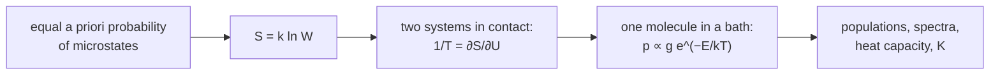

# 21.1 · Microstates, the Boltzmann distribution and temperature

Thermodynamics (Module 13) works with large quantities such as energy, entropy and temperature, and never asks what the molecules are doing. Statistical thermodynamics fills that gap. It starts from the quantised energy levels you met in Modules 12 and 20 and asks one question: in how many ways can a given amount of energy be shared among the molecules? This lesson counts those ways, shows that the answer explains entropy and temperature, and derives the Boltzmann distribution, the rule that sets how many molecules sit in each level.

## Why it matters

In lesson [13.3](../module-13/lesson-03.md) you used the third law and heat capacities to get absolute entropies, and you were promised that $S = k_B \ln W$ explains what entropy is. In lesson [20.1](../module-20/lesson-01.md) you used Boltzmann ratios to decide why the I₂ spectrum shows hot bands and HCl does not. Both rest on one counting argument, and with it you can predict heat capacities, entropies and equilibrium constants from a spectrum: by lesson 21.4 you will calculate the equilibrium constant of $\mathrm{I_2 \rightleftharpoons 2I}$ from spectroscopic constants and match the NIST-JANAF table within a few per cent.

## Core ideas

> [!NOTE]
> Everything in this lesson is settled physics (MIT 5.62 lectures 2–4). The constants are CODATA 2022 ($k_B$ = 1.380649 × 10⁻²³ J/K, exact), and the level energies come from the NIST Atomic Spectra Database and the NIST Chemistry WebBook, all checked 2026-10-17. They will not go out of date in any way that matters here.

### Microstates and macrostates

A **macrostate** is what you can measure: the total energy, the number of molecules, the volume. A **microstate** is one complete list of which molecule is in which energy level. Many microstates give the same macrostate. The number of them is the **multiplicity** $W$.

The simplest model is the **Einstein solid**: $N$ oscillators, each with levels $0, \varepsilon, 2\varepsilon, \dots$ (the harmonic ladder of lesson [12.4](../module-12/lesson-04.md), measured from the zero-point level). Sharing $q$ identical quanta among $N$ oscillators is like placing $q$ balls and $N-1$ dividers in a row:

$$W(N, q) = \frac{(q + N - 1)!}{q!\,(N-1)!}$$

Three oscillators sharing three quanta: $W = 5!/(3!\,2!) = 10$. You can list them: (3,0,0) three ways, (2,1,0) six ways, (1,1,1) one way.

### The fundamental assumption and entropy

Statistical thermodynamics rests on one postulate: in an isolated system, **every microstate with the right total energy is equally likely**. The system wanders through all of them. So the macrostate you observe is simply the one with the most microstates. Boltzmann's definition links this count to entropy:

$$S = k_B \ln W$$

The logarithm makes entropy add: two independent systems have $W = W_A W_B$, so $S = S_A + S_B$. Lesson [13.3](../module-13/lesson-03.md)'s statement "entropy rises in a spontaneous change" becomes "the system moves to macrostates with more microstates".

### Two systems in contact: where temperature comes from

Put solid A ($N_A$ oscillators) next to solid B ($N_B$) and let them exchange quanta, with $q_A + q_B = q$ fixed. The number of microstates of the pair is $W_A(q_A)\,W_B(q - q_A)$. For six quanta shared between two three-oscillator solids:

| $q_A$ | 0 | 1 | 2 | 3 | 4 | 5 | 6 |
|---|---|---|---|---|---|---|---|
| $W_A W_B$ | 28 | 63 | 90 | 100 | 90 | 63 | 28 |

The even split is most likely, but only 100 of 462 microstates (22 %) have it. For 300 and 200 oscillators sharing 100 quanta, 95 % of all microstates lie within ±10 quanta of the peak at $q_A = 60$. For a mole of molecules the peak is so sharp that no deviation is ever seen: that is thermal equilibrium.

At the peak, $\ln(W_A W_B)$ is maximal, so moving one quantum from B to A changes nothing:

$$\frac{\partial \ln W_A}{\partial q_A} = \frac{\partial \ln W_B}{\partial q_B}$$

Whatever two systems have in common at equilibrium is their temperature. Multiplying by $k_B$ and dividing by the quantum size turns this into the statistical definition of temperature:

$$\frac{1}{T} = \left(\frac{\partial S}{\partial U}\right)_{V,N}$$

Temperature measures how much a system's entropy grows when it receives energy. A cold system gains a lot of entropy per joule, a hot one little, so energy flows from hot to cold because that increases the total number of microstates. This is the same relation $dS = dq_\text{rev}/T$ from lesson 13.3, read backwards.

### The Boltzmann distribution

Now look at one molecule inside a large system (the "bath") at temperature $T$. If the molecule takes energy $E_i$, the bath has $E_i$ less, and its number of microstates falls by the factor $e^{-E_i/k_BT}$ (this follows from $\partial \ln W/\partial U = 1/k_BT$). The probability of finding the molecule in level $i$ is therefore proportional to the number of states of that level, $g_i$ (the **degeneracy**), times this **Boltzmann factor**:

$$p_i = \frac{g_i\, e^{-E_i/k_BT}}{\sum_j g_j\, e^{-E_j/k_BT}}$$

The sum in the denominator makes the probabilities add to 1. It is the **partition function** $q$, the subject of lesson 21.2. Two numbers make the formula easy to use. At 298.15 K, $k_BT$ equals 207.2 cm⁻¹ (multiply wavenumbers by $hc/k_B$ = 1.438777 cm K), and $RT$ equals 2.479 kJ/mol.



### What the distribution says

- Within one level type, populations fall exponentially with energy. Each step of $k_BT$ reduces the population by a factor $e$ = 2.718.
- Degeneracy can beat the exponential. HCl at 298 K has its most populated rotational level at $J = 3$, not $J = 0$, because level $J$ has $2J+1$ states (lesson [12.5](../module-12/lesson-05.md)).
- Ratios need no partition function: $N_i/N_j = (g_i/g_j)\,e^{-(E_i - E_j)/k_BT}$.

## Worked example

### 1. How many I₂ molecules vibrate at room temperature?

I₂ has $\omega_e$ = 214.502 cm⁻¹ and $\omega_e x_e$ = 0.6147 cm⁻¹ (NIST WebBook). The gap from $v = 0$ to $v = 1$ is $\omega_e - 2\omega_e x_e$ = 213.27 cm⁻¹. Each vibrational level has $g = 1$. At 298.15 K:

$$\frac{N_1}{N_0} = \exp\left(-\frac{213.27 \times 1.438777}{298.15}\right) = e^{-1.029} = 0.357$$

The full set of populations from $v = 0$ to 5 is 0.643, 0.230, 0.083, 0.030, 0.011, 0.004. A third of all I₂ molecules are vibrationally excited at room temperature, which is why lesson [20.1](../module-20/lesson-01.md) found hot bands in its spectra. For HCl (gap 2885.3 cm⁻¹) the same calculation gives $N_1/N_0 = 9.0\times10^{-7}$.

### 2. Excited chlorine and iodine atoms in a flame

The ground configuration $np^5$ of a halogen atom splits into two levels (NIST ASD): $^2P_{3/2}$ at 0 with $g = 2J+1 = 4$, and $^2P_{1/2}$ with $g = 2$, at 882.35 cm⁻¹ for Cl and 7602.98 cm⁻¹ for I. The fraction in the upper level is

$$f = \frac{2e^{-x}}{4 + 2e^{-x}}, \qquad x = \frac{1.438777\,\Delta\tilde\nu}{T}$$

| | 298 K | 1000 K | 1500 K |
|---|---|---|---|
| Cl, $x$ / $f$ | 4.26 / 0.0070 | 1.27 / 0.123 | 0.85 / 0.177 |
| I, $x$ / $f$ | 36.7 / 6 × 10⁻¹⁷ | 10.9 / 8.9 × 10⁻⁶ | 7.29 / 3.4 × 10⁻⁴ |

Even at infinite temperature $f$ only reaches $2/6 = 1/3$: the upper level has fewer states. For Cl at 1000 K the excited level holds 12 % of the atoms, enough to change the heat capacity measurably (lesson 21.2). For I it can be ignored below about 2000 K.

## Hands-on

What you need: the [Module 21 lab folder](../../labs/module-21/) with Python 3.14 (numpy, matplotlib), 10 paper cups or egg-box cells, 10 identical coins, a phone with a random-number app (or a 10-sided die), and your notebook. Time: about 60 minutes.

### Part A — Python: counting microstates (25 min)

Open `lesson01_microstates.py` and write the two TODO functions:

- `multiplicity(n_osc, quanta)`: the formula for $W(N, q)$, in one line with `math.comb`;
- `boltzmann_fractions(energies_cm, degeneracies, T)`: the normalised populations $p_i$.

Then run:

```bash
py lesson01_microstates.py
```

The script finds the most probable split of 100 quanta between solids of 300 and 200 oscillators, plays a random exchange game with 400 oscillators, and prints the I₂ vibrational and HCl rotational populations at 298.15 K.

How you know it worked: $W(3, 3) = 10$; the most probable $q_A$ is 60 with slopes 1.775 and 1.767; the exchange game gives fractions near 0.50, 0.25, 0.125 for 0, 1, 2 quanta; I₂ gives 0.643 for $v = 0$; HCl peaks at $J = 3$. The plot is in `runs/lesson01_microstates.png`.

<details><summary>Reference solution</summary>

`multiplicity`: `return math.comb(quanta + n_osc - 1, quanta)`. `boltzmann_fractions`: build `w = [g * math.exp(-HC_K * e / T) for e, g in zip(energies_cm, degeneracies)]` and return `[x / sum(w) for x in w]`. Full code in `lesson01_microstates_solution.py`.

Why the exchange game gives a geometric distribution: an oscillator with $n$ quanta is one level of the harmonic ladder, every level has $g = 1$, and the other 399 oscillators act as the bath. The ratio $N(n+1)/N(n) = 0.5$ means $e^{-\varepsilon/k_BT} = 0.5$, so $k_BT = \varepsilon/\ln 2 = 1.44\,\varepsilon$.

</details>

### Part B — kitchen: coins and cups (25 min)

> [!CAUTION]
> Coins are a choking hazard. Do this away from small children and pets. Nothing else in this activity carries any risk.

1. Number 10 cups from 1 to 10 and put one coin in each. That is 10 oscillators sharing 10 quanta.
2. One move: draw a random number to pick a cup. If it is empty, draw again. Take one coin out. Draw another random number and drop the coin into that cup (it may be the same cup).
3. Make 20 moves to forget the starting arrangement. Then, after every 5 further moves, write down how many coins each cup holds. Take 20 such snapshots (200 cup readings).
4. Tally how many readings had 0, 1, 2, 3, ... coins. Save the tally as `my_cups.csv` with the header `n,count` and run `py lesson01_microstates.py my_cups.csv`.

Expected result: about half of the readings show an empty cup, a quarter show one coin, an eighth show two, and so on. Nothing pushes the coins into this shape; it simply has the most microstates. With only 10 cups your numbers will scatter by a few per cent; that scatter is the fluctuation that vanishes for $10^{23}$ molecules. Record the tally on a [notebook page](../../templates/notebook-page.md).

### Part C — simulation and pencil (10 min)

[Simulation: Boltzmann distribution — two-level system](../../simulations/boltzmann/index.html?preset=two-level)

Raise the temperature of the two-level system and watch the upper population approach, but never pass, $g_\text{upper}/g_\text{lower}$ times the lower one: going beyond that (a laser's population inversion) needs pumping, not heating. Then answer by pencil:

1. List the microstates of 2 oscillators sharing 4 quanta and check the formula for $W$.
2. NO has a ground level $^2\Pi_{1/2}$ ($g = 2$) and a level $^2\Pi_{3/2}$ ($g = 2$) about 120 cm⁻¹ higher. What fraction of NO molecules is in the upper level at 298 K?

<details><summary>Answers to Part C</summary>

1. (4,0), (3,1), (2,2), (1,3), (0,4): 5 microstates. Formula: $5!/(4!\,1!) = 5$.
2. $x = 120 \times 1.438777/298.15 = 0.579$, $e^{-x} = 0.560$, $f = 0.560/(1 + 0.560) = 0.36$. Over a third of NO molecules are in the upper level at room temperature.

</details>

## Common mistakes

- **Forgetting degeneracy.** Use $g_i e^{-E_i/k_BT}$, not $e^{-E_i/k_BT}$. Rotational levels ($2J+1$) and atomic levels ($2J+1$ with half-integer $J$) are the usual traps.
- **Mixing energy units.** Convert wavenumbers with $hc/k_B$ = 1.438777 cm K, molar energies with $R$. A ratio $E/k_BT$ must be dimensionless; if you get 10⁵, you used J/mol with $k_B$.
- **Measuring from the wrong zero.** Only energy differences matter in a ratio, but in a full list of populations every level must be measured from the same zero.
- **Thinking the even split is "forced".** Nothing forbids an uneven split; it just has far fewer microstates. For small systems it happens often.
- **Giving one molecule a temperature.** $T$ belongs to a system in equilibrium with many states; a single molecule only has an energy.

## Key takeaways

- A microstate says where every quantum is; the multiplicity $W$ counts microstates; $S = k_B\ln W$.
- All microstates of an isolated system are equally likely, so the observed state is the one with most microstates, and for large systems the peak is extremely sharp.
- Temperature is $1/T = (\partial S/\partial U)_{V,N}$: energy flows from hot to cold because that raises the total $W$.
- A molecule in a bath at $T$ occupies level $i$ with probability $g_i e^{-E_i/k_BT}/q$.
- At 298 K, $k_BT/hc$ = 207 cm⁻¹: rotations are excited, stiff vibrations are not, soft ones (I₂) partly are.

## Sources

- [MIT OpenCourseWare 5.62, lecture notes](https://ocw.mit.edu/courses/5-62-physical-chemistry-ii-spring-2008/pages/lecture-notes/) — lectures 2–4: macroscopic properties from microscopic probabilities, the microcanonical ensemble and $\Omega$.
- [LibreTexts, UC Davis Chem 110B, ch. 18](https://chem.libretexts.org/Courses/University_of_California_Davis/Chem_110B%3A_Physical_Chemistry_II/09%3A_Boltzmann_Factor_and_Partition_Functions) — the Boltzmann factor and the thermal Boltzmann distribution.
- [NIST CODATA 2022: Boltzmann constant](https://physics.nist.gov/cgi-bin/cuu/Value?k) — exact value of $k_B$.
- [NIST Atomic Spectra Database](https://physics.nist.gov/PhysRefData/ASD/levels_form.html) — Cl I and I I levels $^2P_{3/2}$ and $^2P_{1/2}$ (882.3515 and 7602.9762 cm⁻¹).
- [NIST Chemistry WebBook: iodine](https://webbook.nist.gov/cgi/cbook.cgi?ID=C7553562&Mask=1000) — $\omega_e$ and $\omega_e x_e$ of I₂.
