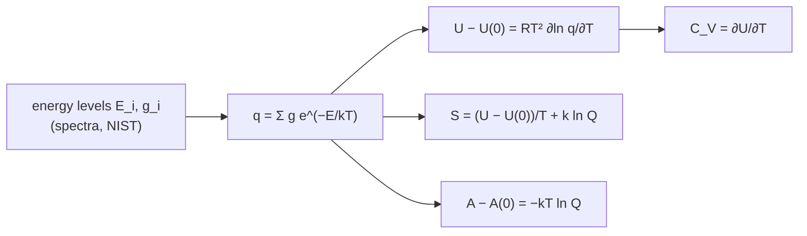

# 21.2 · The partition function

The Boltzmann distribution of lesson 21.1 has a denominator, the sum of $g_i e^{-E_i/k_BT}$ over all levels. That sum, the partition function, turns out to hold everything thermodynamics wants to know about a system of independent molecules. This lesson shows what the partition function means, how energy, heat capacity, entropy and free energy follow from it by differentiation, and tests the result on two real cases: chlorine atoms and nitrogen molecules, whose heat capacities you will predict from spectra and compare with NIST tables.

## Why it matters

Lesson [13.2](../module-13/lesson-02.md) took heat capacities from NIST Shomate fits, which are curves fitted to tables. Where did the tables come from? For gases, mostly not from calorimeters: the NIST-JANAF tables were calculated from spectroscopic energy levels with exactly the formulas in this lesson, because a spectrum measured once gives $C_p$, $S$ and $H$ at every temperature, including temperatures no calorimeter can reach. Knowing the method lets you check a table, extend it, or compute a species nobody has tabulated, such as a radical in a flame.

## Core ideas

> [!NOTE]
> The formulas here are settled (MIT 5.62 lectures 3–6). The check data are the NIST-JANAF Cl(g) table and the NIST WebBook Shomate fit and diatomic constants of N₂, retrieved 2026-10-17; the Cl levels are from the NIST Atomic Spectra Database. Energies are in cm⁻¹ and converted with $hc/k_B$ = 1.438777 cm K (CODATA 2022).

### What the partition function is

$$q = \sum_i g_i\, e^{-E_i/k_BT}$$

Each term is a level's states weighted by how reachable they are. The lowest level counts fully (choose its energy as zero, so its term is $g_0$); levels far above $k_BT$ add almost nothing. So $q$ is roughly **the number of states the molecule can reach at this temperature**. At $T \to 0$, $q \to g_0$; as $T$ rises, $q$ grows.

For a Cl atom (levels 0 with $g = 4$ and 882.35 cm⁻¹ with $g = 2$): $q$ = 4.000 at 100 K, 4.028 at 298 K, 4.562 at 1000 K and 6 at infinite temperature. For a harmonic ladder with spacing $\tilde\nu$ (energies from $v = 0$) the sum is a geometric series:

$$q_\text{vib} = \sum_{v=0}^{\infty} e^{-v x} = \frac{1}{1 - e^{-x}}, \qquad x = \frac{hc\tilde\nu}{k_BT} = \frac{\theta_\text{vib}}{T}$$

$\theta_\text{vib} = hc\tilde\nu/k_B$ is the **vibrational temperature**. HCl has $\theta_\text{vib}$ = 4151 K, so at 298 K $q_\text{vib}$ = 1.0000009: only $v = 0$ is reachable. I₂ has $\theta_\text{vib}$ = 307 K and $q_\text{vib}$ = 1.56.

### Energy and heat capacity from q

The mean energy per molecule is $\langle E\rangle = \sum_i E_i\, p_i$. Because $\partial q/\partial T = \sum g_i (E_i/k_BT^2) e^{-E_i/k_BT}$, the same sum can be written as a derivative:

$$U - U(0) = N k_B T^2 \left(\frac{\partial \ln q}{\partial T}\right)_V, \qquad C_V = \left(\frac{\partial U}{\partial T}\right)_V$$

$U(0)$ is the energy with every molecule in its lowest level. For one mole, $Nk_B = R$. Two models cover most cases:

- **Two levels** ($g_0$ at 0, $g_1$ at $\varepsilon$): the heat capacity rises from zero, peaks and falls back to zero, because once both levels are filled to their limit, more heat cannot be stored in them. This bump is the **Schottky anomaly**. With $x = \varepsilon/k_BT$ and $r = g_1/g_0$:

$$\frac{C_V}{R} = \frac{r\,x^2 e^{-x}}{(1 + r e^{-x})^2}$$

- **Harmonic ladder** (the **Einstein** function): $U - U(0) = R\theta_\text{vib}/(e^{x} - 1)$ and

$$\frac{C_{V,\text{vib}}}{R} = \frac{x^2 e^{x}}{(e^{x} - 1)^2}$$

It is near zero for $T \ll \theta_\text{vib}$ and tends to 1 (the equipartition value $R$) for $T \gg \theta_\text{vib}$. Unlike the two-level case, a ladder never saturates, because there is always a higher level.

### Many molecules: Q, distinguishability and N!

For $N$ independent molecules, the system partition function $Q$ is the sum over all system states. If the molecules can be told apart (atoms fixed at sites in a crystal), $Q = q^N$. Gas molecules cannot: swapping two identical molecules gives the same microstate, so

$$Q = \frac{q^N}{N!} \quad\text{(gas)}, \qquad Q = q^N \quad\text{(localised)}$$

The $N!$ matters for entropy and free energy, not for energy (it does not depend on $T$). From $Q$:

$$A - A(0) = -k_BT \ln Q, \qquad S = \frac{U - U(0)}{T} + k_B \ln Q, \qquad p = k_BT\left(\frac{\partial \ln Q}{\partial V}\right)_T$$

The entropy formula is $S = k_B\ln W$ of lesson 21.1 rewritten for a system at fixed $T$ instead of fixed $U$. For internal motions (vibration, electronic levels) each molecule carries its own levels, so their contribution per mole is simply $S = (U - U(0))/T + R\ln q$. The $N!$ is applied once, to the translational part, in lesson 21.3.



### Separable motions multiply

If a molecule's energy is a sum of independent parts, $E = E_\text{trans} + E_\text{rot} + E_\text{vib} + E_\text{el}$, its partition function is a product, $q = q_\text{trans}\,q_\text{rot}\,q_\text{vib}\,q_\text{el}$. Then $\ln q$, $U$, $C_V$ and $S$ are sums of separate contributions. This is why a Cl atom's $C_p$ is $\frac52 R$ (translation, lesson 21.3) plus an electronic term, and N₂'s is $\frac72 R$ (translation and rotation) plus a vibrational term.

## Worked example

### 1. The heat capacity of chlorine atoms at 600 K

Cl: $r = g_1/g_0 = 2/4 = 0.5$, $\varepsilon/hc$ = 882.35 cm⁻¹. At 600 K, $x = 882.35 \times 1.438777/600 = 2.116$ and $e^{-x} = 0.1205$:

$$\frac{C_{V,\text{el}}}{R} = \frac{0.5 \times 2.116^2 \times 0.1205}{(1 + 0.5 \times 0.1205)^2} = \frac{0.2698}{1.1244} = 0.240$$

$C_{V,\text{el}} = 0.240 \times 8.3145$ = 2.00 J mol⁻¹ K⁻¹. Adding translation ($C_p = \frac52 R$ = 20.786) gives $C_p$ = 22.78 J mol⁻¹ K⁻¹. The NIST-JANAF table lists 22.781. The model matches JANAF to 0.001 J mol⁻¹ K⁻¹ at every temperature from 100 to 2000 K, because this is how the table was built. Note the hump: $C_p$ peaks near 570 K and falls back towards 20.79 at high temperature.

### 2. Vibrational heat capacity of N₂ and I₂

N₂: $\tilde\nu = \omega_e - 2\omega_e x_e$ = 2329.92 cm⁻¹ (NIST WebBook), $\theta_\text{vib}$ = 3352 K. At 1000 K, $x = 3.352$, $e^x = 28.56$:

$$\frac{C_{V,\text{vib}}}{R} = \frac{3.352^2 \times 28.56}{27.56^2} = 0.4224, \qquad C_{V,\text{vib}} = 3.51\ \text{J mol}^{-1}\,\text{K}^{-1}$$

With translation and rotation, $C_p = \frac72 R + 3.51$ = 32.61 J mol⁻¹ K⁻¹. The NIST Shomate value is 32.69. The 0.25 % gap is real physics: the harmonic model ignores anharmonicity, which crowds the upper levels together and adds a little heat capacity.

I₂ at 298.15 K: $x = 307/298.15 = 1.029$, $C_{V,\text{vib}} = 7.62$ J mol⁻¹ K⁻¹, almost equipartition. $C_p = 29.10 + 7.62$ = 36.72, against JANAF 36.887. Soft bonds store heat at room temperature; stiff ones do not.

## Hands-on

What you need: the [Module 21 lab folder](../../labs/module-21/) with Python 3.14 (numpy, matplotlib), a calculator and your notebook. Time: about 60 minutes.

### Part A — Python: heat capacities from levels (40 min)

Open `lesson02_partition.py` and write three TODO functions. Each takes a list of levels as `(energy in cm⁻¹, degeneracy)` pairs:

- `q_levels(levels, T)`: the partition function;
- `mean_energy(levels, T)`: $\langle E\rangle = \sum E_i g_i e^{-E_i/k_BT}/q$ in cm⁻¹;
- `cv_molar(levels, T)`: the molar heat capacity, $R\,(hc/k_B)\,d\langle E\rangle/dT$, by a central difference.

```bash
py lesson02_partition.py
```

The script feeds your functions the two Cl levels from the NIST Atomic Spectra Database and a 60-level harmonic ladder for N₂, and prints the model next to the NIST values. It writes `runs/lesson02_heat_capacity.png`.

How you know it worked: $q_\text{el}$(Cl) = 4.0283 at 298.15 K and approaches 6 at very high $T$; the Cl(g) $C_p$ column agrees with JANAF to ±0.001 from 100 to 2000 K, with an electronic peak of 2.00 J mol⁻¹ K⁻¹ near 570 K; N₂ gives 32.61 against 32.69 at 1000 K, and the gap grows to 0.26 J mol⁻¹ K⁻¹ at 2000 K; I₂ gives 36.72 at 298.15 K. Record the 1000 K values on a [notebook page](../../templates/notebook-page.md).

<details><summary>Reference solution</summary>

`q_levels`: `return sum(g * math.exp(-HC_K * e / T) for e, g in levels)`. `mean_energy`: the same sum with an extra factor `e`, divided by `q_levels(levels, T)`. `cv_molar`: `return R * HC_K * (mean_energy(levels, T + dT) - mean_energy(levels, T - dT)) / (2 * dT)`. Full code in `lesson02_partition_solution.py`.

Why `R * HC_K`: $\langle E\rangle$ is in cm⁻¹; multiplying by $hc/k_B$ turns it into kelvin, and $R$ turns kelvin into J/mol. Why the N₂ gap grows with $T$: the harmonic ladder is too widely spaced at high $v$, and at 2000 K those levels start to matter. Lesson 21.3 sums the real anharmonic levels.

</details>

### Part B — simulation and pencil (20 min)

[Simulation: Boltzmann distribution — energy ladder](../../simulations/boltzmann/index.html?preset=ladder)

Set the ladder spacing to 1 (in units of $k_BT$ at the start) and read $q$ and the populations as you raise $T$. Watch $C_V$ approach $R$ but never pass it. Then by pencil:

1. At what temperature does $q_\text{vib}$ of I₂ ($\theta_\text{vib}$ = 307 K) equal 2? How many vibrational states are then "accessible"?
2. A two-level system with $g_0 = g_1 = 1$ has its Schottky peak at $x = \varepsilon/k_BT \approx 2.40$. NO has two such levels (each $g = 2$, so $r = 1$) about 120 cm⁻¹ apart. Near what temperature does the electronic heat capacity of NO peak?
3. Show that for a harmonic ladder $S_\text{vib}/R = x/(e^x - 1) - \ln(1 - e^{-x})$ and evaluate it for I₂ at 298.15 K.

<details><summary>Answers to Part B</summary>

1. $1/(1 - e^{-x}) = 2$ gives $e^{-x} = 1/2$, $x = \ln 2$, $T = 307/0.693$ = 443 K. About two states: $v = 0$ fully, and $v = 1, 2, \dots$ together worth one more.
2. $T = 120 \times 1.438777/2.40$ = 72 K. NO's heat capacity has a measurable bump at low temperature, which is why the NIST tables for NO include its electronic levels.
3. $S = (U - U(0))/T + R\ln q$ with $U - U(0) = R\theta/(e^x - 1)$ and $q = 1/(1 - e^{-x})$ gives the formula. For I₂, $x$ = 1.029: $0.572 + 0.442 = 1.014$, so $S_\text{vib}$ = 8.43 J mol⁻¹ K⁻¹, about 3 % of I₂'s total entropy.

</details>

## Common mistakes

- **Choosing a different zero for each level list.** $q$ depends on where you put $E = 0$. Here the lowest level is always zero, so the results are $U - U(0)$ and $A - A(0)$. Lesson 21.4 shows where $U(0)$ comes back in.
- **Leaving out degeneracy in q.** The Cl ground level has 4 states; with $g = 1$ you would get the wrong $q$, the wrong peak height and the wrong entropy.
- **Using $Q = q^N$ for a gas.** It gives an entropy that is not extensive (doubling the gas does not double $S$). Use $q^N/N!$ for a gas.
- **Expecting a ladder to saturate.** Only systems with a top level (two-level, spins) show a Schottky peak; a vibration's $C_V$ rises monotonically to $R$ (until the molecule dissociates).
- **Mixing $C_V$ and $C_p$.** For an ideal gas $C_p = C_V + R$. Internal motions give the same contribution to both; the extra $R$ belongs to translation.

## Key takeaways

- $q = \sum g_i e^{-E_i/k_BT}$ counts the thermally accessible states; it starts at $g_0$ and grows with $T$.
- $U - U(0) = RT^2\,\partial\ln q/\partial T$, $C_V = \partial U/\partial T$, $S = (U - U(0))/T + k_B\ln Q$, $A - A(0) = -k_BT\ln Q$.
- Gas: $Q = q^N/N!$; independent motions multiply in $q$ and add in $U$, $C_V$ and $S$.
- Two levels give a Schottky peak (Cl atoms: +2.00 J mol⁻¹ K⁻¹ near 570 K); a harmonic ladder gives the Einstein function, rising to $R$.
- Spectroscopic levels reproduce the NIST tables: Cl(g) exactly, N₂ to 0.25 % at 1000 K with the harmonic model.

## Sources

- [MIT OpenCourseWare 5.62, lecture notes](https://ocw.mit.edu/courses/5-62-physical-chemistry-ii-spring-2008/pages/lecture-notes/) — lectures 3–6: canonical partition function, molecular partition function, indistinguishability.
- [LibreTexts, UC Davis Chem 110B, ch. 18](https://chem.libretexts.org/Courses/University_of_California_Davis/Chem_110B%3A_Physical_Chemistry_II/09%3A_Boltzmann_Factor_and_Partition_Functions) — average energy, heat capacity and $Q$ for distinguishable and indistinguishable molecules.
- [NIST-JANAF table: Cl(g)](https://janaf.nist.gov/tables/Cl-001.html) — $C_p$ from 100 to 2000 K used as the check.
- [NIST Atomic Spectra Database](https://physics.nist.gov/PhysRefData/ASD/levels_form.html) — Cl I $^2P_{1/2}$ level at 882.3515 cm⁻¹.
- [NIST Chemistry WebBook: nitrogen](https://webbook.nist.gov/cgi/cbook.cgi?ID=C7727379&Mask=1) — Shomate $C_p$ coefficients (500–2000 K) and, on the [diatomic constants page](https://webbook.nist.gov/cgi/cbook.cgi?ID=C7727379&Mask=1000), $\omega_e$ and $\omega_e x_e$.
