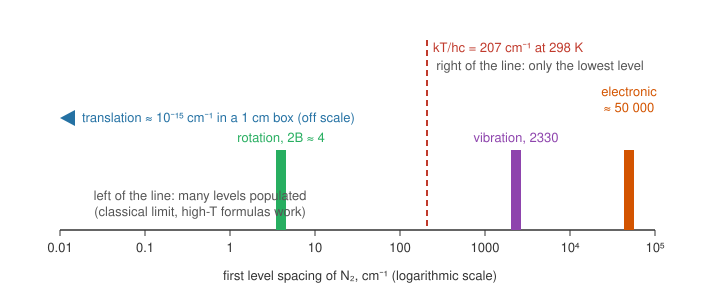

# 21.3 · Molecular partition functions: translation, rotation, vibration

A gas molecule moves, rotates, vibrates and has electrons, and lesson 21.2 showed that independent motions multiply in the partition function. This lesson builds each factor from things you have already measured: the mass, the rotational constant $B$ from a microwave spectrum (lesson 20.2), the vibrational wavenumber from an infrared or Raman band (lesson 20.3) and the degeneracy of the electronic ground state. Put together, they give the standard entropy of a gas to within a tenth of a joule per mole per kelvin of the NIST value, with no calorimetry at all.

## Why it matters

The third-law entropies of lesson [13.3](../module-13/lesson-03.md) come from measuring $C_p$ from near 0 K upwards, through every phase change, and integrating. That is slow, needs very pure samples, and goes wrong if a crystal keeps some disorder at 0 K (CO crystals do, which is why calorimetric and spectroscopic entropies of CO once disagreed by about 4.6 J mol⁻¹ K⁻¹). The statistical route needs only a spectrum. For most gases the NIST tables use it, and when the two routes disagree, the disagreement itself tells you something about the solid.

## Core ideas

> [!NOTE]
> The partition functions and their limits are settled theory (MIT 5.62 lectures 7–15). The molecular constants are from the NIST Chemistry WebBook, the reference entropies are CODATA Key Values (Cox, Wagman and Medvedev 1984) as listed by NIST, or NIST-JANAF values, all retrieved 2026-10-17. Standard pressure $p^\circ$ = 1 bar.



The picture shows why each motion is treated differently. If the level spacing is far below $k_BT$, the sum can be replaced by an integral (the classical or high-temperature limit). If it is far above, only the lowest level counts. Vibration of soft bonds sits in between and needs the exact formula.

### Translation

A particle in a box (lesson [12.2](../module-12/lesson-02.md)) has levels so close together that the sum becomes an integral:

$$q_\text{trans} = \frac{V}{\Lambda^3}, \qquad \Lambda = \frac{h}{\sqrt{2\pi m k_B T}}$$

$\Lambda$ is the **thermal wavelength**, roughly the de Broglie wavelength of a molecule at temperature $T$. For N₂ at 298.15 K, $\Lambda$ = 19.1 pm. The volume per molecule at 1 bar is a cube of side 3450 pm, so each molecule has millions of translational states to itself. That is why the classical treatment of gases works. For a mole of ideal gas at $p^\circ$, $V/N_A = k_BT/p^\circ$, and the **standard** translational partition function per molecule is

$$\frac{q^\circ_\text{trans}}{N_A} = \frac{k_BT}{p^\circ\Lambda^3}$$

With the $N!$ of lesson 21.2 (Stirling's formula, $\ln N! \approx N\ln N - N$), the translational entropy becomes the **Sackur–Tetrode equation**:

$$S_\text{trans}^\circ = R\left[\ln\frac{q^\circ_\text{trans}}{N_A} + \frac52\right]$$

For argon, which has no rotation, no vibration and a single electronic ground state, this is the whole entropy: 154.85 J mol⁻¹ K⁻¹, against the CODATA value 154.846.

### Rotation and the symmetry number

A linear rotor has levels $hcBJ(J+1)$ with degeneracy $2J+1$ (lesson [12.5](../module-12/lesson-05.md)). Define the **rotational temperature** $\theta_\text{rot} = hcB/k_B$: 2.86 K for N₂, 15.0 K for HCl, 0.054 K for I₂. When $T \gg \theta_\text{rot}$ the sum becomes an integral:

$$q_\text{rot} = \frac{k_BT}{\sigma\, hcB} = \frac{T}{\sigma\,\theta_\text{rot}}, \qquad S_\text{rot} = R\,(\ln q_\text{rot} + 1)$$

The **symmetry number** $\sigma$ counts the rotations that turn the molecule into an indistinguishable copy of itself: 1 for CO or HCl, 2 for N₂, O₂ or I₂. For a homonuclear molecule, nuclear-spin statistics allow only half of the $J$ levels for each nuclear-spin arrangement. You saw this in lesson [20.3](../module-20/lesson-03.md) as the 2 : 1 alternation of the N₂ Raman lines. On average, that halves the number of states. For polyatomic molecules $\sigma$ comes from the point group (lesson [20.5](../module-20/lesson-05.md)): 2 for H₂O ($C_{2v}$), 3 for NH₃, 12 for CH₄. A nonlinear molecule with rotational constants $A$, $B$, $C$ has $q_\text{rot} = \frac{\sqrt{\pi}}{\sigma}\left(\frac{k_BT}{hc}\right)^{3/2}\frac{1}{\sqrt{ABC}}$.

Use $B_0$ (the $v = 0$ value from lesson [20.2](../module-20/lesson-02.md)), because nearly every molecule is in $v = 0$. The high-temperature formula is slightly low; the exact sum is about $q_\text{rot}(1 + \theta_\text{rot}/3T)$, a 1.7 % correction for HCl at 298 K (19.85 against 20.19).

### Vibration

Each vibrational mode is a harmonic ladder (lesson 21.2) with its energy measured from $v = 0$:

$$q_\text{vib} = \frac{1}{1 - e^{-\theta_\text{vib}/T}}, \qquad \theta_\text{vib} = \frac{hc\tilde\nu}{k_B}$$

with $\tilde\nu = \omega_e - 2\omega_e x_e$, the measured fundamental (lessons [12.4](../module-12/lesson-04.md) and 20.3). A polyatomic molecule has $3N - 5$ (linear) or $3N - 6$ modes, and $q_\text{vib}$ is their product. For stiff diatomics at 298 K, $q_\text{vib} \approx 1$ and the vibrational entropy is negligible; for I₂ it is 8.43 J mol⁻¹ K⁻¹. Choosing $v = 0$ as zero means the zero-point energy is not in $q$; lesson 21.4 accounts for it through $D_0$.

### Electronic levels

Usually only the ground level matters, so $q_\text{el} = g_0$ and $S_\text{el} = R\ln g_0$. Most closed-shell molecules have $g_0 = 1$. O₂ is the classic exception: its ground state $X\,^3\Sigma_g^-$ is a triplet ($g_0 = 3$, from the two unpaired electrons), worth $R\ln 3$ = 9.13 J mol⁻¹ K⁻¹. Halogen atoms have $g_0 = 4$ ($^2P_{3/2}$), plus the excited level you met in lessons 21.1 and 21.2.

### Putting it together

$$\frac{q^\circ}{N_A} = \frac{q^\circ_\text{trans}}{N_A}\, q_\text{rot}\, q_\text{vib}\, q_\text{el}, \qquad S^\circ = S_\text{trans} + S_\text{rot} + S_\text{vib} + S_\text{el}$$

The same $\ln q^\circ$ also gives $H^\circ(T) - H^\circ(0) = RT^2\,d\ln q^\circ/dT$ and $C_p$. These are exactly the columns of a NIST-JANAF table.

## Worked example

### 1. The standard entropy of N₂ at 298.15 K, by hand

Data: $M$ = 28.0134 g/mol; $B_0 = B_e - \alpha_e/2$ = 1.998241 − 0.008659 = 1.98958 cm⁻¹; $\tilde\nu$ = 2329.92 cm⁻¹; $\sigma = 2$; $g_0 = 1$ (NIST WebBook).

**Translation.** $m = 0.0280134/N_A = 4.652\times10^{-26}$ kg, so $\Lambda = h/\sqrt{2\pi m k_BT} = 1.910\times10^{-11}$ m. Then

$$\frac{q^\circ_\text{trans}}{N_A} = \frac{k_BT}{p^\circ\Lambda^3} = \frac{4.116\times10^{-21}}{10^5 \times 6.970\times10^{-33}} = 5.905\times10^6$$

$S_\text{trans} = 8.3145 \times (\ln 5.905\times10^6 + 2.5) = 8.3145 \times 18.091$ = 150.42 J mol⁻¹ K⁻¹.

**Rotation.** $\theta_\text{rot} = 1.438777 \times 1.98958$ = 2.863 K; $q_\text{rot} = 298.15/(2 \times 2.863)$ = 52.08; $S_\text{rot} = 8.3145 \times (\ln 52.08 + 1)$ = 41.18 J mol⁻¹ K⁻¹.

**Vibration.** $x = 3352/298.15 = 11.24$, so $e^{-x} = 1.3\times10^{-5}$ and $S_\text{vib}$ = 0.001 J mol⁻¹ K⁻¹. **Electronic**: $R\ln 1 = 0$.

**Total**: $S^\circ$ = 191.60 J mol⁻¹ K⁻¹. The CODATA value is 191.609. The calculation took a spectrum and a mass; the calorimetric value took decades of careful low-temperature work.

### 2. Why CO has more entropy than N₂, and O₂ more still

CO and N₂ have almost the same mass and $B$, but CO is heteronuclear: $\sigma = 1$ instead of 2. That doubles $q_\text{rot}$ and adds $R\ln 2$ = 5.76 J mol⁻¹ K⁻¹. Its slightly smaller $B$ adds 0.29 more. Prediction: 191.60 + 6.05 = 197.65; CODATA: 197.660.

O₂ (NIST constants: $B_0$ = 1.42971 cm⁻¹, $\sigma = 2$, $g_0 = 3$): translation 152.08, rotation 43.93, vibration 0.04, electronic $R\ln 3$ = 9.13. Total 205.18 against CODATA 205.152. Without the triplet degeneracy you would be 9 J mol⁻¹ K⁻¹ short, a 4 % error that no rounding can explain.

| Species | $S_\text{trans}$ | $S_\text{rot}$ | $S_\text{vib}$ | $S_\text{el}$ | Total | NIST |
|---|---|---|---|---|---|---|
| Ar | 154.85 | – | – | – | 154.85 | 154.846 |
| N₂ | 150.42 | 41.18 | 0.00 | 0 | 191.60 | 191.609 |
| CO | 150.42 | 47.23 | 0.00 | 0 | 197.65 | 197.660 |
| HCl | 153.71 | 33.16 | 0.00 | 0 | 186.87 | 186.902 |
| O₂ | 152.08 | 43.93 | 0.04 | 9.13 | 205.18 | 205.152 |
| I₂ | 177.91 | 74.24 | 8.43 | 0 | 260.58 | 260.685 |

All values in J mol⁻¹ K⁻¹ at 298.15 K and 1 bar. The largest gap, 0.11 for I₂, comes from rotation–vibration coupling ($B$ shrinks in excited $v$, which the separable model ignores) and anharmonicity.

## Hands-on

What you need: the [Module 21 lab folder](../../labs/module-21/) with Python 3.14 (numpy, matplotlib), a calculator and your notebook. Time: about 60 minutes.

### Part A — Python: S° of eight gases from spectra (40 min)

Open `lesson03_molecular_q.py` and write the three TODO functions: `q_trans_std` (via the thermal wavelength), `q_rot_high_t` (with $\sigma$) and `q_vib_harmonic`. The script takes the NIST constants from `stat21.py`, builds the entropy term by term for Ar, N₂, CO, HCl, O₂, I₂, I and Cl, prints them beside the NIST values, then repeats the calculation from $\ln q$ by numerical derivatives to give $C_p$ and $H - H(0)$ too.

```bash
py lesson03_molecular_q.py
```

How you know it worked: N₂ gives $\Lambda$ = 19.10 pm and $q^\circ_\text{trans}/N_A = 5.905\times10^6$; the table above appears, every total within 0.11 J mol⁻¹ K⁻¹ of NIST; $H(298) - H(0)$ is 8.669 kJ/mol for N₂ (JANAF 8.670) and 10.095 for I₂ (JANAF 10.116). The stacked bar chart `runs/lesson03_entropy_terms.png` shows translation as the largest term everywhere. Record the N₂, O₂ and I₂ rows on a [notebook page](../../templates/notebook-page.md).

<details><summary>Reference solution</summary>

`q_trans_std`: `m = molar_mass / 1000 / N_A`, `lam = H / math.sqrt(2 * math.pi * m * K_B * T)`, `return K_B * T / P_STD / lam**3`. `q_rot_high_t`: `return T / (sigma * HC_K * B)`. `q_vib_harmonic`: `return 1 / (1 - math.exp(-HC_K * nu / T))`. Full code in `lesson03_molecular_q_solution.py`.

The two halogen atoms show the electronic term: I has exactly $R\ln 4$ = 11.53, while Cl has 11.83, because 0.7 % of Cl atoms are already in $^2P_{1/2}$ at 298 K.

</details>

### Part B — simulation and pencil (20 min)

[Simulation: Boltzmann distribution — rigid rotor](../../simulations/boltzmann/index.html?preset=rotor)

Lower the temperature towards $\theta_\text{rot}$ and watch the exact $q_\text{rot}$ separate from $T/\sigma\theta_\text{rot}$. Then by pencil:

1. HCl has $\theta_\text{rot}$ = 15.0 K. Below roughly what temperature would you stop trusting the high-temperature formula?
2. For H₂ gas at 20 K and 1 bar, $\Lambda$ = 275 pm and the spacing between molecules is about 1400 pm. Is the classical $q_\text{trans}$ still safe? What about liquid helium at 2 K?
3. Give $\sigma$ for CO₂, C₂H₂ and C₆H₆, and say by how much each lowers the rotational entropy compared with an unsymmetrical molecule with the same moments of inertia.

<details><summary>Answers to Part B</summary>

1. The correction $\theta_\text{rot}/3T$ reaches 5 % at $T \approx 100$ K, so below about 100 K sum the levels.
2. $N\Lambda^3/V$ = 0.008 for H₂ at 20 K: still small, so the classical treatment holds. For helium at 2 K, $\Lambda \approx$ 600 pm and the liquid is dense, so $N\Lambda^3/V \approx 5$: quantum statistics take over (superfluid helium).
3. CO₂ and C₂H₂ ($D_{\infty h}$): $\sigma = 2$, lowering $S$ by $R\ln 2$ = 5.76 J mol⁻¹ K⁻¹. Benzene ($D_{6h}$): $\sigma = 12$, lowering it by $R\ln 12$ = 20.7 J mol⁻¹ K⁻¹. Symmetry always lowers the rotational entropy.

</details>

## Common mistakes

- **Forgetting $\sigma$.** For N₂, O₂, I₂ and every symmetric polyatomic, omitting $\sigma$ adds $R\ln\sigma$ to the entropy (5.76 J mol⁻¹ K⁻¹ for $\sigma = 2$).
- **Forgetting the electronic degeneracy.** O₂ ($g = 3$), NO, halogen atoms ($g = 4$) and radicals have $g_0 > 1$. Missing it is a 9–12 J mol⁻¹ K⁻¹ error.
- **Using the wrong volume in $q_\text{trans}$.** The standard entropy needs $V/N = k_BT/p^\circ$ with $p^\circ$ = 1 bar, not 1 atm (that changes $S$ by $R\ln 1.01325$ = 0.11) and not 1 m³.
- **Using $\omega_e$ instead of the fundamental.** With energies from $v = 0$, the first gap is $\omega_e - 2\omega_e x_e$. For I₂ the difference is small; for H₂ it is 5 %.
- **Applying the high-temperature rotor formula to H₂.** $\theta_\text{rot}$ of H₂ is 85 K; even at room temperature the formula is off by about 10 %.

## Key takeaways

- $q^\circ_\text{trans}/N_A = k_BT/(p^\circ\Lambda^3)$ with $\Lambda = h/\sqrt{2\pi mk_BT}$; Sackur–Tetrode gives the whole entropy of argon.
- $q_\text{rot} = T/(\sigma\theta_\text{rot})$ for $T \gg \theta_\text{rot}$; the symmetry number lowers $S$ by $R\ln\sigma$.
- $q_\text{vib} = 1/(1 - e^{-\theta_\text{vib}/T})$ per mode, from $v = 0$; it matters only for soft modes at room temperature.
- $q_\text{el} = g_0$ in most cases; O₂'s triplet adds $R\ln 3$ = 9.13 J mol⁻¹ K⁻¹.
- Spectroscopic constants reproduce the NIST standard entropies of N₂, CO, HCl, O₂ and I₂ within 0.11 J mol⁻¹ K⁻¹.

## Sources

- [MIT OpenCourseWare 5.62, lecture notes](https://ocw.mit.edu/courses/5-62-physical-chemistry-ii-spring-2008/pages/lecture-notes/) — lectures 7–15: $q_\text{trans}$, rotation and equipartition, nuclear spin statistics and the symmetry number, limits of $q_\text{rot}$ and $q_\text{vib}$, polyatomics.
- [LibreTexts, UC Davis Chem 110B, ch. 19](https://chem.libretexts.org/Courses/University_of_California_Davis/Chem_110B%3A_Physical_Chemistry_II/Text/18%3A_Partition_Functions_and_Ideal_Gases) — translational, rotational, vibrational and electronic partition functions; molar heat capacities.
- [LibreTexts: Rotational partition functions contain a symmetry number](https://chem.libretexts.org/Courses/BethuneCookman_University/BCU%3A_CH_332_Physical_Chemistry_II/Text/18%3A_Partition_Functions_and_Ideal_Gases/18.6%3A_Rotational_Partition_Functions_Contain_a_Symmetry_Number) — the definition of $\sigma$.
- [NIST Chemistry WebBook: nitrogen constants](https://webbook.nist.gov/cgi/cbook.cgi?ID=C7727379&Mask=1000) and [oxygen thermochemistry](https://webbook.nist.gov/cgi/cbook.cgi?ID=C7782447&Mask=1) — molecular constants and CODATA $S^\circ$ (N₂ 191.609, O₂ 205.152); the same WebBook pages for CO, HCl and Ar give 197.660, 186.902 and 154.846.
- [NIST-JANAF table: I₂(g)](https://janaf.nist.gov/tables/I-027.html) — $S^\circ$ = 260.685 J mol⁻¹ K⁻¹ and $H(298) - H(0)$ = 10.116 kJ/mol.
