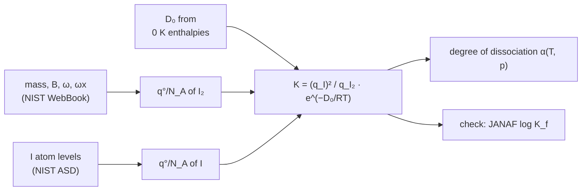

# 21.4 · From partition functions to equilibrium constants

Lesson 13.4 calculated equilibrium constants from tables of enthalpy, entropy and heat capacity. This lesson closes the loop: it computes an equilibrium constant directly from molecular data, with no thermochemical table at all. You will derive the formula, see that it splits neatly into "how many states" and "how much energy", and then, in the module practical, compute $K(T)$ for the dissociation of iodine vapour from 500 to 1500 K and check it against the NIST-JANAF table.

## Why it matters

Many equilibria matter at temperatures or for species that no one can easily measure: radicals in a flame, atoms in a plasma, molecules in a stellar atmosphere, isotope exchange in geochemistry. Iodine is a practical case. Hot iodine vapour dissociates noticeably above about 800 K, which matters in halogen lamps and in nuclear-reactor safety studies of iodine release. With a spectrum and a dissociation energy you can predict how much of it is atomic at any temperature and pressure, and you can say how much to trust the number.

## Core ideas

> [!NOTE]
> The method is settled theory (MIT 5.62 lectures 16–17). The data are NIST WebBook constants of I₂, NIST ASD levels of the I atom, and $D_0$ from the NIST-JANAF 0 K formation enthalpies of I(g) and I₂(g); the check values are the JANAF $\log K_f$ of I(g). All were retrieved 2026-10-17. Standard pressure $p^\circ$ = 1 bar.

### Gibbs energy from the partition function

For an ideal gas, lesson 21.2 gave $A - A(0) = -k_BT\ln(q^N/N!)$. Adding $pV = Nk_BT$ and using Stirling's formula, the molar Gibbs energy at standard pressure is

$$G^\circ_m - U_m(0) = -RT\ln\frac{q^\circ}{N_A}$$

$U_m(0)$ is the molar energy with every molecule in its lowest level. It is the same zero you chose in lesson 21.2, and now it matters, because different species have different lowest levels.

### K as states times a Boltzmann factor

For a reaction $\sum_J \nu_J J = 0$, $\Delta_r G^\circ = \sum_J \nu_J G^\circ_{m,J}$ and $\Delta_r G^\circ = -RT\ln K$ (lesson [13.4](../module-13/lesson-04.md)). Substituting:

$$K = \prod_J \left(\frac{q^\circ_J}{N_A}\right)^{\nu_J} \exp\left(-\frac{\Delta_r E_0}{RT}\right), \qquad \Delta_r E_0 = \sum_J \nu_J\, U_{m,J}(0)$$

Read it in two parts. The product of partition functions compares the numbers of accessible states on the two sides. The exponential is a Boltzmann factor for the energy that the reaction needs at 0 K. A reaction can go "uphill" in energy if the products have enough more states, and that is the statistical meaning of an entropy-driven reaction.

### The energy step at 0 K is $D_0$, not $D_e$

Because each $q$ counts energies from the molecule's own $v = 0$ level, $\Delta_r E_0$ is measured between the lowest levels. For a dissociation $\mathrm{X_2 \rightarrow 2X}$ that is $D_0$, the bond energy from $v = 0$, which is smaller than the well depth $D_e$ by the zero-point energy (lessons [12.4](../module-12/lesson-04.md) and [20.4](../module-20/lesson-04.md)). For other reactions combine dissociation energies, for example $\Delta_r E_0 = D_0(\mathrm{H_2}) + D_0(\mathrm{I_2}) - 2D_0(\mathrm{HI})$ for $\mathrm{H_2 + I_2 \rightleftharpoons 2HI}$. For I₂, the JANAF 0 K formation enthalpies give

$$D_0 = 2 \times 107.164 - 65.504 = 148.824\ \text{kJ/mol} = 12\,440.7\ \text{cm}^{-1}$$

$K$ depends exponentially on this number. An error of 1 % in $D_0$ (124 cm⁻¹) changes $K$ at 1000 K by 16 %. The partition functions themselves are known far better.



### Why dissociation wins at high temperature

Two iodine atoms have two sets of translational states and four-fold electronic degeneracy each; one I₂ molecule has one set of translational states plus rotation and vibration. At 1000 K, $(q^\circ_\text{I}/N_A)^2/(q^\circ_{\mathrm{I_2}}/N_A)$ is about $2\times10^5$: the atoms have vastly more states. The Boltzmann factor $e^{-D_0/RT}$ is $1.7\times10^{-8}$. The product is $3\times10^{-3}$. As $T$ rises, the factor of states grows slowly (as $T^{3/2}$ roughly) but the Boltzmann factor grows exponentially, so $K$ climbs steeply. In thermodynamic language, $\Delta_r H^\circ \approx$ +154 kJ/mol and $\Delta_r S^\circ \approx$ +106 J mol⁻¹ K⁻¹, so $K$ passes 1 near $\Delta_r H^\circ/\Delta_r S^\circ \approx$ 1450 K.

### Degree of dissociation

Start with 1 mol of I₂ and let a fraction $\alpha$ dissociate: $1 - \alpha$ mol I₂ and $2\alpha$ mol I, total $1 + \alpha$. At total pressure $p$:

$$K = \frac{(p_\text{I}/p^\circ)^2}{p_{\mathrm{I_2}}/p^\circ} = \frac{4\alpha^2}{1 - \alpha^2}\,\frac{p}{p^\circ} \quad\Rightarrow\quad \alpha = \sqrt{\frac{K}{K + 4p/p^\circ}}$$

Lower pressure favours dissociation, as Le Chatelier predicts: the side with more moles of gas gains.

## Worked example

### I₂ ⇌ 2I at 1000 K, by hand

**I atom** ($M$ = 126.904 g/mol): $\Lambda$ from lesson 21.3 gives $q^\circ_\text{trans}/N_A = 1.1730\times10^9$. Electronic: $q_\text{el} = 4 + 2e^{-10.94} = 4.00004$. So $q^\circ_\text{I}/N_A = 4.692\times10^9$.

**I₂ molecule** ($M$ = 253.809 g/mol, $B_0$ = 0.037315 cm⁻¹, $\sigma = 2$, $\tilde\nu$ = 213.27 cm⁻¹):

- $q^\circ_\text{trans}/N_A = 3.3178\times10^9$ (twice the mass gives $2^{3/2}$ times more);
- $\theta_\text{rot}$ = 0.05369 K, $q_\text{rot} = 1000/(2 \times 0.05369)$ = 9313;
- $x = 213.27 \times 1.438777/1000 = 0.3069$, $q_\text{vib} = 1/(1 - e^{-0.3069})$ = 3.784.

$q^\circ_{\mathrm{I_2}}/N_A = 3.3178\times10^9 \times 9313 \times 3.784 = 1.169\times10^{14}$.

**Energy step**: $D_0/k_BT = 12\,440.7 \times 1.438777/1000 = 17.899$, $e^{-17.899} = 1.684\times10^{-8}$.

$$K = \frac{(4.692\times10^9)^2}{1.169\times10^{14}} \times 1.684\times10^{-8} = 1.883\times10^5 \times 1.684\times10^{-8} = 3.17\times10^{-3}$$

**Check**: JANAF gives $\log_{10}K_f(\mathrm{I}) = -1.256$ at 1000 K. Above 458 K the reference state of iodine is I₂(g), so $K_f$ is the constant of $\tfrac12\mathrm{I_2 \rightarrow I}$ and $K = K_f^2 = 10^{-2.512} = 3.08\times10^{-3}$. The harmonic estimate is 3 % high. Summing the real anharmonic vibrational levels up to $D_0$ raises $q_\text{vib}$ to 3.840 and brings $K$ to $3.13\times10^{-3}$, 1.6 % high. The rest is rotation–vibration coupling: in excited $v$ the bond is longer, $B$ is smaller, and I₂ has a few more states than the separable model counts.

**Degree of dissociation at 1 bar**: $\alpha = \sqrt{3.13\times10^{-3}/(3.13\times10^{-3} + 4)} = 0.028$. About 3 % of the iodine is atomic at 1000 K and 1 bar, 27 % at 0.01 bar.

## Hands-on

This is the module practical. It uses everything in Module 21: Boltzmann factors (21.1), partition functions and their derivatives (21.2), the molecular factors (21.3) and the equilibrium formula (this lesson).

What you need: the [Module 21 lab folder](../../labs/module-21/) with Python 3.14 (numpy, matplotlib), a calculator, your notebook and the [lab-report template](../../templates/lab-report.md). Time: about 2 hours.

### Part A — pencil warm-up (15 min)

1. Without calculating, which way does each change move $K$ for $\mathrm{I_2 \rightleftharpoons 2I}$ at 1000 K: (a) forgetting the I-atom degeneracy of 4; (b) forgetting $\sigma = 2$ for I₂; (c) using $D_e$ instead of $D_0$?
2. Use the worked example to estimate $\alpha$ at 1000 K and 0.1 bar.
3. For $\mathrm{H_2 + I_2 \rightleftharpoons 2HI}$, $\sum\nu = 0$. Show that the $p^\circ$ and $N_A$ factors cancel, so $K$ depends only on ratios of $q$'s. Which factor of the translational partition functions survives?

<details><summary>Answers to Part A</summary>

1. (a) $K$ contains $q_\text{el}(\mathrm{I})^2 = 16$; forgetting it makes $K$ 16 times too small. (b) $\sigma$ divides $q_{\mathrm{I_2}}$, which is in the denominator; forgetting it makes $K$ 2 times too small. (c) $D_e = D_0 + $ zero-point energy (about 107 cm⁻¹), so $e^{-D_e/RT}$ is smaller and $K$ falls by $e^{-0.154}$ = 0.86. In each case the number of states or energy says which way.
2. $\alpha = \sqrt{3.13\times10^{-3}/(3.13\times10^{-3} + 0.4)} = 0.088$.
3. $K = q_\text{HI}^2/(q_{\mathrm{H_2}}q_{\mathrm{I_2}})\,e^{-\Delta E_0/RT}$; with two molecules on each side, $(k_BT/p^\circ)$ and $N_A$ appear twice on top and twice below and cancel. The translational part leaves only the mass ratio $\left(m_\text{HI}^2/m_{\mathrm{H_2}}m_{\mathrm{I_2}}\right)^{3/2}$.

</details>

### Part B — Python: K(T) for iodine dissociation (60 min)

Open `lesson04_practical.py`. The partition functions of I and I₂ are already built from `stat21.py` (your 21.3 functions, plus the anharmonic level sum). Write three TODO functions:

- `k_dissociation(T, vib, d0_cm)`: $K = (q^\circ_\text{I}/N_A)^2/(q^\circ_{\mathrm{I_2}}/N_A)\,e^{-hcD_0/k_BT}$, using logarithms;
- `degree_of_dissociation(k, p_bar)`: $\alpha$ from the formula above;
- `reaction_h_s(T)`: $\Delta_r H^\circ = D_0 + 2[H - H(0)]_\text{I} - [H - H(0)]_{\mathrm{I_2}}$ and $\Delta_r S^\circ = 2S^\circ_\text{I} - S^\circ_{\mathrm{I_2}}$, with `thermo_from_lnq`.

```bash
py lesson04_practical.py
```

How you know it worked:

| T / K | K harmonic | K anharmonic | K JANAF | α (1 bar) |
|---|---|---|---|---|
| 500 | 3.28 × 10⁻¹¹ | 3.26 × 10⁻¹¹ | 3.24 × 10⁻¹¹ | 3 × 10⁻⁶ |
| 800 | 3.12 × 10⁻⁵ | 3.08 × 10⁻⁵ | 3.05 × 10⁻⁵ | 0.0028 |
| 1000 | 3.17 × 10⁻³ | 3.13 × 10⁻³ | 3.08 × 10⁻³ | 0.028 |
| 1200 | 7.03 × 10⁻² | 6.90 × 10⁻² | 6.79 × 10⁻² | 0.130 |
| 1500 | 1.59 | 1.55 | 1.51 | 0.529 |

The anharmonic column is 0.8–2.6 % above JANAF at every temperature. At 1000 K, $\Delta_r H^\circ$ = 154.0 kJ/mol (JANAF 153.9) and $\Delta_r S^\circ$ = 106.1 J mol⁻¹ K⁻¹ (JANAF 105.8). Raising $D_0$ by 1 % lowers $K$ to 0.80 of its value at 800 K and 0.89 at 1500 K. The plot `runs/lesson04_vant_hoff.png` shows $\ln K$ against $1/T$ with the JANAF points on the line.

<details><summary>Reference solution</summary>

`k_dissociation`: `return math.exp(2 * ln_q_i(T) - ln_q_i2(T, vib) - HC_K * d0_cm / T)`. `degree_of_dissociation`: `return math.sqrt(k / (k + 4 * p_bar))`. `reaction_h_s`: call `thermo_from_lnq(ln_q_i, T)` and `thermo_from_lnq(lambda t: ln_q_i2(t, vib), T)`, then `dh = D0_I2_KJMOL + 2 * ti["H_minus_H0"] - ti2["H_minus_H0"]` and `ds = 2 * ti["S"] - ti2["S"]`. Full code in `lesson04_practical_solution.py`.

Why the agreement is so good: the JANAF tables for I and I₂ were themselves computed from spectroscopic levels; the remaining 1–3 % is the more complete level sum JANAF used (rotation–vibration coupling, centrifugal distortion, excited electronic states). Why the error shrinks in relative terms at low $T$: few excited vibrational levels are populated, so the model's simplifications matter less.

</details>

### Part C — report (45 min)

Write a short report with the [lab-report template](../../templates/lab-report.md):

1. **Aim and data**: the reaction, the sources and versions of every input (NIST WebBook, NIST ASD, JANAF, CODATA 2022, retrieval date).
2. **Method**: the formula for $K$, each partition function, and the choice of $D_0$.
3. **Results**: the table above, the van 't Hoff plot, $\alpha$ at 1 bar and 0.01 bar, $\Delta_r H^\circ$ and $\Delta_r S^\circ$ at 1000 K.
4. **Uncertainty**: rank the error sources by size, using your sensitivity run (harmonic vs anharmonic, 1 % in $D_0$, rotation–vibration coupling).
5. **Comparison with the Module 13 route**: lesson 13.4 got $K$ from $\Delta_f H^\circ$, $S^\circ$ and $C_p(T)$ tables. Explain in two sentences why the two routes must agree for an ideal gas.

How you know it worked: a reader who has not taken the module can reproduce your $K$ at 1000 K from the report alone.

## Common mistakes

- **Using $D_e$ instead of $D_0$.** The partition functions count energies from $v = 0$, so the energy step must too. Using $D_e$ shifts $K$ by $e^{-\text{ZPE}/k_BT}$, 14 % at 1000 K for I₂ and far more for H₂.
- **Mixing standard states.** Use $q^\circ/N_A$ (with $k_BT/p^\circ$) for every species, or $q/V$ for every species and then convert $K_c$ to $K$. Mixing them gives wrong powers of $p^\circ$.
- **Forgetting JANAF's reference state.** $K_f$ of I(g) above 458 K refers to $\tfrac12\mathrm{I_2(g)}$; below it, to solid or liquid iodine. Square $K_f$ for $\mathrm{I_2 \rightarrow 2I}$ only in the gas range.
- **Dropping degeneracies.** The I atom's $g = 4$ enters squared. Halogen, oxygen and nitrogen atoms all have $g_0 > 1$.
- **Expecting a perfect match.** A few per cent is the honest accuracy of a separable rigid-rotor model; the exponential sensitivity to $D_0$ usually dominates anyway.

## Key takeaways

- $G^\circ_m - U_m(0) = -RT\ln(q^\circ/N_A)$, so $K = \prod_J (q^\circ_J/N_A)^{\nu_J}\,e^{-\Delta_r E_0/RT}$.
- $K$ is "ratio of accessible states" times "Boltzmann factor of the 0 K energy step"; $\Delta_r E_0$ uses $D_0$.
- For $\mathrm{I_2 \rightleftharpoons 2I}$ the spectroscopic $K$ matches JANAF within 3 % from 500 to 1500 K; at 1000 K and 1 bar, 2.8 % of the iodine is atomic.
- Dissociation is entropy-driven: the atoms have about 10⁵ times more states, which beats a Boltzmann factor of 10⁻⁸ as $T$ rises.
- The weakest input is usually $D_0$: 1 % in $D_0$ is 16 % in $K$ at 1000 K.

## Sources

- [MIT OpenCourseWare 5.62, lecture notes](https://ocw.mit.edu/courses/5-62-physical-chemistry-ii-spring-2008/pages/lecture-notes/) — lectures 16–17: chemical equilibrium from partition functions.
- [LibreTexts Physical Chemistry, 26.8](https://chem.libretexts.org/Bookshelves/Physical_and_Theoretical_Chemistry_Textbook_Maps/Physical_Chemistry_%28LibreTexts%29/26%3A_Chemical_Equilibrium/26.08%3A_Equilibrium_Constants_in_Terms_of_Partition_Functions) — $K$ in terms of partition functions, with a worked HCl example.
- [NIST-JANAF table: I(g)](https://janaf.nist.gov/tables/I-001.html) and [I₂(g)](https://janaf.nist.gov/tables/I-027.html) — $\Delta_f H^\circ(0)$ = 107.164 and 65.504 kJ/mol, $\log K_f$, $S^\circ$ and $C_p$ from 298 to 1500 K.
- [NIST Chemistry WebBook: iodine](https://webbook.nist.gov/cgi/cbook.cgi?ID=C7553562&Mask=1000) — $\omega_e$, $\omega_e x_e$, $B_e$, $\alpha_e$ of I₂.
- [NIST Atomic Spectra Database](https://physics.nist.gov/PhysRefData/ASD/levels_form.html) — I I $^2P_{1/2}$ level at 7602.9762 cm⁻¹.
