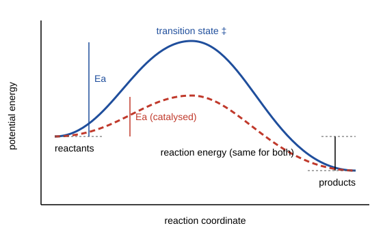

# 22.5 · Catalysis and enzyme kinetics

A catalyst opens a new route with a lower barrier and comes out of the reaction unchanged, ready to go round again. Acids catalyse the splitting of sucrose in a jar of jam, platinum catalyses the burning of carbon monoxide in a car exhaust, and invertase catalyses the same sucrose reaction as acid but far faster at room temperature. This lesson shows what all catalysts share, derives the Michaelis–Menten equation with the steady-state approximation of lesson [22.3](lesson-03.md), and ends with the module practical: a complete fit of the 1913 invertase data, the data you have already met in lessons 22.1 and 22.2, from initial rates to a global model of every time course.

## Why it matters

When you design a process around a catalyst, the two numbers you need are how fast it works when saturated and how much substrate it takes to get there. For an enzyme they are $k_\text{cat}$ and $K_m$. They decide how much enzyme to buy, what substrate concentration to run at, and whether the products will choke the reaction before it finishes. Michaelis and Menten saw this last problem in 1913: glucose and fructose bind to invertase and slow it down, and a model that ignores them gets the enzyme's speed wrong by 16 %. A drug that blocks an enzyme, a sensor that uses one, and a factory that inverts sugar syrup all depend on getting these numbers right.

## Core ideas

> [!NOTE]
> The theory is stable. The invertase data and constants are from Michaelis and Menten (1913) as translated and re-analysed by Johnson and Goody (2011); the fitting code uses SciPy 1.18 (`curve_fit`, `least_squares`, `solve_ivp`), pinned in `labs/common/requirements.txt`, checked 2026-10-17.

### What a catalyst does and does not do

A catalyst provides a mechanism with a lower activation energy (or a more favourable $\Delta^\ddagger S$). Because it is regenerated, a small amount can convert a large amount of substrate; the number of cycles per second per catalytic site is the **turnover frequency**. A catalyst does not change $\Delta_r G^\circ$, so it does not change the equilibrium constant ([13.4](../module-13/lesson-04.md)). Since $K = k_f/k_r$ (lesson [22.1](lesson-01.md)), it must speed up the forward and reverse reactions by the same factor. A catalyst that seemed to shift an equilibrium would be a perpetual-motion machine.



### Homogeneous catalysis

A homogeneous catalyst is in the same phase as the reactants. Acid hydrolysis of sucrose is the classic case: H⁺ protonates the oxygen joining the two rings and the bond breaks. The rate is $k[\mathrm{H^+}][\mathrm{sucrose}]$, and since the acid is not used up, the reaction is pseudo-first-order in sucrose with $k' = k[\mathrm{H^+}]$. Wilhelmy followed exactly this reaction with a polarimeter in 1850, usually counted as the first quantitative study of a reaction rate.

### Surface catalysis

A heterogeneous catalyst is a solid that the reactants touch only at its surface. Molecules first **adsorb** onto surface sites. If the coverage $\theta$ follows the Langmuir isotherm,

$$\theta = \frac{K_\text{ads}\,p}{1 + K_\text{ads}\,p}$$

and the adsorbed molecule reacts with rate $k\theta$, the rate is first order in pressure at low pressure and zero order once the surface is full. When two different reactants must both be adsorbed side by side (the **Langmuir–Hinshelwood** mechanism), the rate goes through a maximum: too much of one reactant crowds the other off the surface. That is why carbon monoxide poisons a car's platinum catalyst when the engine is cold and rich in CO.

### Enzymes: the Michaelis–Menten mechanism

An enzyme E binds its substrate S into a complex ES, which turns over to product:

$$\mathrm{E + S \underset{k_{-1}}{\overset{k_1}{\rightleftharpoons}} ES \xrightarrow{k_\text{cat}} E + P}$$

The total enzyme is fixed, $[\mathrm{E}]_0 = [\mathrm{E}] + [\mathrm{ES}]$, and tiny compared with the substrate. Apply the SSA to ES, $d[\mathrm{ES}]/dt = k_1[\mathrm{E}][\mathrm{S}] - (k_{-1} + k_\text{cat})[\mathrm{ES}] = 0$, and eliminate [E]:

$$v = \frac{k_\text{cat}[\mathrm{E}]_0[\mathrm{S}]}{K_m + [\mathrm{S}]} = \frac{V_\text{max}[\mathrm{S}]}{K_m + [\mathrm{S}]}, \qquad K_m = \frac{k_{-1} + k_\text{cat}}{k_1}$$

This steady-state derivation is due to Briggs and Haldane (1925). Michaelis and Menten assumed instead that the binding step is at equilibrium, which gives the same form with $K_m$ replaced by the dissociation constant $K_S = k_{-1}/k_1$ (a pre-equilibrium, lesson 22.3).

How to read the three parameters:

- $V_\text{max} = k_\text{cat}[\mathrm{E}]_0$ is the rate when every enzyme molecule is busy. At $[\mathrm{S}] \gg K_m$ the reaction is zero order in S, which is what you saw at 333 mM in lesson 22.1.
- $K_m$ is the substrate concentration at which $v = V_\text{max}/2$. It is a concentration, not an affinity, unless $k_\text{cat} \ll k_{-1}$.
- $k_\text{cat}/K_m$, the **specificity constant**, is the second-order rate constant of free enzyme with substrate at low [S], where $v = (k_\text{cat}/K_m)[\mathrm{E}]_0[\mathrm{S}]$: first order in S, with pseudo-first-order constant $V_\text{max}/K_m$. It cannot exceed the rate at which E and S meet by diffusion, about $10^8$–$10^9$ L mol⁻¹ s⁻¹; enzymes close to that limit are called diffusion-limited.

Products often bind to the same site and compete with the substrate. Then $K_m$ is multiplied by $(1 + [\mathrm{P}]/K_P)$, and the reaction slows more than substrate depletion alone explains. Module 29 (lessons 29.2 and 29.3) treats inhibition, regulation and the pitfalls of linear plots in depth.

Explore how $K_m$ and $V_\text{max}$ shape the saturation curve:

[Simulation: Kinetics — enzyme saturation (Michaelis–Menten)](../../simulations/kinetics/index.html?preset=enzyme)

### Linear plots and why to avoid them for final numbers

The Lineweaver–Burk plot of $1/v$ against $1/[\mathrm{S}]$ is a straight line with intercept $1/V_\text{max}$ and slope $K_m/V_\text{max}$. It is useful for seeing the type of inhibition, but it puts most weight on the slowest rates at low [S], where the relative error is largest. Fit the hyperbola directly by nonlinear least squares and quote the uncertainties.

## Worked example

### 1. Km from the 1913 initial rates

The nonlinear fit of the seven initial rates gives $V_\text{max} = 3.91$ (in the paper's units) and $K_m = 17.9$ mM.

1. Check against a measured point: at 20.8 mM the model predicts $3.91 \times 20.8/(17.9 + 20.8) = 2.10$; Michaelis and Menten measured 2.114.
2. At 333 mM it predicts $3.91 \times 333/350.9 = 3.71$, but they measured 3.636 at both 167 and 333 mM. The slight shortfall at the top is also visible in their own figures; they suggested the very concentrated sugar solution changes the solvent.
3. Michaelis and Menten found $K_S$ = 0.0167 M = 16.7 mM by a graphical method; the modern fit agrees within its uncertainty of about 1 mM.

### 2. Connecting to lesson 22.1

In lesson 22.1 the 20.8 mM run decayed with an apparent first-order constant of 0.021 min⁻¹. With $V_\text{max} = 0.775$ mM/min (from the global fit in the practical) and $K_m = 16.7$ mM, the Michaelis–Menten law predicts at the start an apparent constant of

$$\frac{v}{[\mathrm{S}]} = \frac{V_\text{max}}{K_m + [\mathrm{S}]} = \frac{0.775}{16.7 + 20.8} = 0.0207\ \text{min}^{-1}$$

The two lessons agree. At very low [S] the constant would rise to $V_\text{max}/K_m = 0.046$ min⁻¹, the "global constant" of 0.0454 min⁻¹ that Michaelis and Menten extracted from all their time courses: the specificity constant times the enzyme concentration.

## Hands-on

What you need: for Part A, 3 % hydrogen peroxide from a pharmacy, dry baker's yeast, washing-up liquid, three identical tall glasses, a teaspoon, a ruler and safety glasses; for Part B, Python with the course packages and the [Module 22 lab folder](../../labs/module-22/). Write up Part B with the [lab report template](../../templates/lab-report.md). Time: about 2 hours.

### Part A — kitchen: catalase in yeast (30 min)

> [!CAUTION]
> Use only 3 % pharmacy hydrogen peroxide, never the stronger hair-bleaching kind, and never mix it with vinegar, bleach or anything else. It irritates eyes and skin: wear safety glasses, work at a sink, rinse any splash with plenty of water, and keep the bottle away from children (see the PubChem safety entry). Use small amounts. The foam is only oxygen, water, soap and yeast and can be rinsed down the sink.

Yeast contains catalase, an enzyme that splits hydrogen peroxide into water and oxygen, $\mathrm{2H_2O_2 \to 2H_2O + O_2}$. A drop of washing-up liquid traps the oxygen as foam, so the foam height after a fixed time measures how much reaction happened.

1. In a cup, stir 2 teaspoons of dry yeast into 6 teaspoons of warm (not hot) tap water and wait 5 minutes.
2. Put 2 tablespoons (about 30 mL) of 3 % hydrogen peroxide and one drop of washing-up liquid into each of the three glasses.
3. Add 1, 2 and 4 teaspoons of the yeast mixture to the three glasses, one at a time, and swirl once. After exactly 30 s, measure the foam height with the ruler.
4. When the foam in the 4-teaspoon glass has stopped growing, pour in another 2 tablespoons of peroxide. Watch what happens.

How you know it worked: the foam height after 30 s rises roughly in proportion to the amount of yeast, so the rate is first order in enzyme, $v \propto [\mathrm{E}]_0$, as $V_\text{max} = k_\text{cat}[\mathrm{E}]_0$ predicts. In step 4 the foam starts again with no new yeast: the catalyst was not used up. This part trains observation and reasoning, not quantitative technique; foam height is a crude, nonlinear measure of oxygen volume.

### Part B — module practical: fit the 1913 invertase data end to end (90 min)

1. Open `lesson05_practical.py`. It reads `invertase_initial_rates.csv` (seven initial rates) and `invertase_timecourse.csv` (five time courses), and imports $K_S$ = 16.7 mM, $K_F$ = 58 mM and $K_G$ = 89 mM, the dissociation constants of sucrose, fructose and glucose that Michaelis and Menten measured.
2. Complete `michaelis_menten()`, `fit_mm()`, `lineweaver_burk()` and `rate()`. `rate()` is the invertase rate law with competitive product inhibition, $-d[\mathrm{S}]/dt = V_\text{max}([\mathrm{S}]/K_S)/(1 + [\mathrm{S}]/K_S + [\mathrm{P}]/K_F + [\mathrm{P}]/K_G)$, where $[\mathrm{P}] = [\mathrm{S}]_0 - [\mathrm{S}]$ is the concentration of each product. The script integrates it with `solve_ivp` and fits one $V_\text{max}$ to all 28 points.
3. Run it and open `runs/lesson05_practical.png`:

```bash
py lesson05_practical.py
```

4. Write a short report with the template. Answer: (a) how do your $K_m$ values (nonlinear and Lineweaver–Burk) compare with 16.7 mM? (b) Which model describes the time courses, and how do you know from the plot and the RMS residual? (c) How does your $V_\text{max}$ compare with the 0.76 ± 0.05 mM/min of 1913 and the 0.80 ± 0.02 mM/min of the 2011 re-analysis? (d) Which three results of lessons 22.1–22.4 does this practical use?

How you know it worked: nonlinear fit $V_\text{max}$ = 3.91 ± 0.06 (arbitrary units) and $K_m$ = 17.9 ± 1.0 mM; Lineweaver–Burk 3.95 and 18.4 mM. The global fit with product inhibition gives $V_\text{max}$ = 0.775 ± 0.009 mM/min with an RMS residual of 0.016 in fraction converted; without inhibition, 0.648 ± 0.013 mM/min and an RMS residual of 0.032, twice as large, with the dotted curves running ahead of the data at long times. $V_\text{max}/K_m$ = 0.0464 min⁻¹ against 0.0454 ± 0.0032 min⁻¹ in 1913.

<details><summary>Reference solution and model answers</summary>

```python
def michaelis_menten(S, V, K):
    return V * S / (K + S)

def fit_mm(S, v):
    popt, pcov = curve_fit(michaelis_menten, S, v, p0=(v.max(), np.median(S)))
    return popt, np.sqrt(np.diag(pcov))

def lineweaver_burk(S, v):
    slope, intercept = np.polyfit(1.0 / S, 1.0 / v, 1)
    return 1.0 / intercept, slope / intercept

def rate(S, S0, V, inhibition):
    P = (S0 - S) if inhibition else 0.0
    return V * (S / KS_MM) / (1 + S / KS_MM + P / KF_MM + P / KG_MM)
```

Full code: `lesson05_practical_solution.py`.

(a) Both agree with 16.7 mM within about 1–2 mM. Lineweaver–Burk is close here only because the 1913 rates are precise; with noisy data at low [S] it drifts much further. (b) The inhibition model: its residuals are half as large. The trend left in them is at 333 mM, where the model runs slightly ahead of the data, the same slowing at very high sucrose seen in the initial rates (worked example 1). Without inhibition the model must lower $V_\text{max}$ by 16 % to follow the late points and then misses the early ones. (c) 0.775 mM/min lies between the two published values and within both uncertainties; the small differences come from which points are included. (d) Zero and first order as limits of one rate law (22.1), the physical-property conversion to fraction converted (22.2) and the steady-state approximation behind the rate law (22.3); the fit methods are those of 22.2 and 22.4.

</details>

## Common mistakes

- Thinking a catalyst shifts an equilibrium. It speeds both directions equally and changes only how fast equilibrium is reached.
- Reading $K_m$ as a binding constant. It equals the dissociation constant only when $k_\text{cat} \ll k_{-1}$.
- Measuring "initial" rates after a large fraction has reacted, when products already inhibit the enzyme.
- Taking $V_\text{max}$ and $K_m$ from a Lineweaver–Burk line. Use it to look, then fit the hyperbola.
- Comparing $k_\text{cat}$ values without the enzyme concentration. $V_\text{max}$ alone depends on how much enzyme was added; Michaelis and Menten could only report $V_\text{max}/K_m$ for that reason.
- Using stronger hydrogen peroxide "to get more foam". The 3 % solution is enough and is the only strength for home use.

## Key takeaways

- A catalyst lowers the barrier by a new mechanism, is regenerated and leaves $K$ unchanged.
- Surface and enzyme catalysts both saturate: first order at low concentration, zero order at high.
- Michaelis–Menten from the SSA: $v = V_\text{max}[\mathrm{S}]/(K_m + [\mathrm{S}])$ with $V_\text{max} = k_\text{cat}[\mathrm{E}]_0$ and $K_m = (k_{-1} + k_\text{cat})/k_1$.
- $k_\text{cat}/K_m$ is the second-order constant at low [S] and is capped by diffusion near $10^8$–$10^9$ L mol⁻¹ s⁻¹.
- Fitting whole time courses by numerical integration tests the model, here showing that product inhibition is needed; the 1913 data give $K_m \approx 17$ mM and $V_\text{max} \approx 0.78$ mM/min.

## Sources

- [Johnson and Goody (2011), Biochemistry 50, 8264](https://pmc.ncbi.nlm.nih.gov/articles/PMC3381512/) — translation of Michaelis and Menten (1913) with Table I initial rates, $K_S$ = 0.0167 M, $K_F$ = 0.058 M, $K_G$ = 0.089 M, Table 1 time courses, global constant 0.0454 ± 0.0032 min⁻¹, $V_\text{max}$ 0.76 ± 0.05 (1913) and 0.80 ± 0.02 mM/min (2011).
- [LibreTexts Physical Chemistry, 29.8 A Catalyst Affects the Mechanism and Activation Energy](https://chem.libretexts.org/Bookshelves/Physical_and_Theoretical_Chemistry_Textbook_Maps/Physical_Chemistry_(LibreTexts)/29%3A_Chemical_Kinetics_II-_Reaction_Mechanisms/29.08%3A_A_Catalyst_Affects_the_Mechanism_and_Activation_Energy) — catalysts and equilibrium.
- [LibreTexts Physical Chemistry, 29.9 The Michaelis-Menten Mechanism](https://chem.libretexts.org/Bookshelves/Physical_and_Theoretical_Chemistry_Textbook_Maps/Physical_Chemistry_(LibreTexts)/29%3A_Chemical_Kinetics_II-_Reaction_Mechanisms/29.09%3A_The_Michaelis-Menten_Mechanism_for_Enzyme_Catalysis) — steady-state derivation, $K_m$ and $k_\text{cat}$.
- [OpenStax Chemistry 2e, 12.7 Catalysis](https://openstax.org/books/chemistry-2e/pages/12-7-catalysis) — homogeneous, heterogeneous and enzyme catalysts.
- [PubChem, Hydrogen peroxide (CID 784)](https://pubchem.ncbi.nlm.nih.gov/compound/784) — GHS hazards and first aid.
- [MIT OCW 5.60 Thermodynamics and Kinetics](https://ocw.mit.edu/courses/5-60-thermodynamics-kinetics-spring-2008/) — the kinetics lectures (mechanisms, catalysis, enzymes) of the course this module follows.
