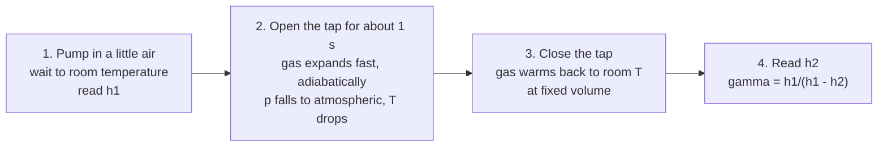

# 23.1 · Gas laws and kinetic theory in the lab

Physical Chemistry Lab 1 starts where Module 7 left off. In lesson 07.6 you used the ideal gas law and van der Waals as equations. Here you test the picture behind them: a gas is a crowd of molecules flying about, and pressure and temperature are averages over that crowd. You will pull a temperature out of a list of molecular speeds from a simulation. Then you will measure the ratio of the two heat capacities of air with one of the oldest experiments in physical chemistry, the Clément–Desormes method, and find out from a single number how many ways an air molecule can store energy.

## Why it matters

The heat-capacity ratio γ decides how hot a gas gets when it is compressed fast. That is why a bicycle pump warms up (lesson [13.1](../module-13/lesson-01.md)), why a diesel engine needs no spark, and how fast sound travels. Engineers who size a compressor or a safety valve look γ up in a table. A chemist should know where the table comes from and how to tell a good value from a bad one. The same picture of molecular speeds sets how fast gases mix, effuse through a leak, and collide in a reaction (Module 22). A wrong γ in a compressor design gives the wrong outlet temperature; a wrong speed gives the wrong collision rate.

## Core ideas

> [!NOTE]
> Kinetic theory and the Clément–Desormes method are stable physics. The constants are CODATA 2022 exact values from NIST ($R$ = 8.314 462 618 J mol⁻¹ K⁻¹, $k_B$ = 1.380 649 × 10⁻²³ J/K), checked on 2026-10-17. The example data in the lab folder are generated by `make_data.py`, not measured. The simulation is an educational model.

### Pressure is momentum delivered to the wall

Picture one molecule of mass $m$ bouncing between the walls of a box. Each hit reverses its velocity and hands the wall a little momentum. Add up the hits of $N$ molecules per second and you get a force, and force per area is pressure. The result of that bookkeeping is

$$pV = \tfrac{1}{3} N m \langle v^2 \rangle$$

where $\langle v^2 \rangle$ is the mean of the squared speed. Compare it with $pV = nRT$ (lesson [07.6](../module-07/lesson-06.md)). Per mole, $\tfrac{1}{2} M \langle v^2 \rangle = \tfrac{3}{2} RT$, with $M$ the molar mass in kg/mol. So temperature *is* the average kinetic energy of translation, in different units. That gives a way to measure temperature from speeds:

$$T = \frac{M \langle v^2 \rangle}{3R}$$

### The Maxwell–Boltzmann distribution

Molecules do not all move at the same speed. Collisions spread them out into the **Maxwell–Boltzmann distribution**: the fraction of molecules with speeds between $v$ and $v + dv$ is $f(v)\,dv$, with

$$f(v) = 4\pi \left(\frac{M}{2\pi RT}\right)^{3/2} v^2 \exp\!\left(-\frac{M v^2}{2RT}\right)$$

The $v^2$ factor says there are more ways to have a large speed (more directions on a bigger sphere). The exponential is the Boltzmann factor (lesson [21.1](../module-21/lesson-01.md)), which makes high energies rare. Three speeds summarise the curve:

| speed | formula | argon, 300 K | N₂, 298 K |
|---|---|---|---|
| most probable | $\sqrt{2RT/M}$ | 353 m/s | 421 m/s |
| mean | $\sqrt{8RT/\pi M}$ | 399 m/s | 475 m/s |
| root-mean-square | $\sqrt{3RT/M}$ | 433 m/s | 515 m/s |

Heavier gases are slower by $\sqrt{M}$. Helium at 300 K is $\sqrt{39.95/4.00} = 3.16$ times faster than argon. This is also Graham's law: effusion rates through a pinhole scale as $1/\sqrt{M}$.

### Heat capacities and γ

Heat a gas at constant volume and all the energy goes into the molecules: $C_{V,m} = (\partial U_m/\partial T)_V$. At constant pressure the gas also pushes back the surroundings, so it needs $R$ more per mole: $C_{p,m} = C_{V,m} + R$ for an ideal gas. Their ratio is

$$\gamma = \frac{C_{p,m}}{C_{V,m}}$$

Each active **degree of freedom** (an independent way to store energy) adds $\tfrac{1}{2}R$ to $C_{V,m}$. A monatomic gas has three of translation, so $C_{V,m} = \tfrac{3}{2}R$ and $\gamma = 5/3$. A diatomic molecule such as N₂ or O₂ adds two of rotation, $C_{V,m} = \tfrac{5}{2}R$ and $\gamma = 7/5 = 1.400$. Vibration would add $R$ more, but at room temperature its quantum is too large to be excited (lesson [21.3](../module-21/lesson-03.md)). So a measured γ of 1.40 for air is a direct sign that vibration is frozen out.

### The Clément–Desormes experiment

The apparatus is a large bottle with a tap, a hand pump and a water manometer (a U-tube that reads pressure as a height of water).



Why each step:

1. **Waiting after pumping** lets the compression heat leave, so the start is at room temperature, pressure $p_1 = p_0 + \rho g h_1$.
2. **The short opening** is an adiabatic expansion: too fast for heat to flow. The gas that stays in the bottle expands to $p_0$ and cools. For a reversible adiabat $p^{1-\gamma}T^{\gamma}$ is constant.
3. **Closing and waiting** lets that gas warm back to room temperature at constant volume. Its pressure rises to $p_2 = p_0 + \rho g h_2$.
4. **The result.** States 1 and 3 are at the same temperature, so they lie on one isotherm; states 1 and 2 lie on one adiabat. Combining the two gives $\gamma = \ln(p_1/p_0)/\ln(p_1/p_2)$. Because the extra pressures are tiny compared with $p_0$, the logs reduce to $\gamma \approx h_1/(h_1 - h_2)$.

What can go wrong:

- **The tap is open too long.** Heat flows in while the gas is still cold, so it warms less after closing, $h_2$ comes out small and γ comes out *low*. Classroom results of 1.30–1.35 usually have this cause.
- **The tap is closed too early.** The pressure has not reached $p_0$; the gas oscillates in and out. γ scatters in both directions.
- **A leak.** The manometer drifts down while you wait, and $h_2$ is low again.
- **Not waiting long enough** before reading $h_1$ or $h_2$: the gas is still warm or cold, and the readings are wrong in a way that repeats every trial.

Safety reasoning: a bottle under pressure stores energy. Glass can burst. Real labs use small overpressures (10–20 cm of water, about 1–2 kPa), a plastic or taped vessel, and eye protection. Old setups used mercury manometers; mercury vapour is toxic, so water or oil is used today.

## Worked example

### 1. Temperature from a speed sample

A simulation of argon exports 3000 speeds. Their mean squared speed is $\langle v^2 \rangle = 1.876 \times 10^5$ m²/s².

$$T = \frac{0.039948 \times 1.876\times10^{5}}{3 \times 8.3145} = 300.5\ \text{K}$$

How precise is it? For $N$ molecules the relative standard deviation of $\langle v^2 \rangle$ is $\sqrt{2/(3N)} = 1.5$ %, so $T = 300.5 \pm 4.5$ K. A simulation box with a few thousand atoms has a "temperature" that fluctuates by a few kelvin. A real flask holds 10²² molecules and the fluctuation vanishes.

### 2. γ of air from one Clément–Desormes trial

Readings: $h_1$ = 15.2 cm, $h_2$ = 4.4 cm of water, room pressure 101.3 kPa.

$$\gamma \approx \frac{15.2}{15.2 - 4.4} = 1.407$$

With the full log form, $p_1 = 101\,325 + 998 \times 9.81 \times 0.152 = 102\,813$ Pa and $p_2 = 101\,756$ Pa, so $\gamma = \ln(102\,813/101\,325)/\ln(102\,813/101\,756) = 1.410$. The approximation costs 0.2 %, far less than the scatter between trials.

Then $C_{V,m} = R/(\gamma - 1) = 8.3145/0.407 = 20.4$ J mol⁻¹ K⁻¹ $= 2.46R$, close to $\tfrac{5}{2}R$, and $C_{p,m} = 28.7$ J mol⁻¹ K⁻¹. Five active degrees of freedom: three of translation, two of rotation, no vibration.

How sensitive is it? An error of 0.1 cm in $h_2$ changes $h_1 - h_2$ by about 1 %, and γ by 1 %. Because $h_1 - h_2$ is a difference, small reading errors matter more than they look (lesson [09.3](../module-09/lesson-03.md)).

## Hands-on

What you need: the [Module 23 lab folder](../../labs/module-23/) with Python set up (see its README), a calculator, and the [lab report template](../../templates/lab-report.md). Time: about 75 minutes. There is no home experiment for this lab: a pressurised bottle and a manometer are not kitchen equipment, so the simulation and real-style data replace them. The simulation trains the procedure and the analysis, not the feel of a real tap and manometer.

### Part A — simulation: a gas of hard spheres (20 min)

[Simulation: Gas laws — kinetic theory in a box](../../simulations/gas-laws/index.html?preset=kinetic)

1. Start with argon at 300 K. Let it run until the speed histogram stops changing shape. Read the pressure and the rms speed. Check the rms speed against $\sqrt{3RT/M}$ = 433 m/s.
2. Double the temperature to 600 K. Predict first: the rms speed should rise by $\sqrt{2}$, to 612 m/s, and the pressure should double. Check both.
3. Switch the gas to helium at 300 K. Predict: speeds 3.16 times higher, and the *same* pressure for the same number of atoms in the same box. Why the same? A light atom delivers less momentum per hit but hits more often; the two effects cancel because pressure depends on $m\langle v^2\rangle$, which is fixed by $T$.
4. Export 3000 speeds as CSV (column `speed_m_s`) and save it as `my_speeds.csv` in the lab folder.
5. Run the simulation's Clément–Desormes bench eight times with a 1 s opening, and once each with 0.2 s and 5 s. Record $h_1$ and $h_2$ as `trial,h1_cm,h2_cm` in `my_clement.csv`.

How you know it worked: the histogram looks like the Maxwell–Boltzmann curve with a long tail to high speeds, and the 1 s trials give γ between about 1.38 and 1.43. The 5 s opening gives a clearly lower γ.

### Part B — Python: temperature and γ from data (30 min)

Open `lesson01_gases.py`. Complete `temperature_from_speeds()` (one line, from $T = M\langle v^2\rangle/3R$) and `gamma_clement()` (one line). Then run, from the lab folder:

```bash
py lesson01_gases.py
py lesson01_gases.py my_speeds.csv my_clement.csv
```

How you know it worked: on the example data the script prints $T$ = 300.5 ± 4.5 K, the three speeds against theory, a χ² close to the number of degrees of freedom (the histogram fits Maxwell–Boltzmann), and γ = 1.411 with a 95 % interval of ± 0.019, giving $C_{V,m}$ = 2.43 R. The plot goes to `runs/lesson01_gases.png`. Write a half-page report with the template: aim, method, γ with its interval, and a discussion of the 0.2 s and 5 s trials.

### Part C — pencil (25 min)

1. At what temperature does N₂ have the same rms speed as helium at 20 K?
2. A Clément–Desormes trial with carbon dioxide gives $h_1$ = 16.0 cm, $h_2$ = 3.8 cm. Find γ, $C_{V,m}$ in units of $R$, and say what it tells you about CO₂ at room temperature.
3. A student holds the tap open for 4 s and gets γ = 1.31 for air. Explain the direction of the error in two sentences.

<details><summary>Answers</summary>

1. Equal rms speeds need equal $T/M$: $T = 20 \times 28.014/4.0026 = 140$ K.
2. $\gamma = 16.0/12.2 = 1.311$; $C_{V,m} = R/0.311 = 3.2R$. That is more than the $\tfrac{5}{2}R$ of a rigid linear molecule: CO₂'s low-frequency bending vibration (667 cm⁻¹, lesson [14.4](../module-14/lesson-04.md)) is partly excited at room temperature. The tabulated value is about 1.29.
3. While the tap is open, heat flows from the room into the cold gas, so the expansion is not adiabatic and the gas ends up warmer than it should. It then warms less after the tap is closed, $h_2$ is too small, and $h_1/(h_1 - h_2)$ comes out too low.

</details>

## Common mistakes

- **Using g/mol instead of kg/mol in $\sqrt{3RT/M}$.** The speed comes out 32 times too small. With $R$ in J mol⁻¹ K⁻¹, $M$ must be in kg/mol.
- **Mixing up the three speeds.** Most probable < mean < rms. Kinetic energy and pressure use the rms speed.
- **Treating a small simulation's temperature as exact.** A few thousand particles fluctuate by about 1–2 %. Quote $T$ with its uncertainty.
- **Holding the tap open "to be sure".** A long opening lets heat in and biases γ low. About one second is the compromise between a full pressure drop and no heat flow.
- **Reading $h_2$ too soon.** Wait until the manometer stops moving; the gas takes a minute or two to warm back.
- **Expecting 1.40 for every gas.** Monatomic gases give 1.67; molecules with soft vibrations, like CO₂, give less than 1.40.

## Key takeaways

- Pressure and temperature are averages over molecular motion: $\tfrac{1}{2}M\langle v^2\rangle = \tfrac{3}{2}RT$.
- The Maxwell–Boltzmann distribution gives most probable, mean and rms speeds in the ratio $\sqrt{2} : \sqrt{8/\pi} : \sqrt{3}$, all scaling as $\sqrt{T/M}$.
- γ = Cp/Cv counts active degrees of freedom: 5/3 for atoms, 7/5 for rigid diatomics; air at room temperature gives 1.40 because vibration is frozen.
- Clément–Desormes compares an adiabat with an isotherm: $\gamma \approx h_1/(h_1 - h_2)$.
- Its main error is heat leaking in during the expansion, which always makes γ low.

## Sources

- [OpenStax Chemistry 2e, 9.5 The Kinetic-Molecular Theory](https://openstax.org/books/chemistry-2e/pages/9-5-the-kinetic-molecular-theory) — the molecular picture of pressure and temperature, Graham's law.
- [OpenStax University Physics 2, 2.4 Distribution of Molecular Speeds](https://openstax.org/books/university-physics-volume-2/pages/2-4-distribution-of-molecular-speeds) — the Maxwell–Boltzmann distribution and the three characteristic speeds.
- [OpenStax University Physics 2, 3.6 Adiabatic Processes for an Ideal Gas](https://openstax.org/books/university-physics-volume-2/pages/3-6-adiabatic-processes-for-an-ideal-gas) — adiabats, $pV^\gamma$ constant, Cp − Cv = R.
- [NIST CODATA 2022: molar gas constant](https://physics.nist.gov/cgi-bin/cuu/Value?r) — $R$ exact.
- [NIST CODATA 2022: Boltzmann constant](https://physics.nist.gov/cgi-bin/cuu/Value?k) — $k_B$ exact.
