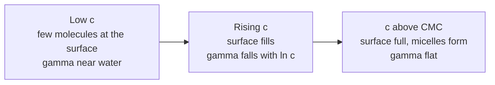

# 23.6 · Surface tension and detergents

A drop of water hangs from a tap until its weight beats the surface holding it up, then falls. Add a little washing-up liquid and the drops get smaller and more numerous, because detergent molecules crowd into the surface and weaken it. This lesson turns that observation into a physical chemistry measurement: surface tension from the weight of drops, the concentration at which the detergent starts forming micelles, and how much area each molecule takes up at the surface. It is also the module practical, so it ends in a full lab report that uses the calibration, fitting and error-analysis habits of the whole module.

## Why it matters

Surfactants are among the most produced chemicals in the world: detergents, shampoos, paints, crop sprays, foods and medicines all rely on them. A formulator needs the critical micelle concentration, because surfactant above it adds cost without lowering surface tension further; it only builds micelles. In the lungs, a natural surfactant lowers the surface tension in the air sacs so they do not collapse when you breathe out, and premature babies who lack it are treated with surfactant replacement. And a drop counter is still how pharmacopoeias define a standard dropper: the size of a drop depends on surface tension.

## Core ideas

> [!NOTE]
> The physics here is stable. The surface tension of water comes from the IAPWS release R1-76(2014): 72.74 mN/m at 20 °C, 71.97 at 25 °C (checked 2026-10-17). Dish soaps are mixtures whose recipes change; your break concentration is a property of your bottle, not a constant. The example data are generated by `make_data.py`, not measured.

### Surface tension

A molecule inside a liquid is pulled equally in all directions by its neighbours. One at the surface has neighbours only on one side, so the surface costs energy. **Surface tension** $\gamma$ is that energy per unit area (J/m²), or equally the force per unit length along any line in the surface (N/m). Values are usually quoted in mN/m. Water's hydrogen bonds give it a high value; IAPWS fits it as

$$\gamma = 235.8\,\tau^{1.256}(1 - 0.625\,\tau)\ \text{mN/m}, \qquad \tau = 1 - T/647.096\ \text{K}$$

At 21 °C that gives 72.58 mN/m. It falls by about 0.15 mN/m per kelvin, so write down the temperature.

### Surfactants and micelles

A **surfactant** (surface-active agent) has a water-loving head (a sulfate or carboxylate group, for example) and a long oily tail. In water the tails are pushed out of the liquid, so the molecules gather at the surface, heads in, tails out. The more surfactant at the surface, the lower $\gamma$. Once the surface is full, adding more surfactant makes the molecules cluster in the bulk into **micelles**, balls with the tails inside. The concentration where this starts is the **critical micelle concentration** (CMC). Above it the surface tension stays almost constant. For pure sodium dodecyl sulfate the CMC is about 8 mM at 25 °C; dish soaps mix several surfactants and have their own, lower, effective value.



### Measuring γ by drop weight

A drop grows on a tip of radius $r$ until its weight exceeds the surface-tension force around the tip. **Tate's law** says $m g \approx 2\pi r \gamma$. Real drops leave a little liquid behind, so a correction factor (Harkins and Brown, 1919) multiplies the right side, and it depends weakly on drop size. If you use the same tip for water and for every solution, $r$ and $g$ cancel:

$$\gamma = \gamma_\text{water}\,\frac{m_\text{drop}}{m_\text{drop, water}}$$

Weighing 20 drops on a 0.01 g scale gives each drop mass to about 0.1 %. The plan.md version, **counting** the drops in a fixed volume, works too: the number of drops is inversely proportional to drop volume, so $\gamma \approx \gamma_\text{water} \times (n_\text{water}/n)\times(\rho/\rho_\text{water})$, and the density ratio is 1 within 0.1 % for these dilute solutions. Counting is quicker, weighing is more precise.

Why each step matters:

- **Same tip, same angle, same rate.** The method is relative; anything that changes between water and solution changes the answer. Let drops form slowly, about one every 2–3 seconds; fast drops are pushed off early and come out too heavy.
- **Water first and last.** A water run at the start and end checks the tip has not changed and gives the reference.
- **Rinse with the next solution.** Surfactant sticks to the tip. Go from the most dilute to the most concentrated, rinsing with each new solution.

### From the curve to molecules: the Gibbs adsorption isotherm

Thermodynamics links how fast $\gamma$ falls to how much surfactant sits at the surface. The **Gibbs adsorption isotherm**, for dilute solutions, is

$$\Gamma = -\frac{1}{nRT}\,\frac{d\gamma}{d\ln c}$$

$\Gamma$ is the **surface excess** in mol/m²: the extra moles of surfactant per square metre of surface. $n$ = 1 for a non-ionic surfactant (or an ionic one in excess salt); $n$ = 2 for a 1:1 ionic surfactant in pure water, because its counter-ions adsorb with it. Concentration units cancel inside $d\ln c$, so you can use mL of detergent per litre even without knowing the molar mass. The area per molecule is $1/(\Gamma N_A)$.

### The module practical in one experiment

This experiment uses every habit of the module: a reference that calibrates the method (like the cup in [23.2](lesson-02.md) and the standards in [23.3](lesson-03.md)), fitted lines ([23.4](lesson-04.md), [23.5](lesson-05.md)), and thermodynamics that turns a slope into a molecular quantity ([23.1](lesson-01.md)).

## Worked example

From the example data at 21.0 °C: 20 water drops weigh 0.993 g on average (49.63 mg per drop); at 1.00 mL/L, 20 drops weigh 0.494 g (24.70 mg per drop).

$$\gamma = 72.58 \times \frac{24.70}{49.63} = 36.1\ \text{mN/m}$$

Repeating for all nine concentrations gives γ falling from 72.6 to about 31.5 mN/m, then flat from 2 mL/L upwards. A two-line fit puts the break at **1.7 mL/L**, γ = 31.9 mN/m.

The slope of γ against ln c just below the break, from the last three points, is −10.8 mN/m. Then, at 294.15 K and $n$ = 1,

$$\Gamma = \frac{10.8\times10^{-3}\ \text{N/m}}{8.314 \times 294.15} = 4.4\ \mu\text{mol/m}^2, \qquad \text{area} = \frac{1}{4.4\times10^{-6}\times6.022\times10^{23}} = 0.38\ \text{nm}^2$$

With $n$ = 2 (an anionic surfactant in pure water), Γ halves and the area doubles to 0.75 nm². The truth for a mixture lies in between, and the report should say so. Either way, each molecule occupies a patch about 0.6–0.9 nm across: the size of a sulfate head group with its water shell.

Uncertainty: the scatter of three trials gives γ to about ±0.1–0.2 mN/m, but that is not the whole story. The Harkins–Brown factor changes by a few per cent as drops shrink from 50 mg to 22 mg, so γ values at high concentration carry a systematic error of 1–3 %, larger than the random one.

## Hands-on

What you need: ordinary washing-up liquid (dish soap; check the label has no bleach or ammonia), tap water that has stood for an hour to reach room temperature, a kitchen scale (0.01 g), a 5 mL or 10 mL oral syringe with a plain tip (a pharmacy dropper bottle also works), ten clean cups and labels, a small dish to catch drops, a kitchen thermometer, safety glasses, the [Module 23 lab folder](../../labs/module-23/), the [lab report template](../../templates/lab-report.md) and the [error analysis template](../../templates/error-analysis.md). Time: about 3 hours including the report. There is no simulation for this lab.

> [!CAUTION]
> Dish soap stings the eyes: wear safety glasses and rinse with water if any gets in. Spilled soap solution makes floors and worktops slippery; work on a tray and wipe up at once. Use only dish soap and water. Do not use a cleaner that contains bleach or ammonia, and do not mix in other cleaning products. The solutions go down the sink afterwards.

### Part A — practise the drop (20 min)

1. Fill the syringe with water. Hold it vertical, tip down, about 2 cm above the dish on the scale. Tare the scale.
2. Press the plunger very slowly so that a drop forms and falls about every 2–3 seconds. Practise until the rate is steady.
3. Count **20 drops** into the dish and read the mass. Repeat three times. The three masses should agree within about 0.01 g. Note the water temperature.
4. Then, for the plan.md drop count: count how many drops 2.0 mL of water makes (read the syringe scale), twice.

How you know it worked: a typical oral syringe gives 40–60 mg per water drop, so 20 drops weigh about 0.8–1.2 g.

### Part B — the dilution series (30 min)

1. **Stock, 10 mL/L.** Weigh 1.00 g of dish soap into a cup (about 1 mL; most dish soaps have a density close to 1.0 g/mL) and add water to a total of 100.0 g. Stir gently to avoid foam. Label it "10".
2. **Dilutions by mass.** Make 5, 2, 1, 0.5, 0.2, 0.1 and 0.05 mL/L, each about 50 g, by mixing a weighed amount of a stronger solution with water. For example, 2 mL/L is 10.0 g of stock plus 40.0 g of water; 0.2 mL/L is 5.0 g of the "2" plus 45.0 g of water. Write down every mass.
3. Let the solutions stand for 10 minutes so the surfactant can reach the surface, and so foam settles.

### Part C — module practical: measure, analyse and report (2 hours)

1. **Measure.** Start with water, then go from the most dilute solution to the most concentrated. Before each solution, rinse the syringe twice with it. Weigh 20 drops three times for each. For water, 1 mL/L and 10 mL/L, also count the drops in 2.0 mL. Finish with a final water run after rinsing the syringe well with water; it should match the first within 2 %.
2. **Record** the data as `my_drops.csv` with columns `c_mL_per_L,trial,n_drops,mass_g` (see `drops_example.csv`; water is `c_mL_per_L` = 0).
3. **Analyse.** Open `lesson06_surface.py` and complete `surface_tension()`, `break_point()` and `surface_excess()`. Run it with your file and your water temperature:

```bash
py lesson06_surface.py
py lesson06_surface.py my_drops.csv 21.0
```

4. **Check your counts.** From the counts in 2.0 mL, compute γ for 1 and 10 mL/L with $\gamma = \gamma_\text{water}\,n_\text{water}/n$ and compare with the weighed values.
5. **Report.** Use the lab report template. Include: aim; method with the tip, rate and dilution masses; a table of drop mass and γ with uncertainties; the plot of γ against ln c with both lines; the break concentration; Γ and the area per molecule for $n$ = 1 and $n$ = 2; and a discussion. Use the error analysis template for the uncertainty budget: random scatter of the trials, the scale, the dilution masses, the temperature, and the Harkins–Brown systematic.

How you know it worked: on the example data the script prints water at 72.58 mN/m, γ falling to 31.5 mN/m, the break at 1.72 mL/L (γ 31.9 mN/m), a slope of −10.8 mN/m per ln unit, Γ = 4.40 µmol/m² and 0.38 nm² per molecule for $n$ = 1 (2.20 µmol/m² and 0.75 nm² for $n$ = 2). With your own dish soap expect water at 71–73 mN/m, a plateau somewhere around 25–35 mN/m, and a break somewhere between about 0.3 and 3 mL/L. The counted γ should agree with the weighed γ within about 5 %.

<details><summary>Reference solution and what a good discussion says</summary>

`surface_tension` returns `g_water * m_drop / m_drop_water`. `break_point` fits `linfit(lnc[:split], g[:split])` and `linfit(lnc[split:], g[split:])` and returns `((a2 - a1) / (b1 - b2), b1, a1, b2, a2)`. `surface_excess` returns `-(slope_mN * 1e-3) / (n_ions * R * (T_C + 273.15))`. Full code: `lesson06_surface_solution.py`.

A good discussion says: the curve below the break is not straight in ln c, so the Gibbs slope belongs just below the break, and a two-line fit places the break a little off (the example data have a true break at 1.5 mL/L); the ionic factor $n$ is unknown for a mixture, so Γ is a range; the Harkins–Brown factor changes by a few per cent as drops shrink. What the kitchen version cannot do: a Du Noüy ring or Wilhelmy plate tensiometer, pure surfactants, or temperature control.

</details>

## Common mistakes

- **Squeezing the drops out fast.** Fast drops are pushed off before they are ready and come out too heavy; the rate must be slow and the same for every solution.
- **Going from concentrated to dilute.** Surfactant left on the tip contaminates the next, weaker solution. Work upwards in concentration and rinse with each new solution.
- **Using the nominal water value.** γ of water changes by 0.15 mN/m per kelvin; use IAPWS at your measured temperature.
- **Fitting the slope over the whole falling curve.** The Gibbs slope belongs just below the CMC, where the surface is nearly full; a slope over the whole curve underestimates Γ.
- **Reporting one area per molecule.** For an ionic surfactant without added salt the factor is 2; for a mixture, give the range.
- **Foam in the cups.** Foam takes surfactant out of the solution and bubbles at the tip change the drop; stir gently and let solutions stand.

## Key takeaways

- Surface tension is energy per area; water has 72.6 mN/m at 21 °C (IAPWS), detergent solutions about 30.
- With the same tip, drop mass is proportional to γ, so water calibrates the method.
- γ falls with ln c until the surface is full; above the critical micelle concentration it stays flat while micelles form.
- The Gibbs isotherm turns the slope dγ/dln c into a surface excess and an area per molecule of a few tenths of a square nanometre.
- A complete lab result has a calibration, a fit, an uncertainty budget and a named systematic error: the habits of this whole module.

## Sources

- [IAPWS R1-76(2014), surface tension of ordinary water substance](https://iapws.org/relguide/Surf-H2O.html) — the formulation used here and in the script.
- [Wikipedia, Critical micelle concentration](https://en.wikipedia.org/wiki/Critical_micelle_concentration) — the surface-tension method for the CMC; SDS about 8 mM in water at 25 °C.
- [LibreTexts, Surface Tension](https://chem.libretexts.org/Bookshelves/Physical_and_Theoretical_Chemistry_Textbook_Maps/Supplemental_Modules_%28Physical_and_Theoretical_Chemistry%29/Physical_Properties_of_Matter/States_of_Matter/Properties_of_Liquids/Surface_Tension) — the molecular origin of surface tension.
- [Harkins and Brown (1919), J. Am. Chem. Soc. 41, 499](https://doi.org/10.1021/ja01461a003) — the drop-weight method and its correction factor.
- [Wikipedia, Gibbs isotherm](https://en.wikipedia.org/wiki/Gibbs_isotherm) — surface excess from the slope of γ against ln c, and the factor for ionic surfactants.
