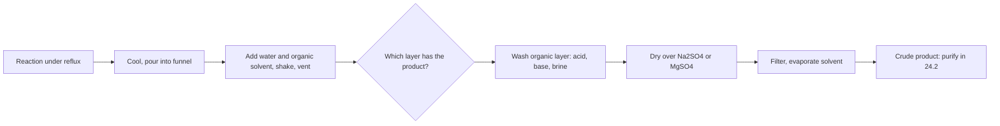

# 24.1 · Lab techniques: reflux, extraction and drying

Almost every organic preparation has the same skeleton: heat the reaction without losing the solvent (reflux), pull the product away from everything else (extraction and washing), and remove the last water (drying). This lesson gives the reason behind each move, so that on the virtual bench you know what each step is for and what it looks like when it goes wrong.

## Why it matters

A student finishes a two-hour reaction, shakes the mixture with water and ether, and throws away the layer that "looks like water". If the product was in that layer, it has gone down the sink. Another shakes the funnel without venting, and the stopper flies off in a spray of ether. A third evaporates a cloudy ether solution and gets a wet oil that will not crystallise. None of these mistakes is about the reaction; they are about technique. A work-up decides the yield as much as the reaction does.

> [!IMPORTANT]
> This lab cannot be done at home. Organic synthesis needs volatile, flammable and corrosive reagents, a fume hood and supervised waste disposal, and in Israel the Hazardous Substances Law 1993 puts lab reagents out of reach of a home learner anyway ([01.4](../module-01/lesson-04.md)). In this module you learn the procedures, the reasons and the safety reasoning on a virtual bench and in videos; the home activities use kitchen materials only. You will not gain bench hands: an employer would still have to train you to assemble glassware, use a separatory funnel and work at a hood.

## Core ideas

> [!NOTE]
> The techniques are stable; they have hardly changed in fifty years. The videos are MIT's Digital Lab Techniques Manual (2007), which MIT 5.301 still lists as its demonstration set; pages checked on 2026-10-17. Hazard data are from PubChem on the same date. Glassware details (joint sizes, stirrer types) differ between labs.

### Reflux: heat without losing the solvent

Most organic reactions are slow at room temperature. From [22.4](../module-22/lesson-04.md), a reaction with $E_a$ = 80 kJ/mol runs nearly 3 times faster for every 10 K near room temperature, so heating from 25 °C to 80 °C speeds it up about 150-fold: a reaction that would take a week takes an hour. The problem is the solvent: an open flask at its boiling point would boil dry and fill the room with vapour.

**Reflux** solves both problems. A vertical **condenser** with cold water flowing through its jacket sits on top of the flask. Vapour rises, condenses on the cold wall and drips back. The reaction stays at the boiling point of the solvent, a fixed and reproducible temperature, for as long as you like. The rules that follow from the reason:

- The system is **open at the top**. Heating a closed system builds pressure until something breaks.
- Water enters the condenser at the **bottom** and leaves at the top, so the jacket stays full.
- Add a stirrer bar or boiling chips **before** heating. A superheated liquid without nucleation sites boils suddenly and violently (**bumping**).
- Heat with a heating mantle, oil bath or aluminium block, never an open flame near flammable solvent. Adjust the heat so the **reflux ring** (where vapour condenses) stays in the lower third of the condenser.

### Extraction: a separatory funnel is an equilibrium machine

After the reaction, the product sits in a mixture of solvent, unreacted reagents, catalyst and by-products. **Liquid–liquid extraction** shakes the mixture with two immiscible liquids, usually water and an organic solvent, and lets each substance share itself between them according to its distribution ratio $D$ (lesson [19.3](../module-19/lesson-03.md)). Salts go to the water; neutral organic molecules go to the organic layer.

**Which layer is which?** The denser liquid is at the bottom. Diethyl ether (0.71 g/mL) and ethyl acetate (0.90 g/mL) float on water; dichloromethane (1.33 g/mL) sinks. A product dissolved in a lot of a dense halide can also sink: 1-bromobutane (1.27 g/mL) is the lower layer in lesson [24.5](lesson-05.md). Never trust colour or memory. Add a few drops of water: the layer they join is the aqueous one. Keep every layer until the product is in your hands.

**Venting.** Ether boils at 35 °C, and your hand warms it, so its vapour pressure builds up inside the stoppered funnel. A bicarbonate wash also releases carbon dioxide. Invert the funnel, point the tip away from people and into the hood, and open the tap after the first gentle shake and after every few shakes.

**Emulsions.** Shaking too hard, especially with basic or soapy mixtures, can leave a cloudy middle layer. Wait, swirl gently, or add saturated salt solution (**brine**), which makes the water more polar and denser and pushes organic molecules out of it.

### Acid–base extraction: switch a molecule between layers

The pH of the water layer decides where an acid goes. For a weak acid HA with partition coefficient $K_D$, only the neutral form dissolves in the organic layer, so

$$D = \frac{K_D\,[\mathrm{H_3O^+}]}{[\mathrm{H_3O^+}] + K_a}$$

(lesson [19.3](../module-19/lesson-03.md), with the pKa ideas of [08.4](../module-08/lesson-04.md)). Benzoic acid has $\mathrm{p}K_a$ = 4.20 and $\log K_{ow}$ = 1.87, so $K_D \approx 74$ (PubChem; the octanol–water value stands in for ether–water). At pH 3, $D \approx 70$ and it stays in the ether. In aqueous sodium hydrogen carbonate at pH 8.3, $D \approx 0.006$: it becomes the benzoate ion and moves into the water. Acidify that water to pH 1 and it comes back out. This is how a lab separates an acid from a neutral compound with nothing but a funnel and two bottles.

The other rule from lesson 19.3 still holds: several small portions beat one large one.

### Drying: the last water

Water dissolves slightly in organic solvents (ether takes up about 1 % by mass). Evaporating a wet solution leaves a wet product. Two steps remove it:

1. **Brine wash.** Saturated salt water pulls most dissolved water out of the organic layer.
2. **Drying agent.** An anhydrous salt that binds water as a hydrate. Anhydrous **magnesium sulfate** is fast and has a high capacity but is a fine powder that must be filtered off. Anhydrous **sodium sulfate** is slower and gentler, and its granules can be decanted. **Calcium chloride** is used for halides such as 1-bromobutane but binds alcohols and amines, so it is not general.

How you know it is dry: the first spatula of drying agent clumps. Keep adding small portions until new crystals stay free-flowing and swirl like a snow globe, and the solution is clear, not cloudy. Then filter or decant and remove the solvent, usually on a **rotary evaporator** (reduced pressure, warm bath, spinning flask).



### The safety reasoning

Every rule above has a hazard behind it. Ether is extremely flammable (GHS H224) and its heavy vapour creeps along a bench to a hot plate: no flames, work in the hood. Pressure in a closed funnel or heated flask is a mechanical hazard: vent, keep reflux open. Concentrated acids and bases cause burns (H314). Read the safety data sheet of every reagent before you plan, as in [01.4](../module-01/lesson-04.md).

## Worked example

### Separate benzoic acid from a neutral ketone

A reaction leaves 1.0 g of benzoic acid and 1.0 g of benzophenone (a neutral ketone) dissolved in 50 mL of diethyl ether. You want each one pure.

1. **Which layer is the ether?** Ether (0.71 g/mL) is less dense than water, so it is the top layer whatever you add. Check with a drop of water anyway.
2. **Wash with water first?** At pH 3, $D = 74 \times 10^{-3}/(10^{-3} + 10^{-4.20}) \approx 70$. Three 15 mL water washes keep $\left(\frac{70 \times 50}{70 \times 50 + 15}\right)^3 = 98.7\,\%$ of the acid in the ether. Water does nothing useful here.
3. **Wash with aqueous NaHCO₃ (pH 8.3).** Now $D \approx 0.006$. One 15 mL wash keeps $\frac{0.006 \times 50}{0.006 \times 50 + 15} = 2\,\%$ in the ether; three washes keep about $10^{-5}$, effectively nothing. Benzoic acid is now sodium benzoate in 45 mL of water. CO₂ forms: vent often. Benzophenone stays in the ether: wash it with brine, dry it over Na₂SO₄ and evaporate.
4. **Recover the acid.** Acidify the combined basic washes to pH 1 with hydrochloric acid (benzoic acid precipitates as a white solid and can be filtered off), or extract with two 20 mL portions of ether. At pH 1, $D \approx 74$ and two extractions recover $1 - \left(\frac{45}{74 \times 20 + 45}\right)^2 = 99.9\,\%$.

Interpretation: the pH switch changes $D$ by a factor of about $10^4$. The base must put the pH at least two units above the pKa and be no stronger than needed: NaOH also works but can hydrolyse esters, so mild NaHCO₃ is the usual choice.

## Hands-on

What you need: a computer for the simulation, videos and Python (the [Module 24 lab folder](../../labs/module-24/)); for Part D a clean glass jar with a screw lid, vegetable oil, water, liquid food colouring, ground turmeric, a teaspoon, safety glasses. Record everything on a [notebook page](../../templates/notebook-page.md). Time: about 90 minutes.

### Part A — virtual bench: reflux and work-up (30 min)

[Simulation: Organic bench — techniques (reflux, extraction, drying)](../../simulations/organic-bench/index.html?preset=techniques)

1. Assemble a reflux: flask, stirrer bar, condenser water in at the bottom, heat. Run it once with no stirrer bar and once with the heat too high, and note what happens.
2. Pour the cooled mixture into the funnel with ether and water. Identify the layers by density and by the drop test. Shake once without venting and record the warning.
3. Run the worked example: water wash, three bicarbonate washes, brine, drying agent until the crystals flow freely.

How you know it worked: the sim reports the benzophenone recovery above 95 % and "dry" for the organic layer. If it reports an emulsion, add brine and wait; if it reports a wet product, you stopped adding drying agent while the crystals still clumped.

### Part B — videos with a checklist (25 min)

Watch MIT's [Video 17: Refluxing a Reaction](https://ocw.mit.edu/courses/res-5-0001-digital-lab-techniques-manual-spring-2007/resources/refluxing-a-reaction/), [Video 5: Reaction Work-Up I](https://ocw.mit.edu/courses/res-5-0001-digital-lab-techniques-manual-spring-2007/resources/reaction-work-up-i/) (extraction, washing, drying) and [Video 6: Reaction Work-Up II](https://ocw.mit.edu/courses/res-5-0001-digital-lab-techniques-manual-spring-2007/resources/reaction-work-up-ii/) (rotary evaporator). For each, write in your notebook one step you did not expect, its reason, and the hazard it controls.

### Part C — Python: plan the extraction (15 min)

Open `lesson01_extraction.py`, complete `fraction_left()`, `distribution_ratio()` and `fraction_into_organic_from_organic()`, then run:

```bash
py lesson01_extraction.py
```

How you know it worked: the script prints 45.5 % and 36.4 % for one 30 mL versus three 10 mL extractions, 98.7 % of benzoic acid kept in ether after three water washes, essentially 0 % after three bicarbonate washes, and 99.91 % recovered after acidifying. The plot `runs/lesson01_extraction.png` shows $D$ falling by a factor of ten per pH unit above each acid's pKa.

<details><summary>Reference solution</summary>

```python
def fraction_left(D, V_aq, V_org, n=1):
    q1 = V_aq / (D * V_org + V_aq)
    return q1 ** n

def distribution_ratio(K_D, pH, pKa):
    h, Ka = 10.0 ** (-pH), 10.0 ** (-pKa)
    return K_D * h / (h + Ka)

def fraction_into_organic_from_organic(D, V_org, V_aq, n=1):
    keep1 = D * V_org / (D * V_org + V_aq)
    return keep1 ** n
```

Full code: `lesson01_extraction_solution.py`. Salicylic acid (pKa 2.97) and aspirin (pKa 3.49) switch layers at lower pH than benzoic acid; all three go into bicarbonate, which matters for the aspirin work-up in lesson 24.4.

</details>

### Part D — kitchen: two colours, two layers (20 min)

> [!CAUTION]
> Kitchen materials only. Wear safety glasses, work at the sink, and do not drink or taste anything. Turmeric stains skin, clothes and plastic. Pour the oil into the bin (soak it up with paper), not down the drain. This trains the idea of partition; it is not a model of a real extraction, which uses volatile flammable solvents and must never be done at home.

1. Put 100 mL of water and 3 drops of blue food colouring in the jar. Add 50 mL of vegetable oil and a quarter teaspoon of turmeric.
2. Close the lid, shake for 20 seconds, and let it stand. Time how long until the layers are sharp.
3. Note which layer is on top, which colour went where, and where the undissolved powder ends up.
4. Add one drop of washing-up liquid, shake again and time the separation.

How you know it worked: the oil floats and turns yellow, because curcumin (the colour of turmeric) is non-polar; the water stays blue, because food dyes are salts with charged groups. With washing-up liquid the layers separate much more slowly, often with a cloudy middle band: an emulsion stabilised by the detergent.

## Common mistakes

- **Throwing away a layer, or assuming the organic one is on top.** Keep all layers, labelled, until you have the product; use densities and the drop test.
- **Shaking without venting.** Vent after the first gentle inversion and often, especially with bicarbonate.
- **Heating a closed system or forgetting boiling chips.** Reflux is always open at the top; add stirrer or chips before heating, never into a hot liquid.
- **Stopping the drying agent too early.** Add until new crystals stay free-flowing and the solution is clear.
- **Using a stronger base than needed.** NaOH can destroy esters (such as aspirin) that bicarbonate leaves alone.

## Key takeaways

- Reflux holds a reaction at the solvent's boiling point for hours without losing solvent; keep it open, stirred and gently heated.
- In a separatory funnel the denser liquid is at the bottom; identify layers by density and the drop test, vent often, keep every layer.
- The pH of the water decides where an acid goes: $D$ falls about tenfold per pH unit above the pKa, so bicarbonate pulls carboxylic acids out of ether.
- Brine and an anhydrous salt dry the organic layer; free-flowing crystals and a clear solution mean dry.
- None of this can be done at home; the virtual bench and the MIT videos teach the procedure and the reasons, not the hands.

## Sources

- [MIT OCW RES.5-0001 Digital Lab Techniques Manual, videos](https://ocw.mit.edu/courses/res-5-0001-digital-lab-techniques-manual-spring-2007/pages/videos/) — videos 5, 6 and 17 (work-up, rotary evaporator, reflux); licence CC BY-NC-SA 4.0.
- [MIT OCW 5.301 Chemistry Laboratory Techniques, study materials](https://ocw.mit.edu/courses/5-301-chemistry-laboratory-techniques-january-iap-2012/pages/study-materials/) — the list of technique videos MIT's lab-techniques course uses.
- [LibreTexts, Nichols, Organic Chemistry Lab Techniques, ch. 4 Extraction](https://chem.libretexts.org/Bookshelves/Organic_Chemistry/Organic_Chemistry_Lab_Techniques_(Nichols)/04%3A_Extraction) — separatory funnel practice, emulsions, drying agents.
- [LibreTexts, Nichols, ch. 1 General Techniques](https://chem.libretexts.org/Bookshelves/Organic_Chemistry/Organic_Chemistry_Lab_Techniques_(Nichols)/01%3A_General_Techniques) — glassware, heating and reflux.
- [PubChem, Benzoic acid (CID 243)](https://pubchem.ncbi.nlm.nih.gov/compound/243) — pKa 4.20, log Kow 1.87.
- [PubChem, Diethyl ether (CID 3283)](https://pubchem.ncbi.nlm.nih.gov/compound/3283) — GHS H224 (extremely flammable), H336.
