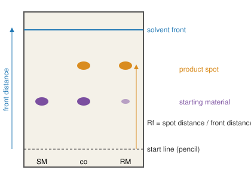

# 24.3 · Checking purity: TLC and melting point

How do you know the reaction has finished, and how do you know the white powder in your filter is what you think it is? In a teaching lab the two everyday answers are thin-layer chromatography (TLC), which takes five minutes and a few micrograms, and the melting point, which takes ten. Neither proves a structure, which is the job of spectra ([17.5](../module-17/lesson-05.md)), but together they catch most failures before you waste an NMR slot. This lesson explains both from the chromatography theory of [19.3](../module-19/lesson-03.md) and the solution thermodynamics of Module 13, and ends with a paper chromatogram you make in your kitchen.

## Why it matters

You have refluxed a reaction for an hour. Is it done? If you work it up too early, unreacted starting material contaminates the product and has to be removed by a recrystallisation that costs a quarter of your yield. If you wait too long, side products form. A TLC plate answers the question in five minutes: is the starting-material spot gone? Later, your product melts at 128–133 °C. Is it impure, wet, or a different compound? The melting point and one mixed melting point tell you which.

## Core ideas

> [!NOTE]
> The ideas are stable. Rf values depend on the plate, the eluent, the temperature and the chamber, so compare samples on the same plate rather than with printed values. The benzoic acid fusion data are from the NIST WebBook (checked 2026-10-17).

### TLC: chromatography on a glass slide

A TLC plate is a thin layer of silica gel (the **stationary phase**, very polar, covered in Si–OH groups) on glass, plastic or aluminium. You spot a dilute solution of each sample on a pencil **start line**, stand the plate in a closed jar with a shallow pool of **eluent** (the **mobile phase**) below the line, and let the solvent climb by capillary action. Each compound shares its time between sticking to the silica and moving with the solvent, exactly the partition idea of [19.3](../module-19/lesson-03.md). When the solvent is about 1 cm from the top, mark the **solvent front** and measure:

$$R_f = \frac{\text{distance moved by the spot centre}}{\text{distance moved by the solvent front}}$$



Rules that follow from the silica being polar:

- **More polar compounds stick more and have lower Rf.** An alcohol or acid (O–H donor) runs lower than a ketone or ester; a hydrocarbon runs near the front.
- **A more polar eluent moves everything up.** Pure hexane leaves polar compounds on the line; ethyl acetate–hexane mixtures are the usual starting point; adjust until the spots of interest sit at Rf 0.2–0.6.
- **Visualise.** Many plates contain a fluorescent dye: under a UV lamp (254 nm) aromatic compounds show as dark spots. Iodine vapour or a stain shows others. Circle spots in pencil at once.

The **co-spot** lane is the one that makes TLC reliable. Spot the starting material (SM), the reaction mixture (RM), and both on top of each other (co). If the RM shows a spot at the SM height and the co lane shows one spot there, starting material is still present. If the co lane shows two spots where you expected one, the two samples are different compounds, even if their Rf values look similar on separate plates.

Watch MIT's [Video 3: TLC - The Basics](https://ocw.mit.edu/courses/res-5-0001-digital-lab-techniques-manual-spring-2007/resources/tlc-the-basics/) and, for spotters and stains, [Video 4: TLC - Advanced](https://ocw.mit.edu/courses/res-5-0001-digital-lab-techniques-manual-spring-2007/resources/tlc-advanced/).

Paper chromatography works the same way. The stationary phase is the water held on the cellulose fibres of the paper, and with a water-based eluent the ionic food dyes separate by how strongly they stick to the fibres. It is TLC at kitchen level, which is why you can do it at home.

### Melting point: a pure solid melts sharply

A pure crystalline solid melts over a narrow range, typically 1–2 °C. An impurity that dissolves in the liquid but not in the crystal lowers the melting point and broadens the range. The reason is the same as freezing-point depression ([13.6](../module-13/lesson-06.md)): the impurity lowers the chemical potential of the liquid, so the solid is in equilibrium with it at a lower temperature. For an ideal solution the last crystal disappears at temperature $T$ where

$$\ln x_\text{main} = -\frac{\Delta_\text{fus}H}{R}\left(\frac{1}{T} - \frac{1}{T_m}\right), \qquad \Delta T \approx \frac{R T_m^2}{\Delta_\text{fus}H}\, x_\text{impurity}$$

For benzoic acid ($T_m$ = 395.5 K, $\Delta_\text{fus}H$ = 18.0 kJ/mol, NIST): 1 mol% impurity lowers the end of melting by 0.7 K, 5 mol% by 3.7 K, 10 mol% by 7.5 K. Melting begins even lower, at the eutectic temperature, which is why impure samples soften early and melt over a wide range.

Three practical rules:

- **Pack 2–3 mm** of dry, finely ground solid in a capillary. Wet samples melt low because water is an impurity.
- **Heat quickly** to about 15 °C below the expected value, then at **1–2 °C per minute**. Faster heating makes the thermometer lag and the reading too high.
- **Mixed melting point.** Grind your product with an authentic sample. If they are the same compound, the mixture melts sharply at the same temperature; if not, each acts as an impurity in the other and the mixture melts low and broad.

Some compounds decompose as they melt (aspirin's 135 °C is measured with rapid heating, PubChem). Report the range, for example "134–136 °C", never a single number. Watch MIT's [Video 12: Melting Point Determination](https://ocw.mit.edu/courses/res-5-0001-digital-lab-techniques-manual-spring-2007/resources/melting-point-determination/).

## Worked example

### 1. Has the oxidation of benzoin to benzil finished?

In lesson [24.6](lesson-06.md) you oxidise benzoin (an α-hydroxy ketone, with an O–H) to benzil (a diketone, no O–H). On silica with 20 % ethyl acetate in hexane, the front moves 62 mm. After 30 minutes the RM lane shows spots at 21 mm and 40 mm; the SM (benzoin) lane shows one spot at 21 mm; the co lane shows two spots, at 21 and 40 mm.

- Rf(benzoin) = 21/62 = 0.34; Rf(new spot) = 40/62 = 0.65.
- The new spot is less polar: no O–H to hold it on the silica. That fits benzil.
- Starting material is still present. Keep heating and spot again in 15 minutes. Work up only when the RM lane shows no spot at 0.34.

### 2. What does a 4 °C low melting point mean?

Your benzoic acid melts at 117–119 °C; the literature value is 122.4 °C. The ideal formula gives 5 mol% impurity for a 3.7 K depression, so a few per cent of impurity (or water) is enough. Dry the sample to constant mass and measure again. If it is still low and broad, recrystallise. If a mixed melting point with authentic benzoic acid is also low, your compound may not be benzoic acid at all.

## Hands-on

What you need: the simulation, the [Module 24 lab folder](../../labs/module-24/), and for Part D white coffee filters (or kitchen paper), liquid food colourings (at least one green or brown), several water-based felt-tip markers including black, one permanent marker, a pencil, a ruler, a tall glass, table salt, a teaspoon, toothpicks, a clothes peg or tape. Write Part D on the [lab report template](../../templates/lab-report.md). Time: about 100 minutes.

### Part A — virtual bench: TLC and melting point (25 min)

[Simulation: Organic bench — techniques (TLC and melting point)](../../simulations/organic-bench/index.html?preset=techniques)

1. Run a TLC of the benzoin oxidation at three times. Try 100 % hexane, 20 % and 50 % ethyl acetate in hexane, and choose the eluent that puts both spots between Rf 0.2 and 0.7.
2. Measure the melting point of a pure and a 5 % impure benzoic acid sample, each at 2 °C/min and at 10 °C/min. Then do a mixed melting point.

How you know it worked: 20 % ethyl acetate separates the two spots well; hexane leaves both near the line; 50 % pushes both near the front. The pure sample melts within 1 °C of 122 °C at 2 °C/min and reads several degrees high at 10 °C/min; the impure one starts lower and melts over several degrees.

### Part B — videos (15 min)

Watch [Video 3: TLC - The Basics](https://ocw.mit.edu/courses/res-5-0001-digital-lab-techniques-manual-spring-2007/resources/tlc-the-basics/) and [Video 12: Melting Point Determination](https://ocw.mit.edu/courses/res-5-0001-digital-lab-techniques-manual-spring-2007/resources/melting-point-determination/). Note how the spots are kept small and how the heating rate is set.

### Part C — Python: Rf and melting-point depression (15 min)

Complete `rf()`, `ideal_melting_point()` and `depression_estimate()` in `lesson03_purity.py` and run it. It uses your `chromatogram.csv` from Part D if it exists, otherwise the example rows in `chromatogram_template.csv`.

```bash
py lesson03_purity.py
```

How you know it worked: depressions of 0.7, 1.5, 3.7 and 7.5 K for 1, 2, 5 and 10 mol%, with the small-x estimate within 0.3 K. The example chromatogram gives Rf 0.15, 0.47 and 0.88 for the three black-marker spots.

<details><summary>Reference solution</summary>

```python
def rf(spot_mm, front_mm):
    return spot_mm / front_mm

def ideal_melting_point(x_main, Tm=BENZOIC_TFUS_K, dH=BENZOIC_DFUS_H):
    return 1.0 / (1.0 / Tm - R * math.log(x_main) / dH)

def depression_estimate(x_impurity, Tm=BENZOIC_TFUS_K, dH=BENZOIC_DFUS_H):
    return R * Tm ** 2 * x_impurity / dH
```

Full code: `lesson03_purity_solution.py`.

</details>

### Part D — home: paper chromatography of food colourings and markers (45 min)

> [!CAUTION]
> Kitchen materials only: water, table salt, food colourings and water-based markers. Do not use nail-polish remover, rubbing alcohol or other solvents; they are flammable and not needed. Wear safety glasses, do not taste anything, and protect the table, because the dyes stain.

1. Make the eluent: a quarter of a teaspoon of salt (about 1 g) in a glass of water (250 mL), about 0.4 % salt. Pour 1 cm into the tall glass.
2. Cut strips 2–3 cm wide and a little taller than the glass. Draw a pencil line 2 cm from the bottom (pencil graphite does not dissolve; ink would run).
3. With a toothpick, put a small dot of each food colouring on the line of its own strip, about 2 mm across; let it dry and add a second dot on top. Put a dot of each marker on other strips, including the permanent one.
4. Hang each strip from a peg or tape so that the bottom dips in the eluent but the line stays above the liquid. Do not move the glass.
5. When the water is about 1 cm from the top (10–20 minutes), take the strip out and mark the front in pencil at once. Let it dry.
6. Measure the front and the centre of each spot from the start line. Copy `chromatogram_template.csv` to `chromatogram.csv`, enter your values and run the Python script. Repeat one colour on three strips to estimate the spread of its Rf.

How you know it worked: green and brown colourings and black markers split into two or more coloured spots (often blue and yellow, or blue, red and yellow); single-colour dyes stay as one spot. The permanent marker barely moves, because its dyes are not water-soluble: water is the wrong eluent for them, just as hexane is for a polar compound on silica. Repeat strips of the same colour typically agree within about ±0.03 in Rf; different brands of "the same" colour may not, because they use different dyes.

## Common mistakes

- **Drawing the start line in pen, or putting it below the solvent surface.** Ink runs, and spots dissolve into the pool instead of climbing.
- **Spots too big or too concentrated.** They streak and overlap. Spot small, let dry, repeat.
- **Comparing Rf values from different plates or eluents.** Use a co-spot on the same plate.
- **Forgetting to mark the solvent front.** It evaporates within a minute; mark it as soon as the plate comes out.
- **Heating the melting point too fast or measuring a wet sample.** Both give wrong values; dry the sample and slow to 1–2 °C/min near the melt.
- **Reporting one temperature.** Report the range; a wide range is information.

## Key takeaways

- $R_f$ is spot distance over front distance; on polar silica, polar compounds run lower and a more polar eluent moves everything up.
- A co-spot lane on the same plate tells you whether starting material remains and whether two samples are the same.
- Impurities lower and broaden the melting range; for benzoic acid, 5 mol% lowers it by about 4 K.
- A mixed melting point distinguishes "impure" from "a different compound".
- Paper chromatography of food colourings is TLC at kitchen level: the same partition, the same Rf, the same need to compare on one strip.

## Sources

- [MIT OCW RES.5-0001, Video 3: TLC - The Basics](https://ocw.mit.edu/courses/res-5-0001-digital-lab-techniques-manual-spring-2007/resources/tlc-the-basics/) — chamber, spotting, Rf; [Video 4: TLC - Advanced](https://ocw.mit.edu/courses/res-5-0001-digital-lab-techniques-manual-spring-2007/resources/tlc-advanced/) for spotters and stains.
- [MIT OCW RES.5-0001, Video 12: Melting Point Determination](https://ocw.mit.edu/courses/res-5-0001-digital-lab-techniques-manual-spring-2007/resources/melting-point-determination/) — purity and identity from the melting point.
- [LibreTexts, Nichols, ch. 2 Chromatography](https://chem.libretexts.org/Bookshelves/Organic_Chemistry/Organic_Chemistry_Lab_Techniques_(Nichols)/02%3A_Chromatography) — TLC practice, eluent choice, visualisation.
- [LibreTexts, Nichols, ch. 6 Miscellaneous Techniques](https://chem.libretexts.org/Bookshelves/Organic_Chemistry/Organic_Chemistry_Lab_Techniques_(Nichols)/06%3A_Miscellaneous_Techniques) — melting point range, heating rate, mixed melting point.
- [NIST WebBook, Benzoic acid phase change data](https://webbook.nist.gov/cgi/cbook.cgi?ID=C65850&Mask=4) — Tfus 395.2 ± 0.7 K (average), ΔfusH 18.006 kJ/mol at 395.52 K (Ginnings and Furukawa 1953).
- [RSC Education, Chromatography challenge](https://edu.rsc.org/download?ac=532687) — classroom paper chromatography of food colourings, liquid versus gel colourings.
