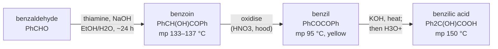

# 24.6 · Multi-step synthesis with spectra at every step

Real targets take several steps, and every step adds its own losses and its own impurities. This last lesson of the module is its practical piece: a classic three-step teaching sequence, benzaldehyde to benzoin to benzil to benzilic acid, run on the virtual bench with a yield, a melting point, an IR spectrum and a ¹H NMR spectrum at every stage. It joins the planning of [16.7](../module-16/lesson-07.md), the spectroscopy of Module 17 and every technique of this module, and it trains the habit that separates a chemist from a recipe follower: never carry an intermediate forward until you have proved what it is.

## Why it matters

Three steps at 80 % each give only 51 % overall; at 60 % each, 22 %. A target that needs 1 g at the end may need several grams at the start. Worse, impurities travel. Benzoin left in your benzil does not simply sit there: in the hot base of step 3 it reacts differently, and the product of the last step is contaminated with things that are hard to identify. The Technion's second organic lab (01240912) is built around exactly this: a sequence with IR, UV and NMR checks at each step. In this module the virtual bench plays that role.

## Core ideas

> [!NOTE]
> The chemistry is classic and stable. Melting points are from PubChem and the NIST WebBook; band positions and shifts are typical literature values (OpenStax), checked 2026-10-17. The observation file in the lab folder is illustrative, written for this exercise; real spectra are in the NIST WebBook and SDBS. Like the rest of the module, this sequence cannot be done at home: step 2 classically uses concentrated nitric acid, which releases toxic nitrogen dioxide and needs a fume hood.

### The sequence



**Step 1, benzoin condensation.** Two benzaldehyde molecules join to form a C–C bond. Normally the aldehyde carbon is an electrophile. Thiamine (vitamin B₁), deprotonated by base, adds to one aldehyde and turns its carbon into a nucleophile, which then attacks a second aldehyde. This reversal of polarity is called **umpolung**; living cells use the same thiamine trick. The reaction runs at room temperature for about a day. Benzaldehyde oxidises in air to benzoic acid, so use fresh material.

**Step 2, oxidation.** The secondary alcohol of benzoin becomes a ketone, giving the 1,2-diketone benzil ([16.1](../module-16/lesson-01.md)). The classic teaching method heats benzoin with concentrated nitric acid in a fume hood; copper(II)-catalysed methods are a greener alternative. Benzil is bright yellow, because the two conjugated carbonyls absorb blue light.

**Step 3, benzilic acid rearrangement.** Hydroxide adds to one carbonyl; a phenyl group then moves with its electron pair to the neighbouring carbonyl carbon (a 1,2-shift), giving the salt of an α-hydroxy acid. Acidifying precipitates benzilic acid. It is one of the oldest known rearrangements, and the only step of the three in which the carbon skeleton changes.

### What each spectrum must show

| Compound | IR (cm⁻¹) | ¹H NMR (ppm) | mp |
|---|---|---|---|
| benzaldehyde | C=O near 1700; aldehyde C–H near 2720 and 2820 | CHO singlet near 10.0 | liquid |
| benzoin | O–H near 3400; C=O near 1680 (aryl ketone) | CH(OH) near 5.9 (1H); OH near 4.5; 10 aromatic H | 133–137 °C |
| benzil | no O–H; C=O near 1660–1680 | aromatic only (10 H, three groups 7.5–8.0) | 95 °C |
| benzilic acid | broad acid O–H 2500–3300 plus alcohol O–H; C=O near 1715 | aromatic only (10 H); broad OH and COOH | 150 °C |

Each step has one decisive change. Step 1: the CHO signal at 10 ppm disappears and a CH(OH) signal near 5.9 ppm appears. Step 2: the O–H band and the 5.9 ppm signal disappear. Step 3: the C=O band moves up to an acid C=O and the broad acid O–H appears. These are the IR and NMR rules of [17.2](../module-17/lesson-02.md) and [17.3](../module-17/lesson-03.md) applied to a real decision.

### Quantifying an impurity from NMR integrals

NMR integrals count protons, so they count molecules. In a benzil sample contaminated with benzoin, both compounds have 10 aromatic protons, but only benzoin has the CH(OH) proton at 5.9 ppm. If you scale the aromatic integral to 10.0 and the 5.9 ppm peak integrates to 0.20, then 0.20 of the molecules are benzoin: 20 mol%. A melting point would tell you "impure"; the NMR tells you "how impure, and with what".

### Yields in a sequence

The overall yield is the product of the step yields, $Y = y_1 y_2 y_3$. To get mass $m$ of the final product you need, working backwards,

$$m_\text{start} = \frac{m}{Y}\cdot\frac{M_\text{start}\,\nu}{M_\text{final}}$$

where $\nu$ is the number of starting molecules per product molecule (2 for the benzoin condensation). Plan for your real yields, not 100 %.

### The rule: check before you carry forward

After every step: TLC with a co-spot of the starting material, a melting point and at least one spectrum. If the intermediate fails, purify it (recrystallise) or repeat the step. Only then use it. In a synthesis notebook, the check is part of the step, not an extra.

## Worked example

### Four samples, three steps, one decision

The bench gives these results (from `multistep_observations.csv`):

| Sample | Step | Used → got | mp | Key IR | Key NMR |
|---|---|---|---|---|---|
| S1 | 1 | 10.46 g benzaldehyde → 6.10 g | 134–136 °C | 3415, 1679 | 5.95 (1H), no 10.0 |
| S2a | 2 | 4.00 g S1 → 3.62 g | 82–91 °C | 3410, 1675 | 5.95 (0.2H) |
| S2b | 2 | 4.00 g S1 → 3.31 g (recrystallised) | 94–95 °C | 1677, 1660, no O–H | aromatic only |
| S3 | 3 | 2.00 g S2b → 1.62 g | 149–151 °C | 3405, 3300–2500 broad, 1718 | aromatic, broad OH |

1. **S1 is benzoin.** The aldehyde proton is gone, the CH(OH) at 5.95 ppm and the O–H at 3415 cm⁻¹ are present, and the melting point is sharp and in the literature range. Yield: 10.46 g of benzaldehyde is 98.6 mmol, which can give at most 49.3 mmol, 10.46 g, of benzoin (two in, one out, and the masses happen to match). $6.10/10.46 = 58.3\,\%$.
2. **S2a fails.** It melts 4–13 °C low over a 9 °C range and still shows the O–H band. The 5.95 ppm signal integrates to 0.20 H against 10 aromatic H: 20 mol% benzoin, an incomplete oxidation. Its "yield" of 91 % is meaningless. Do not use it. Recrystallise it or repeat the oxidation for longer.
3. **S2b is benzil.** No O–H, no 5.9 ppm signal, sharp melting point at 95 °C. Theoretical: $4.00 \times 210.23/212.24 = 3.96$ g; yield $3.31/3.96 = 83.5\,\%$.
4. **S3 is benzilic acid.** Broad acid O–H, C=O moved up to 1718 cm⁻¹, melting point 149–151 °C. Theoretical: $2.00 \times 228.25/210.23 = 2.17$ g; yield 74.6 %.
5. **Overall:** $0.583 \times 0.835 \times 0.746 = 36.3\,\%$. For 1.00 g of benzilic acid (4.38 mmol) you must start from enough benzaldehyde for $4.38/0.363 = 12.1$ mmol of benzoin at 100 %, that is 24.1 mmol or about 2.6 g.

## Hands-on

This is the module practical. What you need: the simulation, the [Module 24 lab folder](../../labs/module-24/), the NIST WebBook and SDBS, the [spectrum assignment template](../../templates/spectrum-assignment.md) and the [lab report template](../../templates/lab-report.md). Time: about 2.5 hours.

### Part A — virtual bench: run the sequence (75 min)

[Simulation: Organic bench — multi-step synthesis with spectra at every step](../../simulations/organic-bench/index.html?preset=multistep)

1. **Plan.** Set a target of 1.00 g of benzilic acid. Estimate the benzaldehyde you need with 70 % per step, and write the amounts, conditions and hazards of each step in your notebook before you start.
2. **Step 1.** Run the benzoin condensation. Take a TLC (co-spot with benzaldehyde), the melting point, and the IR and ¹H NMR the sim provides. Decide: pass or fail.
3. **Step 2.** Oxidise. Stop the first run early on purpose (the sim lets you choose the time), take the TLC, melting point and spectra, and quantify the remaining benzoin from the NMR integrals. Then fix it: recrystallise or rerun, and check again.
4. **Step 3.** Rearrange with KOH, acidify and isolate. Check as before.
5. Record every mass, so you can compute step and overall yields.

How you know it worked: each passing intermediate matches the table in Core ideas within a few cm⁻¹ and 1–2 °C, and the sim's TLC shows one spot with no starting material. Overall yields of 30–45 % are typical; if you carried an impure benzil into step 3, the sim shows a low, broad melting point for the final product and extra peaks in its spectrum.

### Part B — Python: check every step (25 min)

Complete `step_yield()`, `overall()` and `assign()` in `lesson06_practical.py`. Run it first with the example file, then replace the rows of `multistep_observations.csv` with your own results from Part A and run it again.

```bash
py lesson06_practical.py
```

How you know it worked: with the example file, S1 passes as benzoin (58.3 %), S2a fails as "benzil containing about 20 mol% benzoin", S2b passes (83.5 %), S3 passes as benzilic acid (74.6 %), the overall yield is 36.3 % and 2.6 g of benzaldehyde are needed per gram of benzilic acid.

<details><summary>Reference solution</summary>

```python
def step_yield(mass_g, start_g, step):
    start, prod, ratio = STEPS[step]
    theo = start_g / molar_mass(start) / ratio * molar_mass(prod)
    return 100 * mass_g / theo

def assign(ir, nmr):
    oh = any(lo <= 3600 and hi >= 3200 and not broad for lo, hi, broad in ir)
    acid = any(broad and lo <= 2600 and hi >= 3200 for lo, hi, broad in ir)
    co = max([hi for lo, hi, _ in ir if 1650 <= hi <= 1760] or [0])
    ch = sum(n for s, n, _ in nmr if 5.5 <= s <= 6.2)
    if any(9.8 <= s <= 10.2 for s, _, _ in nmr):
        return "benzaldehyde"
    if acid and co >= 1700:
        return "benzilic acid"
    if oh and ch >= 0.5:
        return "benzoin"
    if co and (oh or ch > 0):
        return f"benzil containing about {100 * ch:.0f} mol% benzoin"
    return "benzil" if co else "unknown"
```

`overall()` multiplies the step fractions. Full code: `lesson06_practical_solution.py`. The rules are deliberately simple; they work because each step changes one clear feature. A real unknown needs the full method of [17.5](../module-17/lesson-05.md).

</details>

### Part C — real spectra (30 min)

1. Open the IR spectra of [benzaldehyde](https://webbook.nist.gov/cgi/cbook.cgi?ID=C100527&Mask=80), [benzoin](https://webbook.nist.gov/cgi/cbook.cgi?ID=C119539&Mask=80) and [benzil](https://webbook.nist.gov/cgi/cbook.cgi?ID=C134816&Mask=80) in the NIST WebBook. Note each spectrum's state (the benzoin spectrum is a solid mull).
2. In [SDBS](https://sdbs.db.aist.go.jp/), search by compound name for benzoin, benzil and benzilic acid (NIST has no IR spectrum for benzilic acid). Open the ¹H NMR and IR of each.
3. Fill in one spectrum assignment template per compound: the decisive band and signal, and the one that rules out the previous compound in the sequence.

How you know it worked: you can point, in real spectra, to the aldehyde C–H and 10 ppm signal (benzaldehyde), the O–H and CH(OH) near 5.9 ppm (benzoin), their absence (benzil), and the broad acid O–H and higher C=O (benzilic acid).

### Part D — report (20 min)

Write the practical on the lab report template: aim; the scheme; amounts and hazards per step; a results table with mass, yield, melting point, TLC and spectral evidence for each intermediate; the failed sample and how you fixed it; overall yield; and a conclusion on which step limits the sequence and what you would change. Keep it to two pages.

## Common mistakes

- **Carrying an intermediate forward without checking it.** Impurities travel and multiply; check by TLC, melting point and a spectrum every time.
- **Trusting a high yield from an impure sample.** S2a's 91 % includes 20 mol% starting material; only pure, dry product counts.
- **Forgetting the 2:1 stoichiometry of step 1.** Two benzaldehydes make one benzoin; the theoretical yield is half the moles.
- **Adding step yields instead of multiplying them.** Three 80 % steps are 51 % overall, not 80 %.
- **Reading NMR integrals without a reference.** Scale to a group present in both compounds (here the 10 aromatic protons) before comparing.
- **Comparing your spectrum with one measured in another state or solvent.** Check the state line and solvent before you match bands and shifts.

## Key takeaways

- Benzaldehyde → benzoin (thiamine umpolung) → benzil (oxidation) → benzilic acid (1,2-phenyl shift) is a classic teaching sequence with one clear spectral change per step.
- Every intermediate is checked by TLC, melting point, IR and ¹H NMR before it is used.
- NMR integrals quantify a contaminant: scale to a shared group and read the unique signal.
- Overall yield is the product of step yields; plan starting amounts from realistic yields.
- The virtual bench trains the plan, the checks and the decisions of a multi-step synthesis; it does not replace the supervised bench practice of a real organic lab.

## Sources

- [LibreTexts, Organic Chemistry Labs, 9: Multistep Synthesis (Experiment)](https://chem.libretexts.org/Ancillary_Materials/Laboratory_Experiments/Wet_Lab_Experiments/Organic_Chemistry_Labs/Experiments/9%3A_Multistep_Synthesis_(Experiment)) — thiamine-catalysed benzoin condensation (about 24 h, room temperature), benzoin mp 133–137 °C, nitric acid oxidation to benzil.
- [LibreTexts, Soderberg, 14.5 Thiamine diphosphate-dependent reactions](https://chem.libretexts.org/Under_Construction/Purgatory/Book%3A_Organic_Chemistry_with_a_Biological_Emphasis_(Soderberg)/14%3A_Reactions_with_stabilized_carbanion_intermediates%2C_part_II/14.5%3A_Thiamine_diphosphate-dependent_reactions) — how the thiazolium ring makes an aldehyde carbon nucleophilic.
- [NIST WebBook, Benzoin](https://webbook.nist.gov/cgi/cbook.cgi?ID=C119539&Mask=80) and [Benzil](https://webbook.nist.gov/cgi/cbook.cgi?ID=C134816&Mask=80) — IR spectra; benzil Tfus 368 ± 1 K. [Benzaldehyde](https://webbook.nist.gov/cgi/cbook.cgi?ID=C100527&Mask=80) — IR.
- [PubChem, Benzilic acid (CID 6463)](https://pubchem.ncbi.nlm.nih.gov/compound/6463) — mp 150 °C.
- [OpenStax Organic Chemistry (2023), 13.4 Chemical Shifts in ¹H NMR](https://openstax.org/books/organic-chemistry/pages/13-4-chemical-shifts-in-1h-nmr-spectroscopy) — aldehyde, carbinol and aromatic shift ranges.
- [SDBS (AIST)](https://sdbs.db.aist.go.jp/) — IR and ¹H NMR of benzoin, benzil and benzilic acid, searched by compound name.
