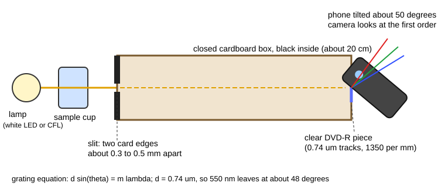

# 25.1 · Spectrophotometry of mixtures and a phone spectrometer

Real samples rarely hold one coloured compound. A green sports drink is a blue dye plus a yellow one, and their absorption bands overlap. Because absorbances add, you can still measure both, by reading at two wavelengths or by fitting the whole spectrum. In this lab you do it twice: on a simulated benchtop spectrometer, and on a spectrometer you build yourself from a cardboard box, a piece of DVD and your phone. You met Beer–Lambert in [Lesson 19.1](../module-19/lesson-01.md) and phone colour readings in [Lesson 09.6](../module-09/lesson-06.md); this lesson turns them into a full instrument.

## Why it matters

A food-safety lab checks that a lime drink contains the permitted amounts of tartrazine (yellow, E102) and Brilliant Blue FCF (blue, E133). A technician reads the absorbance at the blue dye's peak and at the yellow dye's peak, and reports each dye from its own calibration line. The blue result is fine. The yellow result is 6 % high, because the blue dye also absorbs a little at the yellow peak. Nothing in the instrument warns about this; only the mixture equations do. The same equations run every multi-component method, from the oxygen saturation in a pulse oximeter to the dyes in a forensic ink.

## Core ideas

> [!NOTE]
> Stable: additivity of absorbance, the mixture equations, the grating equation and the Hg line wavelengths (NIST, checked 2026-10-17). These go out of date: phone camera processing (HDR, automatic white balance, "scene" modes) changes with every software update, compact fluorescent lamps are disappearing from shops, and food-dye rules differ between countries. Absorptivities: Brilliant Blue FCF 164 L g⁻¹ cm⁻¹ at 629 nm (FAO/JECFA), tartrazine E¹%₁cm 530 at about 426 nm, that is 53 L g⁻¹ cm⁻¹ (EU 231/2012). The lab data are simulated.

### Absorbances add

Each absorbing species contributes its own term. For two dyes in a cell of path $b$:

$$A(\lambda) = b\,\big[a_\mathrm{B}(\lambda)\,c_\mathrm{B} + a_\mathrm{Y}(\lambda)\,c_\mathrm{Y}\big]$$

Here $a$ is the absorptivity (in L mg⁻¹ cm⁻¹ when $c$ is in mg/L). Measure at two wavelengths and you have two linear equations in two unknowns, exactly the system of [Lesson 03.1](../module-03/lesson-01.md). Choose each wavelength where one dye absorbs strongly and the other weakly, so the system is well conditioned. If the two spectra look alike at both wavelengths, a tiny absorbance error becomes a huge concentration error.

### Use the whole spectrum

A spectrometer gives hundreds of wavelengths, not two. **Classical least squares** (CLS) fits the measured spectrum as a sum of the pure-component spectra, each scaled by its concentration. With $n$ wavelengths and 2 dyes the system is overdetermined, and the least-squares answer averages the noise of all the points. You need the pure spectrum of every absorber present; a third, unknown absorber makes CLS wrong in a way the residuals reveal.

### A DVD is a diffraction grating

A DVD stores data along a spiral track. The tracks are $d$ = 0.74 µm apart (ECMA-267), about 1350 per millimetre. Light passing a regular array of lines leaves at angles given by the **grating equation**:

$$d \sin\theta = m\lambda$$

with $m$ the diffraction order. For $m$ = 1: blue 436 nm leaves at 36°, green 546 nm at 48°, red 700 nm at 71°. The second order would need $\sin\theta > 1$ for every visible colour, so a DVD gives one clean rainbow on each side. A CD (1.6 µm) spreads the colours only half as far, so its spectrum is less detailed.



### From pixels to nanometres

The camera records the rainbow as an image. Each pixel column is one wavelength, but you do not know which until you **calibrate** with known lines. A compact fluorescent lamp (CFL) or a fluorescent tube is ideal: its mercury gives sharp lines at 404.7, 435.8, 546.1 and 577/579 nm (NIST), and its red phosphor adds a line near 611.6 nm. Fit wavelength against pixel with a straight line, or a gentle quadratic, because the angle-to-pixel mapping is not exactly linear. If you have no fluorescent lamp, use the blue peak of a white LED (about 450 nm, ± 5 nm between makes) and the yellow sodium line at 589 nm from Lesson 25.3, and accept a rougher scale.

### What limits a phone spectrometer

- **Bandwidth.** The slit image on the sensor is 5–10 nm wide, against 1–2 nm on a lab instrument. Broad dye bands survive; sharp features are smeared, and peak absorbances read slightly low (Lesson 19.1).
- **Stray light.** Light leaking round the slit or reflecting inside the box adds a constant. A 2 % leak caps the absorbance near 1.7 and bends the calibration from about 0.8.
- **Camera processing.** Phones apply the sRGB curve, white balance and automatic exposure. Undo sRGB as in Lesson 09.6, and lock exposure and white balance, or every photo is on a different scale.
- **Saturation.** A pixel at 255 has lost information. If the blank's brightest part is clipped, its absorbance is wrong in exactly the region you care about.

The cup's path (about 5 cm, not 1 cm) is no problem as long as you use the same cup in the same place every time.

## Worked example

### 1. A green drink on the benchtop

A green drink is diluted 1 + 4 with water and read in a 1 cm cell. Your own standards give: $a_\mathrm{B}$ = 0.164 and $a_\mathrm{Y}$ = 0.000 L mg⁻¹ cm⁻¹ at 630 nm; $a_\mathrm{B}$ = 0.006 and $a_\mathrm{Y}$ = 0.053 L mg⁻¹ cm⁻¹ at 426 nm. The diluted drink reads $A_{630}$ = 0.738 and $A_{426}$ = 0.512.

At 630 nm only the blue dye absorbs: $c_\mathrm{B} = 0.738/0.164 = 4.50$ mg/L.

At 426 nm both absorb: $0.512 = 0.006 \times 4.50 + 0.053\,c_\mathrm{Y}$, so $c_\mathrm{Y} = (0.512 - 0.027)/0.053 = 9.15$ mg/L.

In the drink (× 5): blue 22.5 mg/L, yellow 45.8 mg/L. Ignoring the blue dye's small absorbance at 426 nm would give $0.512/0.053 \times 5$ = 48.3 mg/L, 5.5 % too high.

### 2. Where will the rainbow be?

With $d$ = 740 nm, the first order of 546 nm leaves at $\sin^{-1}(546/740) = 47.5°$. The spectrum from 400 to 700 nm spans $\sin^{-1}(0.541) = 32.7°$ to $\sin^{-1}(0.946) = 71.1°$, about 38°. A phone's main camera sees roughly 60–70° across, so the whole first order fits if the phone is tilted about 50° to the box axis. That is why the build below tilts the phone.

## Hands-on

> [!WARNING]
> Cutting a DVD can crack it into sharp shards. Wear safety glasses, let an adult cut with strong scissors over a box (not a craft knife on a hand-held disc), and wrap the leftovers in paper before throwing them away. Never point the spectrometer at the sun. Food colouring stains clothes and surfaces; nothing used here is tasted afterwards.

What you need: a shoebox or similar box with a lid, black paper or a black marker for the inside, two pieces of thin card for the slit, tape, scissors, one recordable DVD (DVD-R or DVD+R), a phone, a fluorescent lamp if you can find one (desk lamp or ceiling tube), a white LED lamp or torch, a clear straight-sided glass or plastic cup, blue and yellow liquid food colouring, a 100 mL measuring jug or kitchen scale, tap water, the [Module 25 lab folder](../../labs/module-25/) with Python set up, and the [notebook page template](../../templates/notebook-page.md). Time: about 2 hours. A phone spectrometer trains the ideas of a real instrument; it does not train you on a lab instrument's software or on handling quartz cells.

### Part A — simulation: two dyes on the bench (20 min)

[Simulation: Spectrometer — two-dye mixture](../../simulations/spectrometer/index.html?preset=mixture)

1. Record the spectra of pure tartrazine and pure Brilliant Blue standards. Note each maximum and how much each dye absorbs at the other's maximum.
2. Make five standards of each dye and read both wavelengths. Fit four lines through the origin to get the four absorptivities.
3. Read the unknown green drink. Solve the 2 × 2 system, then compare with the simulation's full-spectrum fit.
4. Break it on purpose: choose 500 nm and 550 nm instead. How much larger is the scatter of the answer over five repeat readings?

How you know it worked: your four absorptivities match the simulation's within 2 %, and the two-wavelength and full-spectrum answers agree within their scatter.

### Part B — home: build the spectrometer and run a dye series (70 min)

1. **Grating.** Cut a 2 × 2 cm piece from the edge of the DVD. Flex it until the two plastic layers separate. Peel the coloured or silver film off with sticky tape. Keep the clear piece; hold it up to a lamp and you should see bright rainbows.
2. **Box.** Blacken the inside. At one end cut a slot and tape two card edges over it with a gap of about 0.3–0.5 mm (thinner gives sharper lines but less light). At the other end cut a hole for the camera.
3. **Phone.** Tape the DVD piece over the camera lens. Hold the phone against the hole and tilt it until the first-order rainbow fills the screen (about 50°). Fix the phone to the box with tape so it cannot move.
4. **Calibration.** Point the slit at a fluorescent lamp. Lock exposure and white balance (long-press the screen, or "pro" mode). Take a photo: you should see separate violet, blue, green, yellow and red lines.
5. **Dye series.** Mix one drop of blue colouring into 500 mL of water: this is the stock (fraction 1.0). Make fractions 0.1, 0.2, 0.3, 0.5 and 0.7 by mixing stock and water. Do the same for yellow (1.0, 0.5, 0.25), and mix a "green unknown" without writing down the recipe; let someone else do it if you can.
6. **Photos.** Put the white LED behind the cup and the cup in front of the slit. Photograph water (blank), then each solution, with nothing else moved. Retake if any part of the blank shows pure white (saturated).
7. Turn the photos into one CSV and analyse it:

```bash
py photo_to_profile.py my_spectra.csv cfl=cfl.jpg blank=water.jpg blue_0.1=b01.jpg blue_0.2=b02.jpg blue_0.3=b03.jpg blue_0.5=b05.jpg blue_0.7=b07.jpg blue_1.0=b10.jpg yellow_0.25=y025.jpg yellow_0.5=y05.jpg yellow_1.0=y10.jpg green_unknown=g.jpg
py lesson01_phone_spectrometer_solution.py my_spectra.csv
```

How you know it worked: the lamp lines fit the calibration within about 2 nm, the blue dye's peak lands at 620–635 nm and the yellow's at 420–435 nm, and the blue series is straight up to about $A$ = 0.7.

### Part C — Python: calibrate, check Beer–Lambert, unmix (30 min)

Open `lesson01_phone_spectrometer.py`. Complete `calibrate()` (TODO 1, one `np.polyfit` line) and `absorbance()` (TODO 2, one line). Run `py lesson01_phone_spectrometer.py` on the example data.

How you know it worked: lines found at pixels 28, 87, 290, 348 and 407, calibration residuals below 0.3 nm; blue maximum 630 nm, yellow 424 nm; Beer–Lambert line $A = 0.0039 + 1.195\,f$ up to $f$ = 0.5, with the stock reading 5.9 % low (stray light); full-spectrum fit blue 0.353 and yellow 0.597 of stock against true 0.35 and 0.60.

<details><summary>Hint for TODO 1 and TODO 2</summary>

`np.polyfit(pixels, wavelengths, 2)` and `A = -np.log10(I / I_blank)`. If the line finder picks a phosphor band instead of a mercury line, the residuals jump to 10 nm or more; edit `HG_EU_LINES` to the lines you can really see.

</details>

## Common mistakes

- **Reading each dye at its own peak and ignoring the other.** Always check whether every absorber contributes at every wavelength; solve the system.
- **Auto exposure left on.** Each photo is then on its own scale and the blank no longer matches. Lock exposure and white balance, and keep the phone taped.
- **A saturated blank.** Clipped pixels make the absorbance near the brightest part of the spectrum wrong. Lower the exposure until nothing is pure white.
- **Calibrating with a phosphor band.** Broad phosphor bands are not reference wavelengths. Use only sharp mercury lines (or a known sodium or LED feature) and check the residuals.
- **Calibrating at full strength.** The phone's stray light bends the top of the range. Keep the strongest solution near $A$ = 0.7 and check linearity from the residuals.

## Key takeaways

- Absorbances add, so $n$ absorbers need at least $n$ well-chosen wavelengths, and a full-spectrum least-squares fit uses the rest of the data to average the noise.
- A DVD's 0.74 µm tracks make a grating with one clean first order; $d\sin\theta = m\lambda$ tells you where to point the camera.
- Every spectrometer needs a wavelength calibration; mercury lines from a fluorescent lamp give a phone spectrometer an accuracy of about 1 nm.
- The phone's limits (wide bandwidth, stray light, camera processing, saturation) set a usable range of roughly $A$ = 0.05–0.8; plan dilutions for it.

## Sources

- [Harvey, Analytical Chemistry 2.1, section 10.3](https://chem.libretexts.org/Bookshelves/Analytical_Chemistry/Analytical_Chemistry_2.1_(Harvey)/10%3A_Spectroscopic_Methods/10.03%3A_UV_Vis_and_IR_Spectroscopy) — mixture analysis and instrument design.
- [FAO/WHO JECFA, Brilliant Blue FCF monograph](https://www.fao.org/fileadmin/user_upload/jecfa_additives/docs/Monograph1/additive-059-m1.pdf) — specific absorptivity 164 L g⁻¹ cm⁻¹ at 629 nm.
- [Regulation (EU) No 231/2012](https://eur-lex.europa.eu/eli/reg/2012/231/oj) — tartrazine E¹%₁cm 530 at about 426 nm in water.
- [NIST, strong lines of mercury](https://physics.nist.gov/PhysRefData/Handbook/Tables/mercurytable2.htm) — 404.66, 435.83, 546.07, 576.96 and 579.07 nm.
- [ECMA-267, DVD read-only disk](https://www.ecma-international.org/wp-content/uploads/ECMA-267_3rd_edition_april_2001.pdf) — the 0.74 µm track pitch.
- [OpenStax University Physics 3, 4.4 Diffraction gratings](https://openstax.org/books/university-physics-volume-3/pages/4-4-diffraction-gratings) — the grating equation.
