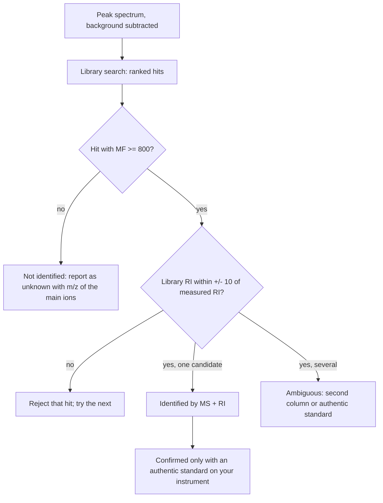

# 25.4 · Gas chromatography and GC-MS

A gas chromatograph separates a mixture; a mass spectrometer bolted to its end records a mass spectrum of everything that comes out, several times a second. GC-MS is the workhorse for flavours, fragrances, drugs, pesticides and environmental pollutants. Its power is also its trap: the software proposes a name for every peak, with a score, and many of those names are wrong. This lab runs a lemon-oil sample, searches its peaks against real reference spectra from the NIST WebBook, and builds the rule a careful analyst uses before writing a compound name in a report. It builds on the retention index of [Lesson 19.4](../module-19/lesson-04.md) and on reading electron-ionisation spectra from [Lesson 17.1](../module-17/lesson-01.md).

## Why it matters

A flavour company buys "cold-pressed lemon oil". The certificate lists limonene, β-pinene, γ-terpinene and the citrals neral and geranial, all identified "by GC-MS". You run the oil and your software agrees, but it also calls a small late peak "γ-terpinene" with a score of 861 out of 999, although γ-terpinene has already appeared ten minutes earlier. A second γ-terpinene is impossible; the late peak is something else. Terpenes are isomers of each other, many with nearly identical spectra, so the score alone cannot tell them apart. The retention index can. An identification that ignores it may approve an adulterated oil or reject a genuine one.

## Core ideas

> [!NOTE]
> Stable: electron ionisation, library searching by spectral similarity, and the retention-index check (Harvey 12.4; Stein and Scott 1994; checked 2026-10-17). These change: instrument software, the NIST/EPA/NIH library edition and its search settings, and the free WebBook's contents. The retention indices used here are medians of the 5 %-phenyl temperature-ramp entries on each compound's WebBook page, read 2026-10-17. NIST mass spectra are copyrighted; the lab downloads them to your computer and does not redistribute them.

### The run, step by step

1. **Tune and leak check.** The MS is tuned daily with a calibration compound (PFTBA, ions at m/z 69, 219 and 502) so that masses and relative intensities are right. High m/z 18, 28 and 32 mean water, nitrogen and oxygen: an air leak.
2. **Blank.** Inject solvent only. Peaks in the blank (septum bleed, contamination, carry-over) must not be reported as sample.
3. **Injection.** 1 µL of the oil diluted 1:100 in hexane, split 1:50, injector 250 °C. The split keeps the column from being overloaded by a concentrated sample.
4. **Oven programme.** 60 °C, then 3 K/min. A temperature programme spaces early and late peaks evenly; isothermal at 60 °C would take hours for the citrals, at 150 °C the pinenes would crowd together.
5. **Solvent delay.** The filament stays off for the first 3 minutes while the hexane elutes; a huge solvent peak would shorten its life and swamp the detector.
6. **Scan m/z 35–350.** Below 35 are air and carrier ions; above 350 nothing in this sample.
7. **Alkane ladder.** Run C8–C14 under identical conditions to convert retention times into retention indices.

[Simulation: Chromatography — GC run of a lemon oil](../../simulations/chromatography/index.html?preset=gc)

### Total ion current and extracted ions

The **total ion current** (TIC) chromatogram sums all ions in each scan; it looks like an ordinary chromatogram. An **extracted ion chromatogram** (EIC) plots one m/z only. If a peak hides a second compound with a different characteristic ion, its EIC peaks at a slightly different time. For example, m/z 119 is p-cymene's base peak, absent from limonene's spectrum.

### Library search: the match factor

A library search compares the measured spectrum with every reference spectrum and ranks them by similarity. A common measure is a **weighted dot product**: each intensity is square-rooted and multiplied by its m/z, the two spectra become vectors, and the score is the cosine of the angle between them, scaled to 0–999:

$$\mathrm{MF} = 999\,\frac{\sum_m w_m^\text{meas}\,w_m^\text{ref}}{\sqrt{\sum_m (w_m^\text{meas})^2}\,\sqrt{\sum_m (w_m^\text{ref})^2}}, \qquad w_m = m\sqrt{I_m}$$

Stein and Scott (1994) found that dot-product searches with square-rooted intensities and mass weighting identified the right compound most often. The weighting matters because heavy ions are more characteristic than small fragments like m/z 41 that almost every organic molecule gives. A match above about 900 is excellent, 800–900 good, below 700 poor. A perfect score never proves identity.

### Why isomers defeat the search

α-pinene and β-pinene, or neral and geranial (the *Z* and *E* isomers of citral), fragment through the same ions. Their reference spectra match each other at 950–990. Noise in your spectrum can easily swap their order. The **retention index** separates them: on a 5 %-phenyl column α-pinene elutes at 937 and β-pinene at 979; neral at 1241 and geranial at 1270 (NIST medians). An accepted identity needs both:



The window must be narrower than the RI gap between the candidates, but wider than the scatter between laboratories (5–10 units for one phase type).

### Co-elution and the residual

When two compounds elute together, the spectrum is their sum. The best hit then explains most, but not all, of the ions. Subtract the best hit (scaled to fit) and search what is left: if the residual matches a sensible compound, you have found a co-elution. Confirm it with an EIC or a slower temperature ramp.

### Safety reasoning in the real lab

Hexane is highly flammable and harmful to nerves with long exposure: dilute in a fume hood and cap vials. The injector, oven and transfer line are at 250–300 °C. Hydrogen, increasingly used instead of scarce helium as carrier, is flammable: the instrument needs a hydrogen sensor and leak checks. The rotary-pump exhaust carries oil mist and sample vapour and is vented outside.

## Worked example

### 1. Neral or geranial?

A peak at 17.58 min sits between C12 (16.05 min) and C13 (19.80 min):

$$I = 100\left(12 + \frac{17.58 - 16.05}{19.80 - 16.05}\right) = 1241$$

The library search gives neral MF 886 and geranial 883: a tie. The RIs are 1241 (neral) and 1270 (geranial). Neral is 0 units away, geranial 29. The peak is neral, identified by MS + RI. The next peak, at RI 1271, is geranial.

### 2. A good score for the wrong compound

A small peak at RI 1191 gives best hits γ-terpinene (861) and limonene (844). Both have RIs near 1031–1061, 130–160 units away, and both already appeared earlier in the run. Verdict: not identified. Adding α-terpineol (RI 1190) to the library gives MF 973 and Δ = 1: identified. The lesson: a missing reference spectrum produces a confident wrong answer, not an empty one.

## Hands-on

What you need: the [Module 25 lab folder](../../labs/module-25/) with Python set up, an internet connection once, a web browser and the [spectrum assignment template](../../templates/spectrum-assignment.md). Time: about 90 minutes. There is no home version; GC-MS needs the instrument. The simulation and the real library data train the method and the judgement, not instrument maintenance.

### Part A — simulation: build the separation (25 min)

[Simulation: Chromatography — temperature programme](../../simulations/chromatography/index.html?preset=temperature-program)

1. Run the lemon oil isothermally at 60 °C and at 150 °C. Note what goes wrong in each.
2. Run 60 °C then 3, 5 and 10 K/min. For each, read the resolution between limonene and p-cymene and the run time.
3. Choose the fastest ramp that keeps every pair above $R_s$ = 1.5 except limonene/p-cymene. Then run the alkane ladder under the same programme.

How you know it worked: isothermal runs either crowd the early peaks or take far too long; faster ramps shorten the run but merge neighbours; limonene and p-cymene stay overlapped at every reasonable ramp on this column.

### Part B — Python: search against NIST spectra (40 min)

```bash
py get_nist_ms.py
py lesson04_gcms.py
```

The first command downloads ten spectra (about a minute) and builds the simulated run. Then open `lesson04_gcms.py` and complete `match_factor()` (TODO 1) and the condition in `decide()` (TODO 2).

How you know it worked: nine peaks; α-pinene MF 976 at RI 936, β-pinene 970 at 973, myrcene 971 at 993; limonene 918 at 1030 with 11 % of the ions unexplained and a residual that matches p-cymene (MF 884); γ-terpinene 984; linalool 980; P7 not identified; neral 886 at 1241 and geranial 887 at 1271, each separated from the other only by RI. Finally add `"C98555"` (α-terpineol) to `LIBRARY` and run again: P7 becomes α-terpineol, MF 973.

### Part C — the WebBook by hand (25 min)

1. Open the [limonene mass spectrum](https://webbook.nist.gov/cgi/cbook.cgi?ID=C138863&Mask=200) and the [neral gas-chromatography page](https://webbook.nist.gov/cgi/cbook.cgi?ID=C106263&Mask=2000) on the WebBook.
2. From limonene's spectrum, write down the base peak, the molecular ion and the two next strongest ions. Explain m/z 68 with a retro-Diels–Alder fragmentation (Lesson 17.1).
3. On the neral page, find five DB-5 or HP-5 values in the temperature-ramp tables. What spread do you see, and is the ± 10 window reasonable?
4. Fill in the spectrum-assignment template for peak P4, including the co-eluting compound.

<details><summary>What you should find</summary>

Limonene: base peak m/z 68, molecular ion m/z 136, next m/z 93 and 67. Limonene is a cyclohexene; the retro-Diels–Alder split of its ring gives isoprene-like C₅H₈⁺ at m/z 68. Neral DB-5-type values cluster tightly around 1235–1245. A handful sit near 1270, the value of geranial: published data contain the same isomer mix-up this lesson warns about. ± 10 covers the normal scatter but would not separate two isomers closer than about 15 units. P4: limonene (MS + RI), with p-cymene co-eluting (residual MF 884, m/z 119 and 134), to be confirmed by an EIC of m/z 119 or on a polar column.

</details>

## Common mistakes

- **Taking the top hit as the identity.** The search always returns a best hit, even for a compound not in the library. Check the score, the RI and whether the hit makes chemical sense.
- **Comparing indices from different column types.** A DB-5 index means nothing next to a wax-column value; check the phase in the database table.
- **Ignoring the blank.** Siloxane ions (m/z 73, 207, 281) come from column and septum bleed, not from the sample.
- **Reading a merged peak as pure.** Unexplained ions in a spectrum are evidence of co-elution; check EICs across the peak.
- **Calling an identification "confirmed" without a standard.** MS + RI is a strong identification; confirmation needs an authentic standard on your own instrument.

## Key takeaways

- A GC-MS run is only as good as its tune, blank, solvent delay and alkane ladder; each protects a different part of the result.
- The match factor is a cosine similarity of weighted spectra; high scores rank candidates but do not prove identity.
- Isomers often have nearly identical spectra; the retention index on a stated column decides between them.
- Unexplained ions reveal co-elution; subtract the best hit and search the residual.
- Report the level of evidence: tentative (MS only), identified (MS + RI), confirmed (authentic standard).

## Sources

- [NIST Chemistry WebBook](https://webbook.nist.gov/chemistry/) — reference EI mass spectra and gas-chromatographic retention indices; IDs used in the lab are listed in `get_nist_ms.py`.
- [NIST WebBook, limonene mass spectrum](https://webbook.nist.gov/cgi/cbook.cgi?ID=C138863&Mask=200) and [neral gas chromatography](https://webbook.nist.gov/cgi/cbook.cgi?ID=C106263&Mask=2000) — the pages used in Part C.
- [Stein and Scott 1994](https://doi.org/10.1016/1044-0305(94)87009-8) — the dot-product search with square-root intensities and mass weighting.
- [Harvey, Analytical Chemistry 2.1, 12.4](https://chem.libretexts.org/Bookshelves/Analytical_Chemistry/Analytical_Chemistry_2.1_(Harvey)/12%3A_Chromatographic_and_Electrophoretic_Methods/12.04%3A_Gas_Chromatography) — GC instrumentation, temperature programming and MS detection.
