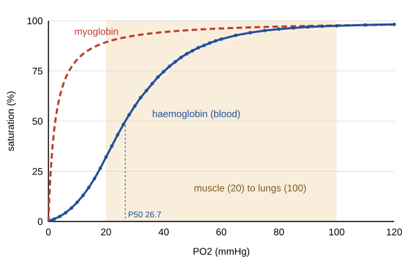

# 26.3 · Oxygen transport: haemoglobin and myoglobin

Myoglobin and haemoglobin bind O₂ with the same haem and almost the same pocket, yet they do opposite jobs. Myoglobin, one chain with one haem, holds on to O₂ inside muscle cells. Haemoglobin, four chains with four haems, picks O₂ up in the lungs and lets go of most of it in the tissues. The difference is cooperativity: binding one O₂ makes the next one bind more easily. This lesson turns that idea into numbers with the Hill equation and a real oxygen dissociation curve, explains it with the two-state model built on the iron movement of lesson [26.2](lesson-02.md), and shows how acid, CO₂ and carbon monoxide move the curve.

## Why it matters

Blood leaves the lungs at an oxygen partial pressure of about 100 mmHg. Resting tissue sits near 40 mmHg and working muscle near 20 mmHg. A carrier is useful only if its saturation changes a lot between those pressures. Myoglobin is still 89 % saturated at 20 mmHg, so it would deliver almost nothing. A non-cooperative protein with haemoglobin's affinity would release about a third of its O₂ to working muscle; real haemoglobin releases about two thirds. Anaesthetists, divers, high-altitude physiologists and the designers of blood substitutes all work with this curve, and its shape follows from the coordination chemistry of four iron ions.

## Core ideas

> [!NOTE]
> The binding models are stable. The data are the standard human blood curve of Severinghaus (1979, revised 2007; 37 °C, pH 7.40) and the myoglobin P50 of Schenkman et al. (1997), both checked 2026-10-17. Pressures are in mmHg (1 mmHg ≈ 1 Torr = 133.3 Pa), the unit of the clinical literature. The lab uses NumPy 2.5 and Matplotlib 3.11 as pinned in `labs/common/requirements.txt`.

### One site: myoglobin

For one binding site, $\mathrm{Mb + O_2 \rightleftharpoons MbO_2}$ with dissociation constant $K_d$. Write the dissolved O₂ as its partial pressure $p$ (Henry's law, lesson [13.6](../module-13/lesson-06.md)). The fractional saturation $S$ (the fraction of sites holding O₂) is

$$S = \frac{p}{P_{50} + p}$$

where $P_{50}$, the pressure at half saturation, plays the role of $K_d$. This is the same hyperbola as the Langmuir isotherm and the Michaelis–Menten law of lesson [22.5](../module-22/lesson-05.md). Schenkman et al. measured horse myoglobin at 37 °C and pH 7.0: $P_{50}$ = 2.39 mmHg, and the curve was fitted by this equation with no cooperativity.

### Four sites: a sigmoid curve

Haemoglobin is an α₂β₂ tetramer (lesson [06.2](../module-06/lesson-02.md)). Its saturation curve is S-shaped: flat at low pressure, steep in the middle, flat again near saturation. For human blood at 37 °C and pH 7.40, $P_{50}$ ≈ 26.7 mmHg, about ten times myoglobin's. Arterial blood (100 mmHg) is 97.5 % saturated; mixed venous blood (40 mmHg) is 74.7 % saturated.

### The Hill equation and the Hill plot

In 1910 A. V. Hill fitted haemoglobin data with

$$S = \frac{p^{n}}{P_{50}^{\,n} + p^{n}}$$

where $n$, the **Hill coefficient**, measures cooperativity. Rearranged and taken as logarithms:

$$\log_{10}\frac{S}{1 - S} = n \log_{10} p - n \log_{10} P_{50}$$

A plot of $\log_{10}[S/(1-S)]$ against $\log_{10} p$ is the **Hill plot**. For myoglobin it is a straight line of slope 1. For haemoglobin the middle part (20–80 % saturation) has slope about 2.6–2.8. Three points to remember:

- $n$ is not the number of sites. Four sites set the upper limit $n \le 4$, reached only if binding were all-or-none.
- $n = 1$ means independent sites; $n > 1$ positive cooperativity.
- The Hill equation is a fit, not a mechanism. Real data bend back to slope 1 at both ends of the Hill plot, which the equation cannot do.

### Why the curve is sigmoid: the two-state model

Monod, Wyman and Changeux (1965) proposed the **two-state** or **MWC model**. The tetramer exists in two quaternary structures:

- **T** (tense), the deoxy form, with low O₂ affinity (dissociation constant $K_T$);
- **R** (relaxed), the oxy form, with high affinity ($K_R$, much smaller).

With no O₂ bound, T is far more stable than R. Each O₂ that binds pays more favourably in R, so after two or three O₂ the balance tips and the whole molecule switches to R, making the remaining sites high-affinity. At very low pressure every molecule is T, so the Hill plot has slope 1 and lies on the line for $K_T$. At very high pressure every molecule is R, slope 1 again, on the line for $K_R$. The steep middle is the switch. The vertical gap between the two lines measures the free energy that cooperativity is worth, which you calculate in the module practical.

The trigger is the iron of lesson 26.2. In T the high-spin iron sits about 0.35 Å out of the plane. When O₂ binds, the iron moves into the plane and pulls the proximal histidine and its F helix. That movement is resisted by salt bridges and contacts at the α₁β₂ interface, which hold T together. Enough bound O₂ breaks them, and one αβ pair rotates against the other into the R structure.

### Moving the curve: allosteric effectors

Molecules that bind away from the haem but change O₂ affinity are **allosteric effectors**. A right shift (higher $P_{50}$) means lower affinity and more O₂ released.

- **Bohr effect**: H⁺ binds T more than R (several histidines and the N termini take up protons in T). Lower pH raises $P_{50}$. Severinghaus gives $\Delta\log_{10} P_{50}/\Delta\mathrm{pH} \approx -0.48$: at pH 7.20, $P_{50}$ rises from 26.6 to about 33 mmHg. Working muscle makes acid and gets more O₂.
- **CO₂** binds the N-terminal amino groups as carbamate and also lowers pH, both favouring T.
- **2,3-Bisphosphoglycerate** (2,3-BPG), made in red cells, binds the central cavity of T and stabilises it. It rises at high altitude. Fetal haemoglobin binds it weakly, so it has higher affinity and takes O₂ from the mother's blood.
- **Temperature**: warming shifts the curve right; binding O₂ is exothermic.
- **Carbon monoxide** binds the haem much more tightly than O₂ and also pushes the remaining sites towards R. The curve of the leftover sites moves left: the O₂ still bound is released less easily, so CO harms twice.

### Cooperativity is what makes delivery work

From the standard curve, between 100 and 40 mmHg haemoglobin releases 23 % of its bound O₂; between 100 and 20 mmHg, 65 %. A one-site carrier with the same $P_{50}$ would release 19 % and 36 %. A myoglobin-like carrier releases 3 % and 8 %. Myoglobin's job is different: inside muscle cells, where PO₂ can fall to a few mmHg, it stores O₂ and helps it diffuse to the mitochondria. Its higher affinity is exactly what lets it pull O₂ off haemoglobin.



## Worked example

### 1. The Hill coefficient from two points of the standard curve

Take two points of the Severinghaus table on either side of $P_{50}$: 21.40 % at 16 mmHg and 85.08 % at 50 mmHg.

1. Hill-plot ordinates: $\log_{10}(0.2140/0.7860) = -0.565$ and $\log_{10}(0.8508/0.1492) = 0.756$.
2. Abscissa difference: $\log_{10}(50/16) = 0.495$.
3. Slope: $n = (0.756 + 0.565)/0.495 = 2.67$.
4. $P_{50}$ from the upper point: $\log_{10} P_{50} = \log_{10} 50 - 0.756/2.67$, so $P_{50} = 26.0$ mmHg.

A fit through all the points between 20 and 80 % (Part B) gives $n$ = 2.63 and $P_{50}$ = 26.6 mmHg. Two points already give a good estimate because the middle of the Hill plot is nearly straight.

### 2. How much does acid help working muscle?

Muscle at 20 mmHg and pH 7.20. With $n$ = 2.63:

1. At pH 7.40, $P_{50}$ = 26.6 mmHg: $S = 20^{2.63}/(26.6^{2.63} + 20^{2.63}) = 0.32$.
2. At pH 7.20, $P_{50} = 26.6 \times 10^{0.48 \times 0.20} = 33.2$ mmHg: $S = 0.21$.
3. Arterial blood arrives 97.5 % saturated, so the blood gives up $97.5 - 32 = 65.5$ % of its O₂ at pH 7.40 but $97.5 - 21 = 76.5$ % at pH 7.20.

The Bohr effect hands the working muscle about a sixth more oxygen from the same blood flow, exactly where the acid is made.

## Hands-on

What you need: pencil, Python with the course packages and the [Module 26 lab folder](../../labs/module-26/); for the optional Part C, a fingertip pulse oximeter if you already own one (do not buy one for this). Record your results on the [notebook page template](../../templates/notebook-page.md). Time: about 60 minutes.

### Part A — pencil (15 min)

1. Use the standard-curve points 4.37 % at 6 mmHg and 98.77 % at 150 mmHg to compute the slope of the Hill plot between them. Why is it lower than 2.67?
2. In the two-state model, what is the slope of the Hill plot when only T molecules are present, and why?
3. Predict the direction of the shift (left or right) for: a fever; blood stored for weeks, which loses 2,3-BPG; a smoker with 10 % of haem bound to CO.

<details><summary>Answers</summary>

1. $\log_{10}(0.0437/0.9563) = -1.340$, $\log_{10}(0.9877/0.0123) = 1.905$, $\log_{10}(150/6) = 1.398$, slope $= 3.245/1.398 = 2.32$. The two points lie in the ends of the curve, where the Hill plot bends back towards slope 1, so the average slope is lower.
2. Slope 1: all four sites have the same low affinity and bind independently, like four myoglobins.
3. Fever: right (lower affinity). Stored blood without 2,3-BPG: left (higher affinity, less O₂ released until the red cells rebuild it). CO: left for the remaining sites, which keep their O₂ more tightly.

</details>

### Part B — Python: the Hill plot of real blood (30 min)

1. Open `lesson03_hill.py` and complete `hill()`, `hill_plot()`, `hill_line()` and `p50_at_ph()`.
2. Run it and open `runs/lesson03_hill.png`:

```bash
py lesson03_hill.py
```

3. Note the local Hill slope at 1, 10, 26, 50, 100 and 500 mmHg. Where is cooperativity strongest?

How you know it worked: Hill line (20–80 %) $n$ = 2.63, $P_{50}$ = 26.6 mmHg. Local slope 1.00 at 1 mmHg, 1.82 at 10, 2.61 at 26, 3.03 at 50, 1.88 at 100 and 1.00 at 500 mmHg. Released from 100 to 40 mmHg: haemoglobin 23 %, myoglobin-like carrier 3 %; to 20 mmHg: 65 % and 8 %. $P_{50}$ at pH 7.20: 33.2 mmHg; at pH 7.60: 21.3 mmHg.

<details><summary>Reference solution</summary>

```python
def hill(p, p50, n):
    return p ** n / (p50 ** n + p ** n)

def hill_plot(p, s):
    return np.log10(p), np.log10(s / (1 - s))

def hill_line(p, s, lo=0.2, hi=0.8):
    m = (s > lo) & (s < hi)
    x, y = hill_plot(p[m], s[m])
    n, c = np.polyfit(x, y, 1)
    return n, 10 ** (-c / n)

def p50_at_ph(p50, pH):
    return p50 * 10 ** (BOHR_LOG10 * (pH - 7.40))
```

Full code: `lesson03_hill_solution.py`. Cooperativity is strongest between about 40 and 70 mmHg (local slope near 3), where most molecules are switching from T to R. At both ends the slope returns to 1: only T at the bottom, only R at the top.

</details>

### Part C — optional: your own saturation (10 min)

> [!CAUTION]
> This is not a medical test. Measure sitting quietly and breathing normally; never hold your breath or hyperventilate to change the reading. Cold fingers, nail polish and movement give false readings. If a reading worries you, ask a doctor, not this script.

1. Warm your hands, sit for two minutes and read SpO₂ from a fingertip pulse oximeter.
2. Run the script with your reading, for example `py lesson03_hill.py 97`.

How you know it worked: a healthy reading of 95–99 % maps to an arterial PO₂ of roughly 75 to 170 mmHg on the standard curve; 97 % gives about 92 mmHg. Notice how flat the curve is up there: one percent of saturation spans tens of mmHg, which is why oximeters are poor at detecting too much oxygen and good at detecting too little.

## Common mistakes

- Reading the Hill coefficient as the number of binding sites. Haemoglobin has four sites and $n \approx 2.6$–2.8; $n = 4$ would need all-or-none binding.
- Fitting the Hill equation to the whole curve and trusting its residuals at the ends. Real binding returns to slope 1 at both extremes; fit the middle or use a model that includes T and R.
- Mixing units. $P_{50}$ in mmHg, kPa and Torr differ (26.7 mmHg = 3.56 kPa); keep one unit through a calculation.
- Saying the Bohr effect "makes haemoglobin bind more O₂ in the lungs". It lowers affinity at low pH and so releases more O₂ where acid is made.
- Treating CO as only a competitor. It also shifts the remaining sites to high affinity, so the O₂ still carried is released less easily.

## Key takeaways

- One site gives a hyperbola $S = p/(P_{50} + p)$; myoglobin has $P_{50}$ = 2.39 mmHg at 37 °C.
- Haemoglobin's four cooperative sites give a sigmoid with $P_{50}$ ≈ 26.7 mmHg; the Hill plot of real blood has slope about 2.6 in the middle and 1 at both ends.
- In the two-state model, T (low affinity) switches to R (high affinity) as O₂ binds; the trigger is the iron moving into the haem plane.
- H⁺, CO₂, 2,3-BPG and heat shift the curve right and release more O₂; CO shifts it left and blocks sites.
- Cooperativity nearly doubles the O₂ delivered to working muscle compared with a one-site carrier of the same affinity.

## Sources

- [Severinghaus (1979, revised 2007), J. Appl. Physiol. 46, 599](https://www.nickalls.org/dick/papers/anes/JWSrevised2007.pdf) — Table 1 standard human blood O₂ curve at 37 °C, pH 7.40 (from Roughton and Severinghaus 1973 measurements), Bohr coefficient −0.48, O₂ content equation.
- [Schenkman et al. (1997), J. Appl. Physiol. 82, 86](https://pubmed.ncbi.nlm.nih.gov/9029202/) — horse myoglobin $P_{50}$ = 2.39 Torr at 37 °C, pH 7.0, fitted by a one-site curve.
- [Jakubowski and Flatt, 5.3 Oxygen-Binding Proteins and Allosterism](https://bio.libretexts.org/Bookshelves/Biochemistry/Fundamentals_of_Biochemistry_(Jakubowski_and_Flatt)/01%3A_Unit_I-_Structure_and_Catalysis/05%3A_Protein_Function/5.03%3A_A._Oxygen-Binding_Proteins_and_Allosterism) — Hill equation, empirical $n$ ≈ 2.8, MWC and sequential models.
- [Bertini et al., 4.17 Stereochemical Changes Upon Ligation](https://chem.libretexts.org/Bookshelves/Inorganic_Chemistry/Book3A_Bioinorganic_Chemistry_(Bertini_et_al.)/04%3A_Biological_and_Synthetic_Dioxygen_Carriers/4.17%3A_Stereochemical_Changes_Upon_Ligation) — iron displacement and histidine movement in T and R haemoglobin.
- [RCSB PDB-101, Molecule of the Month: Hemoglobin](https://pdb101.rcsb.org/motm/41) — structures of haemoglobin and the rocking motion of its subunits.
