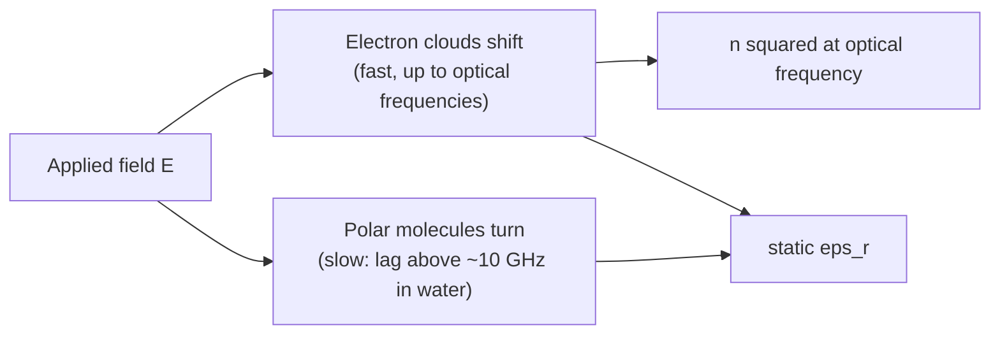

# 27.1 · Maxwell's equations for chemists

Four equations, written down by James Clerk Maxwell in the 1860s, contain all of electricity, magnetism and light. A chemist rarely solves them in full, but uses their consequences every day: Coulomb's law between ions, the screening of charges by a solvent, the speed of light in a spectrometer, the heating of a cup of tea in a microwave oven. This lesson reads the four equations in plain words, puts numbers on two of them, and shows how matter changes them through its permittivity. Then you measure the speed of light with a microwave oven and a bar of chocolate.

## Why it matters

Every solvent table lists a "dielectric constant". It decides whether salts dissolve, how strongly ions pair, how fast charged molecules react, and which way a solvatochromic dye shifts. Where does that number come from, and why does water have 80 in one table and a refractive index of 1.33 (so $n^2 = 1.78$) in another? Both come out of Maxwell's equations once matter is added. The same equations tell you why a microwave oven heats water but not a dry plate, and why the electric field of light, not its magnetic field, drives almost all spectroscopy (lesson [12.6](../module-12/lesson-06.md)). Without them, "polarity" and "dielectric" stay words; with them, they are numbers you can compute and check.

## Core ideas

> [!NOTE]
> Maxwell's equations are stable physics. The constants are CODATA 2022 values from NIST ($c$ exact; $\varepsilon_0 = 8.854\,187\,8188\times10^{-12}$ F/m and $\mu_0 = 1.256\,637\,061\,27\times10^{-6}$ N/A², both measured since the 2019 SI revision), checked on 2026-10-17. The liquid permittivities are from NBS Circular 514 (1951), still the standard compilation for these liquids. The microwave example data in the lab are generated, not measured.

### Two ideas: flux and circulation

A **field** is a quantity with a value at every point in space. The electric field $\mathbf{E}$ (lesson [04.3](../module-04/lesson-03.md)) is a vector: it has a size and a direction. Maxwell's equations describe fields with two pictures.

- **Flux** through a surface: how much field passes through it. Picture the field as arrows; flux counts the arrows that pierce the surface, outward minus inward. For a closed surface, such as a sphere, flux measures what is *created inside*.
- **Circulation** around a closed loop: how much the field pushes you along the loop if you walk all the way round. A field that swirls has circulation; the field of a still charge does not.

### The four equations in words

| Equation | In words | Where a chemist meets it |
|---|---|---|
| Gauss's law for $\mathbf{E}$: $\oint \mathbf{E}\cdot d\mathbf{A} = Q_\text{inside}/\varepsilon_0$ | Electric flux out of a closed surface equals the charge inside, divided by $\varepsilon_0$. | Coulomb's law, the field of an ion, Debye–Hückel screening, Born solvation energy |
| Gauss's law for $\mathbf{B}$: $\oint \mathbf{B}\cdot d\mathbf{A} = 0$ | Magnetic flux out of any closed surface is zero: there are no magnetic charges. | Field lines of an NMR magnet close on themselves |
| Faraday's law: $\oint \mathbf{E}\cdot d\mathbf{l} = -\,d\Phi_B/dt$ | A changing magnetic flux creates a circulating electric field. | The induced voltage that *is* the NMR signal in the receiver coil |
| Ampère–Maxwell law: $\oint \mathbf{B}\cdot d\mathbf{l} = \mu_0 I + \mu_0\varepsilon_0\, d\Phi_E/dt$ | A current, or a changing electric flux, creates a circulating magnetic field. | Electromagnets; together with Faraday's law it makes light |

The last two equations feed each other. A changing $\mathbf{E}$ makes a $\mathbf{B}$, which changes and makes an $\mathbf{E}$, and so on. Maxwell found that this disturbance travels through empty space at

$$c = \frac{1}{\sqrt{\varepsilon_0\mu_0}} = 2.998\times10^{8}\ \text{m/s}$$

Two constants measured with capacitors and coils gave the speed of light. That is how light was recognised as an electromagnetic wave (lesson [04.5](../module-04/lesson-05.md)).

### Gauss's law at work

For a charge with spherical symmetry, the field points straight out and has the same size $E$ everywhere on a sphere of radius $r$. The flux is then $E \times 4\pi r^2$, so

$$E = \frac{Q_\text{inside}}{4\pi\varepsilon_0 r^2}$$

That is Coulomb's law, derived in one line. Two consequences matter in chemistry. First, *only enclosed charge counts*: charges outside the sphere bend the field lines, but every line they send in also comes out, so their net flux is zero. Second, a spherical ion acts on the outside world exactly like a point charge at its centre, which is why the simple ion models of lesson [04.3](../module-04/lesson-03.md) work.

The same law written point by point says $\nabla\cdot\mathbf{E} = \rho/\varepsilon_0$: the *divergence* (the outward spreading of the field per unit volume) equals the local charge density $\rho$. With $\mathbf{E} = -\nabla\phi$ it becomes Poisson's equation, $\nabla^2\phi = -\rho/\varepsilon_0$. Debye–Hückel theory of ionic activity and modern implicit-solvent models in computational chemistry both start by solving it.

### Adding matter: polarisation and permittivity

In a material, an applied field shifts electron clouds and turns polar molecules. Each molecule gains a small dipole, and the dipole moment per unit volume is the **polarisation** $\mathbf{P}$. The bound charges this creates partly cancel the applied field. Maxwell's equations handle this with the **displacement field** $\mathbf{D} = \varepsilon_0\mathbf{E} + \mathbf{P}$, whose flux counts only the free charges you put in. For most liquids $\mathbf{P}$ is proportional to $\mathbf{E}$, and

$$\mathbf{D} = \varepsilon_r\varepsilon_0\mathbf{E}$$

where $\varepsilon_r$ is the **relative permittivity** (dielectric constant). Coulomb's law inside the medium gains a factor $1/\varepsilon_r$, as you used in lesson [04.3](../module-04/lesson-03.md). A capacitor shows it directly: fill the gap with a liquid and the capacitance rises by $\varepsilon_r$. That ratio is how the values in solvent tables are measured.

### Light in matter: refractive index

In a non-magnetic medium the wave speed drops to $v = c/n$ with

$$n = \sqrt{\varepsilon_r}$$

This is **Maxwell's relation**. It holds only if $\varepsilon_r$ is taken *at the frequency of the light*. Electron clouds follow an optical field ($\sim 10^{15}$ Hz) easily. Whole polar molecules cannot turn that fast; in water their turning lags already in the tens of gigahertz. So:

| Liquid (20 °C) | static $\varepsilon_r$ | $n_D^2$ | ratio |
|---|---|---|---|
| cyclohexane | 2.023 | 2.035 | 0.99 |
| benzene | 2.281 | 2.253 | 1.01 |
| methanol | 33.62 | 1.767 | 19 |
| water | 80.37 | 1.777 | 45 |

For non-polar liquids the two agree: only electrons respond, at both frequencies. For polar liquids the static value is far larger, because turning molecular dipoles add to it. Lesson [27.3](lesson-03.md) turns this into numbers for the dipole moment and the polarisability.



## Worked example

### 1. The field at the surface of a sodium ion

Na⁺ has an ionic radius of about 102 pm. By Gauss's law the field just outside it is

$$E = \frac{1.602\times10^{-19}}{4\pi \times 8.854\times10^{-12} \times (1.02\times10^{-10})^2} = 1.38\times10^{11}\ \text{V/m}$$

Air breaks down at about $3\times10^{6}$ V/m. The field at an ion's surface is forty thousand times larger, which is why the first layer of water molecules around an ion is strongly oriented. Continuum $\varepsilon_r$ does not apply to that first layer: there are no "many molecules" to average over.

### 2. Measuring εr with a capacitor

An empty parallel-plate cell has $C_0$ = 25.00 pF. Filled with cyclohexane it reads 50.58 pF; with chlorobenzene, 142.7 pF.

$$\varepsilon_r = \frac{C}{C_0}: \quad \frac{50.58}{25.00} = 2.023, \qquad \frac{142.7}{25.00} = 5.71$$

Both match NBS Circular 514 (2.023 and 5.708 at 20 °C). Real cells need a correction for stray capacitance at the edges, which is why the reference work calibrates against standard liquids.

## Hands-on

What you need: the [Module 27 lab folder](../../labs/module-27/) with Python set up (see its README), a microwave oven, a large flat microwave-safe plate, a bar of chocolate or a layer of grated cheese or mini marshmallows, a ruler, and the [lab report template](../../templates/lab-report.md). Time: about 75 minutes.

### Part A — Python: Gauss and Maxwell in numbers (25 min)

Open `lesson01_maxwell.py`. Complete `speed_of_light()` (one line), `field_at()` (Coulomb's law summed over charges, about three lines) and `c_from_spots()` (one line). Then run, from the lab folder:

```bash
py lesson01_maxwell.py
```

How you know it worked: Part 1 prints $c$ = 299 792 458 m/s to better than one part in $10^{12}$. Part 2 prints the same flux, $3.619\times10^{-9}$ V m, for the enclosed charge and for the sphere integral, and again after the outside charges are moved at random. Part 3 gives about $3.07\pm0.05\times10^8$ m/s from the example spots. Part 4 prints the $\varepsilon_r$ against $n_D^2$ table above.

### Part B — home experiment: the speed of light from a microwave oven (30 min)

> [!WARNING]
> Use the oven only as its manual allows. Never run it empty, and never put metal, foil or gold-rimmed plates inside. Do not use an oven whose door, hinges or seals are damaged (US FDA advice). The plate and melted food get hot: let them cool before you touch them.

1. Read the frequency on the oven's rating plate (usually on the back or inside the door frame). It is almost always 2450 MHz.
2. Remove the turntable so the food stays still. If your oven's manual says it must not run without the turntable, leave it in and put the plate on an upside-down bowl so it does not turn.
3. Cover the plate with an even layer of chocolate, grated cheese or marshmallows.
4. Heat on full power for 15–20 s. Stop as soon as a few spots begin to melt. Inside the oven the microwaves reflect from the metal walls and form a **standing wave**: fixed hot spots (antinodes) half a wavelength apart.
5. Measure the distance between the centres of neighbouring melted spots. Repeat with fresh food in two or three places, for at least four spacings. Write them as `trial,spacing_cm` in `my_microwave.csv`.
6. Run `py lesson01_maxwell.py my_microwave.csv 2450` (use your oven's frequency).

How you know it worked: spacings of 5.5–6.5 cm, and $c$ within about 5 % of $3.00\times10^8$ m/s. Spots are blurred by heat spreading and by the three-dimensional pattern of the wave, so do not expect better than a few per cent. The experiment trains reading a standing wave, not oven repair: never open the oven casing.

### Part C — pencil (20 min)

1. A Cl⁻ ion (radius 181 pm) sits in a vacuum. Find the field at its surface. By what factor is it weaker than at the Na⁺ surface, and why?
2. Use $n = \sqrt{\varepsilon_r}$ to predict the refractive index of a non-polar liquid with $\varepsilon_r$ = 1.890 (n-hexane). Then explain why the same calculation for water gives nonsense.
3. A 2450 MHz microwave enters a block of ice. Ice's permittivity at that frequency is about 3.2. What is the wavelength inside the ice?

<details><summary>Answers</summary>

1. $E = 1.602\times10^{-19}/(4\pi\varepsilon_0 (1.81\times10^{-10})^2) = 4.4\times10^{10}$ V/m. It is weaker by $(181/102)^2 = 3.1$, because the same charge's flux spreads over a larger sphere.
2. $n = \sqrt{1.890} = 1.375$; the measured value is 1.375 at 20 °C (1.3727 at 25 °C in PubChem). For water $\sqrt{80.4} = 8.97$, but the static value includes molecular turning, which cannot follow light. Only the electronic part, $n^2 \approx 1.78$, acts at optical frequencies.
3. In vacuum $\lambda = c/f = 12.24$ cm. In ice $n = \sqrt{3.2} = 1.79$, so $\lambda = 12.24/1.79 = 6.8$ cm.

</details>

## Common mistakes

- **Counting outside charges in Gauss's law.** They change the field on the surface but not the net flux. Only the enclosed charge enters.
- **Using the static εr for light.** Maxwell's relation needs both quantities at the same frequency. For polar liquids the static value is ten to fifty times $n^2$.
- **Treating εr as valid next to an ion.** A continuum constant describes many molecules on average. The first solvation shell sees fields near $10^{11}$ V/m and needs a molecular picture.
- **Measuring the microwave spot spacing as a full wavelength.** Neighbouring hot spots are half a wavelength apart, so $c = 2df$. Forgetting the 2 gives $1.5\times10^{8}$ m/s.
- **Mixing up E and D.** $\mathbf{E}$ is the field a test charge actually feels; $\mathbf{D}$ is a bookkeeping field whose flux counts only free charges.

## Key takeaways

- Maxwell's four equations say: charge makes electric flux; there is no magnetic charge; changing magnetic flux makes circulating E; currents and changing electric flux make circulating B.
- Gauss's law gives Coulomb's law in one line and says only enclosed charge counts.
- The two "curl" equations together make waves that travel at $c = 1/\sqrt{\varepsilon_0\mu_0}$.
- In matter, polarisation enters through $\mathbf{D} = \varepsilon_r\varepsilon_0\mathbf{E}$; $\varepsilon_r$ is measured as a capacitance ratio.
- $n^2 = \varepsilon_r$ holds only at the same frequency: non-polar liquids obey it, polar liquids do not, because molecular turning is too slow for light.

## Sources

- [OpenStax University Physics Volume 2, 6.3 Applying Gauss's Law](https://openstax.org/books/university-physics-volume-2/pages/6-3-applying-gausss-law) — flux, Gauss's law for spherical symmetry.
- [OpenStax University Physics Volume 2, 16.1 Maxwell's Equations and Electromagnetic Waves](https://openstax.org/books/university-physics-volume-2/pages/16-1-maxwells-equations-and-electromagnetic-waves) — the four equations and $c = 1/\sqrt{\varepsilon_0\mu_0}$.
- [OpenStax University Physics Volume 2, 8.4 Capacitor with a Dielectric](https://openstax.org/books/university-physics-volume-2/pages/8-4-capacitor-with-a-dielectric) — capacitance ratio as the dielectric constant.
- [NIST CODATA 2022: vacuum electric permittivity](https://physics.nist.gov/cgi-bin/cuu/Value?ep0) and [vacuum magnetic permeability](https://physics.nist.gov/cgi-bin/cuu/Value?mu0) — constant values.
- [NBS Circular 514, Table of Dielectric Constants of Pure Liquids](https://nvlpubs.nist.gov/nistpubs/Legacy/circ/nbscircular514.pdf) — static permittivities at 20 °C.
- [US FDA: Microwave ovens](https://www.fda.gov/radiation-emitting-products/resources-you-radiation-emitting-products/microwave-oven-radiation) — how ovens work and safe-use advice.
