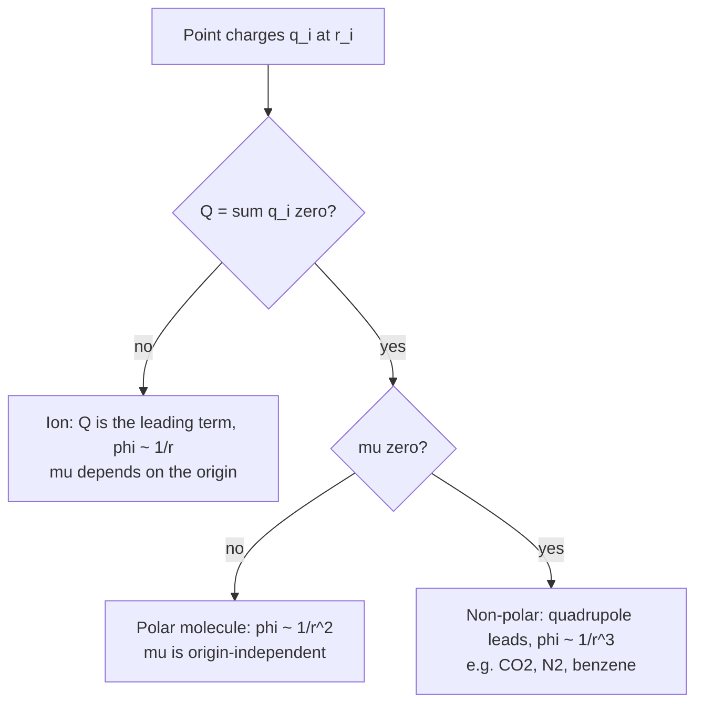

# 27.2 · Multipoles and molecular charge distributions

A molecule is a cloud of electrons around a few nuclei. Seen from far away, all that detail collapses into a short list of numbers: the net charge, the dipole moment, the quadrupole moment, and so on. These **multipole moments** decide how a molecule pulls on ions, on other molecules and on light. In lesson [04.3](../module-04/lesson-03.md) you met the dipole as two charges $\pm q$ a distance apart. Here you compute dipoles and quadrupoles for real molecular models, find out which ones depend on where you put the origin, and test the models against measured values.

## Why it matters

CO₂ and N₂ have no dipole moment, yet porous solids such as zeolites and metal–organic frameworks soak up far more CO₂ than N₂ from flue gas. The reason is the quadrupole moment: CO₂'s is three times larger than N₂'s, so it binds more strongly to the charged sites in the pores. Carbon-capture materials are screened on exactly this number. The same moments set the charges in every molecular-dynamics force field. A water model with the wrong dipole gives the wrong boiling point, the wrong dielectric constant and the wrong solvation energies. Knowing how to get the moments from charges, and how to check them against experiment, is how you judge a model before you trust it.

## Core ideas

> [!NOTE]
> The definitions here are stable. The experimental moments are from the NIST CCCBDB (Release 22) and were checked on 2026-10-17. The point charges are model parameters: TIP3P water (1983) and EPM2 CO₂ (1995) are still widely used, but force fields keep changing, so check the current literature before using any model for research.

### Moments of a set of charges

Put charges $q_i$ at positions $\mathbf{r}_i$, measured from an origin you choose.

- **Monopole** (net charge): $Q = \sum_i q_i$.
- **Dipole moment** (a vector): $\boldsymbol{\mu} = \sum_i q_i\,\mathbf{r}_i$. Its size is in C m or in debye, $1\ \text{D} = 3.336\times10^{-30}$ C m. In chemistry it points from the negative to the positive end.
- **Quadrupole moment** (a 3×3 table, a tensor): in the form introduced by Buckingham,

$$\Theta_{ab} = \tfrac{1}{2}\sum_i q_i\left(3\,r_{i,a}\,r_{i,b} - r_i^2\,\delta_{ab}\right)$$

where $a, b$ stand for $x, y, z$ and $\delta_{ab}$ is 1 when $a = b$ and 0 otherwise. The sum of the three diagonal elements (the trace) is always zero. Units: C m², or D Å ($1\ \text{D Å} = 3.336\times10^{-40}$ C m²).

For a linear molecule along $z$, the tensor has only one independent number, $\Theta = \Theta_{zz}$, with $\Theta_{xx} = \Theta_{yy} = -\Theta/2$. A negative $\Theta$ means negative charge at the ends and positive charge around the middle. CO₂ ($\Theta = -14.3\times10^{-40}$ C m²) has that shape: δ− oxygens at both ends, a δ+ carbon belt. So does benzene ($\Theta_{zz} = -8.7$ D Å along its six-fold axis): its π electrons make the two faces negative and its rim of H atoms positive.

### Which moments depend on the origin

Move the origin by a vector $\mathbf{a}$. Then each $\mathbf{r}_i$ becomes $\mathbf{r}_i - \mathbf{a}$ and

$$\boldsymbol{\mu}' = \boldsymbol{\mu} - Q\,\mathbf{a}$$

So the dipole of a *neutral* molecule does not depend on the origin, but the dipole of an ion does. The general rule: **the first non-zero moment is origin-independent; all higher ones depend on the origin.** The quadrupole of CO₂ (no charge, no dipole) is a property of the molecule. The quadrupole of water depends on where you put the origin, so tables quote it about the centre of mass. The "dipole moment of NH₄⁺" has no meaning unless you say about which point.

### Symmetry decides what must vanish

A molecule with a centre of inversion (CO₂, N₂, benzene, SF₆) has $\boldsymbol{\mu} = 0$: every charge at $\mathbf{r}$ has a twin at $-\mathbf{r}$. A tetrahedral or octahedral molecule (CH₄, SF₆) also has $\Theta = 0$, and its first non-zero moment is the octupole or higher. This is the same symmetry reasoning as lesson [20.5](../module-20/lesson-05.md): a moment can only be non-zero if it is unchanged by every symmetry operation of the molecule.

### The multipole expansion

Far from a molecule, its potential is a sum of terms that fall off faster and faster:

$$\phi(\mathbf{r}) = \frac{1}{4\pi\varepsilon_0}\left[\frac{Q}{r} + \frac{\boldsymbol{\mu}\cdot\mathbf{r}}{r^3} + \frac{\sum_{ab}\Theta_{ab}\,r_a r_b}{r^5} + \dots\right]$$

The charge term goes as $1/r$, the dipole as $1/r^2$, the quadrupole as $1/r^3$. Double the distance and a dipole's potential drops fourfold, a quadrupole's eightfold. That is why ion–ion forces act over long ranges, while forces between neutral molecules are short-ranged (lesson [27.4](lesson-04.md)). The expansion only works when you are far outside the charge distribution. Close in, at the distance of a hydrogen bond, you must sum the charges directly.



### Charges are a model, moments are measured

Atomic partial charges cannot be measured; they are chosen to reproduce something that can. Dipole moments are measured from the Stark effect in microwave spectra (lesson [20.2](../module-20/lesson-02.md)) or from dielectric data (lesson [27.3](lesson-03.md)). Quadrupole moments are measured from birefringence induced by a field gradient. A good charge model reproduces the measured moments, or deliberately departs from them for a stated reason.

## Worked example

### 1. The dipole of a TIP3P water molecule

TIP3P puts −0.834 e on O and +0.417 e on each H, with O–H = 0.9572 Å and H–O–H = 104.52°. Put O at the origin and the two-fold axis along $z$. Each H sits at $z = 0.9572\cos(52.26°) = 0.5859$ Å, at $x = \pm0.7570$ Å. The $x$ parts cancel. Along $z$:

$$\mu = 2 \times 0.417\,e \times 0.5859\ \text{Å} = 0.4886\ e\,\text{Å}$$

With $1\ e\,\text{Å} = 1.602\times10^{-29}$ C m $= 4.803$ D, $\mu = 2.35$ D. The isolated molecule's measured value is 1.857 D. TIP3P is too polar *on purpose*: in the liquid, each molecule is polarised by its neighbours, and a fixed-charge model has to include that extra dipole in its charges.

### 2. The quadrupole of CO₂ and the charge it implies

Put the O atoms at $z = \pm d$ with charge $-q$ each, and C at the origin with $+2q$. Only the O atoms contribute ($r = 0$ for C):

$$\Theta_{zz} = \tfrac{1}{2}\left[2 \times (-q)\,(3d^2 - d^2)\right] = -2qd^2$$

With the EPM2 charge $q = 0.3256\,e$ and the experimental $d = 1.162$ Å: $\Theta = -2 \times 0.3256 \times 1.602\times10^{-19} \times (1.162\times10^{-10})^2 = -14.09\times10^{-40}$ C m². The measured value is $(-14.27 \pm 0.61)\times10^{-40}$ C m². Turned around, the experiment implies $q = 14.27\times10^{-40}/(2 \times (1.162\times10^{-10})^2) = 5.28\times10^{-20}$ C $= 0.33\,e$ on each oxygen.

N₂'s measured quadrupole is $-4.65\times10^{-40}$ C m², three times smaller. At the same distance from a cation in a zeolite pore, CO₂'s quadrupole interaction is three times stronger: the quantitative root of CO₂/N₂ selectivity.

## Hands-on

What you need: the [Module 27 lab folder](../../labs/module-27/) with Python set up, and the [notebook page template](../../templates/notebook-page.md). Time: about 60 minutes.

### Part A — Python: moments of three models (35 min)

Open `lesson02_multipoles.py`. Complete `dipole()` (one line) and `quadrupole()` (a double loop is fine). Then run, from the lab folder:

```bash
py lesson02_multipoles.py
```

How you know it worked:

- Water (TIP3P): $|\mu|$ = 2.347 D along $+z$; quadrupole diagonal about the centre of mass (+1.76, −1.68, −0.08) D Å. The measured gas values are (+2.63, −2.50, −0.13) D Å in the same axes (in-plane, out-of-plane, along the two-fold axis; CCCBDB). Same pattern, about two-thirds the size.
- CO₂: $\mu$ = 0; $\Theta_{zz} = -14.09\times10^{-40}$ C m², close to experiment.
- OH⁻ (illustrative charges): charge −1 e, and in Part 2 its dipole changes by 4.80 D when the origin moves 1 Å, exactly $Q \times a$.
- Part 2: shifting the origin changes water's quadrupole (it has a dipole) but not CO₂'s.
- Part 3: on water's axis the dipole-only potential is 14 % off at 2.5 Å, 1.5 % at 7.5 Å, under 1 % at 12 Å.

Then build your own model. Write `hcl.csv` with H at $z$ = 0 and Cl at $z$ = 1.2746 Å, charges $\pm0.1785\,e$ (H positive), and run `py lesson02_multipoles.py hcl.csv`. You should get $\mu$ = 1.093 D, the measured value: the charge was chosen that way in lesson [04.3](../module-04/lesson-03.md).

### Part B — pencil (25 min)

1. Which of these have a zero dipole moment: BF₃, NH₃, CH₂Cl₂, trans-1,2-dichloroethene, SF₆? Which of the zero-dipole ones also have a zero quadrupole?
2. A model of N₂ puts −0.48 e on each N (at ±0.55 Å) and +0.96 e at the centre. Find $\Theta$ and compare with $-4.65\times10^{-40}$ C m².
3. On the axis of a dipole, the potential at 5 Å is 0.20 V. Estimate it at 10 Å. For a pure quadrupole with the same value at 5 Å, what is it at 10 Å?

<details><summary>Answers</summary>

1. Zero dipole: BF₃ (trigonal planar), trans-1,2-dichloroethene (centre of inversion), SF₆ (octahedral). NH₃ and CH₂Cl₂ are polar. Of the three, only SF₆ also has zero quadrupole (cubic symmetry). BF₃ and the trans-alkene have a non-zero quadrupole.
2. $\Theta = -2qd^2 = -2 \times 0.48 \times 1.602\times10^{-19} \times (0.55\times10^{-10})^2 = -4.65\times10^{-40}$ C m². The model was built to match the measured quadrupole.
3. Dipole: $1/r^2$, so $0.20/4 = 0.050$ V. Quadrupole: $1/r^3$, so $0.20/8 = 0.025$ V.

</details>

## Common mistakes

- **Quoting the dipole of an ion without an origin.** For a charged species, $\boldsymbol{\mu}$ changes with the origin. Say "about the centre of mass" or do not quote it.
- **Treating partial charges as measured.** Different charge schemes give different atomic charges for the same molecule. Only the moments they produce can be compared with experiment.
- **Forgetting the factor ½ or the trace term in Θ.** Without them the numbers differ from tables by factors of 2 or 3. Check that your tensor's trace is zero.
- **Assuming "no dipole" means "no electrostatics".** CO₂, N₂ and benzene interact strongly through their quadrupoles.
- **Using the multipole expansion at contact distances.** At hydrogen-bond distances the expansion converges slowly; sum the charges directly.

## Key takeaways

- Net charge, dipole and quadrupole are sums over charges: $Q = \sum q$, $\boldsymbol{\mu} = \sum q\mathbf{r}$, $\Theta_{ab} = \tfrac12\sum q(3r_ar_b - r^2\delta_{ab})$.
- The first non-zero moment is independent of the origin; the higher ones are not.
- Symmetry decides which moments vanish: an inversion centre removes the dipole, cubic symmetry also removes the quadrupole.
- The potential falls as $1/r$, $1/r^2$, $1/r^3$ for charge, dipole and quadrupole; the expansion fails close in.
- TIP3P water has 2.35 D against 1.857 D measured, by design; EPM2 CO₂ charges reproduce the measured quadrupole within its uncertainty.

## Sources

- [NIST CCCBDB: experimental dipole moments](https://cccbdb.nist.gov/diplistx.asp) — water 1.857 D, HCl 1.093 D.
- [NIST CCCBDB: experimental quadrupole moments](https://cccbdb.nist.gov/quadlistx.asp) — CO₂, N₂ (Graham et al. 1998), water, benzene.
- [NIST CCCBDB: experimental geometry of CO2](https://cccbdb.nist.gov/expgeom2x.asp?casno=124389) — r(CO) = 1.162 Å.
- [LAMMPS manual: TIP3P water model](https://docs.lammps.org/Howto_tip3p.html) — TIP3P charges and geometry.
- [MCCCS Towhee: EPM force fields](https://towhee.sourceforge.net/forcefields/epm.html) — EPM2 CO₂ charge increment.
- [OpenStax University Physics Volume 2, 7.3 Calculations of Electric Potential](https://openstax.org/books/university-physics-volume-2/pages/7-3-calculations-of-electric-potential) — potential of a dipole and of a charge distribution.
