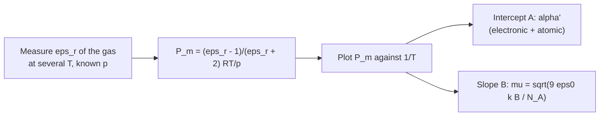

# 27.3 · Polarisability and dielectrics

Put a molecule in an electric field and two things happen. Its electron cloud shifts, giving an induced dipole; and, if it already has a dipole, it tends to turn and line up with the field. Add up those responses over many molecules and you get the relative permittivity of lesson [27.1](lesson-01.md). This lesson builds the bridge in both directions. From a molecular property, the polarisability, you predict the dielectric constant. From a measured dielectric constant at several temperatures, you recover the dipole moment, as chemists did for every polar molecule before microwave spectroscopy existed. You will do it with real data from the National Bureau of Standards tables.

## Why it matters

Polarisability sets how strongly molecules attract by dispersion (lesson [27.4](lesson-04.md)), how much light they scatter, and their refractive index. It is the reason iodine is a solid and fluorine a gas. Dielectric data are how most of the dipole moments in older tables were measured. The same analysis is still used to check the purity of transformer oils and to characterise new solvents, ionic liquids and polymers. A chemist who can read a permittivity table can tell, from two numbers, whether a liquid's molecules are polar, how much of its response comes from turning molecules, and whether the simple models can be trusted for it.

## Core ideas

> [!NOTE]
> The theory (Clausius–Mossotti, Debye, Onsager) is stable. The data are from NBS Circulars 514 (1951) and 537 (1953), still the reference compilations for these substances, read from the NIST copies on 2026-10-17. Polarisabilities and dipoles are NIST CCCBDB Release 22. Refractive indices and densities are from PubChem (HSDB records). The HCl Debye points in the lab are *reconstructed* from the published fit, not the original readings; the lab README says how.

### Polarisability: how soft a molecule is

A field $\mathbf{E}$ pulls electrons one way and nuclei the other, creating an induced dipole

$$\boldsymbol{\mu}_\text{ind} = \alpha\,\mathbf{E}$$

The **polarisability** $\alpha$ has the awkward SI unit C m² V⁻¹. Chemists use the **polarisability volume** $\alpha' = \alpha/(4\pi\varepsilon_0)$, in ų. It is roughly the volume of the electron cloud: He 0.21 ų, Ar 1.66 ų, CCl₄ 10.0 ų (CCCBDB). Big, diffuse electron clouds are soft; small, tightly held ones are stiff. Tiny example: in the field of 0.15 V/nm inside a lipid membrane, an argon atom gets $\mu = 4\pi\varepsilon_0\alpha' E = 1.11\times10^{-10} \times 1.66\times10^{-30} \times 1.5\times10^{8} = 2.8\times10^{-32}$ C m, or 0.008 D. Small, but every molecule has it.

### Clausius–Mossotti: from molecules to εr

In a dense material each molecule feels the applied field plus the field of its polarised neighbours. Lorentz's estimate of this **local field** is $E_\text{loc} = E + P/(3\varepsilon_0)$. Feeding it back into $P = N\alpha E_\text{loc}$ gives the **Clausius–Mossotti equation**

$$\frac{\varepsilon_r - 1}{\varepsilon_r + 2} = \frac{N\alpha}{3\varepsilon_0}$$

where $N$ is the number of molecules per m³. Multiply by the molar volume $M/\rho$ and the right side becomes a molecular constant, the **molar polarisation**:

$$P_m = \frac{\varepsilon_r - 1}{\varepsilon_r + 2}\,\frac{M}{\rho} = \frac{N_A\alpha}{3\varepsilon_0} = \frac{4\pi}{3}N_A\alpha'$$

Put $n^2$ in place of $\varepsilon_r$ and the same formula gives the **molar refraction** $R_m$ (the Lorentz–Lorenz equation). $R_m$ contains only the electronic polarisability, because only electrons follow light (lesson [27.1](lesson-01.md)).

For a gas $\varepsilon_r$ is close to 1, so $\varepsilon_r - 1 \approx N\alpha/\varepsilon_0$, and $\varepsilon_r - 1$ is proportional to pressure. NBS Circular 537 lists argon at 20 °C and 1 atm as $\varepsilon_r - 1 = 517.2\times10^{-6}$.

### Debye: turning dipoles add $\mu^2/3kT$

A polar molecule in a field has energy $-\mu E\cos\theta$, where $\theta$ is the angle between dipole and field. Thermal motion fights alignment. The Boltzmann average (lesson [21.1](../module-21/lesson-01.md)) for a weak field gives a mean dipole along the field of $\mu^2E/(3kT)$. It acts like an extra polarisability that falls with temperature, so

$$P_m = \frac{N_A}{3\varepsilon_0}\left(\alpha + \frac{\mu^2}{3kT}\right) = A + \frac{B}{T}, \qquad B = \frac{N_A\mu^2}{9\varepsilon_0 k_B}$$

This is the **Debye equation**. A plot of $P_m$ against $1/T$ is a straight line. The intercept $A$ is the **distortion polarisation** (electronic plus a small "atomic" part from vibrations); the slope gives $\mu$. A non-polar gas gives a flat line.



### Where it breaks: polar liquids

Clausius–Mossotti assumes each molecule's neighbours are a smooth, uncorrelated continuum. That holds for gases and for non-polar liquids. In a polar liquid, the neighbours' dipoles respond to each molecule's own dipole (Onsager's **reaction field**), and hydrogen-bonded molecules line up in chains, so dipoles add. Onsager's equation fixes the first problem:

$$\frac{(\varepsilon_r - n^2)(2\varepsilon_r + n^2)}{\varepsilon_r(n^2 + 2)^2} = \frac{N\mu^2}{9\varepsilon_0 k_B T}$$

It works for liquids without hydrogen bonds. For water and alcohols it still gives too large a dipole, because neighbouring dipoles are correlated; Kirkwood added a correlation factor $g$ for that.

## Worked example

### 1. Argon's polarisability from its dielectric constant

At 20 °C and 1 atm, $N = p/(k_BT) = 101\,325/(1.380649\times10^{-23} \times 293.15) = 2.503\times10^{25}$ m⁻³. Then

$$\alpha' = \frac{3}{4\pi N}\,\frac{\varepsilon_r - 1}{\varepsilon_r + 2} = \frac{3}{4\pi \times 2.503\times10^{25}} \times \frac{517.2\times10^{-6}}{3.000517} = 1.644\times10^{-30}\ \text{m}^3$$

That is 1.644 ų, 1.2 % below the CCCBDB value of 1.664 ų. One measurement of a capacitor gives an atomic property.

### 2. Benzene and chlorobenzene: polar or not?

| at 20 °C | $M$ (g/mol) | $\rho$ (g/cm³) | $\varepsilon_r$ | $n_D$ | $P_m$ | $R_m$ |
|---|---|---|---|---|---|---|
| benzene | 78.11 | 0.8765 | 2.2811 | 1.5011 | 26.7 | 26.3 |
| chlorobenzene | 112.56 | 1.1058 | 5.708 | 1.5241 | 62.2 | 31.2 |

(cm³/mol; $\varepsilon_r$ from NBS Circular 514, $n_D$ and $\rho$ from PubChem.) For benzene $P_m \approx R_m$: only electrons respond, and the 0.4 cm³/mol difference is the small atomic polarisation. Chlorobenzene's $P_m$ is twice its $R_m$: the extra 31 cm³/mol is orientation. Treating it as a Debye gas gives $\mu = \sqrt{9\varepsilon_0 k_B T (P_m - R_m)/N_A} = 1.22$ D, well below the gas value of 1.78 D. Onsager's equation gives 1.46 D, closer. The liquid's neighbours are the problem, not the molecule.

### 3. The dipole of HCl from a Debye fit

Zahn measured HCl gas from 201 to 589 K. NBS Circular 537 lists his fit as $A$ = 7.63 cm³/mol and $\mu$ = 1.050 D. Check the slope: $B = N_A\mu^2/(9\varepsilon_0 k_B) = 6.02\times10^{23} \times (3.502\times10^{-30})^2/(9 \times 8.854\times10^{-12} \times 1.381\times10^{-23}) = 6.71\times10^{-3}$ m³ K/mol = 6710 cm³ K/mol. At 298 K the orientation term is $6710/298 = 22.5$ cm³/mol, three times the distortion term: 75 % of HCl's polarisation comes from turning molecules. The modern Stark-effect value is 1.093 D. A 4 % gap is typical of 1920s dielectric work.

## Hands-on

What you need: the [Module 27 lab folder](../../labs/module-27/) with Python set up, and the [error analysis template](../../templates/error-analysis.md). Time: about 60 minutes. The data are real tables from NBS Circulars 537 and 514 (US government works) plus PubChem and CCCBDB, except `hcl_debye_points.csv`, which is rebuilt from Zahn's published fit with 0.4 % noise so you can run the full analysis.

### Part A — Python: three analyses (40 min)

Open `lesson03_dielectrics.py`. Complete `alpha_volume_gas()` (two lines), `molar_polarisation()` (one line) and `debye_mu()` (one line). Run:

```bash
py lesson03_dielectrics.py
```

How you know it worked:

- Part 1: polarisability volumes within 2.5 % of CCCBDB for He, H₂, O₂, Ar and N₂. CO₂ comes out 17 % high (2.93 against 2.51 ų). NBS Circular 537 warns why: CO₂ absorbs strongly in the infrared, so its static value includes a vibrational ("atomic") part that the optical polarisability lacks.
- Part 2: $P_m \approx R_m$ within 2 cm³/mol for cyclohexane, CCl₄ and benzene; $P_m \gg R_m$ for the four polar liquids. The naive Debye dipoles are all too low. Onsager gives 4.16 D for nitrobenzene (gas 4.22) and 1.46 D for chlorobenzene (gas 1.78), but 3.0 D for methanol and 3.1 D for water (gas 1.67 and 1.86): hydrogen-bonded dipoles line up.
- Part 3: $\mu$ = 1.053 ± 0.003 D and $A$ = 7.46 ± 0.11 cm³/mol, consistent with Zahn's fit; orientation share 75 % at 298 K. The table of other gases shows 95 % for water and 21 % for HI.

Write up Part 3 with the error-analysis template: where does the 4 % gap between 1.05 D and 1.093 D come from? (Hint: the stated uncertainty is the scatter about the line only.)

### Part B — pencil (20 min)

1. Krypton's polarisability volume is 2.498 ų (CCCBDB). Predict $\varepsilon_r - 1$ for krypton gas at 20 °C and 1 atm.
2. A gas gives $P_m$ = 40.0 cm³/mol at 300 K and 31.2 cm³/mol at 400 K. Find $A$ and $\mu$.
3. Carbon tetrachloride gives $P_m - R_m$ = 1.75 cm³/mol, but CCl₄ has no dipole. What does the difference measure?

<details><summary>Answers</summary>

1. $\varepsilon_r - 1 \approx 4\pi N\alpha' = 4\pi \times 2.503\times10^{25} \times 2.498\times10^{-30} = 7.86\times10^{-4}$, about 786 ppm (to first order; the full Clausius–Mossotti form changes it by 0.05 %).
2. $B = (40.0 - 31.2)/(1/300 - 1/400) = 8.8/8.333\times10^{-4} = 10\,560$ cm³ K/mol; $A = 40.0 - 10\,560/300 = 4.8$ cm³/mol. $\mu = \sqrt{9\varepsilon_0k_B \times 1.056\times10^{-2}/N_A} = 4.39\times10^{-30}$ C m = 1.32 D.
3. The atomic (vibrational) polarisation: in a static field the C–Cl bonds bend and stretch a little, which light at optical frequencies cannot drive. It is part of the distortion polarisation $A$, not orientation.

</details>

## Common mistakes

- **Using the Debye equation for a polar liquid.** It assumes isolated molecules. In a liquid it underestimates $\mu$; use dilute solutions in a non-polar solvent, the gas, or at least Onsager's equation.
- **Mixing up α and α′.** α in C m² V⁻¹ is about $10^{-40}$; α′ in m³ is about $10^{-30}$. They differ by $4\pi\varepsilon_0 = 1.11\times10^{-10}$.
- **Copying CGS formulas into SI.** Old tables write $P = \tfrac{4\pi}{3}N_A(\alpha' + \mu^2/3kT)$ with $\mu$ in esu. In SI with $\mu$ in C m use $N_A/(3\varepsilon_0)$ and $\alpha$ in C m² V⁻¹, or convert every term.
- **Forgetting that A includes atomic polarisation.** Taking $A = R_m$ (the "optical procedure") makes $\mu$ slightly too large; NBS Circular 537 lists such values as upper limits.
- **Using a gas permittivity without its pressure and temperature.** $\varepsilon_r - 1$ is proportional to $p/T$; a number without conditions cannot be converted to $P_m$.

## Key takeaways

- Polarisability volume α′ (ų) measures how soft the electron cloud is; it grows with the number and looseness of electrons.
- Clausius–Mossotti links α to εr: $P_m = \frac{\varepsilon_r - 1}{\varepsilon_r + 2}\frac{M}{\rho} = \frac{4\pi}{3}N_A\alpha'$; with $n^2$ it gives the molar refraction.
- Debye adds orientation: $P_m = A + B/T$ with $B = N_A\mu^2/(9\varepsilon_0k_B)$; slope gives μ, intercept gives the distortion polarisation.
- $P_m \approx R_m$ means non-polar; $P_m \gg R_m$ means turning dipoles.
- Polar liquids break the simple model; Onsager's reaction field fixes non-associated liquids, hydrogen-bonded ones also need correlation.

## Sources

- [NBS Circular 537](https://nvlpubs.nist.gov/nistpubs/Legacy/circ/nbscircular537.pdf) — reference gas dielectric constants at 20 °C, 1 atm; Debye fits for HCl, HBr, HI, NH₃, SO₂, H₂S, H₂O; the optical procedure.
- [NBS Circular 514](https://nvlpubs.nist.gov/nistpubs/Legacy/circ/nbscircular514.pdf) — static permittivities of standard liquids at 20 °C.
- [NIST CCCBDB: experimental polarizabilities](https://cccbdb.nist.gov/pollistx.asp) and [experimental dipole moments](https://cccbdb.nist.gov/diplistx.asp) — α′ and gas-phase μ.
- [OpenStax University Physics Volume 2, 8.5 Molecular Model of a Dielectric](https://openstax.org/books/university-physics-volume-2/pages/8-5-molecular-model-of-a-dielectric) — induced and oriented dipoles in a dielectric.
- [PubChem: benzene](https://pubchem.ncbi.nlm.nih.gov/compound/241) — refractive index and density (HSDB), as for the other liquids by CID in the lab file.
