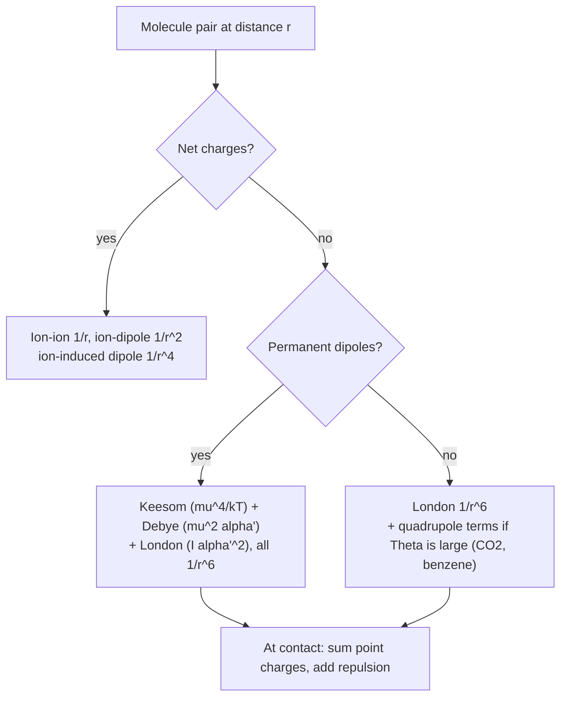

# 27.4 · Intermolecular forces from electrostatics

In lesson [07.4](../module-07/lesson-04.md) you ranked boiling points with labels: dispersion, dipole–dipole, hydrogen bond. This lesson puts numbers behind the labels. Every one of those forces is electrostatics between the charge distributions of lesson [27.2](lesson-02.md), with the polarisabilities of lesson [27.3](lesson-03.md) deciding how much each molecule responds. You will compute how much of the attraction between two HCl molecules is dispersion (most of it), why water is the exception, and how strong a hydrogen bond is when you build it from point charges. The lesson ends with the module's practical report.

## Why it matters

Intermolecular forces decide boiling points, solubility, crystal packing, how a drug fits its pocket and how a protein folds. Every molecular-dynamics force field is built from the terms in this lesson: point charges for electrostatics, an $r^{-6}$ attraction for dispersion and a steep repulsion. A chemist who knows the size of each term can predict which solvent dissolves a compound, see why HI boils higher than HCl despite a smaller dipole, and judge whether a cheap model is good enough for a problem.

## Core ideas

> [!NOTE]
> The interaction formulas are stable textbook physics. The molecular data are measured values (CCCBDB Release 22 for μ and α′, NIST WebBook evaluated ionisation energies, PubChem and WebBook boiling points), checked 2026-10-17. London's formula is an approximation: modern dispersion coefficients come from quantum chemistry and differ from it by tens of per cent. TIP3P and EPM2 are fixed-charge models; newer polarisable models give better dimer geometries.

### The family of interactions

Each interaction comes from putting one charge distribution in the field of another. Energies for two molecules at distance $r$ (with $k = 1/4\pi\varepsilon_0$):

| Interaction | Energy | Falls off as |
|---|---|---|
| ion–ion | $k\,q_1q_2/r$ | $r^{-1}$ |
| ion–dipole (aligned) | $-k\,q\mu/r^2$ | $r^{-2}$ |
| dipole–dipole (fixed, head to tail) | $-2k\,\mu_1\mu_2/r^3$ | $r^{-3}$ |
| ion–induced dipole | $-\tfrac12 k\,q^2\alpha'/r^4$ | $r^{-4}$ |
| quadrupole–quadrupole (fixed) | $\propto k\,\Theta_1\Theta_2/r^5$ | $r^{-5}$ |
| dipole–dipole, thermally averaged (Keesom) | $-\tfrac23 k^2\mu_1^2\mu_2^2/(k_BT\,r^6)$ | $r^{-6}$ |
| dipole–induced dipole (Debye) | $-k\,\mu_1^2\alpha'_2/r^6$ (plus the reverse) | $r^{-6}$ |
| dispersion (London) | $-\tfrac32\,\frac{I_1I_2}{I_1+I_2}\,\alpha'_1\alpha'_2/r^6$ | $r^{-6}$ |

The higher the multipole, the shorter the range, exactly as the potentials of lesson [27.2](lesson-02.md) fall off faster.

### Why thermal motion gives r⁻⁶

Two polar molecules in a gas or liquid tumble. If they had no preference, attractive and repulsive orientations would cancel and the average energy would be zero. But the Boltzmann factor $e^{-U/kT}$ (lesson [21.1](../module-21/lesson-01.md)) weights the attractive orientations slightly more. When $|U| \ll kT$, expanding to first order gives the **Keesom** energy: proportional to $\mu^4$, to $1/T$, and to $r^{-6}$ (the square of the $r^{-3}$ dipole energy). The same averaging over orientations gave the $\mu^2/3kT$ of the Debye equation in lesson [27.3](lesson-03.md).

### Induction and dispersion: the polarisability at work

A permanent dipole's field polarises its neighbour (the **Debye** or induction term). Even two non-polar atoms attract: the electron cloud of one fluctuates, creating an instantaneous dipole that polarises the other, and the two fluctuations become correlated. That is **London dispersion**. For two identical molecules London's formula becomes $C_6 = \tfrac34 I\alpha'^2$, with $I$ the ionisation energy (a measure of the fluctuation frequency) and $\alpha'$ the polarisability volume. Dispersion scales as $\alpha'^2$: double the size of the electron cloud and the attraction quadruples. That is why boiling points of non-polar molecules track polarisability so closely.



### Contact distances: the expansion stops working

All the $r^{-n}$ formulas assume the molecules are far apart compared with their size. In a liquid or a hydrogen bond, they touch. Then two things matter. First, a steep repulsion appears as electron clouds overlap (the Pauli principle); force fields write it as $r^{-12}$ in the **Lennard-Jones** potential $4\epsilon[(\sigma/r)^{12} - (\sigma/r)^6]$. Second, the electrostatics must be computed charge by charge, because the multipole expansion converges slowly or not at all. A hydrogen bond is mostly electrostatic, but only a point-charge model, not a point-dipole one, gets its size right.

## Worked example

### 1. A water molecule next to Na⁺

The first-shell O sits about 2.4 Å from Na⁺, with the dipole (1.857 D = $6.19\times10^{-30}$ C m) pointing away from the ion. The ion–dipole energy is

$$U = -\frac{k\,e\,\mu}{r^2} = -\frac{8.988\times10^{9} \times 1.602\times10^{-19} \times 6.19\times10^{-30}}{(2.4\times10^{-10})^2} = -1.55\times10^{-19}\ \text{J}$$

That is −93 kJ/mol per water molecule, about 38 times $kT$ at 298 K (2.48 kJ/mol). The waters are locked in place, not tumbling, which is why thermal averaging does not apply to a first solvation shell. (The point-dipole formula is only a rough guide this close, as you will see for the water dimer.)

### 2. What holds HCl together in the liquid?

With CCCBDB values $\mu$ = 1.093 D, $\alpha'$ = 2.515 ų, and the NIST ionisation energy $I$ = 12.744 eV, at 298 K:

| term | formula (like pair) | $C_6$ ($10^{-79}$ J m⁶) | energy at 0.40 nm (kJ/mol) |
|---|---|---|---|
| Keesom | $\tfrac23 k^2\mu^4/k_BT$ | 23.1 | −0.34 |
| Debye | $2k\mu^2\alpha'$ | 6.0 | −0.09 |
| London | $\tfrac34 I\alpha'^2$ | 96.9 | −1.42 |

Dispersion is 77 % of the $r^{-6}$ attraction even in this "polar" molecule. Going down to HI, the dipole shrinks to 0.448 D but $\alpha'$ more than doubles to 5.45 ų, so London's $C_6$ quadruples. That is why HI (bp 238 K) boils higher than HCl (188 K). Check also the condition for Keesom: the fixed head-to-tail energy at 0.40 nm, $-2k\mu^2/r^3 = -2.2$ kJ/mol, is about $kT$. The thermal average is only a rough estimate for HCl at contact.

## Hands-on

What you need: the [Module 27 lab folder](../../labs/module-27/) with Python set up, your results from lessons [27.2](lesson-02.md) and [27.3](lesson-03.md), and the [lab report template](../../templates/lab-report.md). Time: about 100 minutes. This is the module's practical piece: it chains point charges → moments → polarisabilities → interaction energies → boiling points.

### Part A — Python: from properties to forces (45 min)

Open `lesson04_imf.py`. Complete `keesom_c6()`, `debye_c6()`, `london_c6()` (one line each) and `pair_energy()` (Coulomb energy between two sets of charges). Run:

```bash
py lesson04_imf.py
py lesson04_imf.py 373
```

How you know it worked:

- Part 1 reproduces the HCl row above (23.1, 6.0, 96.9) and shows water as the exception: Keesom 81 %, London 14 %. NH₃ is 55 % Keesom. For the six non-polar molecules, the boiling point tracks $\ln C_6$ with $r$ = 0.988. At 373 K the Keesom terms shrink by 298/373.
- Part 2: the TIP3P dimer has its minimum at R(O···O) = 2.75 Å with −25.5 kJ/mol (Coulomb −32.8, Lennard-Jones +7.3). A point-dipole estimate at the same geometry gives only −12.7 kJ/mol. Tilting the acceptor to 90° weakens the bond to −10.8 kJ/mol.
- Part 3: CO₂ pairs end-to-end (+1.6 kJ/mol) and side by side (+1.7) repel electrostatically; the T shape attracts (−3.3 kJ/mol). Negative oxygen ends meet the positive carbon belt only in the T: the quadrupole picture of lesson [27.2](lesson-02.md).

Compare with experiment: the measured dissociation energy of the gas-phase water dimer is $D_0$ = 13.2 kJ/mol (Rocher-Casterline et al. 2011); high-level calculations that add back the zero-point vibrational energy put the well depth near 21 kJ/mol (Gurtubay and Needs 2007). TIP3P overbinds by about 20 %, the price of charges tuned for the liquid (lesson [27.2](lesson-02.md)).

### Part B — the module report (35 min)

Write a two-page report with the lab-report template. Use these headings inside it:

1. **Charges to moments.** Your water and CO₂ moments from 27.2 against CCCBDB, and what the TIP3P dipole excess means.
2. **Moments to polarisation.** Your Clausius–Mossotti α′ for Ar and N₂ and your Debye μ for HCl from 27.3, with uncertainties.
3. **Polarisation to forces.** Rerun Part 1 after replacing the CCCBDB α′ of Ar and N₂ in a copy of `imf_molecules.csv` with your own values from 27.3. How much do the London $C_6$ values change (expect about 2–4 %, since $C_6 \propto \alpha'^2$)?
4. **Forces to properties.** Explain, with your numbers, the boiling-point order HCl < HBr < HI and why water breaks the pattern.
5. **Limits.** Name two places where the models of this module stop working (contact distances, polar liquids, fixed charges).

### Part C — pencil (20 min)

1. Estimate the Keesom energy of two water molecules at 0.5 nm and 298 K. Is the averaging assumption valid?
2. Xenon (α′ = 4.005 ų, I = 12.13 eV) and argon (1.664 ų, 15.76 eV): by what factor is xenon's London $C_6$ larger?
3. Why do benzene molecules in the crystal sit edge-to-face rather than stacked exactly face-to-face?

<details><summary>Answers</summary>

1. $C_K$ = 192.6 × 10⁻⁷⁹ J m⁶ (lab), so $U = -C/r^6 = -1.926\times10^{-77}/(0.5\times10^{-9})^6 = -1.23\times10^{-21}$ J = −0.74 kJ/mol, below $kT$ (2.48 kJ/mol), so roughly valid at 0.5 nm. The fixed head-to-tail energy there, $-2k\mu^2/r^3 = -3.3$ kJ/mol, is already larger than $kT$: the approximation is strained.
2. $(4.005/1.664)^2 \times 12.13/15.76 = 5.79 \times 0.770 = 4.46$. The lab gives 233.8/52.4 = 4.46.
3. Benzene's quadrupole is negative along its axis (negative faces, positive rim). Face-to-face puts two negative faces together; edge-to-face puts a positive rim of H atoms against a negative face, so electrostatics favours it. Dispersion favours stacking, so real crystals and dimers compromise (edge-to-face or offset stacks).

</details>

## Common mistakes

- **Calling every polar-molecule attraction "dipole–dipole".** For HCl, HBr and HI, dispersion dominates. Compute the terms before naming the force.
- **Using Keesom when |U| is not small compared with kT.** At contact, or next to an ion, molecules lock in place and the $1/T$ average fails.
- **Treating a hydrogen bond as two point dipoles.** At 2.75 Å the dipole formula gives half the point-charge energy. Use charges (or a quantum calculation).
- **Forgetting the repulsion.** Without the $r^{-12}$ (or exponential) term, charges collapse onto each other and energies run to minus infinity.
- **Comparing C₆ values that use different conventions.** Some tables quote the energy coefficient for unlike pairs, others include factors of 2 for "both directions" of induction. State your formula.

## Key takeaways

- All intermolecular forces are electrostatics between charge distributions plus the polarisation they induce; the higher the multipole, the shorter the range.
- Thermal averaging turns the $r^{-3}$ dipole–dipole energy into the Keesom term, $\propto \mu^4/(kT\,r^6)$, valid only when $|U| \ll kT$.
- London dispersion, $C_6 \approx \tfrac34 I\alpha'^2$, dominates for most molecules, polar ones included; boiling points of non-polar molecules track $\ln C_6$.
- Water is the exception: its Keesom term is 81 % of the $r^{-6}$ attraction, and its hydrogen bond needs point charges, not dipoles.
- Quadrupoles decide geometry for CO₂ and benzene: T-shaped or edge-to-face contacts.

## Sources

- [LibreTexts: Dipole-Dipole Interactions](https://chem.libretexts.org/Bookshelves/Physical_and_Theoretical_Chemistry_Textbook_Maps/Supplemental_Modules_(Physical_and_Theoretical_Chemistry)/Physical_Properties_of_Matter/Atomic_and_Molecular_Properties/Intermolecular_Forces/Specific_Interactions/Dipole-Dipole_Interactions) — fixed and rotating dipole interactions.
- [NIST CCCBDB: experimental polarizabilities](https://cccbdb.nist.gov/pollistx.asp) and [dipole moments](https://cccbdb.nist.gov/diplistx.asp) — α′ and μ for the molecules in `imf_molecules.csv`.
- [NIST Chemistry WebBook: hydrogen chloride, ion energetics](https://webbook.nist.gov/cgi/cbook.cgi?ID=C7647010&Mask=20) — evaluated ionisation energy 12.744 eV (the other molecules from their own WebBook pages, listed in the lab file).
- [LAMMPS manual: TIP3P water model](https://docs.lammps.org/Howto_tip3p.html) — charges, geometry, O–O Lennard-Jones parameters.
- [Rocher-Casterline et al., J. Chem. Phys. 134, 211101 (2011)](https://doi.org/10.1063/1.3598339) — measured water dimer $D_0$ = 13.2 kJ/mol.
- [Gurtubay and Needs, arXiv:0709.4351](https://arxiv.org/abs/0709.4351) — computed water dimer well depth of about 5.0–5.5 kcal/mol (21–23 kJ/mol).
- [OpenStax Chemistry 2e, 10.1 Intermolecular Forces](https://openstax.org/books/chemistry-2e/pages/10-1-intermolecular-forces) — qualitative ranking and boiling-point trends.
