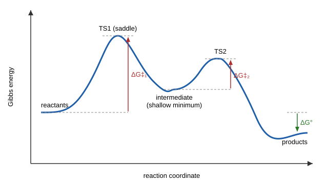

# 28.1 · Potential energy surfaces and reaction coordinates

Every mechanism you drew with curved arrows in Modules 15 and 16 is a walk across a landscape. The landscape is the potential energy surface: the energy of a group of atoms for every possible arrangement of their nuclei. Valleys are molecules, mountain passes are transition states, and the easiest route between two valleys is the reaction path. This lesson teaches you to read that landscape, to turn the height of a pass into a rate with the Eyring equation from [22.4](../module-22/lesson-04.md), and to decide which product a reaction gives when two routes compete. You will find the valleys and passes of a classic model surface in Python.

## Why it matters

Suppose you have separated two slowly interconverting forms of a drug molecule, for example two shapes that differ by rotation about a crowded single bond. Will the pure form stay pure in the bottle? The answer is the height of the pass between the two valleys. With a free-energy barrier of 80 kJ/mol at 25 °C, half of the sample has converted after about 12 seconds. With 100 kJ/mol, after about 10 hours. With 120 kJ/mol, after about 4 years. Twenty kJ/mol, about the energy of one hydrogen bond, decides whether you have one compound or two. You can only make that decision if you know where the pass is and how high it is.

## Core ideas

> [!NOTE]
> The ideas here (stationary points, reaction paths, transition-state theory, Curtin–Hammett) are stable textbook physical chemistry. The Müller–Brown surface is a fixed published test function from 1979. Constants are CODATA 2022. Checked on 2026-10-17.

### The surface

Electrons move so much faster than nuclei that, for every fixed arrangement of the nuclei, the electrons settle into their lowest state (the Born–Oppenheimer approximation, which you met with isotopes in [12.4](../module-12/lesson-04.md)). The electronic energy plus the repulsion between the nuclei is then a function of the nuclear positions only. That function is the **potential energy surface** (PES). A molecule with $N$ atoms has $3N - 6$ internal coordinates (bond lengths, angles, dihedrals), so the PES of even a small reaction lives in many dimensions. We draw slices of it: one coordinate gives a curve (the torsion scan of butane in [15.2](../module-15/lesson-02.md)), two coordinates give a contour map.

### Stationary points: valleys and passes

A **stationary point** is a geometry where the **gradient** (the vector of first derivatives of the energy, minus the force on each atom) is zero. The second derivatives, collected in the **Hessian** matrix, tell you what kind of point it is. Diagonalise the Hessian and read the signs of its eigenvalues, which are the curvatures along the principal directions:

| Eigenvalues of the Hessian | Stationary point | Chemical meaning |
|---|---|---|
| all positive | minimum | a reactant, product or intermediate |
| exactly one negative | first-order saddle point | a transition state |
| two or more negative | higher-order saddle | not on any useful reaction path |

A **transition state** (TS) is the highest point on the best route and the lowest point across the ridge at the same time: a mountain pass. Along the one direction of negative curvature the energy falls on both sides; along every other direction it rises. In a vibrational calculation, negative curvature gives an **imaginary frequency**. Module 31 uses exactly this test: a computed transition state must have one imaginary frequency, and a computed minimum none.

### The reaction coordinate and the minimum-energy path

Start at the saddle point, step a tiny distance along the direction of negative curvature, and roll downhill. Do the same in the opposite direction. The two descents end in two minima, and together they form the **minimum-energy path** (MEP), also called the intrinsic reaction coordinate. Distance along that path is the **reaction coordinate**. A textbook energy profile is the energy plotted against this one coordinate, with all the other $3N - 7$ coordinates relaxed. A straight line between two minima is not the reaction path: it usually climbs over a hill instead of through the pass.

Energy profiles in organic chemistry usually show the **Gibbs energy**, not the bare potential energy. The Gibbs profile adds zero-point energy, thermal energy and entropy, and it is the one that sets rates and equilibria.

### Intermediates and transition states



An **intermediate** sits in a valley, however shallow. It vibrates there for at least a few vibrations, so in principle you can detect it, trap it, or, if the well is deep, isolate it. A transition state sits on a pass. It exists for about one vibration (about $10^{-13}$ s) and can never be bottled. Carbocations, radicals and carbenes (lesson [28.4](lesson-04.md)) are intermediates; a structure with partly formed and partly broken bonds drawn in square brackets with ‡ is a transition state.

In a multistep reaction the **rate-determining step** is not simply the step with the largest individual barrier. It is the transition state that lies highest above the lowest state that comes before it. In the figure, TS1 lies highest above the reactants, so the first step limits the rate. This is the energy-landscape version of the rate-determining step and pre-equilibrium ideas of [22.3](../module-22/lesson-03.md).

### From barrier height to rate

Transition-state theory gives the rate constant of one elementary step from its free energy of activation:

$$k = \frac{k_BT}{h}\,e^{-\Delta^\ddagger G/RT}$$

At 298 K, $k_BT/h = 6.21\times10^{12}$ s⁻¹ and $RT\ln 10 = 5.71$ kJ/mol. So every 5.7 kJ/mol of barrier costs a factor of 10 in rate. A barrier of about 90 kJ/mol gives a half-life of minutes at room temperature: the comfortable range for a reaction you run in a flask. Barriers below about 60 kJ/mol react in well under a second; those above about 120 kJ/mol barely move unless heated.

### Kinetic and thermodynamic control

When two products can form, two questions decide which one you get. Under **kinetic control** the products do not convert back, so their ratio is the ratio of the rates of formation: $P_1/P_2 = e^{(\Delta^\ddagger G_2 - \Delta^\ddagger G_1)/RT}$, set by the difference between the two transition states. Under **thermodynamic control** the products equilibrate, so their ratio is $e^{-\Delta G^\circ/RT}$, set by the difference between the products themselves. Low temperature and short times favour kinetic control; heat and long times allow the system to reach equilibrium.

### The Curtin–Hammett principle

Many molecules react from two conformers that interconvert much faster than either reacts (the cyclohexane ring flip of [15.2](../module-15/lesson-02.md) takes about $10^{-5}$ s). Then the product ratio does not depend on how much of each conformer is present. It depends only on the difference in Gibbs energy between the two transition states, each measured from the same starting point. A minor conformer can give the major product if its transition state is lower. This is the **Curtin–Hammett principle**: populations of rapidly equilibrating starting forms do not set the product ratio; the transition states do.

## Worked example

### 1. How long does a separated isomer survive?

Two isomers interconvert over a free-energy barrier $\Delta^\ddagger G$. Find the half-life at 25 °C for 80, 100 and 120 kJ/mol.

1. $RT = 8.3145 \times 298.15 = 2479$ J/mol and $k_BT/h = 6.21\times10^{12}$ s⁻¹.
2. For 80 kJ/mol: $k = 6.21\times10^{12} \times e^{-80\,000/2479} = 6.21\times10^{12} \times e^{-32.27} = 0.060$ s⁻¹. First-order half-life: $t_{1/2} = \ln 2/k = 11.6$ s.
3. For 100 kJ/mol: $k = 1.88\times10^{-5}$ s⁻¹, $t_{1/2} = 3.7\times10^4$ s, about 10 hours.
4. For 120 kJ/mol: $k = 5.9\times10^{-9}$ s⁻¹, $t_{1/2} = 1.2\times10^8$ s, about 3.7 years.

At body temperature (37 °C) the 120 kJ/mol isomer lasts only about half a year, because $k$ rises sevenfold. For a real equilibrium between two forms the approach to equilibrium is faster still, because the reverse reaction also runs; the point here is the steepness: 20 kJ/mol is a factor of about 3000.

### 2. A minor conformer gives the major product

A molecule exists as two conformers, A and B, that interconvert in microseconds. B is 4.0 kJ/mol above A. Each reacts irreversibly with a reagent: the transition state from A lies 80.0 kJ/mol above A; the one from B lies 74.0 kJ/mol above B. Which product dominates at 298 K?

1. Populations: $[B]/[A] = e^{-4000/2479} = 0.199$, so B is only 17 % of the material.
2. Put both transition states on one scale, measured from A: $\text{TS}_A = 80.0$ kJ/mol, $\text{TS}_B = 4.0 + 74.0 = 78.0$ kJ/mol.
3. Curtin–Hammett: $P_B/P_A = e^{(80.0 - 78.0)/2.479} = e^{0.807} = 2.24$.

So 69 % of the product comes from the 17 % conformer. Multiplying the population (0.199) by the ratio of the separate rate constants ($e^{6/2.479} = 11.2$) gives the same 2.24; the shortcut through the transition states is quicker and harder to get wrong.

## Hands-on

What you need: Python with the course packages and the [Module 28 lab folder](../../labs/module-28/), pencil and paper. Record your stationary points in a [notebook page](../../templates/notebook-page.md). Time: about 60 minutes.

### Part A — Python: map a model surface (40 min)

The Müller–Brown surface is a published two-coordinate test landscape used to check algorithms that find minima, saddle points and reaction paths. It has three valleys and two passes. Its energy unit is arbitrary; read it as kJ/mol.

1. Open `lesson01_pes.py`. The energy and its analytic gradient are written for you.
2. Complete `classify()` (eigenvalues of the Hessian), `find_stationary()` (solve gradient = 0 with `scipy.optimize.root`, because a minimiser can only roll downhill and will never stop on a pass) and `mep_from_saddle()` (step off the saddle along the negative-curvature eigenvector both ways, then descend).
3. Run it from the lab folder and open `runs/lesson01_pes.png`:

```bash
py lesson01_pes.py
```

How you know it worked: three minima at about (−0.558, 1.442), (0.623, 0.028) and (−0.050, 0.467) with energies −146.70, −108.17 and −80.77; two saddles at (−0.822, 0.624) and (0.212, 0.293) with energies −40.66 and −72.25, each with one negative eigenvalue (about −751 and −735). The path from the deepest valley A to valley B passes through the shallow valley C, an intermediate. Its two barriers are 106.0 and 8.5 units, and the straight line from A to B would have to climb 159 units.

<details><summary>Reference solution</summary>

```python
def classify(p):
    ev = np.linalg.eigvalsh(hessian(p))
    if np.all(ev > 0):
        return "minimum", ev
    if np.sum(ev < 0) == 1:
        return "saddle", ev
    return "maximum", ev

def find_stationary(guess):
    return root(gradient, guess, jac=hessian, tol=1e-12).x

def mep_from_saddle(ts, delta=1e-2):
    ev, vec = np.linalg.eigh(hessian(ts))
    v = vec[:, np.argmin(ev)]
    back = steepest_descent(ts - delta * v)[::-1]
    forward = steepest_descent(ts + delta * v)
    return np.vstack([back, ts, forward])
```

Full code: `lesson01_pes_solution.py`. Reading the result: the overall step A → B is uphill by 38.5 units, and the rate-determining pass is TS1, 106 units above A. The intermediate C sits only 8.5 units below TS2, so it would be short-lived and hard to observe.

</details>

### Part B — pencil (20 min)

1. A quantum-chemistry program reports a converged geometry with vibrational frequencies 3050, 1450, 1210 and 420i cm⁻¹ (the i marks an imaginary value), plus many more real ones. What kind of stationary point is it, and what should you do next to prove which reactant and product it connects?
2. A two-step reaction has these Gibbs energies relative to the reactants: TS1 +72, intermediate +40, TS2 +85, products −30 kJ/mol. Which step is rate-determining? What is the effective barrier, and what is the rate constant at 298 K?
3. Two products form from one starting material. The transition state to product K is 6.0 kJ/mol lower than the one to product T, but T is 8.0 kJ/mol more stable than K. Give the product ratio at −78 °C (195 K) when the products cannot interconvert, and at 40 °C (313 K) after full equilibration.

<details><summary>Answers to Part B</summary>

1. One imaginary frequency means one direction of negative curvature: a first-order saddle point, a transition-state candidate. Follow the intrinsic reaction coordinate (the MEP) in both directions from it and optimise the two end points. Only then do you know which two minima it connects.
2. Step 2. TS2 at +85 kJ/mol is the highest point, measured from the reactants, the lowest state before it. The effective barrier is 85 kJ/mol, not the 45 kJ/mol separating TS2 from the intermediate. $k = 6.21\times10^{12}\,e^{-85\,000/2479} = 7.9\times10^{-3}$ s⁻¹, a half-life of about 90 s.
3. Kinetic control: $K/T = e^{6000/(8.314 \times 195)} = e^{3.70} = 40$, so about 98 % K. Thermodynamic control: $T/K = e^{8000/(8.314 \times 313)} = e^{3.07} = 22$, so about 96 % T. The low-temperature product is the one with the lower pass; the high-temperature product is the one in the deeper valley.

</details>

## Common mistakes

- Calling an intermediate a transition state, or the reverse. An intermediate is a minimum (all curvatures positive); a transition state is a saddle with one negative curvature.
- Taking the largest single barrier as the rate-determining step. Measure each transition state from the lowest state that comes before it, as in Part B question 2.
- Treating a 1D energy profile as the whole story. It is a slice along one path; a straight-line interpolation between minima overestimates the barrier, as the Müller–Brown run shows.
- Trying to find a saddle point with a minimiser. Minimisers roll downhill; use a root-finder on the gradient, an eigenvector-following method or a path method, then check the Hessian.
- Using conformer populations to predict a product ratio when the conformers interconvert faster than they react. Compare the transition states (Curtin–Hammett).
- Mixing potential energy and Gibbs energy profiles. Rates and equilibria follow $\Delta G$, which includes zero-point energy and entropy.

## Key takeaways

- A potential energy surface gives the energy for every arrangement of nuclei; minima are molecules, first-order saddle points are transition states.
- The Hessian decides: all eigenvalues positive is a minimum; exactly one negative (one imaginary frequency) is a transition state.
- The minimum-energy path from a saddle down to two minima defines the reaction coordinate; energy profiles are slices along it.
- The rate-determining transition state is the one highest above the lowest preceding state; $k = (k_BT/h)e^{-\Delta^\ddagger G/RT}$, and 5.7 kJ/mol is a factor of 10 at 298 K.
- Kinetic control follows the transition states, thermodynamic control follows the products, and Curtin–Hammett says fast-equilibrating conformer populations do not set the product ratio.

## Sources

- [Chemistry LibreTexts, Potential Energy Surface](https://chem.libretexts.org/Bookshelves/Physical_and_Theoretical_Chemistry_Textbook_Maps/Supplemental_Modules_(Physical_and_Theoretical_Chemistry)/Quantum_Mechanics/11:_Molecules/Potential_Energy_Surface) — definition of the PES, minima as stable species, saddle points as transition states.
- [Simons, Advanced Theoretical Chemistry, 3.1 Strategies for Geometry Optimization and Finding Transition States](https://chem.libretexts.org/Bookshelves/Physical_and_Theoretical_Chemistry_Textbook_Maps/Advanced_Theoretical_Chemistry_(Simons)/03:_Characteristics_of_Energy_Surfaces/3.01:_Strategies_for_Geometry_Optimization_and_Finding_Transition_States) — gradients, Hessians, curvature tests and reaction paths.
- [Müller and Brown, Theor. Chim. Acta 53, 75 (1979)](https://doi.org/10.1007/BF00547608) — the model surface used in Part A (bibliographic record checked via Crossref; the stationary points were recomputed here).
- [Statistical Thermodynamics: A Primer for Chemists, 4.4 Transition State Theory](https://chem.libretexts.org/Courses/University_of_Canterbury/Statistical_Thermodynamics:_A_Primer_for_Chemists/04:_Applications/4.04:_Transition_State_Theory) — the transition state as the saddle point that reactive trajectories cross.
- [NIST CODATA constants](https://physics.nist.gov/cuu/Constants/) — $k_B$, $h$, $N_A$ (exact in the 2019 SI).
