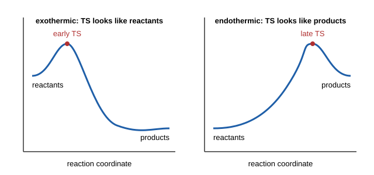

# 28.2 · The Hammond postulate and selectivity

A transition state lives for one vibration, so no instrument can photograph it. Yet chemists routinely say that one transition state "looks like the carbocation" and another "looks like the starting material", and they use that to predict which product wins. The licence for this is the Hammond postulate. This lesson states it, makes it quantitative with real bond enthalpies and product ratios for the halogenation of propane, and connects it to the Marcus theory you met for electron transfer in [26.4](../module-26/lesson-04.md). You will compute how selective a reaction should be from data, and see where the simple rule stops working.

## Why it matters

You need 2-bromopropane or 2-chloropropane from propane and light. Chlorine gives 45 % 1-chloropropane and 55 % 2-chloropropane at 25 °C: a mixture of two liquids with close boiling points that you must separate. Bromine gives 97 % 2-bromopropane and only 3 % of the other isomer. Same alkane, same mechanism, same kind of radical intermediates, yet one halogen is nearly unselective and the other nearly perfect. Choosing the right reagent here saves a distillation and a third of your material. The reason is the position of the transition state, and Hammond's idea lets you predict it before you go to the lab.

## Core ideas

> [!NOTE]
> The postulate and the linear free-energy relations are stable physical-organic chemistry. Bond dissociation enthalpies are the evaluated 298 K values of Blanksby and Ellison (2003) as listed on LibreTexts; H–Cl and H–Br bond enthalpies are computed from NIST-JANAF and CODATA key enthalpies of formation; propane product ratios are from LibreTexts. All checked on 2026-10-17.

### The postulate

George Hammond (1955) put it like this: if two states that follow each other on a reaction path have nearly the same energy, they have nearly the same structure, and they interconvert with only a small change in geometry. Apply it to the transition state and its two neighbours on the path:



- In a strongly **exothermic** step the transition state is close in energy to the reactants, so it is **early** and reactant-like. Bonds have barely started to change.
- In a strongly **endothermic** step the transition state is close in energy to the products, so it is **late** and product-like. Whatever stabilises the product, for example the intermediate, stabilises the transition state almost as much.

The second case is the useful one. Forming a carbocation from an alkyl halide (the slow step of SN1 in [15.5](../module-15/lesson-05.md)) is strongly uphill. So the transition state resembles the carbocation, and everything that stabilises a carbocation (more alkyl groups, resonance) lowers the barrier nearly as much. That is why tertiary halides ionise fastest. The same argument explains Markovnikov addition of HBr to alkenes: the step that makes the more stable carbocation has the lower, carbocation-like transition state.

### A case with numbers: chlorine and bromine radicals

In radical halogenation the selectivity is decided in one step: a halogen atom pulls a hydrogen atom off the alkane.

$$\mathrm{X\cdot + H{-}R \rightarrow H{-}X + R\cdot}$$

Its enthalpy is the C–H bond broken minus the H–X bond made. With bond dissociation enthalpies (BDE) at 298 K:

| Bond | BDE (kJ/mol) |
|---|---|
| CH₃CH₂–H (primary, as in propane C1) | 423.0 |
| (CH₃)₂CH–H (secondary, propane C2) | 412.5 |
| (CH₃)₃C–H (tertiary) | 403.8 |
| H–Cl | 431.6 |
| H–Br | 366.2 |

For chlorine, abstraction is downhill: −8.6 kJ/mol (primary) and −19.1 kJ/mol (secondary). For bromine it is uphill: +56.8 and +46.3 kJ/mol. The secondary radical is 10.5 kJ/mol more stable than the primary one in both cases. Hammond predicts that the chlorine transition state is early, with the C–H bond barely stretched and little radical character on carbon, so the 10.5 kJ/mol hardly matters. The bromine transition state is late and radical-like, so it feels almost all of the 10.5 kJ/mol. The product ratios confirm it (worked example 1).

### Bell–Evans–Polanyi and the parameter α

For a family of similar reactions, the barrier often changes linearly with the reaction energy. This is the **Bell–Evans–Polanyi** relation:

$$E_a = E_0 + \alpha\,\Delta H, \qquad 0 \le \alpha \le 1$$

The same idea written with free energies, $\delta\Delta^\ddagger G = \alpha\,\delta\Delta G^\circ$, defines **Leffler's α**: the fraction of a change in the reaction free energy that appears in the barrier. α near 0 means an early, reactant-like transition state; α near 1 means a late, product-like one; α = ½ means a transition state halfway along. α is the Hammond postulate turned into a number. It is also your first **linear free-energy relationship**, the idea behind the Hammett equation of the next lesson.

### Where α comes from: the Marcus picture

Draw the energy of the reactants and of the products as two parabolas along the reaction coordinate. The transition state is where they cross. Marcus theory ([26.4](../module-26/lesson-04.md)) gives the barrier from the reaction free energy $\Delta G^\circ$ and the reorganisation energy $\lambda$:

$$\Delta^\ddagger G = \frac{\lambda}{4}\left(1 + \frac{\Delta G^\circ}{\lambda}\right)^2, \qquad \alpha = \frac{d\,\Delta^\ddagger G}{d\,\Delta G^\circ} = \frac{1}{2}\left(1 + \frac{\Delta G^\circ}{\lambda}\right)$$

$\lambda/4$ is the **intrinsic barrier**: the barrier when $\Delta G^\circ = 0$. Then α = ½. Make the step more downhill and α falls (earlier transition state); more uphill and α rises toward 1 (later transition state). Hammond's qualitative rule falls straight out of two crossing parabolas. Marcus's formula, derived for electron transfer, works surprisingly well for proton, hydrogen-atom and methyl transfers, as long as $|\Delta G^\circ|$ is smaller than $\lambda$.

### Reactivity and selectivity

The halogen case suggests a general **reactivity–selectivity principle**: the more reactive the reagent, the earlier its transition state and the less it discriminates. It is a useful first guess, but it fails often. When a reaction is so fast that it happens at every encounter (the diffusion limit, about $10^9$–$10^{10}$ M⁻¹ s⁻¹ in water), every substrate reacts at the same rate and selectivity disappears for a reason that has nothing to do with the shape of the transition state. Many families of reactions also show constant selectivity over a wide range of reactivity. Use the principle as a hint, then check it with data.

## Worked example

### 1. How late is each transition state?

Propane has 6 primary and 2 secondary hydrogens. Light-induced chlorination at 25 °C gives 45 % 1-chloro- and 55 % 2-chloropropane; bromination gives 3 % and 97 %.

1. Per-hydrogen selectivity, chlorine: $(55/2)/(45/6) = 27.5/7.5 = 3.7$. Bromine: $(97/2)/(3/6) = 48.5/0.5 = 97$.
2. Convert each rate ratio into a difference in free energy of activation, $\delta\Delta^\ddagger G = RT\ln(\text{ratio})$ with $RT = 2.479$ kJ/mol. Chlorine: $2.479 \times \ln 3.7 = 3.2$ kJ/mol. Bromine: $2.479 \times \ln 97 = 11.3$ kJ/mol.
3. The secondary radical is more stable by $423.0 - 412.5 = 10.5$ kJ/mol. Leffler's α: chlorine $3.2/10.5 = 0.31$; bromine $11.3/10.5 = 1.08$.

The chlorine transition state passes on only about a third of the radical's extra stability: it is early. The bromine transition state passes on all of it: it is fully product-like (a value slightly above 1 is within the uncertainty of the bond enthalpies, about ±1.7 kJ/mol each, and of treating $\Delta H$ as $\Delta G$).

### 2. The same result from two parabolas

Take the secondary abstraction step as a test: $\Delta G^\circ \approx -19$ kJ/mol for chlorine and $+46$ kJ/mol for bromine. Assume a reorganisation energy $\lambda = 60$ kJ/mol for both (an intrinsic barrier of 15 kJ/mol, a model value, not a measurement).

1. Chlorine: $\alpha = \tfrac12(1 - 19/60) = 0.34$; barrier $= 15 \times (1 - 0.317)^2 = 7.0$ kJ/mol.
2. Bromine: $\alpha = \tfrac12(1 + 46/60) = 0.88$; barrier $= 15 \times (1 + 0.767)^2 = 47$ kJ/mol.

The model gives α = 0.34 and 0.88 against 0.31 and 1.08 from the product ratios. One crossing of two parabolas reproduces the Hammond trend, and the bromine barrier comes out just above the step's own +46 kJ/mol uphill energy, as it must for a late transition state.

## Hands-on

What you need: Python with the course packages and the [Module 28 lab folder](../../labs/module-28/), pencil and calculator. Time: about 55 minutes.

### Part A — Python: selectivity, α and the Marcus curve (30 min)

1. Open `lesson02_hammond.py`. The bond enthalpies are in `sr28.py` and the propane product ratios at the top of the file.
2. Complete `per_h_selectivity()`, `ddg_barrier()`, `leffler_alpha()` and `marcus_alpha()`.
3. Run it and open `runs/lesson02_hammond.png`:

```bash
py lesson02_hammond.py
```

How you know it worked: per-H selectivities 3.7 (Cl) and 97.0 (Br); $\delta\Delta^\ddagger G$ = 3.22 and 11.34 kJ/mol; abstraction enthalpies −8.6 and −19.1 kJ/mol (Cl), +56.8 and +46.3 kJ/mol (Br); α = 0.31 and 1.08. The script then uses each α to estimate 2-methylpropane (9 primary H, 1 tertiary H): about 55 % tertiary chloride but 99.8 % tertiary bromide. The right-hand plot shows the Marcus α rising from early to late as the step becomes more uphill, with the two data points beside the model points.

<details><summary>Reference solution</summary>

```python
def per_h_selectivity(pct_primary, pct_secondary, n_primary=6, n_secondary=2):
    return (pct_secondary / n_secondary) / (pct_primary / n_primary)

def ddg_barrier(selectivity, T=298.15):
    return R * T * math.log(selectivity) / 1000

def leffler_alpha(ddg_barrier_kj, ddh_reaction_kj):
    return ddg_barrier_kj / ddh_reaction_kj

def marcus_alpha(dG0, lam):
    return 0.5 * (1 + dG0 / lam)
```

Full code: `lesson02_hammond_solution.py`. The chlorine estimate for 2-methylpropane assumes that α stays at 0.31 for the larger tertiary–primary gap (19.2 kJ/mol). Bell–Evans–Polanyi is a linear approximation over a narrow range, so treat that figure as a rough guide, not a prediction to three digits.

</details>

### Part B — pencil (25 min)

1. Use α = 1 for bromine. Estimate the per-H tertiary/primary selectivity at 25 °C from the bond enthalpies, and the percentage of 2-bromo-2-methylpropane from 2-methylpropane.
2. Two alkyl chlorides ionise in water in an SN1 reaction. Their carbocations differ in stability by 30 kJ/mol. Ionisation is strongly uphill, so take α = 0.9. Roughly how much faster does the halide that gives the more stable cation react at 25 °C?
3. A family of methyl-transfer reactions has $\lambda$ = 80 kJ/mol. Find the barrier and α for $\Delta G^\circ$ = −20, 0 and +20 kJ/mol. Which transition state is the most reactant-like?
4. A very reactive carbocation is mixed with two alkenes. It reacts with alkene 1 at $3\times10^9$ and with alkene 2 at $2\times10^9$ M⁻¹ s⁻¹, although alkene 1 is a far better nucleophile in slower reactions. Does this low selectivity prove that the transition states are very early?

<details><summary>Answers to Part B</summary>

1. $\delta\Delta H = 423.0 - 403.8 = 19.2$ kJ/mol. Selectivity $= e^{19.2/2.479} = e^{7.75} \approx 2300$ per H. With 1 tertiary and 9 primary H: $2300/(2300 + 9) = 99.6$ % tertiary bromide.
2. $e^{0.9 \times 30/2.479} = e^{10.9} \approx 5\times10^4$ times faster. A late, cation-like transition state passes on 90 % of the cation's extra stability.
3. $\Delta G^\circ = -20$: barrier $20 \times (0.75)^2 = 11.3$ kJ/mol, α = 0.375. $\Delta G^\circ = 0$: barrier 20.0 kJ/mol, α = 0.5. $\Delta G^\circ = +20$: barrier $20 \times (1.25)^2 = 31.3$ kJ/mol, α = 0.625. The most downhill step has the earliest, most reactant-like transition state.
4. No. Rate constants of $2$–$3\times10^9$ M⁻¹ s⁻¹ are at the diffusion limit: the cation reacts at nearly every encounter, so the rate measures how fast the partners meet, not the barrier. The reactivity–selectivity principle cannot be tested with diffusion-controlled rates.

</details>

## Common mistakes

- Reading the Hammond postulate as a statement about rates alone. It is about structure: a late transition state resembles the product, so product-stabilising factors lower the barrier.
- Comparing product percentages without dividing by the number of hydrogens of each type. Propane's 55:45 chlorination ratio hides a per-H selectivity of 3.7.
- Getting the sign of the abstraction enthalpy wrong. It is the bond broken minus the bond made: BDE(C–H) − BDE(H–X).
- Applying one α far outside the range where it was measured. Bell–Evans–Polanyi and Marcus are local approximations; α itself changes with $\Delta G^\circ$.
- Explaining every low selectivity with an early transition state. Diffusion-controlled reactions are unselective for a different reason.

## Key takeaways

- Hammond: neighbouring states close in energy are close in structure. Exothermic steps have early, reactant-like transition states; endothermic steps have late, product-like ones.
- Endothermic steps that form intermediates (carbocations, radicals) have transition states that feel the intermediate's stability: tertiary cations form fastest, bromination is selective.
- Leffler's α (or the Bell–Evans–Polanyi slope) measures transition-state position: 0.31 for chlorine and about 1 for bromine abstracting H from propane.
- Marcus's crossing parabolas give $\alpha = \tfrac12(1 + \Delta G^\circ/\lambda)$, the Hammond postulate in one line.
- The reactivity–selectivity principle is a useful first guess that fails at the diffusion limit and for many constant-selectivity families.

## Sources

- [Hammond, J. Am. Chem. Soc. 77, 334 (1955)](https://doi.org/10.1021/ja01607a027) — the original statement of the postulate (record checked via Crossref).
- [Chemistry LibreTexts (Morsch et al.), 7.11 The Hammond Postulate](https://chem.libretexts.org/Bookshelves/Organic_Chemistry/Organic_Chemistry_(Morsch_et_al.)/07:_Alkenes-_Structure_and_Reactivity/7.11:_The_Hammond_Postulate) — early and late transition states, carbocation formation in HX addition.
- [Chemistry LibreTexts (Morsch and Andrews), 15.06 Chlorination versus Bromination](https://chem.libretexts.org/Courses/University_of_Illinois_Springfield/UIS%3A_CHE_269_(Morsch_and_Andrews)/Chapters/Chapter_15%3A_Radical_Reactions/15.06_Chlorination_versus_Bromination) — propane product ratios at 25 °C: 45:55 (Cl), 3:97 (Br).
- [Wenthold, Homolytic C–H Bond Dissociation Energies of Organic Molecules (LibreTexts)](https://chem.libretexts.org/Bookshelves/Organic_Chemistry/Supplemental_Modules_(Organic_Chemistry)/Fundamentals/Homolytic_C-H_Bond_Dissociation_Energies_of_Organic_Molecules) — C–H bond enthalpies at 298 K from [Blanksby and Ellison, Acc. Chem. Res. 36, 255 (2003)](https://doi.org/10.1021/ar020230d).
- [NIST Chemistry WebBook, HBr](https://webbook.nist.gov/cgi/cbook.cgi?ID=C10035106&Mask=1) and [HCl](https://webbook.nist.gov/cgi/cbook.cgi?ID=C7647010&Mask=1) — ΔfH°(gas) −36.29 and −92.31 kJ/mol (CODATA key values); with H 217.998, Cl 121.301 and Br 111.87 kJ/mol these give D(H–Cl) = 431.6 and D(H–Br) = 366.2 kJ/mol.
