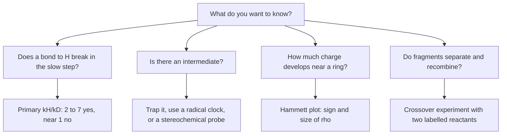

# 28.5 · Probing mechanisms: isotope effects and trapping

A mechanism is a hypothesis about events nobody can watch. You cannot see a transition state, and most intermediates vanish in microseconds. Chemists therefore test mechanisms indirectly: change one atom's mass and see whether the rate notices, add a reagent that would catch a proposed intermediate, or let a fast "clock" reaction compete with the step you want to time. This lesson teaches the two most common probes, kinetic isotope effects and trapping, and then puts the whole module to work. In the module practical you analyse a 2025 kinetic study of an azo coupling with a Hammett plot, isotope effects and an energy profile.

## Why it matters

Medicinal chemists sometimes replace hydrogen with deuterium at the spot where the liver's enzymes oxidise a drug, hoping to slow its breakdown. Sometimes this changes the drug's lifetime a lot; sometimes not at all. The difference is whether breaking that C–H bond is part of the rate-determining step. The same question decides how to speed up a manufacturing step, which catalyst to try or which by-product to expect. An isotope effect answers it with one pair of rate measurements, and a trapping experiment can confirm or rule out the intermediate you proposed. Without these probes a mechanism is a drawing; with them it is a tested model.

## Core ideas

> [!NOTE]
> The theory of isotope effects and trapping is stable. The radical-clock rate constant is from Bowry, Lusztyk and Ingold (1991); the azo-coupling data are from El Abed et al. (2025, CC BY 4.0). Typical isotope-effect ranges are from LibreTexts. Checked on 2026-10-17.

### Primary kinetic isotope effects

The **kinetic isotope effect** (KIE) is the ratio of rate constants for a molecule with a light and a heavy isotope, usually $k_H/k_D$. Deuterium changes neither the electronic structure nor the potential energy surface (Born–Oppenheimer, [12.4](../module-12/lesson-04.md)). It changes the vibrational frequencies: a C–D bond vibrates at about $1/1.36$ of the C–H frequency, so its **zero-point energy** (ZPE, $\tfrac12 h c\tilde\nu$) is lower.

$$\tilde\nu_D = \tilde\nu_H\sqrt{\frac{\mu_H}{\mu_D}}, \qquad \frac{k_H}{k_D} \approx \exp\!\left[\frac{hc(\tilde\nu_H - \tilde\nu_D)}{2k_BT}\right]$$

If the stretching vibration disappears at the transition state, because the bond is breaking, the C–H compound loses more ZPE on the way up: its barrier is lower. For a C–H stretch at 2900 cm⁻¹ the C–D stretch is at 2129 cm⁻¹, the ZPE difference is 4.6 kJ/mol, and $k_H/k_D \approx 6.4$ at 298 K. This is a **primary** isotope effect: the labelled bond is made or broken in the rate-determining step. Measured values of about 2–7 are typical. Westheimer (1961) pointed out that the effect is largest when the hydrogen is about half transferred in a symmetrical transition state, and smaller for early or late ones, a Hammond-type argument ([28.2](lesson-02.md)). Values well above 7–10 at room temperature point to tunnelling ([12.3](../module-12/lesson-03.md)).

Two textbook cases show both outcomes. In the E2 elimination of 2-bromopropane with sodium ethoxide, the C–H bond breaks in the only step: $k_H/k_D = 6.7$ ([15.6](../module-15/lesson-06.md)). In the nitration of benzene, Melander (1949) found no isotope effect: the slow step is the attack of NO₂⁺ to form the σ-complex ([16.5](../module-16/lesson-05.md)); the C–H bond breaks later, in a fast step.

### Secondary and heavy-atom effects

A **secondary** isotope effect comes from a label on an atom whose bonds are not broken. Typical values lie close to 1, within about 0.8–1.25. When the labelled carbon goes from sp³ to sp² in the transition state (an SN1 ionisation), the C–H bending vibrations loosen and $k_H/k_D$ is a little above 1 (normal); from sp² to sp³ (addition to a C=C or an aromatic ring) it is a little below 1 (inverse). Isotope effects of carbon, nitrogen or oxygen are much smaller, usually 1.02–1.10, and need very precise measurements.

### Trapping intermediates

If a proposed intermediate exists, a reagent that reacts with it fast should intercept it and give a new, identifiable product.

- Carbocations: an added nucleophile such as azide competes with the solvent.
- Radicals: a stable nitroxide radical such as TEMPO couples with carbon radicals at close to the diffusion limit.
- Carbenes: an alkene gives a cyclopropane (with the Skell test of [28.4](lesson-04.md) telling the spin state).

A positive result is strong evidence. A negative result is weak: the intermediate may be too short-lived for your trap, or the trap may change the reaction.

### Radical clocks

A **radical clock** is a radical that rearranges at a known rate. The cyclopropylcarbinyl radical opens to the but-3-enyl radical with $k_r = 1.2\times10^8$ s⁻¹ at 37 °C. Put a cyclopropylmethyl group where you suspect a radical forms, and add a trap T that reacts with the radical at rate constant $k_T$. If the radical lives long enough, some of it opens before it is trapped:

$$\frac{[\text{unrearranged product}]}{[\text{rearranged product}]} = \frac{k_T[\mathrm{T}]}{k_r}$$

Ring-opened products prove that a radical existed for at least a few nanoseconds. Their ratio, with $k_r$ known, measures $k_T$, or the radical's lifetime.

### Choosing a probe

A **crossover experiment** runs two similar reactants with different labels in one flask: if products with mixed labels appear, fragments left their partners (intermolecular); if not, the rearrangement is intramolecular. **Stereochemical probes** ask whether a stereocentre is inverted (backside attack, SN2), scrambled (a planar intermediate, SN1 or a radical) or kept. No single probe proves a mechanism; a mechanism is accepted when several independent probes agree with it and rule out the alternatives.

## Worked example

### 1. How big can a C–H/C–D isotope effect be?

A C–H stretch at 2900 cm⁻¹ is lost at the transition state. Estimate $k_H/k_D$ at 25 °C and 100 °C.

1. Reduced masses: $\mu_H = 12 \times 1.008/13.008 = 0.930$ u and $\mu_D = 12 \times 2.014/14.014 = 1.725$ u. So $\tilde\nu_D = 2900 \times \sqrt{0.930/1.725} = 2129$ cm⁻¹.
2. ZPE difference: $\tfrac12(2900 - 2129) = 386$ cm⁻¹, or $386 \times 0.01196 = 4.61$ kJ/mol.
3. At 298 K: $k_H/k_D = e^{4610/(8.314 \times 298)} = e^{1.86} = 6.4$. At 373 K: $e^{1.49} = 4.4$.

The effect shrinks as the temperature rises, because the same ZPE difference is a smaller fraction of $RT$. A measured 6.7 for an E2 reaction is close to this ceiling: the C–H bond is well on its way to breaking in the transition state.

### 2. Timing a radical with a clock

A reaction is thought to pass through a primary alkyl radical. A substrate with a cyclopropylmethyl group at that position is run at 37 °C with 0.10 M of a trap T. The products are unrearranged (trapped before opening) and ring-opened in the ratio 1 : 4.

1. Ring-opened product exists, so a radical formed and lived long enough to open.
2. $k_T = \dfrac{0.25 \times 1.2\times10^8\ \text{s}^{-1}}{0.10\ \text{M}} = 3.0\times10^8$ M⁻¹ s⁻¹.
3. The radical's lifetime under these conditions: $1/(k_T[\mathrm{T}] + k_r) = 1/(3.0\times10^7 + 1.2\times10^8) = 6.7$ ns.

Use the clock at the temperature where it was calibrated, or correct it with its Arrhenius parameters; a clock run at the wrong temperature gives a wrong $k_T$.

## Hands-on

What you need: Python with the course packages and the [Module 28 lab folder](../../labs/module-28/), pencil and calculator, and the [lab report template](../../templates/lab-report.md) for Part B. Time: about 110 minutes.

### Part A — isotope effects and clocks (20 min)

1. Open `lesson05_practical.py`. Complete `kie_from_zpe()` and `trap_rate_constant()` (Part B of the file). Run it once: it stops at the next TODO, which belongs to the module practical.
2. Pencil: (a) Deuterating the C–H bond that is replaced in a reaction gives $k_H/k_D = 1.05$. What do you conclude? (b) An SN1 solvolysis with deuterium on the carbon that loses the leaving group gives $k_H/k_D = 1.15$. Primary or secondary, normal or inverse, and why? (c) You suspect a substitution goes through a free carbocation. Name one trapping and one stereochemical test.

How you know it worked: $k_H/k_D$ = 6.4 (2900 cm⁻¹) and 6.8 (3000 cm⁻¹) at 298 K, 4.4 and 4.7 at 373 K; $k_T = 3.0\times10^8$ M⁻¹ s⁻¹.

Answers to Part A

(a) No primary isotope effect: the C–H bond is not broken in the rate-determining step. Something earlier is slow (as in the nitration of benzene), and the proton is lost afterwards in a fast step.
(b) Secondary (the C–H bond is not broken) and normal (above 1). The carbon goes from sp³ to sp² in the transition state, which loosens its C–H bending vibrations.
(c) Trapping: add azide and look for an alkyl azide whose amount grows with azide concentration, or look for rearranged products (28.4). Stereochemistry: start from a single enantiomer and look for racemisation (planar cation) rather than clean inversion (SN2).

### Part B — module practical: a mechanism case file (90 min)

El Abed and co-workers (2025) measured, by stopped-flow spectrophotometry, how fast 3-aminothiophene couples with eight para-substituted benzenediazonium ions, X–C₆H₄–N₂⁺, in 50 % water–DMSO at 20 °C. Coupling makes an azo dye (Ar–N=N–thiophene) by attack of the electron-rich thiophene carbon C2 on the terminal nitrogen of the diazonium ion. They also used 3-aminothiophene with deuterium at C2. Their Table 1 is in `diazonium_coupling.csv` (open access, CC BY 4.0). Your job: decide what the data say about the rate-determining step, using every tool of this module.

1. Read the header of the CSV. Note what $k$ and $k_1$ are: the amine is partly protonated at pH 1 and 2, and only the free amine reacts.
2. Complete `k1_from_k()` and check that your $k_1$ values match the table at both pH values.
3. Complete `yukawa_tsuno()` and run the whole file. It fits $\log k_1$ (both pH sets) against σp and σp+, then the Yukawa–Tsuno equation, and prints the isotope effects. Open `runs/lesson05_practical.png`.
4. Write a short report with the lab report template that answers:
   - Which σ scale describes the data better, judged by the residual plot, not only R²? Why should a para donor need σ+ here?
   - What do the sign and size of ρ say about charge in the transition state?
   - What do the isotope effects say about which step is rate-determining?
   - Sketch the Gibbs energy profile (as in [28.1](lesson-01.md)): reactants, the rate-determining transition state, any intermediate, a second transition state, product. Where on the path is the slow transition state, by the Hammond postulate?
   - Two limits of the analysis.

How you know it worked: recomputed $k_1$ agree with the table within 2 %. σp: ρ = 3.39 ± 0.16, R² = 0.968, with a systematic residual pattern (p-OCH₃ 0.4 log units below the line). σp+: ρ = 2.48 ± 0.10, $\log k_1(\mathrm{H})$ = 2.91, R² = 0.976, which reproduces the authors' equation $\log k_1 = 2.91 + 2.48\,\sigma_p^+$. A free Yukawa–Tsuno fit gives ρ = 2.92 ± 0.16 and r = 0.49 ± 0.14, with a correlation of −0.81 between them; the paper reports ρ = 2.11 and r = 1.54. $k_H/k_D$ = 0.96–1.16 for the six pairs.

Reference interpretation

Scale. With σp the residuals bend: the methoxy point sits 0.4 log units below the line and the ones near zero sit above it. With σp+ the methoxy point falls into line and the residuals look more random (rms 0.20 against 0.22 log units). The R² values differ little, which is why you look at residuals. A para donor conjugates directly with the N≡N⁺ group of the diazonium ion (a quinoid resonance form), so it stabilises the electrophile more than σp predicts. That extra stabilisation is lost when the C–N bond forms, so donors slow the reaction more than σp suggests.

ρ. Positive and large (about 2.5, similar to ester hydrolysis). Electron-withdrawing groups make the diazonium ion more electrophilic and speed the coupling; positive charge leaves the aryl–N₂ part as the C–N bond forms and moves onto the thiophene. A large |ρ| means much of that charge transfer has happened at the transition state.

Isotope effect. All six $k_H/k_D$ values are close to 1 (mean about 1.07, with scatter of about ±0.1). There is no primary isotope effect, so the C2–H bond does not break in the rate-determining step. The slow step is the attack that forms the C–N bond and a cationic σ-complex (Wheland intermediate) on the thiophene; loss of the proton from C2 is fast, as in the nitration of benzene.

Profile. Reactants → TS1 (C–N bond forming, the highest point) → σ-complex intermediate (a shallow minimum) → TS2 (loss of H⁺, lower) → azo product. The large ρ and the cationic intermediate suggest a fairly late, σ-complex-like TS1 (Hammond), but ρ alone cannot give a number for α without the ρ of the equilibrium.

Limits. Eight substituents, all para, at one temperature in one mixed solvent; the scatter of 0.2 log units limits ρ to about ±0.1. The two Yukawa–Tsuno parameters are strongly correlated with so few points, and our free fit does not reproduce the published ρ and r: the paper does not give enough detail (weighting or data selection) to resolve the difference, so report both and do not over-interpret r. Small secondary effects on $k_H/k_D$ (an sp² carbon becoming sp³ gives a slightly inverse effect) are hidden in the scatter.

## Common mistakes

- Reading any isotope effect above 1 as primary. Values within about 0.8–1.25 are usually secondary; primary C–H/C–D effects at room temperature are typically 2–7.
- Concluding that an intermediate does not exist because a trap found nothing. The trap may be too slow, or the intermediate too short-lived.
- Using a radical-clock rate constant at a temperature other than its calibration temperature without correcting it.
- Judging a Hammett fit by R² alone. A systematic pattern in the residuals shows the wrong σ scale even when R² looks fine.
- Over-interpreting a two-parameter fit (Yukawa–Tsuno ρ and r) from eight points. Check the parameter correlation before quoting either.
- Treating one probe as proof. Mechanisms are accepted when independent probes agree.

## Key takeaways

- A primary $k_H/k_D$ of about 2–7 means the C–H bond breaks in the rate-determining step; the zero-point-energy ceiling is about 6–7 at 298 K for a C–H stretch near 2900–3000 cm⁻¹.
- $k_H/k_D \approx 1$ means the bond to hydrogen breaks after the slow step, as in electrophilic aromatic substitution.
- Trapping, radical clocks, crossover and stereochemical experiments test intermediates; a radical clock turns a product ratio into a rate constant: $[U]/[R] = k_T[\mathrm{T}]/k_r$.
- In the module practical, σp+ (ρ = 2.48 ± 0.10) and $k_H/k_D \approx 1$ together point to a rate-determining C–N bond formation that gives a cationic σ-complex, followed by fast proton loss.
- No single probe proves a mechanism; agreement between kinetics, isotope effects, Hammett analysis and trapping does.

## Sources

- [Chemistry LibreTexts, Kinetic Isotope Effects](https://chem.libretexts.org/Bookshelves/Physical_and_Theoretical_Chemistry_Textbook_Maps/Supplemental_Modules_(Physical_and_Theoretical_Chemistry)/Quantum_Mechanics/06._One_Dimensional_Harmonic_Oscillator/Kinetic_Isotope_Effects) — primary and secondary effects, typical deuterium values up to about 7–8, heavy-atom effects 1.02–1.10.
- [Chemistry LibreTexts (Morsch et al.), 11.8 The E2 Reaction and the Deuterium Isotope Effect](https://chem.libretexts.org/Bookshelves/Organic_Chemistry/Organic_Chemistry_I_(Morsch_et_al.)/11%3A_Reactions_of_Alkyl_Halides-_Nucleophilic_Substitutions_and_Eliminations/11.08%3A_The_E2_Reaction_and_the_Deuterium_Isotope_Effect) — 2-bromopropane with sodium ethoxide, $k_H/k_D$ = 6.7.
- [Westheimer, Chem. Rev. 61, 265 (1961)](https://doi.org/10.1021/cr60211a004) — the magnitude of primary isotope effects and transition-state symmetry.
- [Bowry, Lusztyk and Ingold, J. Am. Chem. Soc. 113, 5687 (1991)](https://doi.org/10.1021/ja00015a024) — cyclopropylcarbinyl ring opening, 1.2 × 10⁸ s⁻¹ at 37 °C, calibrated by nitroxide (TEMPO) trapping.
- [Melander, Nature 163, 599 (1949)](https://doi.org/10.1038/163599a0) — no hydrogen isotope effect in aromatic nitration.
- [El Abed, Slama, Mahdhaoui and Boubaker, ChemPhysChem 26, e202500553 (2025)](https://pmc.ncbi.nlm.nih.gov/articles/PMC12710183/) — Table 1 rate constants, σp and σp+ values, $\log k_1 = 2.91 + 2.48\,\sigma_p^+$, Yukawa–Tsuno ρ = 2.11 and r = 1.54, absence of an isotope effect; open access under CC BY 4.0, data reused in `diazonium_coupling.csv`.
