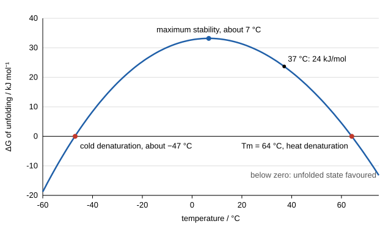

# 29.1 · Protein structure and stability

A folded protein is a molecule balanced on a knife edge: thousands of weak contacts hold it together, yet it is only a few tens of kJ/mol more stable than the tangled chain it came from. Lesson [06.2](../module-06/lesson-02.md) showed where the hydrogen bonds and the hydrophobic core are. This lesson puts numbers on the balance. You will treat folding as a chemical equilibrium, the same way lesson [13.6](../module-13/lesson-06.md) treated any reaction, see why heat and urea both unfold proteins, and fit two melting curves to measure how stable a protein is.

## Why it matters

A company makes an enzyme for laundry powder. It must survive a 60 °C wash, so the team tests 200 mutants. Which ones are worth keeping? The answer is a number, the Gibbs energy of unfolding, and each mutant shifts it by a few kJ/mol. The same number decides whether an insulin formulation can sit in a warm bag, why some inherited diseases are caused by a single amino-acid change that makes a protein unfold too often, and why antibodies for medicine are screened for their melting temperature before anything else. You cannot read that number from a structure. You have to measure it, and the measurement is a fit of a simple equilibrium model to a melting curve.

## Core ideas

> [!NOTE]
> The thermodynamics is stable. The protein parameters in the lab are generated, typical of a small globular protein of about 100 residues, not of one named protein; the egg-white temperatures are from a scan at 10 K/min and shift with heating rate. Fitting code uses SciPy 1.18 (`curve_fit`, `brentq`), pinned in `labs/common/requirements.txt`, checked 2026-10-17.

### Folding as an equilibrium

Many small proteins unfold in one step, with no intermediate present in measurable amounts. This is the **two-state model**:

$$\mathrm{N \rightleftharpoons U}, \qquad K_U = \frac{[\mathrm{U}]}{[\mathrm{N}]}, \qquad \Delta G_U = -RT\ln K_U$$

N is the native (folded) state and U the unfolded state. $\Delta G_U$, the Gibbs energy of unfolding, is the stability: positive means the folded form wins. The fraction unfolded is

$$f_U = \frac{K_U}{1 + K_U} = \frac{1}{1 + e^{\Delta G_U/RT}}$$

At 25 °C, $RT$ = 2.48 kJ/mol, so every 5.7 kJ/mol of stability is a factor of ten in $K_U$. Typical small proteins have $\Delta G_U$ of 20–60 kJ/mol at room temperature, so between one molecule in a thousand and one in $10^{10}$ is unfolded at any moment. That is "marginal" stability: a single lost hydrogen bond or buried methyl group can cost 5 kJ/mol.

### Why the balance is so fine

Folding trades large terms against each other. Burying nonpolar side chains releases ordered water around them (the **hydrophobic effect**, lesson [06.1](../module-06/lesson-01.md)): a gain in entropy for the water. Packing the core and forming internal hydrogen bonds lowers the enthalpy. Against this, the chain loses its conformational entropy: one shape instead of an astronomical number. The net $\Delta G_U$ is the small difference of terms each worth hundreds of kJ/mol.

### Temperature: the stability curve

Unfolding absorbs heat, so $\Delta H_U > 0$. Unfolding also exposes nonpolar groups to water, and water around exposed nonpolar groups has a high heat capacity, so the heat capacity of U is larger than that of N: $\Delta C_p > 0$. With $\Delta C_p$ constant, the Gibbs–Helmholtz equation (lesson [13.4](../module-13/lesson-04.md)) gives the **stability curve**:

$$\Delta G_U(T) = \Delta H_m\left(1 - \frac{T}{T_m}\right) - \Delta C_p\left[(T_m - T) + T\ln\frac{T}{T_m}\right]$$

$T_m$ is the melting temperature, where $\Delta G_U = 0$ and half the molecules are unfolded; $\Delta H_m$ is the unfolding enthalpy at $T_m$. Three things follow:

- The curve is a downward parabola-like arc. Stability is greatest at $T_s = T_m\,e^{-\Delta H_m/(T_m\Delta C_p)}$, often near room temperature or below.
- Heat unfolds the protein above $T_m$, but the curve also crosses zero again at low temperature: **cold denaturation**. For most proteins it is predicted below 0 °C, where water freezes first, so it is seldom seen.
- $\Delta C_p$ grows with the surface buried in the fold. Myers, Pace and Scholtz found that both $\Delta C_p$ and the urea m value (below) scale with the surface area exposed on unfolding, so both grow with protein size.



### Chemical denaturants: the m value

Urea and guanidinium chloride unfold proteins because they interact better with the exposed backbone and side chains of U than water does. Over a wide range the stability falls linearly with denaturant concentration, the **linear extrapolation method**:

$$\Delta G_U([\mathrm{D}]) = \Delta G_U(\mathrm{H_2O}) - m[\mathrm{D}]$$

The **m value** (kJ mol⁻¹ M⁻¹) measures how much new surface is exposed. The midpoint $C_m = \Delta G_U(\mathrm{H_2O})/m$ is where half the protein is unfolded. Extrapolating back to zero urea gives the stability in water at the temperature of the experiment.

### How a melt is measured

You need a signal that differs between N and U: the circular-dichroism (CD) signal at 222 nm (helices give a strong negative band), tryptophan fluorescence (lesson [19.2](../module-19/lesson-02.md)), or heat absorbed in a calorimeter (differential scanning calorimetry, DSC). Each state's signal drifts slowly with temperature or urea, so the model has a sloping **baseline** for N and for U:

$$y = y_N + (y_U - y_N)\,f_U$$

The two-state fit only means something if unfolding is reversible and really two-state. Check by cooling and re-scanning, and by seeing whether two different signals give the same $T_m$. Egg white, which you will cook below, fails the first test: its proteins aggregate as they unfold and never refold.

## Worked example

### 1. How much of the protein is unfolded at body temperature?

The lab's thermal fit gives $T_m$ = 64.2 °C (337.3 K), $\Delta H_m$ = 378 kJ/mol, with $\Delta C_p$ = 6.0 kJ mol⁻¹ K⁻¹ assumed. At 37 °C (310.15 K):

1. $\Delta H_m(1 - T/T_m) = 378 \times (1 - 310.15/337.3) = 378 \times 0.0805 = 30.4$ kJ/mol.
2. $\Delta C_p[(T_m - T) + T\ln(T/T_m)] = 6.0 \times [27.15 + 310.15 \times \ln(0.9195)] = 6.0 \times [27.15 - 26.03] = 6.7$ kJ/mol.
3. $\Delta G_U$ = 30.4 − 6.7 = 23.7 kJ/mol.
4. $K_U = e^{-23\,700/(8.314 \times 310.15)} = e^{-9.19} = 1.0 \times 10^{-4}$.

One molecule in ten thousand is unfolded at any instant. That sounds safe, but an unfolded molecule is what proteases cut and what aggregates, so this small fraction sets the protein's lifetime in a cell. Without the $\Delta C_p$ term you would overestimate the stability by 6.7 kJ/mol, a factor of 13 in $K_U$.

### 2. What does a mutation cost?

The urea fit at 25 °C gives $\Delta G_U(\mathrm{H_2O})$ = 31.3 kJ/mol and $m$ = 7.3 kJ mol⁻¹ M⁻¹, so $C_m$ = 31.3/7.3 = 4.30 M. A mutant that replaces a buried leucine by alanine melts at $C_m$ = 3.80 M with the same m value.

1. Because m is the same, the shift in $C_m$ converts directly: $\Delta\Delta G = m\,\Delta C_m = 7.3 \times 0.50 = 3.65$ kJ/mol.
2. The mutant's stability in water is about 31.3 − 3.7 = 27.6 kJ/mol.
3. Its $K_U$ rises by $e^{3650/2479} = 4.4$ times.

Using the shift in $C_m$ is more precise than subtracting two extrapolated $\Delta G_U(\mathrm{H_2O})$ values, because the extrapolation to zero urea carries most of the uncertainty (here ±1.8 kJ/mol).


## Hands-on

What you need: for Part A, two eggs, three mugs, a kettle, a kitchen thermometer (a cooking or meat thermometer reading to 100 °C), a teaspoon, a timer and a dark plate; for Part B, Python with the course packages and the [Module 29 lab folder](../../labs/module-29/). Record Part A on a [notebook page](../../templates/notebook-page.md). Time: about 1 h 30 min.

### Part A — kitchen: when does egg white unfold? (30 min)

> [!WARNING]
> Water above 60 °C scalds skin within seconds. Pour kettle water into mugs on a stable surface, let it cool there, and never carry a full mug past children or pets. Raw egg can carry *Salmonella*: wash your hands and the spoon after touching it, and do not eat the samples.

Egg white is about 10 % protein in water. Its main proteins are ovalbumin and ovotransferrin (also called conalbumin). In a DSC scan of fresh egg white at 10 K/min, ovotransferrin unfolds at about 70 °C and ovalbumin at about 87 °C (Mettler-Toledo note). Unfolded egg proteins stick to each other and form the white, opaque gel you know as cooked egg.

1. Separate the white of one egg into a cup. Keep the yolk for cooking.
2. Fill mug 1 with the hottest tap water (usually 45–55 °C). Fill mugs 2 and 3 from a just-boiled kettle and let them cool, stirring with the thermometer, until mug 2 reads 65 °C and mug 3 reads 85 °C. Write down each temperature.
3. Pour one teaspoon of egg white gently into each mug at the same moment. Start the timer.
4. After 5 minutes, lift each sample out with the spoon onto the dark plate. Note colour (clear, milky, white), texture (runny, soft gel, firm) and the water temperature, which will have fallen a few degrees.
5. Put the 65 °C sample back into a fresh 65 °C mug for 10 more minutes and look again.

How you know it worked: at 45–55 °C the white stays clear and runny; at 65 °C it turns milky and partly sets into a soft, loose gel; at 85 °C it turns opaque white and firm within a minute or two. A longer hold at 65 °C sets it further. The middle mug shows the less stable protein unfolding below the ovalbumin transition. This part trains observation, not measurement: egg unfolding is irreversible and depends on time as well as temperature, so it is not a two-state equilibrium, and holding for minutes unfolds protein at temperatures lower than a fast DSC scan shows. That is why the next part uses a reversible model protein.

### Part B — Python: fit a thermal melt and a urea melt (60 min)

1. Open `lesson01_stability.py`. It reads `protein_thermal_melt.csv` (CD at 222 nm, 20–90 °C) and `protein_urea_melt.csv` (CD at 222 nm, 0–8 M urea, 25 °C). Both are generated from the two-state model with noise; the parameters are in the file headers and in `make_data.py`, but fit first and look afterwards.
2. Complete `thermal_model()`, `urea_model()` and `fraction_unfolded()`. Each model is the baseline equation above with $f_U$ from the two-state model. $\Delta C_p$ is fixed at 6.0 kJ mol⁻¹ K⁻¹ because a single thermal melt cannot pin it down.
3. Run it and open `runs/lesson01_stability.png`:

```bash
py lesson01_stability.py
```

4. Answer: (a) What are $T_m$, $\Delta H_m$, $\Delta G_U(\mathrm{H_2O})$, m and $C_m$? (b) Does the stability at 25 °C extrapolated from the thermal melt agree with the urea value? (c) At what temperature is the protein most stable, and where does the model predict cold denaturation? (d) What fraction is unfolded at 37 °C?

How you know it worked: $T_m$ = 64.15 ± 0.12 °C, $\Delta H_m$ = 378 ± 14 kJ/mol; extrapolated $\Delta G_U$ = 29.7 kJ/mol at 25 °C and 23.7 kJ/mol at 37 °C; fraction unfolded at 37 °C = 1.0 × 10⁻⁴. Urea melt: $\Delta G_U(\mathrm{H_2O})$ = 31.3 ± 1.8 kJ/mol, m = 7.30 ± 0.42 kJ mol⁻¹ M⁻¹, $C_m$ = 4.30 M. Maximum stability 33.2 kJ/mol at 6.7 °C; cold denaturation predicted near −47 °C.

<details><summary>Reference solution and model answers</summary>

```python
def thermal_model(T, Tm, dHm, aN, bN, aU, bU):
    dG = dG_unfold(T, Tm, dHm, DCP)
    fU = 1.0 / (1.0 + np.exp(dG / (R * T)))
    yN = aN + bN * (T - T25)
    yU = aU + bU * (T - T25)
    return yN + (yU - yN) * fU

def urea_model(D, dG0, m, aN, bN, aU, bU):
    dG = dG0 - m * D
    fU = 1.0 / (1.0 + np.exp(dG / (R * T25)))
    return (aN + bN * D) + ((aU + bU * D) - (aN + bN * D)) * fU

def fraction_unfolded(dG, T):
    return 1.0 / (1.0 + np.exp(dG / (R * T)))
```

Full code: `lesson01_stability_solution.py`.

(a) See the numbers above. (b) Yes: 29.7 against 31.3 ± 1.8 kJ/mol, inside the uncertainty. Agreement between two independent methods is the best evidence that the two-state model and the assumed $\Delta C_p$ are reasonable. (c) About 7 °C; −47 °C is far below freezing, so cold denaturation would not be seen in plain water. (d) 1 in 10 000. The protein is stable, but its lifetime in a cell still depends on that small unfolded fraction.

</details>

## Common mistakes

- Reading $T_m$ as "the temperature where the protein starts to unfold". At $T_m$ half is already unfolded; unfolding is under way 10–15 °C below it.
- Ignoring $\Delta C_p$ when extrapolating from $T_m$ to room temperature. The simple estimate $\Delta H_m(1 - T/T_m)$ overestimates stability by several kJ/mol.
- Fitting without sloping baselines. The fitted midpoint then shifts, and $\Delta H_m$ is wrong.
- Applying the two-state equilibrium model to an irreversible melt such as egg white or an aggregating antibody. Check reversibility first; if it fails, the "$T_m$" depends on the heating rate.
- Comparing mutants by their extrapolated $\Delta G_U(\mathrm{H_2O})$ when they share an m value. $m\,\Delta C_m$ is more precise.
- Mixing units: m values are per mole of protein per molar of urea, and $RT$ must be in the same energy unit as $\Delta G$.

## Key takeaways

- A two-state protein is an equilibrium N ⇌ U with $\Delta G_U = -RT\ln K_U$; typical small proteins are only 20–60 kJ/mol stable.
- The stability curve $\Delta G_U(T)$ comes from Gibbs–Helmholtz with $\Delta C_p > 0$; it peaks at moderate temperature and predicts both heat and cold denaturation.
- Urea melts give $\Delta G_U(\mathrm{H_2O})$ by linear extrapolation, $\Delta G_U = \Delta G_U(\mathrm{H_2O}) - m[\mathrm{D}]$, with $C_m = \Delta G_U(\mathrm{H_2O})/m$.
- Both m and $\Delta C_p$ grow with the surface buried in the fold.
- A mutation's cost is $\Delta\Delta G = m\,\Delta C_m$; a few kJ/mol changes the unfolded fraction several-fold.

## Sources

- [Lindorff-Larsen and Teilum (2020), arXiv 2010.12281](https://arxiv.org/abs/2010.12281) — two-state model, the stability curve with $\Delta H_m$, $T_m$ and $\Delta C_p$, and how thermal and chemical melts are analysed.
- [Myers, Pace and Scholtz (1995), Protein Sci. 4, 2138](https://pubmed.ncbi.nlm.nih.gov/8535251/) — m values and $\Delta C_p$ both correlate with the surface exposed on unfolding (R ≈ 0.84–0.90).
- [Jakubowski and Flatt, 4.9 Protein Stability - Thermodynamics](https://bio.libretexts.org/Bookshelves/Biochemistry/Fundamentals_of_Biochemistry_(Jakubowski_and_Flatt)/01%3A_Unit_I-_Structure_and_Catalysis/04%3A_The_Three-Dimensional_Structure_of_Proteins/4.09%3A_Protein_Stability_-_Thermodynamics) — enthalpy, entropy and the hydrophobic effect in folding; marginal stability.
- [Mettler-Toledo, Egg protein denaturation](https://www.mt.com/us/en/home/supportive_content/matchar_apps/MatChar_HB1004.html) — DSC of fresh egg white at 10 K/min: conalbumin peak near 70 °C, ovalbumin near 87 °C (citing Donovan et al. 1975).
- [MIT OCW 5.07SC Biological Chemistry I](https://ocw.mit.edu/courses/5-07sc-biological-chemistry-i-fall-2013/) — Module I, protein structure, the course this module follows.
