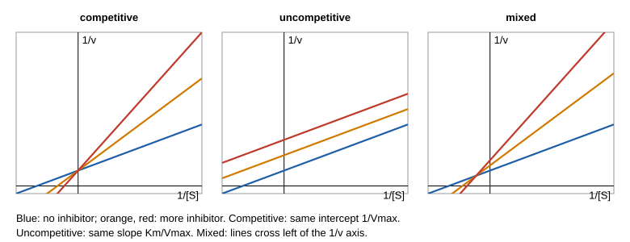

# 29.3 · Inhibition and regulation

Most drugs work by slowing an enzyme, and every cell controls its chemistry by speeding enzymes up and slowing them down. An inhibitor is any molecule that lowers an enzyme's rate. This lesson sorts reversible inhibitors into three types by where they bind, shows how each one changes $K_m$ and $V_\text{max}$, and teaches you to tell them apart from data, which is the skill the module practical tests. It then turns to the ways a cell regulates enzymes, building on the cooperative binding of lesson [26.3](../module-26/lesson-03.md).

## Why it matters

Two drug candidates block the same enzyme. A paper reports an IC50 of 50 nM for one; your lab measured 400 nM for the other. Is the first eight times better? Not necessarily: IC50 depends on how much substrate was in the assay, and on the inhibition type. A competitive inhibitor looks weaker at high substrate; an uncompetitive one looks stronger. Which type you have also decides how the drug behaves in the body, where substrate can pile up in front of a blocked enzyme. Getting the type and the true inhibition constant right is one of the first jobs in any drug project, and it is done with the kinetics you already know.

## Core ideas

> [!NOTE]
> The rate laws are stable textbook results. Drug examples are standard pharmacology; the invertase constants are from Michaelis and Menten (1913) as translated by Johnson and Goody. The fitting code uses SciPy 1.18, pinned in `labs/common/requirements.txt`, checked 2026-10-17.

### Where an inhibitor can bind

A reversible inhibitor I binds and leaves quickly. It may bind the free enzyme, the enzyme–substrate complex, or both:

$$\mathrm{E + I \rightleftharpoons EI}\quad (K_i), \qquad \mathrm{ES + I \rightleftharpoons ESI}\quad (K_i')$$

$K_i$ and $K_i'$ are dissociation constants; smaller means tighter. Neither EI nor ESI makes product. Applying the same steady-state treatment as in lesson [22.5](../module-22/lesson-05.md) gives one general rate law:

$$v = \frac{V_\text{max}[\mathrm{S}]}{\alpha K_m + \alpha'[\mathrm{S}]}, \qquad \alpha = 1 + \frac{[\mathrm{I}]}{K_i}, \quad \alpha' = 1 + \frac{[\mathrm{I}]}{K_i'}$$

Divide top and bottom by $\alpha'$ and it is again a Michaelis–Menten hyperbola, with apparent constants

$$V_\text{max}^\text{app} = \frac{V_\text{max}}{\alpha'}, \qquad K_m^\text{app} = \frac{\alpha}{\alpha'}K_m$$

### Three types

| Type | Binds | $V_\text{max}^\text{app}$ | $K_m^\text{app}$ | Lineweaver–Burk lines |
|---|---|---|---|---|
| Competitive ($K_i' \to \infty$) | E only, usually the active site | unchanged | larger, $\alpha K_m$ | cross on the y-axis |
| Uncompetitive ($K_i \to \infty$) | ES only | smaller, $V_\text{max}/\alpha'$ | smaller, $K_m/\alpha'$ | parallel |
| Mixed (both finite) | E and ES | smaller | larger or smaller | cross left of the y-axis |

When $K_i = K_i'$ the mixed type is called **noncompetitive**: $V_\text{max}$ falls and $K_m$ is unchanged, and the lines cross on the x-axis. Some books use "noncompetitive" for every mixed inhibitor; say which you mean.

A competitive inhibitor can always be outcompeted: at high enough [S] the rate returns to $V_\text{max}$. An uncompetitive inhibitor does the opposite. It binds only after substrate, so more substrate makes more of its target, and the inhibition gets stronger relative to the uninhibited rate.



### Deciding the type from data

The patterns are best seen on a Lineweaver–Burk plot, but the numbers should come from a **global fit**: one nonlinear fit of the general rate law to every point at every [I] at once, with shared $V_\text{max}$ and $K_m$. Fit the competitive, uncompetitive and mixed models and compare:

- **Residuals.** The wrong model leaves a pattern, for example underestimating the rate at high [S] for every inhibitor concentration.
- **AICc**, the corrected Akaike information criterion, $\mathrm{AICc} = n\ln(\mathrm{RSS}/n) + 2k + 2k(k+1)/(n-k-1)$ for $n$ points, $k$ parameters and a residual sum of squares RSS. Lower is better; it rewards a better fit and penalises extra parameters. A difference under about 2 means the data cannot really tell the models apart, so prefer the simpler one.
- **Fitted constants.** If the mixed model returns a $K_i'$ that runs off to infinity, or one a hundred times larger than any [I] used, the data show no binding to ES: the inhibitor is competitive.

### IC50 and the Cheng–Prusoff relation

Drug screens usually report the **IC50**, the inhibitor concentration that halves the rate in a given assay. It is not a constant of the inhibitor. For a competitive inhibitor, Cheng and Prusoff showed that

$$\mathrm{IC_{50}} = K_i\left(1 + \frac{[\mathrm{S}]}{K_m}\right)$$

and for an uncompetitive inhibitor $\mathrm{IC_{50}} = K_i'(1 + K_m/[\mathrm{S}])$. Compare inhibitors by $K_i$, or at least by IC50 values measured at the same [S]. The relation assumes the inhibitor is far more concentrated than the enzyme; for very tight binders, with $K_i$ near $[\mathrm{E}]_0$, the inhibitor is depleted and a fuller treatment (the Morrison equation) is needed.

### Other inhibitors

- **Product inhibition** is the commonest kind in nature. Glucose and fructose compete with sucrose for invertase, which is why the 1913 time courses in 22.5 needed $K_F$ and $K_G$.
- **Transition-state analogues** imitate the shape and charge of the transition state, which the enzyme binds far more tightly than the substrate (lesson [29.4](lesson-04.md)); they can reach $K_i$ in the nanomolar range or below.
- **Irreversible inhibitors** form a covalent bond. Aspirin transfers its acetyl group to a serine in cyclooxygenase, and penicillin acylates a serine in the bacterial enzymes that build the cell wall. Activity then falls with time at fixed [I], and no amount of substrate brings it back.

### How cells regulate enzymes

Inhibition in a cell is usually control, not damage:

- **Allosteric regulation.** A regulator binds a site away from the active site and shifts the enzyme between a less active T state and a more active R state, as O₂ does with haemoglobin (26.3). Such enzymes often give sigmoid rate curves, fitted with the Hill equation instead of Michaelis–Menten.
- **Feedback inhibition.** The end product of a pathway inhibits the first committed step. Aspartate transcarbamoylase, the first enzyme of pyrimidine synthesis, is inhibited by CTP, an end product, and activated by ATP. Phosphofructokinase-1 in glycolysis is inhibited by ATP and activated by AMP (lesson [29.5](lesson-05.md)).
- **Covalent modification.** Kinases add phosphate groups and phosphatases remove them, switching enzymes on or off within seconds.
- **Zymogen activation.** Digestive proteases are made as inactive precursors and switched on by cutting the chain once, as chymotrypsinogen becomes chymotrypsin.

[Simulation: Kinetics — enzyme saturation (Michaelis–Menten)](../../simulations/kinetics/index.html?preset=enzyme)

In the simulation, compare a curve with $K_m$ doubled and one with $V_\text{max}$ halved. The first mimics a competitive inhibitor at $[\mathrm{I}] = K_i$, the second a noncompetitive one.

## Worked example

### 1. How much does fructose slow invertase?

Take the 1913 constants: $K_m$ = 16.7 mM for sucrose, fructose competitive with $K_i$ = 58 mM. The reaction starts at 20.8 mM sucrose, and you add 50 mM fructose.

1. $\alpha = 1 + 50/58 = 1.86$, so $K_m^\text{app} = 1.86 \times 16.7 = 31.1$ mM.
2. Rate relative to no fructose: $\dfrac{K_m + [\mathrm{S}]}{\alpha K_m + [\mathrm{S}]} = \dfrac{16.7 + 20.8}{31.1 + 20.8} = \dfrac{37.5}{51.9} = 0.72$.
3. At 167 mM sucrose the same fructose leaves $(16.7 + 167)/(31.1 + 167) = 0.93$ of the rate.

The same inhibitor costs 28 % at low substrate and 7 % at high substrate: the signature of competition.

### 2. Comparing two drug candidates

Candidate 1, a competitive inhibitor, has IC50 = 120 nM, measured at [S] = 3$K_m$. Candidate 2, also competitive, has IC50 = 60 nM, measured at [S] = $K_m$/2.

1. Candidate 1: $K_i = 120/(1 + 3) = 30$ nM.
2. Candidate 2: $K_i = 60/(1 + 0.5) = 40$ nM.

Candidate 1 binds slightly more tightly, although its IC50 looked twice as large. The two labs simply used different amounts of substrate.

## Hands-on

What you need: Python with the course packages and the [Module 29 lab folder](../../labs/module-29/), paper and a pencil. Record the analysis on a [notebook page](../../templates/notebook-page.md). Time: about 70 min.

### Part A — Python: what kind of inhibitor is fructose? (45 min)

1. Open `lesson03_inhibition.py`. It reads `invertase_fructose_rates.csv`: initial rates at six sucrose concentrations (5.2–167 mM) and four fructose concentrations (0, 50, 100 and 200 mM). The data are generated from the 1913 constants with 2 % noise; Michaelis and Menten measured fructose binding with a different design.
2. Complete `model_competitive()` and `model_uncompetitive()` (each calls `mixed()` from `enz29.py` with one constant set to `BIG`) and `ic50()` (use `brentq` to find the [I] where the rate is half the uninhibited rate).
3. Run it and open `runs/lesson03_inhibition.png`:

```bash
py lesson03_inhibition.py
```

4. Answer: (a) How do the apparent $V_\text{max}$ and $K_m$ change with fructose? (b) Which model has the lowest AICc, and what happens to $K_i'$ in the mixed fit? (c) What is the IC50 at 20.8 mM sucrose, does Cheng–Prusoff recover $K_i$, and what is the IC50 at 167 mM?

How you know it worked: apparent $V_\text{max}$ stays at 3.8–4.0 while apparent $K_m$ rises from 16 to 31, 44 and 75 mM. Global fits: competitive AICc −177.5 with $K_i$ = 56.8 ± 1.8 mM; mixed −174.6 with $K_i'$ running off to infinity; uncompetitive −61.1. IC50 = 130 mM at 20.8 mM sucrose, Cheng–Prusoff $K_i$ = 57 mM; IC50 = 640 mM at 167 mM sucrose.

<details><summary>Reference solution and model answers</summary>

```python
def model_competitive(X, V, K, Ki):
    S, I = X
    return mixed(S, I, V, K, Ki, BIG)

def model_uncompetitive(X, V, K, Kii):
    S, I = X
    return mixed(S, I, V, K, BIG, Kii)

def ic50(S, V, K, Ki, Kii):
    v0 = mm(S, V, K)
    return brentq(lambda I: mixed(S, I, V, K, Ki, Kii) - v0 / 2, 1e-9, 1e6)
```

Full code: `lesson03_inhibition_solution.py`.

(a) $V_\text{max}$ is constant within noise and $K_m$ grows roughly linearly with [fructose], as $\alpha K_m$ predicts: competitive. On the Lineweaver–Burk plot the four lines meet on the 1/v axis. (b) Competitive. The mixed model fits equally well but pays for an extra parameter (AICc 2.9 higher), and its $K_i'$ goes to infinity, meaning fructose does not bind ES. (c) 130 mM; $130/(1 + 20.8/16.2) = 57$ mM, the fitted $K_i$. At 167 mM sucrose the IC50 is five times higher: an IC50 is only meaningful with its [S].

</details>

### Part B — pencil: read the patterns (25 min)

For each data set below, name the inhibition type, then estimate the inhibition constant.

1. $K_m$ = 2.0 mM and $V_\text{max}$ = 100 µM/min without inhibitor. With 10 µM inhibitor, $K_m^\text{app}$ = 6.0 mM and $V_\text{max}^\text{app}$ = 100 µM/min.
2. Without inhibitor $K_m$ = 0.40 mM, $V_\text{max}$ = 50 µM/min. With 2.0 mM inhibitor, $K_m^\text{app}$ = 0.20 mM and $V_\text{max}^\text{app}$ = 25 µM/min.
3. On a Lineweaver–Burk plot, the lines with and without inhibitor cross at a point on the 1/[S] axis, to the left of the origin.
4. Activity of an enzyme falls by half every 10 minutes after an inhibitor is added, and does not return when you add a large excess of substrate.

<details><summary>Model answers</summary>

1. Competitive ($V_\text{max}$ unchanged, $K_m$ up). $\alpha = 3$, so $K_i = 10/(3 - 1) = 5$ µM.
2. Uncompetitive (both halved, ratio $V_\text{max}/K_m$ unchanged, parallel lines). $\alpha' = 2$, so $K_i' = 2.0/(2 - 1) = 2.0$ mM.
3. Noncompetitive in the narrow sense, $K_i = K_i'$: $K_m$ unchanged, $V_\text{max}$ lowered.
4. Irreversible (time-dependent, covalent) inhibition; Michaelis–Menten inhibition constants do not apply. You would measure the inactivation rate constant instead.

</details>

## Common mistakes

- Comparing IC50 values measured at different substrate concentrations, or quoting IC50 as if it were $K_i$.
- Choosing the inhibition type from a Lineweaver–Burk plot drawn by separate straight-line fits. Noise at low [S] can make competitive lines miss the axis; confirm with a global fit.
- Picking the mixed model because its RSS is a little lower. It always is, since it has one more parameter; use AICc and look at the fitted $K_i'$.
- Calling every mixed inhibitor "noncompetitive" without saying whether $K_i = K_i'$.
- Treating a covalent inhibitor as reversible. If inhibition grows with time at fixed [I], the equations of this lesson do not apply.
- Assuming a competitive drug will work as well in the body as in the assay. If substrate builds up, a competitive inhibitor is overcome.

## Key takeaways

- One rate law covers reversible inhibition: $v = V_\text{max}[\mathrm{S}]/(\alpha K_m + \alpha'[\mathrm{S}])$ with $\alpha = 1 + [\mathrm{I}]/K_i$, $\alpha' = 1 + [\mathrm{I}]/K_i'$.
- Competitive raises $K_m$ (lines cross on the 1/v axis), uncompetitive lowers both constants (parallel lines), mixed does both (lines cross left of the axis).
- Decide the type by global nonlinear fits, residuals and AICc; prefer the simpler model when AICc differs by less than about 2.
- IC50 depends on [S]; for a competitive inhibitor $K_i = \mathrm{IC_{50}}/(1 + [\mathrm{S}]/K_m)$.
- Cells regulate enzymes by allosteric effectors, feedback from pathway end products, covalent modification and zymogen activation.

## Sources

- [Cheng and Prusoff (1973), Biochem. Pharmacol. 22, 3099](https://pubmed.ncbi.nlm.nih.gov/4202581/) — relation between $K_i$ and IC50 for each inhibition type.
- [Johnson and Goody (2011), Biochemistry 50, 8264](https://pmc.ncbi.nlm.nih.gov/articles/PMC3381512/) — the 1913 constants: $K_m$ 16.7 mM for sucrose, $K_i$ 58 mM for fructose and 89 mM for glucose.
- [OpenStax Biology 2e, 6.5 Enzymes](https://openstax.org/books/biology-2e/pages/6-5-enzymes) — competitive and allosteric inhibition, feedback inhibition, cofactors.
- [MIT OCW 5.07SC Biological Chemistry I](https://ocw.mit.edu/courses/5-07sc-biological-chemistry-i-fall-2013/) — Module I, inhibition; Module II, regulation of metabolism.
