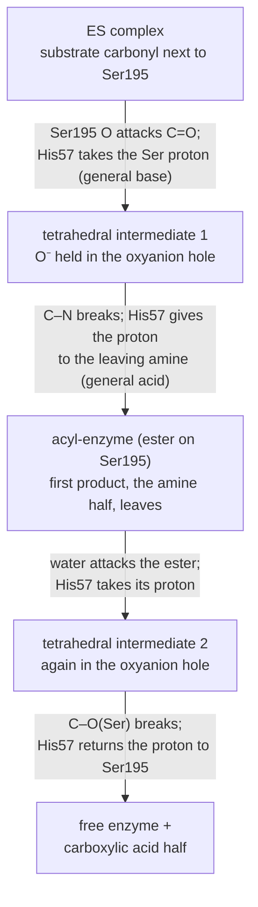

# 29.4 · Enzyme mechanisms: catalytic strategies

An amide bond in water lasts for years; chymotrypsin cuts one in a fraction of a second at body temperature, with no heat and no strong acid. The enzyme uses the same organic chemistry you learned in lessons [15.4](../module-15/lesson-04.md) and [16.3](../module-16/lesson-03.md), proton transfers and nucleophilic acyl substitution, but arranges every group in exactly the right place. This lesson shows how large enzymatic rate enhancements are, the handful of strategies enzymes use to get them, and how to read a mechanism from a crystal structure and a pH-rate profile.

## Why it matters

A chemist designing a protease inhibitor for a virus, an engineer building an enzyme for a detergent, and a toxicologist explaining why a nerve agent is lethal all ask the same question: what does each active-site residue do? A mechanism tells you which bond to block, which residue a mutation will cripple, and at what pH the enzyme works. It also explains why the structure of one protease predicts the behaviour of hundreds of others: the serine proteases of digestion, blood clotting and the immune system share one mechanism. Mechanism is where enzyme kinetics, organic chemistry and structure meet.

## Core ideas

> [!NOTE]
> The mechanisms are stable textbook chemistry. Distances come from PDB entry 4CHA (1.68 Å, released 1985; CC0), measured 2026-10-17. The pH-rate data in the lab are generated with pKa values typical of chymotrypsin, not measured. The labs use NumPy 2.5 and SciPy 1.18, pinned in `labs/common/requirements.txt`.

### How much faster?

Radzicka and Wolfenden measured some of the slowest biological reactions without a catalyst. Orotic acid, a precursor of the pyrimidine nucleotides, loses CO₂ in neutral water with a half-life of 78 million years at room temperature. The enzyme orotidine 5'-phosphate decarboxylase does the same job $10^{17}$ times faster. Across the reactions they compared, uncatalysed rates span more than 14 orders of magnitude, but the enzymes' $k_\text{cat}/K_m$ values fall in a range of only 600-fold: enzymes for the slowest reactions are simply better catalysts.

Transition-state theory (lesson [22.4](../module-22/lesson-04.md)) turns a rate ratio into an energy:

$$\Delta\Delta G^\ddagger = RT\ln\frac{k_\text{cat}}{k_\text{uncat}}$$

A factor of $10^{17}$ at 25 °C is $2.48 \times \ln 10^{17} = 97$ kJ/mol taken off the barrier, about the strength of several hydrogen bonds and a salt bridge together.

### The key idea: bind the transition state

Pauling's insight was that an enzyme binds the **transition state** much more tightly than the substrate. Think of the energy profile of lesson [28.1](../module-28/lesson-01.md): if the enzyme stabilised the substrate as much as the transition state, the barrier from ES would be unchanged. A good enzyme binds the substrate moderately (that sets $K_m$) and the transition state enormously. For orotidine 5'-phosphate decarboxylase, Radzicka and Wolfenden estimated a dissociation constant for the transition state below $5 \times 10^{-24}$ M. This is why transition-state analogues (lesson [29.3](lesson-03.md)) make such tight inhibitors.

### Five strategies

Enzymes combine a small set of tricks:

- **General acid–base catalysis.** A side chain gives or takes a proton during the reaction, so no charged high-energy species has to form. Histidine (pKa near 6–7) is ideal because it can do either at pH 7 (lesson [06.2](../module-06/lesson-02.md)).
- **Covalent catalysis.** A nucleophilic side chain attacks the substrate and forms a temporary covalent intermediate: serine in serine proteases, cysteine in cysteine proteases such as bromelain from pineapple, lysine forming a Schiff base (imine) with a carbonyl in aldolase (lesson [29.5](lesson-05.md)).
- **Metal-ion catalysis.** A metal ion polarises a substrate, activates a water molecule or shields negative charge. Zn²⁺ in carbonic anhydrase (lesson [26.4](../module-26/lesson-04.md)) and Mg²⁺ on ATP are the classic cases.
- **Proximity and orientation.** Holding two reactants next to each other, aligned for reaction, turns an intermolecular reaction into an intramolecular one. The rate gain is expressed as an **effective molarity**, the concentration of one reactant that would give the same rate; it can be many molar.
- **Electrostatic catalysis and preorganisation.** The active site is built in advance with charges and hydrogen-bond donors placed to stabilise the charge distribution of the transition state, so the enzyme does not pay the reorganisation cost that water would.

### Chymotrypsin: a worked mechanism

Chymotrypsin is a digestive serine protease. It cuts peptide bonds after a large hydrophobic residue (Phe, Trp, Tyr), which fits into a deep nonpolar pocket next to the active site. Its catalytic machinery is the **catalytic triad** Ser195, His57 and Asp102, plus the **oxyanion hole**, two backbone N–H groups (of Gly193 and Ser195) that donate hydrogen bonds to the carbonyl oxygen.



Every strategy in the list appears: His57 is the general acid and base, Ser195 is the covalent nucleophile, the oxyanion hole is preorganised electrostatics, and the binding pocket provides proximity and orientation. Asp102 holds His57 in the right tautomer and orientation and stabilises its positive charge in the transition state. In the related bacterial protease subtilisin, Carter and Wells replaced the triad residues by alanine: turnover fell steeply while $K_m$ barely changed, and the three residues together, acting synergistically, were worth a factor of about $2 	imes 10^6$.

### pH-rate profiles

Because catalysis needs His57 in its neutral (base) form, activity depends on pH. For chymotrypsin, $k_\text{cat}/K_m$ follows a bell:

$$\frac{k_\text{cat}}{K_m} = \frac{(k_\text{cat}/K_m)_\text{max}}{1 + 10^{\mathrm{p}K_{a1} - \mathrm{pH}} + 10^{\mathrm{pH} - \mathrm{p}K_{a2}}}$$

The rising side, with pKa₁ near 7, is His57 losing its extra proton. The falling side, with pKa₂ near 9, is the N-terminal amino group of Ile16. That group is created when chymotrypsinogen is cut to activate it (lesson 29.3), and its positive charge forms a salt bridge with Asp194 that holds the oxyanion hole and pocket in the active shape. When it loses its proton, the enzyme relaxes towards the inactive zymogen form. The profile of $k_\text{cat}/K_m$ reports groups in the free enzyme and free substrate; the profile of $k_\text{cat}$ reports groups in the ES complex. Assign a pKa to a residue only with independent evidence, such as a mutant or a structure: a measured pKa can be shifted several units by its surroundings.

## Worked example

### 1. Seventy-eight million years to a fraction of a second

The uncatalysed decarboxylation of orotic acid has $t_{1/2}$ = 78 million years; the enzyme is $10^{17}$ times faster.

1. Uncatalysed first-order constant: $k_\text{uncat} = \ln 2/t_{1/2} = 0.693/(78 \times 10^6 \times 3.156 \times 10^7\ \mathrm{s}) = 2.8 \times 10^{-16}$ s⁻¹.
2. Enzyme: $k_\text{cat} \approx 10^{17} \times 2.8 \times 10^{-16} \approx 30$ s⁻¹, a turnover every 35 ms, close to the median enzyme of lesson [29.2](lesson-02.md).
3. Barrier lowering at 25 °C: $\Delta\Delta G^\ddagger = RT\ln 10^{17} = 2.479 \times 39.1 = 97$ kJ/mol.

The enzyme does not make the reaction thermodynamically easier; it removes almost 100 kJ/mol from the path.

### 2. How much enzyme is active at pH 6?

With pKa₁ = 6.9 and pKa₂ = 8.9, the fraction of enzyme in the active protonation state is $1/(1 + 10^{\mathrm{p}K_{a1} - \mathrm{pH}} + 10^{\mathrm{pH} - \mathrm{p}K_{a2}})$.

1. pH 6.0: $1/(1 + 10^{0.9} + 10^{-2.9}) = 1/(1 + 7.94 + 0.001) = 0.11$.
2. pH 7.4: $1/(1 + 10^{-0.5} + 10^{-1.5}) = 1/(1 + 0.316 + 0.032) = 0.74$.
3. Optimum, half-way between the pKa values: pH 7.9.

Moving from pH 7.4 to 6.0 costs nearly seven-fold in rate, because His57 is then mostly protonated and cannot act as a base. The small intestine, where chymotrypsin works, is near neutral pH.

## Hands-on

What you need: for Part A, a fresh pineapple (or a ripe one from the market), a tin of pineapple pieces, a packet of unflavoured gelatin (powder or sheets), a small pan, a kettle, four small glasses or jars, a knife, a chopping board and a fridge; for Part B, Python with the course packages and the [Module 29 lab folder](../../labs/module-29/). Record Part A on a [notebook page](../../templates/notebook-page.md) and Part B with the [lab report template](../../templates/lab-report.md). Time: about 1 h 30 min of work plus 3 h in the fridge.

### Part A — kitchen: a cysteine protease from pineapple (30 min + 3 h)

> [!CAUTION]
> Use the knife on a stable board and cut away from your hand. Hot water and a boiling pan scald: keep handles turned inward and children away. Fresh pineapple juice contains an active protease that can sting the mouth, lips and skin and irritate cuts; anyone with a pineapple or latex allergy should not handle fresh pineapple. Wash your hands afterwards and do not eat the test samples.

Pineapple stem and fruit contain bromelain, a cysteine protease (UniProt P14518): its nucleophile is a cysteine thiolate assisted by a histidine, the cysteine version of the serine mechanism above. Gelatin is denatured collagen, a protein; it sets into a gel when its chains form a network as it cools. A protease cuts the chains, and the gel cannot form.

1. Make the gelatin as the packet says for about 500 mL, using hot (not boiling) water, and let it cool until just warm.
2. Cut four small cubes (about 1 cm) of fresh pineapple. Put two in a small pan with a little water and boil them for 5 minutes, then let them cool.
3. Label four glasses: (1) gelatin only, (2) fresh pineapple, (3) boiled fresh pineapple, (4) tinned pineapple. Add one or two cubes to each of glasses 2–4 and pour the same amount of warm gelatin into all four.
4. Refrigerate for 3 hours, then tilt each glass.

How you know it worked: glasses 1, 3 and 4 set firm; glass 2 stays liquid or very soft around the pineapple. Boiling, and the heating of the canning process, unfold bromelain (lesson [29.1](lesson-01.md)) so it can no longer cut. If glass 2 sets, the gelatin was too concentrated or too hot when poured, or the pineapple was unripe; repeat with more fresh pineapple. This part shows that the activity belongs to a heat-sensitive protein, not to the fruit's acid or sugar; it does not measure a rate.

### Part B — Python: the active site and the pH-rate profile (60 min)

1. Open `lesson04_mechanism.py`. It reads `data/4CHA_site.pdb` (the active site of α-chymotrypsin, trimmed from PDB 4CHA) and `chymotrypsin_ph_rate.csv` (generated $k_\text{cat}/K_m$ from pH 5.0 to 10.5).
2. Complete `distance()`, `log_bell()` (the base-10 log of the bell equation above) and `fraction_active()`.
3. Run it and open `runs/lesson04_mechanism.png`:

```bash
py lesson04_mechanism.py
```

4. Optional: open [4CHA on the RCSB site](https://www.rcsb.org/structure/4CHA) in the Mol* viewer and find Ser195, His57 and Asp102 yourself. To measure the full entry, run `py fetch_pdb.py 4CHA` and then `py lesson04_mechanism.py data/downloaded/4CHA.pdb`.
5. Answer: (a) Are Ser195 Oγ–His57 Nε2 and His57 Nδ1–Asp102 short enough for hydrogen bonds (under about 3.2 Å between N and O)? (b) Why is the distance from Ser195 Oγ to the Gly193 N longer? What sits between them in the reaction? (c) What are the two pKa values, and what is the active fraction at pH 6.0, 7.4 and 8.0?

How you know it worked: Ser195 Oγ–His57 Nε2 2.82 Å, His57 Nδ1–Asp102 Oδ1 2.61 Å, Gly193 N–Ser195 N 4.37 Å, Ser195 Oγ–Gly193 N 5.38 Å. The full entry gives the same values. pH fit: pKa₁ = 6.93 ± 0.03, pKa₂ = 8.85 ± 0.03, maximum 2.1 × 10⁵ M⁻¹ s⁻¹; active fraction 0.10 (pH 6.0), 0.73 (7.4), 0.82 (8.0); optimum pH 7.9.

<details><summary>Reference solution and model answers</summary>

```python
def distance(a, b):
    return float(np.linalg.norm(a["xyz"] - b["xyz"]))

def log_bell(pH, log_kmax, pKa1, pKa2):
    return log_kmax - np.log10(1 + 10 ** (pKa1 - pH) + 10 ** (pH - pKa2))

def fraction_active(pH, pKa1, pKa2):
    return 1 / (1 + 10 ** (pKa1 - pH) + 10 ** (pH - pKa2))
```

Full code: `lesson04_mechanism_solution.py`.

(a) Yes, both are hydrogen-bond distances; the Asp–His one is especially short, consistent with a strong bond that stabilises the positive His57 in the transition state. The Gonzaga course page reports 3.02 and 2.67 Å for a related entry (5CHA); a tenth of an ångström is within the typical spread between refinements. (b) The serine oxygen must reach the substrate carbonyl carbon, and the carbonyl oxygen, as it becomes the oxyanion, sits between the two backbone N–H groups; it is the substrate, not the enzyme, that fills the gap. (c) 6.9 and 8.9; His57 must be neutral and the Ile16 amino group protonated. The fit recovers the values used to generate the data, which only shows the method works; real profiles need buffers of constant ionic strength and checks that the enzyme is stable at each pH.

</details>

## Common mistakes

- Saying the enzyme "binds the substrate tightly" to explain catalysis. Tight substrate binding alone deepens the well and raises the barrier from ES; the transition state must be bound more tightly.
- Forgetting the acyl-enzyme. Serine and cysteine proteases work in two half-reactions, and the second (hydrolysis of the acyl-enzyme) is often rate-limiting for ester substrates.
- Reading a pKa from a pH-rate profile as the pKa of a free amino acid. Active-site pKa values are shifted by their surroundings; the falling limb of chymotrypsin is not a histidine at all.
- Treating a rate enhancement as a change in equilibrium. Catalysis lowers the barrier only; $\Delta G$ of the reaction is unchanged (lesson [22.5](../module-22/lesson-05.md)).
- In the kitchen part, blaming the acid of pineapple. Boiled fresh pineapple has the same acid and the gel sets.

## Key takeaways

- Enzymes reach rate enhancements up to about $10^{17}$; $\Delta\Delta G^\ddagger = RT\ln(k_\text{cat}/k_\text{uncat})$, close to 100 kJ/mol in the extreme case.
- Catalysis comes from binding the transition state far more tightly than the substrate.
- Five strategies recur: general acid–base, covalent, metal-ion, proximity and orientation, electrostatic preorganisation.
- Chymotrypsin uses a Ser–His–Asp triad and an oxyanion hole to form and then hydrolyse an acyl-enzyme; the triad distances in 4CHA are 2.6–2.8 Å.
- A bell-shaped pH-rate profile gives two pKa values of groups the reaction needs; for chymotrypsin about 7 (His57) and about 9 (Ile16 amino group).

## Sources

- [Radzicka and Wolfenden (1995), Science 267, 90](https://pubmed.ncbi.nlm.nih.gov/7809611/) — orotic acid decarboxylation $t_{1/2}$ 78 million years; rate enhancement $10^{17}$; transition-state $K_d$ below $5 \times 10^{-24}$ M; $k_\text{cat}/K_m$ spread only 600-fold.
- [Carter and Wells (1988), Nature 332, 564](https://pubmed.ncbi.nlm.nih.gov/3282170/) — alanine replacements of the subtilisin triad: large drops in turnover, small changes in $K_m$, synergy worth about $2 \times 10^6$.
- [RCSB PDB 4CHA](https://www.rcsb.org/structure/4CHA) — α-chymotrypsin at 1.68 Å (Tsukada and Blow, J. Mol. Biol. 184, 703, 1985).
- [Cronk, The catalytic triad in serine proteases](https://web02.gonzaga.edu/faculty/cronk/CHEM440pub/catalytic-triad.html) — roles of Ser195, His57 and Asp102, the oxyanion hole of Gly193 and Ser195, triad distances in 5CHA.
- [UniProt P14518, stem bromelain](https://www.uniprot.org/uniprotkb/P14518/entry) — a cysteine proteinase from pineapple.
- [Biology Corner, pineapple and gelatin](https://www.biologycorner.com/2021/11/07/investigation-how-do-enzymes-in-pineapple-affect-gelatin/) — classroom design: fresh pineapple stops gelatin setting, tinned pineapple does not.
- [MIT OCW 5.07SC Biological Chemistry I](https://ocw.mit.edu/courses/5-07sc-biological-chemistry-i-fall-2013/) — Module I, principles of catalysis and serine proteases.
