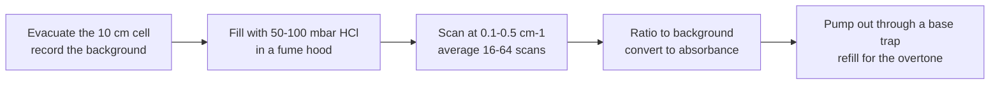

# 30.1 · IR spectroscopy from first principles: HCl rotation-vibration

The first experiment of almost every physical chemistry lab course in the world is the infrared spectrum of hydrogen chloride gas. In lesson [20.3](../module-20/lesson-03.md) you assigned the band from a 1964 chart with 4 cm⁻¹ resolution and got constants about 1 % off. This lesson does the experiment the way a modern lab does it: a Fourier-transform spectrometer at 0.1 cm⁻¹ resolution, both chlorine isotopes resolved, the fundamental and the first overtone. From one afternoon's data you get the bond length to four digits, the anharmonicity of the bond, a test of the Morse model, and the temperature of the gas.

## Why it matters

Rotation-vibration lines are the most precise rulers chemistry has. HCl lines are used to calibrate the wavenumber scale of infrared spectrometers. Satellite and ground-based instruments measure HCl in the stratosphere from these same lines, because chlorine from old refrigerants destroys ozone. Every one of these uses rests on the analysis you do here: which line is which, and which constants describe them. The lab also teaches a lasting habit: never trust a fit until an independent number (here the isotope ratio and the temperature) agrees with it.

## Core ideas

> [!NOTE]
> The physics is stable. The constants are the NIST WebBook values for H³⁵Cl and CODATA 2022 values, checked 2026-10-17. The example spectrum in the lab folder is generated from those constants with realistic line widths and noise; it is not a measured spectrum. Modern measured line positions (Rank et al. 1965; Guelachvili et al. 1981) agree with it to a few hundredths of a cm⁻¹. The simulation is an educational model.

### From the potential to the lines

Start from the two models of Module 12. The bond is an anharmonic oscillator ([12.4](../module-12/lesson-04.md)) with vibrational terms

$$G(v) = \omega_e\left(v+\tfrac12\right) - \omega_e x_e\left(v+\tfrac12\right)^2$$

and the molecule is a rotor ([12.5](../module-12/lesson-05.md)) whose rotational constant depends a little on $v$ and which stretches when it spins fast:

$$F_v(J) = B_vJ(J+1) - DJ^2(J+1)^2, \qquad B_v = B_e - \alpha_e\left(v+\tfrac12\right)$$

The selection rules for a ¹Σ diatomic are $\Delta J = \pm1$, and $\Delta v = \pm1$ for a harmonic oscillator with a linear dipole. Anharmonicity of the potential and curvature of the dipole function relax $\Delta v$: the overtone $v = 2 \leftarrow 0$ appears near 5668 cm⁻¹, about 50 times weaker than the fundamental. With the running number $m$ ($m = J+1$ for R, $m = -J$ for P, as in [20.3](../module-20/lesson-03.md)) every line of a band is

$$\tilde\nu(m) = \tilde\nu_0 + (B' + B'')\,m + (B' - B'')\,m^2 - 2(D' + D'')\,m^3$$

where a single prime is the upper level and a double prime the lower one. The cubic term is the centrifugal distortion. For HCl, $D \approx 5\times10^{-4}$ cm⁻¹; at $m = 10$ it moves a line by 2 cm⁻¹, ten times the line width. At high resolution you must fit it.

### Two isotopologues, two tests

Natural chlorine is 75.8 % ³⁵Cl and 24.2 % ³⁷Cl. H³⁷Cl has a reduced mass larger by 0.15 %. With $\rho = \sqrt{\mu_{35}/\mu_{37}} = 0.999243$, the theory says $\omega_e$ scales as $\rho$ and $B$ as $\rho^2$. So each H³⁵Cl line has a partner three times weaker, about 2.1 cm⁻¹ lower in the fundamental and 4.1 cm⁻¹ lower in the overtone. Fitting the two sets separately and comparing the ratios with $\rho$ and $\rho^2$ is a free test of the whole analysis, because the masses are known to ten digits.

The second test is the temperature. The height of a line follows the population of its lower level (lesson [21.1](../module-21/lesson-01.md)), times a factor $|m|$ from the rotational line strength, times $\tilde\nu$:

$$I(m) \propto |m|\,\tilde\nu\,\exp\!\left(-\frac{hc\,F_0(J'')}{k_BT}\right)$$

A plot of $\ln[I/(|m|\tilde\nu)]$ against $F_0(J'')$ is a straight line with slope $-hc/k_BT$. If your assignment were wrong by one $J$, this plot would curve. Real spectra add a small Herman–Wallis factor that makes R lines a little stronger than P lines; it shifts the temperature by a few kelvin.

### Fundamental plus overtone

The band centres are $\tilde\nu_{01} = G(1) - G(0) = \omega_e - 2\omega_ex_e$ and $\tilde\nu_{02} = G(2) - G(0) = 2\omega_e - 6\omega_ex_e$. Two equations, two unknowns:

$$\omega_ex_e = \frac{2\tilde\nu_{01} - \tilde\nu_{02}}{2}, \qquad \omega_e = \tilde\nu_{01} + 2\omega_ex_e$$

A Morse potential with these constants has a well depth $D_e = \omega_e^2/4\omega_ex_e$. Subtract the zero-point energy $G(0)$ and you get the dissociation energy $D_0$ the model predicts. Lesson [20.4](../module-20/lesson-04.md) showed with iodine that a two-term extrapolation overestimates $D_0$; HCl shows it again.

### The experiment and why each step



1. **Background with the empty cell.** The spectrometer's own response, the windows and any water vapour in the beam are divided out.
2. **Low pressure.** Collisions broaden each line (pressure broadening). At 50–100 mbar the lines are about 0.1–0.2 cm⁻¹ wide, so the isotope doublets are cleanly separated.
3. **Resolution.** The doublet spacing is 2.1 cm⁻¹, so 0.5 cm⁻¹ resolution separates it and 0.1 cm⁻¹ gives line positions to better than 0.01 cm⁻¹. The 4 cm⁻¹ of the 1964 chart blurred each doublet into one peak and biased every position.
4. **The overtone needs more molecules.** It is about 50 times weaker, so labs use a higher pressure or a multi-pass cell, and often a different detector and beamsplitter for the near infrared.

Safety reasoning: HCl gas is H280 (gas under pressure), H314 (severe burns and eye damage) and H331 (toxic if inhaled) in PubChem's GHS summary. It is handled from a small cylinder on a vacuum line in a fume hood, with goggles and gloves, and pumped out through a base trap, never vented. With a trace of moisture it also etches the water-soluble KBr or NaCl windows, so the cell is dried first. This is a lab-only experiment; nothing in this module asks you to handle HCl.

What can go wrong: a leaky cell lets air and water in; a saturated line (absorbance above about 1.5) has a flat top and a poorly defined position; coarse resolution merges the doublets; a mis-numbered branch puts the band centre in the wrong gap.

## Worked example

Take three measured lines of the H³⁵Cl fundamental (values of the size Rank et al. report): R(0) = 2906.25, P(1) = 2865.10 and R(1) = 2925.90 cm⁻¹, with P(2) = 2843.62 cm⁻¹.

1. Combination difference for the lower level (lines sharing the upper level $J' = 1$): $R(0) - P(2) = 4B_0 \times 1.5 = 6B_0$, so $B_0 = (2906.25 - 2843.62)/6 = 10.438$ cm⁻¹.
2. Upper level (lines sharing $J'' = 1$): $R(1) - P(1) = 6B_1$, so $B_1 = (2925.90 - 2865.10)/6 = 10.133$ cm⁻¹.
3. $\alpha_e = B_0 - B_1 = 0.305$, $B_e = B_0 + \alpha_e/2 = 10.590$ cm⁻¹. With $\mu = 0.979593$ u, $r_e = \sqrt{h/(8\pi^2 cB_e\mu)} = 1.2748$ Å (NIST 1.2746 Å).
4. Band centre: $\tilde\nu_0 = R(0) - 2B_1 = 2906.25 - 20.27 = 2885.98$ cm⁻¹.
5. With the overtone centre $\tilde\nu_{02} = 5668.0$ cm⁻¹: $\omega_ex_e = (2 \times 2885.98 - 5668.0)/2 = 51.98$ and $\omega_e = 2989.9$ cm⁻¹.
6. Morse: $D_e = 2989.9^2/(4 \times 51.98) = 43\,000$ cm⁻¹; $G(0) = \omega_e/2 - \omega_ex_e/4 = 1482$ cm⁻¹; $D_0 = 41\,500$ cm⁻¹ = 5.15 eV.

Interpretation: the real $D_0$ of HCl is about 4.43 eV (427.6 kJ/mol). The Morse model, built only from the bottom of the well, overestimates it by 16 %. The low levels tell you the curvature of the well, not where it ends. Also note that $\omega_ex_e$ comes out 1 cm⁻¹ below NIST's 52.82: NIST's fit includes a cubic term $\omega_ey_e$, which two bands cannot separate.

## Hands-on

What you need: a browser, Python with the course packages and the [Module 30 lab folder](../../labs/module-30/) (see its README), and a [spectrum assignment sheet](../../templates/spectrum-assignment.md). Time: about 80 minutes. There is no home experiment: HCl gas is a toxic, corrosive lab gas. The simulation and the data train the procedure and the analysis, not the hands on a vacuum line.

### Part A — simulation: build the band from the physics (25 min)

[Simulation: IR and ESR — HCl rotation-vibration band](../../simulations/ir-esr/index.html?preset=hcl)

1. Start at 4 cm⁻¹ resolution, 300 K. You should see the same comb as in 20.3. Now go to 0.5 cm⁻¹. Each peak splits into a 3 : 1 doublet. Measure the doublet spacing at R(0) and at R(8): it should be about 2.1 cm⁻¹ and grow slightly with $m$.
2. Switch off centrifugal distortion ($D = 0$) and watch the high-$J$ lines move. By how much does R(10) move? (Expect about 3 cm⁻¹.)
3. Set the pressure from 50 to 500 mbar. Find the pressure at which the doublets stop being resolved.
4. Raise the absorbance until the strongest lines saturate (flat tops), then switch to the overtone and note what you must change (path, pressure, scans) for a similar signal.

How you know it worked: at 0.5 cm⁻¹ and low pressure every line is a clean doublet; above a few hundred mbar they merge; a saturated line looks broader and its peak is less well defined.

### Part B — Python: full analysis of a high-resolution spectrum (40 min)

Open `lesson01_hcl.py`. Peak picking, isotope sorting and numbering are written for you. Complete three functions: `fit_band()` (turn the cubic fit coefficients into $\tilde\nu_0$, $B''$, $B'$, $D$), `vib_constants()` (the two equations above) and `temperature_from_lines()` (the Boltzmann plot). Then run, from the lab folder:

```bash
py lesson01_hcl.py
```

How you know it worked: 19 lines per isotopologue in the fundamental and 13 in the overtone; for H³⁵Cl $\tilde\nu_0$ = 2886.04 cm⁻¹, $B_0$ = 10.440, $B_1$ = 10.133 cm⁻¹, $D$ = 5.3 × 10⁻⁴ cm⁻¹, rms residual below 0.01 cm⁻¹; $r_e$ = 1.2745 Å; $\omega_e$ = 2989.7 and $\omega_ex_e$ = 51.8 cm⁻¹; Morse $D_0$ = 5.16 eV against a real 4.43 eV; isotope ratios within 0.005 % of $\rho$ and $\rho^2$; temperature 292 ± 1 K (the data were made at 296 K). The plot `runs/lesson01_hcl.png` shows the spectrum with both isotopologues marked and the curvature of each band.

Then rerun `lesson03_hcl_band.py` from the Module 20 lab folder and put the two sets of constants side by side on your assignment sheet.

<details><summary>Reference solution and discussion</summary>

```python
c3, c2, c1, c0 = np.polyfit(m, nu, 3)
return c0, (c1 - c2) / 2, (c1 + c2) / 2, -c3 / 4          # fit_band
wexe = (2 * nu01 - nu02) / 2
return nu01 + 2 * wexe, wexe                               # vib_constants
```

For the temperature, take `J = np.where(m > 0, m - 1, -m)`, the energy `B0*J*(J+1) - D*(J*(J+1))**2`, fit `ln(height/(|m| nu))` against it and return `T = -HC_K/b` with `sigma = T*sb/|b|`. Full code: `lesson01_hcl_solution.py`.

Discussion. $B_0$ is now correct to 0.01 % instead of 1 % in 20.3: resolution, not cleverness, made the difference, because the unresolved doublets in the old chart pulled every peak. The temperature comes out 4 K low because neighbouring lines and the baseline add to the weak high-$J$ peaks; fitting line areas instead of heights removes most of that. The Morse failure is physics, not noise.

</details>

### Part C — pencil (15 min)

1. DCl has $\mu$ = 1.9044 u. Predict its fundamental band centre and $B_0$ from the H³⁵Cl values, using $\omega_e \propto \mu^{-1/2}$ and $B \propto \mu^{-1}$ (ignore anharmonic scaling).
2. A student numbers the P branch starting at the wrong gap, so every P line has $|m|$ one too large. Which of $B_0$, $B_1$ and $\tilde\nu_0$ would show it most clearly, and how would the Boltzmann plot look?
3. At what resolution would you stop seeing the H³⁷Cl partners in the overtone? Explain in one sentence.

<details><summary>Answers</summary>

1. $\sqrt{0.97959/1.9044} = 0.7172$: $\tilde\nu_0 \approx 2886.0 \times 0.7172 = 2070$ cm⁻¹ (measured about 2091, because anharmonicity scales as $\mu^{-1}$, not $\mu^{-1/2}$); $B_0 \approx 10.440 \times 0.5144 = 5.37$ cm⁻¹ (measured 5.39).
2. The fit would no longer be a smooth curve: the residuals jump between branches and the quadratic coefficient, which is $B_1 - B_0$ and small, goes badly wrong; the band centre shifts by about $2B$. The Boltzmann plot splits into two parallel lines, one per branch.
3. The overtone doublets are 4.1 cm⁻¹ apart, so they merge at a resolution of about 4 cm⁻¹; the fundamental's 2.1 cm⁻¹ doublets merge already at about 2 cm⁻¹.

</details>

## Common mistakes

- **Numbering from the wrong gap.** The band centre is the widest gap, about $4B$; with saturated or missing lines another gap can look wide. Check that the residuals of the fit are smooth across $m = 0$.
- **Leaving out $D$ at high resolution.** A quadratic fit to 19 lines of HCl leaves residuals of several tenths of a cm⁻¹ with an S-shaped pattern, far above the 0.01 cm⁻¹ precision. Add the cubic term.
- **Mixing the isotopologues.** If one H³⁷Cl line slips into the H³⁵Cl list, the fit jumps by 2 cm⁻¹ at that point. Sort by isotope before numbering.
- **Treating the Morse $D_0$ as a measurement.** It is an extrapolation of two levels to the top of the well. Quote it as a model value and compare it with thermochemistry.
- **Reading line positions off saturated lines.** Keep peak absorbance below about 1; dilute the gas or shorten the path instead.

## Key takeaways

- At 0.5 cm⁻¹ or better the HCl band is two sets of lines, one per chlorine isotope, 3 : 1 in height and about 2.1 cm⁻¹ apart.
- One cubic fit per band gives $\tilde\nu_0$, $B''$, $B'$ and $D$; $B_e$ and $r_e$ follow.
- Fundamental plus overtone give $\omega_e$ and $\omega_ex_e$; the Morse dissociation energy from them is about 16 % too high for HCl.
- Isotope ratios ($\rho$, $\rho^2$) and the Boltzmann temperature are independent checks of the assignment.
- HCl is a toxic, corrosive gas: vacuum line, fume hood, base trap, dry cell.

## Sources

- [NIST Chemistry WebBook, HCl diatomic constants](https://webbook.nist.gov/cgi/cbook.cgi?ID=C7647010&Mask=1000) — H³⁵Cl $\omega_e$ = 2990.9463, $\omega_ex_e$ = 52.8186, $B_e$ = 10.593416, $\alpha_e$ = 0.307181, $D_e$ = 5.3194 × 10⁻⁴ cm⁻¹, $r_e$ = 1.274552 Å; used to generate the example spectrum.
- [NIST Chemistry WebBook, HCl IR spectrum](https://webbook.nist.gov/cgi/cbook.cgi?ID=C7647010&Mask=80) — the 1964 low-resolution spectrum analysed in 20.3.
- [Rank, Rao and Wiggins, J. Mol. Spectrosc. 17, 122 (1965)](https://doi.org/10.1016/0022-2852(65)90114-1) — measured H³⁵Cl line positions and constants.
- [Guelachvili, Niay and Bernage, J. Mol. Spectrosc. 85, 271 (1981)](https://doi.org/10.1016/0022-2852(81)90200-9) — Fourier-transform line positions of HCl and DCl bands.
- [PubChem: Hydrogen chloride (CID 313)](https://pubchem.ncbi.nlm.nih.gov/compound/313) — GHS hazard statements H280, H314, H331.
- [NIST CODATA 2022 constants](https://physics.nist.gov/cuu/Constants/) — $h$, $c$, $k_B$, atomic mass constant.
