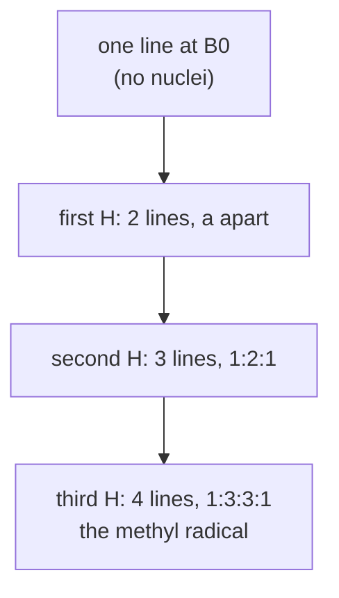

# 30.2 · Electron spin resonance and hyperfine splitting

Most molecules have all their electrons paired and are invisible to electron spin resonance (ESR, also called EPR, electron paramagnetic resonance). A radical has one unpaired electron, and that electron is a tiny magnet. In a magnetic field it can point with or against the field, and microwaves flip it. The flip would give one boring line, except that the electron also feels the magnetic nuclei it visits. Those nuclei split the line into a pattern that tells you which atoms the unpaired electron spends time on, and how much. This lesson reads the two textbook patterns: the four lines of the methyl radical and the two widely spaced lines of the hydrogen atom.

## Why it matters

Radicals are short-lived and scarce, yet they drive combustion, polymerisation, radiation damage and many enzymes (Module 26). ESR sees only them, nothing from the solvent or the paired-electron molecules around them. When a chemist proposes a radical mechanism, the ESR spectrum is the evidence: the number of lines says how many protons the electron touches; the spacing says how much spin density sits next to each one. Food scientists use it to measure antioxidants and archaeologists to date tooth enamel, with the analysis of this lesson.

## Core ideas

> [!NOTE]
> The physics is stable. Constants are CODATA 2022 ($\mu_B$ = 9.274 010 0657 × 10⁻²⁴ J/T, $g_e$ = 2.002 319 304 36) from NIST, checked 2026-10-17. The methyl constants are Fessenden and Schuler's (1963): $g$ = 2.00255, $|a_H|$ = 2.304 mT. The hydrogen-atom splitting is the 21 cm line, 1420.405 751 768 MHz. The example spectra in the lab folder are generated from these values. The simulations are educational models.

### The resonance condition

An electron has spin ½ ([12.5](../module-12/lesson-05.md)). In a field $B$ its two states $m_S = \pm\tfrac12$ differ in energy by

$$\Delta E = g\mu_B B$$

where $\mu_B$ is the Bohr magneton and $g$ is the g factor, 2.0023 for a free electron. Resonance happens when a microwave photon matches the gap, $h\nu = g\mu_B B$. Spectrometers keep the frequency fixed (a resonant cavity works at one frequency) and sweep the field. At X band, $\nu \approx$ 9.5 GHz, a free electron resonates at about 0.34 T, a field made by a large electromagnet.

A molecule's g differs from 2.0023 because orbital motion adds a little magnetism (spin–orbit coupling): organic radicals have $g$ = 2.002–2.006, transition-metal ions ([18.5](../module-18/lesson-05.md)) anything from 1 to 6.

The gap is tiny, 0.32 cm⁻¹ at 0.34 T, so the two spin states are almost equally populated (Boltzmann factor 0.9985 at room temperature, [21.1](../module-21/lesson-01.md)). To pull the small signal out of the noise, the field is modulated slightly at 100 kHz and a lock-in amplifier records the change of absorption with field. The result is the **first derivative** of the absorption line: it crosses zero at the line centre, and the field between its maximum and minimum is the peak-to-peak width $\Delta B_{pp}$.

### Hyperfine coupling

A nucleus with spin $I$ has $2I + 1$ orientations $m_I$. The unpaired electron feels a slightly different local field for each, so its line splits:

$$B(m_I) = B_0 - a\,m_I$$

where $a$ is the **hyperfine coupling constant** in mT. The main source of $a$ in a radical tumbling in a liquid is the **Fermi contact interaction**: it depends on the probability of finding the electron right at the nucleus, $|\psi(0)|^2$. Only s orbitals have density at a nucleus, so $a$ measures s character.

With $n$ equivalent nuclei the shifts add. For protons ($I = \tfrac12$) there are $n + 1$ lines with intensities from Pascal's triangle, exactly like the NMR $n + 1$ rule of [17.3](../module-17/lesson-03.md). For any spin $I$ the count is $2nI + 1$: three deuterons ($I = 1$) give 7 lines, 1 : 3 : 6 : 7 : 6 : 3 : 1.



A coupling to a different nucleus is a property of that nucleus's magnetic moment and of the spin density. Replace H by D and the spin density stays the same, but the nuclear moment drops: $a_D = a_H\,g_D/g_p = 0.1535\,a_H$.

### The methyl radical and the McConnell relation

CH₃• is planar. Its unpaired electron sits in a carbon 2p orbital perpendicular to the plane, which has a node in the plane where the protons are. So why is $a_H$ = 2.30 mT and not zero? The unpaired electron slightly polarises the C–H bonding pairs: in each bond the electron with spin parallel to the unpaired one is pulled towards carbon, leaving a small excess of opposite spin at the proton. That **spin polarisation** gives a negative coupling, and ESR of a tumbling radical measures only its size.

McConnell turned this into a rule for π radicals: the coupling of a proton on a carbon is proportional to the π spin density $\rho$ on that carbon,

$$a_H = Q\rho, \qquad |Q| \approx 2.3\ \text{mT}$$

For methyl, $\rho = 1$ and $a_H \approx |Q|$. In the benzene radical anion one electron is shared by six carbons, $\rho = 1/6$, and the seven lines are 0.375 mT apart. This is how ESR maps where an unpaired electron lives in a molecule.

### The hydrogen atom: when the splitting is not small

In the hydrogen atom the electron is in a 1s orbital, with the largest possible density at the proton. The coupling is enormous: $A$ = 1420.4 MHz, which is the famous 21 cm radio line of interstellar hydrogen. In field units $a = hA/(g\mu_B)$ = 50.7 mT, 15 % of the resonance field itself.

The simple rule $B = B_0 - a\,m_I$ assumes $a \ll B_0$. When it is not, the electron and nuclear spins are partly mixed by the field, and the exact levels follow the **Breit–Rabi** formula. To second order each line moves:

$$B(m_I) = B_0 - a\,m_I - \frac{a^2}{2B_0}\left[I(I+1) - m_I^2\right]$$

For hydrogen at 9.45 GHz both lines move down by $a^2/(4B_0) = 1.9$ mT. Take the midpoint of the two lines as $B_0$ and you would report $g$ = 2.0137 instead of 2.0023, a huge error by ESR standards. For methyl the same term is below 0.01 mT, but at high resolution it splits the inner lines slightly, which Fessenden and Schuler observed.

### The experiment and why each step

1. **Make the radical where it lives long enough.** Methyl lasts microseconds in a warm liquid, so it is made by irradiating cold liquid hydrocarbons or photolysing CH₃I frozen at 77 K; H atoms are trapped in irradiated frozen acids or quartz.
2. **Tune the cavity and set the power low.** Too much microwave power equalises the two populations (saturation): the line broadens and weakens.
3. **Set the modulation amplitude below about a third of $\Delta B_{pp}$.** Overmodulation broadens and distorts the derivative.
4. **Calibrate the field** with a frequency counter and an NMR gaussmeter, or a standard such as DPPH ($g$ = 2.0036).

Safety reasoning: the bridge emits microwaves (never look into an open waveguide); the electromagnet's field attracts steel tools and affects pacemakers; liquid nitrogen causes frostbite and can displace oxygen in a small room; radicals are often made with UV lamps or radiation sources under their own rules. ESR is a lab-only technique.

## Worked example

### 1. Predict the methyl spectrum at X band

At $\nu$ = 9.4500 GHz and $g$ = 2.00255: $B_0 = h\nu/(g\mu_B) = 6.62607\times10^{-34} \times 9.45\times10^{9}/(2.00255 \times 9.27401\times10^{-24}) = 0.33716$ T = 337.16 mT. With $a$ = 2.304 mT the four lines sit at $B_0 \pm 1.152$ and $B_0 \pm 3.456$ mT: 333.70, 336.01, 338.31 and 340.62 mT, heights 1 : 3 : 3 : 1. In frequency units $a$ = 64.6 MHz.

If you move to Q band (35 GHz), $B_0$ moves to 1249 mT but the four lines stay 2.304 mT apart. That is the test for which splitting is hyperfine (fixed in field) and which is a g difference (scales with frequency).

### 2. CD₃

$a_D = 2.304 \times 0.1535 = 0.354$ mT. Seven lines, 1 : 3 : 6 : 7 : 6 : 3 : 1, spanning $6 \times 0.354 = 2.12$ mT, all inside the gap between two lines of CH₃.

### 3. Hydrogen atom, first order against exact

First order: $a$ = 50.68 mT, $B_0$ = 337.21 mT for $g$ = 2.00228, so lines at 311.87 and 362.55 mT. The exact Breit–Rabi fields are 309.81 and 360.78 mT. Both are about 1.9 mT low, as the second-order term predicts, and their spacing is 0.3 mT larger than $a$.

## Hands-on

What you need: a browser, Python with the course packages and the [Module 30 lab folder](../../labs/module-30/), a calculator and the [spectrum assignment sheet](../../templates/spectrum-assignment.md). Time: about 70 minutes. There is no home version: ESR needs a microwave bridge and a 0.3 T electromagnet. The simulations train reading and predicting spectra, not tuning a cavity.

### Part A — simulation: the methyl radical (20 min)

[Simulation: IR and ESR — methyl radical hyperfine pattern](../../simulations/ir-esr/index.html?preset=esr-methyl)

1. Start with no nuclei: one derivative line at the free-spin field. Read its centre and check it against $h\nu/(g\mu_B)$.
2. Add one proton, then two, then three (all with $a$ = 2.30 mT). Watch 1 → 2 → 3 → 4 lines and the 1 : 3 : 3 : 1 heights.
3. Swap the protons for deuterons. Count the lines and measure the total width (expect 7 lines over 2.1 mT).
4. Raise the modulation amplitude until it exceeds the line width. Note how the lines broaden and the heights stop following 1 : 3 : 3 : 1.
5. Change the microwave frequency from 9.5 to 35 GHz. Which numbers change?

How you know it worked: the line count follows $2nI + 1$; the centre moves with frequency, the spacing does not.

[Simulation: IR and ESR — hydrogen atom and Breit–Rabi shifts](../../simulations/ir-esr/index.html?preset=esr-hydrogen)

6. Compare the exact line positions with the first-order positions at 9.5 GHz and at 35 GHz. At which frequency is the first-order picture better, and why?

### Part B — Python: g and a from spectra (30 min)

Open `lesson02_esr.py`. The line finder and the exact hydrogen calculation are written for you. Complete `field_for_g()` (one line), `multiplet()` (repeated `np.convolve`) and `g_and_a()` (a straight-line fit of line centres against $m_I$). Run:

```bash
py lesson02_esr.py
```

How you know it worked: four methyl lines at 333.705, 336.009, 338.313 and 340.617 mT; $g$ = 2.00255, $|a_H|$ = 2.304 mT (64.6 MHz); heights 1.0 : 2.9 : 3.0 : 1.0; CD₃ predicted as 7 lines, $a_D$ = 0.354 mT. For hydrogen: lines at 309.81 and 360.78 mT, first order 311.86 and 362.55 mT, centre shift −1.91 mT, and a naive $g$ of 2.0137. The plot goes to `runs/lesson02_esr.png`.

<details><summary>Reference solution</summary>

```python
return H * nu / (g * MU_B) * 1e3                       # field_for_g, in mT
out = np.array([1.0])
for _ in range(n):
    out = np.convolve(out, np.ones(int(round(2 * I)) + 1))
return out                                             # multiplet
B0, a, sB0, sa, _, _ = linfit(mI, centres)
return H * NU / (B0 * 1e-3 * MU_B), a, sa              # g_and_a
```

Full code: `lesson02_esr_solution.py`. On real spectra, lines of different widths break the height ratios, so intensities are compared by double integration.

</details>

### Part C — pencil (20 min)

1. The ethyl radical CH₃CH₂• has $a(\text{CH}_2)$ ≈ 2.24 mT and $a(\text{CH}_3)$ ≈ 2.69 mT. How many lines does its spectrum have, and what are the intensities within one group?
2. The benzene radical anion shows 7 lines 0.375 mT apart. Find $Q$ from the McConnell relation. In the naphthalene anion the two kinds of protons have couplings 0.495 and 0.183 mT; estimate the spin density at each kind of carbon.
3. A spectrum shows two lines 50.5 mT apart, centred 1.9 mT below the free-spin field. A student says: "two different radicals with different g factors". Give the better interpretation and one experiment that decides.

<details><summary>Answers</summary>

1. A triplet (2 CH₂ protons) of quartets (3 CH₃ protons): 3 × 4 = 12 lines, each quartet 1 : 3 : 3 : 1 and the three quartets in the ratio 1 : 2 : 1.
2. $Q = 0.375/(1/6) = 2.25$ mT. Naphthalene: $\rho = 0.495/2.25 = 0.22$ at C1 (four such carbons) and $0.183/2.25 = 0.08$ at C2 (four such carbons); the total, $4 \times 0.22 + 4 \times 0.08 = 1.2$, is close to 1, as it should be for one electron (the excess comes from the approximate Q).
3. It is the hydrogen-atom doublet: a 50.5 mT splitting is the 1s contact coupling, and the 1.9 mT shift of the centre is the second-order Breit–Rabi term. Record at another frequency: a hyperfine doublet keeps its spacing, two radicals with different $g$ would move apart in proportion to the frequency.

</details>

## Common mistakes

- **Reading the centre of a derivative line at a maximum.** The line centre is where the derivative crosses zero.
- **Using $n + 1$ for nuclei with $I > \tfrac12$.** The rule is $2nI + 1$: deuterium, ¹⁴N ($I = 1$) and many metals give more lines.
- **Taking the midpoint of a large hyperfine pattern as $B_0$.** When $a$ is not small compared with $B_0$, the second-order shift biases $g$; use the Breit–Rabi formula.
- **Overmodulating or saturating to get more signal.** Both broaden and distort the lines.

## Key takeaways

- Resonance: $h\nu = g\mu_B B$; at 9.5 GHz an organic radical resonates near 0.34 T.
- Spectra are first derivatives; centres are zero crossings.
- $n$ equivalent nuclei of spin $I$ give $2nI + 1$ lines with binomial-type intensities; CH₃ gives 1 : 3 : 3 : 1 with $a$ = 2.30 mT.
- Hyperfine couplings measure spin density: Fermi contact for s orbitals, spin polarisation and McConnell ($a = Q\rho$) for π radicals.
- The hydrogen atom's 50.7 mT coupling is so large that second-order (Breit–Rabi) shifts of 1.9 mT appear at X band.

## Sources

- [Fessenden and Schuler, J. Chem. Phys. 39, 2147 (1963)](https://doi.org/10.1063/1.1701415) — methyl and ethyl radical couplings and g factors in irradiated liquid hydrocarbons; second-order splittings.
- [Breit and Rabi, Phys. Rev. 38, 2082 (1931)](https://doi.org/10.1103/PhysRev.38.2082.2) — the energy levels of a spin-½ electron coupled to a nucleus in any field.
- [NIST CODATA 2022: Bohr magneton](https://physics.nist.gov/cgi-bin/cuu/Value?mub) and [electron g factor](https://physics.nist.gov/cgi-bin/cuu/Value?gem) — constants used in all calculations.
- [ORCA 6.1 tutorials: Electron Paramagnetic Resonance](https://www.faccts.de/docs/orca/6.1/tutorials/spec/EPR.html) — methyl radical g (2.0025) and couplings, computed against experiment.
- [Wikipedia: Hydrogen line](https://en.wikipedia.org/wiki/Hydrogen_line) — the hydrogen ground-state hyperfine frequency 1420.405 751 768 MHz from hydrogen-maser measurements.
