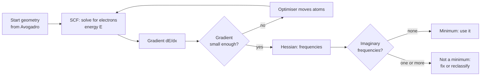

# 31.1 · Setting up Avogadro, xtb and ORCA

This module is the one lab in the course you do for real, with the same programs research groups use. You will install three free tools on your laptop, run a first calculation on water within a minute, and learn the habits that decide whether a calculation can be trusted: checking that it finished, that it converged, that it found a true minimum, and that you compared energies only where comparing makes sense. Everything later in the module, from conformer searches to excited states, builds on the routine you set up here.

## Why it matters

A student hands in a report: "DFT says product B is 12 kJ/mol more stable than A, so the reaction is favourable." Asked for the files, she finds that A was calculated with one method and B with another, that B's optimisation stopped after the maximum number of steps without converging, and that B has an imaginary frequency. The number is meaningless, and nothing in the final energy line warned her. Computational chemistry is cheap enough that you can run a hundred jobs in an afternoon; that makes the checking routine, not the running, the real skill. It also matters legally: ORCA is free only under conditions, and a chemist who uses it at work without a licence is breaking its terms.

## Core ideas

> [!NOTE]
> The ideas here (Born–Oppenheimer, energy, gradient, Hessian, model chemistries, unit conversions) are stable. The software details will go out of date: they were checked on 2026-10-17 against Avogadro 2.0.0 (released 2026-04-01), xtb 6.7.1 (2024-07-23, still the latest release), ORCA 6.1.1 (announced 2025-12-09) and the ORCA EULA dated June 2025. The [lab README](../../labs/module-31/README.md) pins the versions and download pages.

### What a quantum-chemistry program actually does

Every program in this module repeats the same three steps. First, it fixes the nuclei in place and solves for the electrons: the Born–Oppenheimer picture from [12.4](../module-12/lesson-04.md). That gives the electronic energy $E$ for this one geometry. Like the variational calculations of [12.6](../module-12/lesson-06.md), it writes the orbitals as combinations of basis functions, turns the problem into matrices and finds their eigenvalues, repeating until the orbitals stop changing. That repeat loop is the **self-consistent field** (SCF) procedure. Second, it computes the **gradient**, the derivative of $E$ with respect to every nuclear coordinate (minus the force on each atom). Third, an **optimiser** moves the atoms downhill and starts again, until the gradient is close to zero. That end point is a stationary point of the potential energy surface of [28.1](../module-28/lesson-01.md).

A **frequency calculation** then computes the **Hessian**, the matrix of second derivatives. Its eigenvalues, converted with the atomic masses, give the harmonic vibrational wavenumbers of [12.4](../module-12/lesson-04.md). All positive means a minimum. One negative curvature shows up as one **imaginary frequency**, printed as a negative number, and means a transition state.



### Three tools, three jobs

| Tool | What it is | What you use it for | Typical time for water |
|---|---|---|---|
| Avogadro 2.0.0 | molecule builder and viewer with built-in force fields (MMFF94, UFF) | draw a start structure, clean it up, write xyz files and ORCA inputs, look at results and animate vibrations | instant |
| xtb 6.7.1 | GFN2-xTB, a semiempirical tight-binding method: quantum mechanics with fitted parameters, valence electrons only, a minimal basis | fast optimisations, frequencies, scans and conformer work for molecules up to thousands of atoms | under a second |
| ORCA 6.1.1 | full ab initio and DFT program: Hartree–Fock, DFT, TD-DFT, NMR, coupled cluster | the accurate "production" calculations | seconds to minutes |

The three form a ladder. Molecular mechanics (Avogadro's force fields, lesson [31.2](lesson-02.md)) treats atoms as balls on springs; it is instant but knows nothing about electrons. GFN2-xTB includes electrons with a simplified, parameterised Hamiltonian; it is about 100 to 1000 times faster than DFT and usually gives sensible geometries. Hartree–Fock and DFT (lesson [31.3](lesson-03.md)) solve the electronic problem with far fewer shortcuts. A sensible workflow climbs the ladder: build in Avogadro, pre-optimise with xtb, refine with ORCA.

### Model chemistry: method plus basis plus settings

A calculation is defined by its **model chemistry**: the method (GFN2-xTB, HF, B3LYP, r2SCAN-3c), the **basis set** (the set of atom-centred functions used to build orbitals, such as def2-SVP), the **charge** and the **spin multiplicity** ($2S + 1$: 1 for a closed-shell molecule, 2 for a radical, 3 for triplet O₂). Get the charge or multiplicity wrong and the program happily calculates a different species. In an ORCA input they are the two numbers after `* xyzfile`: `* xyzfile 0 1 water.xyz` means neutral singlet water.

### Energies and their units

Programs report energies in **hartree** (Eh), the atomic unit: 1 Eh = 2625.50 kJ/mol = 27.2114 eV (CODATA 2022). A total energy is measured from separated nuclei and electrons at rest, so it is a large negative number. Only **differences** between calculations at the **same** model chemistry mean anything chemically. GFN2-xTB gives water a total energy of about −5.07 Eh because it leaves out the core electrons and uses its own reference; Hartree–Fock gives about −76.06 Eh. Both are "right", and the difference between them is meaningless.

### Licences

Avogadro (BSD-3-Clause) and xtb (LGPL-3.0) are open source: free for anyone, including companies, and you may share them. ORCA is free of charge but not open source. Its EULA allows use only for academic purposes at a school, university or Max Planck institute, or for private, non-commercial use by one person that is not related to their work. You must not pass the program on, and published results must cite it. Self-study with this course is private use. Calculations for an employer need a commercial licence from FACCTs. The [lab README](../../labs/module-31/README.md) lists the main clauses.

## Worked example

### 1. From hartree to something chemical

Two conformers of a molecule, both optimised with GFN2-xTB, have total energies −13.534140 Eh and −13.534178 Eh. How much more stable is the second, and what fraction of molecules sits in the higher one at 298 K (ignoring entropy)?

1. Difference: $\Delta E = -13.534140 - (-13.534178) = 3.8\times10^{-5}$ Eh.
2. Convert: $3.8\times10^{-5} \times 2625.5 = 0.10$ kJ/mol, or $3.8\times10^{-5} \times 27.211 = 1.0$ meV.
3. Boltzmann factor: $e^{-100/(8.314 \times 298)} = e^{-0.040} = 0.96$. The two forms are almost equally populated.

The same arithmetic shows what convergence thresholds mean. A tight SCF convergence of $10^{-6}$ Eh is 0.0026 kJ/mol, far below anything chemical. A geometry optimisation, by contrast, stops when the energy change is about $5\times10^{-6}$ Eh and the gradient about $10^{-3}$ Eh/bohr (xtb's defaults, printed in its output). That is loose enough that a soft methyl rotation can be left slightly wrong. You will meet exactly that case, with exactly these two energies, for acetone in [31.3](lesson-03.md).

### 2. How long will the bigger job take?

A DFT optimisation of a 10-atom molecule takes 2 minutes on your laptop. You now want a 40-atom molecule with the same method. Hybrid DFT cost grows roughly as $N^3$ to $N^4$ with system size $N$.

1. Size ratio: 40/10 = 4.
2. Cost ratio per step: $4^3 = 64$ to $4^4 = 256$.
3. A bigger, floppier molecule also needs more optimisation steps, say twice as many.
4. Estimate: 2 min × 64 × 2 ≈ 4 hours, up to 2 min × 256 × 2 ≈ 17 hours.

The same 40-atom job with GFN2-xTB takes seconds. That is the practical reason for the ladder: explore cheaply, and spend DFT time only on the structures that matter.

## Hands-on

What you need: a laptop with Windows 10/11, macOS or Linux, about 2 GB free disk, internet, the [Module 31 lab folder](../../labs/module-31/) and its README, and a [notebook page](../../templates/notebook-page.md) for recording versions and results. Time: about 90 minutes, most of it downloading and installing.

### Part A — install (45 min)

Follow the installation section of the [lab README](../../labs/module-31/README.md) for your operating system: Avogadro 2.0.0, xtb 6.7.1, ORCA 6.1.1 (after registering on the ORCA Forum and reading the EULA), then the course Python environment. Write the three version numbers and the date in your notebook.

### Part B — your first xtb calculation (10 min)

From the lab folder run:

```bash
py check_setup.py
```

The script finds xtb, optimises water with GFN2-xTB and computes its frequencies (`xtb water.xyz --ohess`), and prints the key numbers. Then open `runs/31.1-water/water.out` in a text editor and find the same numbers by hand: the line `GEOMETRY OPTIMIZATION CONVERGED`, the `Frequency Printout` block, the `TOTAL ENERGY` box and `normal termination of xtb`.

How you know it worked (xtb 6.7.1, checked 2026-10-17; the printout is in `expected/31.1_check_setup.txt` and an output excerpt in `expected/31.1_water_ohess_excerpt.txt`):

- converged, total energy −5.070544 Eh, HOMO–LUMO gap 14.39 eV;
- r(O–H) = 0.9592 Å, angle H–O–H = 107.30°;
- frequencies 1538.8, 3643.1 and 3651.6 cm⁻¹, no imaginary ones;
- in `water.out`, six near-zero values (translations and rotations) before the three real modes.

### Part C — look at it in Avogadro (10 min)

1. Open Avogadro, sketch a small molecule with the Draw tool (try acetic acid), then optimise it with the built-in force field (Extensions → Optimize Geometry). Save it as `acetic_acid.xyz` (File → Save As, XYZ format).
2. Open `runs/31.1-water/xtbopt.xyz` and measure the O–H distance and the H–O–H angle with the Measure tool. They should match Part B.

### Part D — your first ORCA job (15 min)

In the lab folder's `orca/` subfolder run:

```bash
orca 01_water_r2scan3c.inp > 01_water_r2scan3c.out
```

Then check, in this order: the last lines say `ORCA TERMINATED NORMALLY`; the optimisation printed `THE OPTIMIZATION HAS CONVERGED`; the `VIBRATIONAL FREQUENCIES` block has six zeros and three positive values; and the `FINAL SINGLE POINT ENERGY` is near −76.4 Eh. Open the `.out` file in Avogadro: it shows the molecule, and the Vibrations panel animates each mode.

How you know it worked: three real frequencies, a bend near 1600 cm⁻¹ and two O–H stretches somewhere between about 3700 and 3900 cm⁻¹. They are harmonic values, so they sit above the measured fundamentals of 3657 and 3756 cm⁻¹ (lesson [31.4](lesson-04.md) explains why). This ORCA input was not run when the module was written (see the README); if ORCA stops with an input error, compare the keywords with the ORCA 6.1 manual.

<details><summary>Reference answers and troubleshooting</summary>

- `xtb not found`: the XTB variable or PATH is not set in the terminal you are using. Close and reopen the terminal after `setx` on Windows.
- xtb stops with a stack overflow on a larger molecule: on Linux or macOS run `ulimit -s unlimited` and set `OMP_STACKSIZE=1G`.
- Typing `orca` starts a different program: on some Linux systems `orca` is also a screen reader. Call ORCA by its full path, which is also what ORCA needs for parallel runs.
- Your xtb numbers differ in the last digit from the ones above: different thread counts and builds change energies by about $10^{-6}$ Eh and frequencies by about 0.1 cm⁻¹. Larger differences mean a different version or start geometry.
- The total energies of Part B (−5.07 Eh) and Part D (about −76.4 Eh) differ by about 71 Eh, or 190 000 kJ/mol. That is not a chemical energy: GFN2-xTB and r2SCAN-3c measure from different references, as explained in Core ideas.

</details>

## Common mistakes

- Reading only the last energy line. Always check, in order: normal termination, converged optimisation, expected charge and multiplicity, and the number of imaginary frequencies.
- Comparing total energies from different methods, basis sets or programs. Energy differences mean something only within one model chemistry.
- Wrong multiplicity. A radical run as a singlet, or O₂ run as a singlet, gives an energy for a different electronic state. Count unpaired electrons before you write `0 1`.
- Downloading programs from mirrors or file-sharing sites. Use the official pages in the README and check the published SHA-256 sum where one is given. Never share ORCA itself: the EULA forbids it.
- Not recording versions. A result without program version, method, basis and convergence settings cannot be reproduced by you next year or by anyone else.

## Key takeaways

- Every calculation is SCF energy, then gradient, then optimisation, then (for checking) the Hessian and frequencies.
- Avogadro builds and shows, xtb explores fast, ORCA refines accurately; climb that ladder instead of starting with the most expensive method.
- A model chemistry is method + basis + charge + multiplicity; total energies are only comparable inside one model chemistry.
- 1 Eh = 2625.50 kJ/mol = 27.2114 eV, so 1 kJ/mol is about $3.8\times10^{-4}$ Eh.
- Avogadro and xtb are open source; ORCA is free only for academic and private, non-work use, may not be redistributed, and must be cited.

## Sources

- [Avogadro, Install](https://avogadro.cc/install/index.html) and [Avogadro 2.0.0 release](https://github.com/OpenChemistry/avogadrolibs/releases/tag/2.0.0) — current version 2.0.0 (2026-04-01), installers for Windows, macOS (Apple silicon and Intel) and Linux (AppImage, Flathub), plugin system and faster optimisations.
- [xtb v6.7.1 release](https://github.com/grimme-lab/xtb/releases/tag/v6.7.1) — latest release (2024-07-23), Linux and Windows assets with SHA-256 sums.
- [xtb documentation, Setup](https://xtb-docs.readthedocs.io/en/latest/setup.html) — conda-forge installation, `ulimit -s unlimited`, `OMP_STACKSIZE`, `OMP_NUM_THREADS`.
- [FACCTs, ORCA 6.1.1](https://www.faccts.de/orca-6-1-1/) — release announcement and download locations; ORCA is free for academic and personal use, commercial licences from FACCTs.
- [ORCA 6.1 manual, Installation](https://www.faccts.de/docs/orca/6.1/manual/contents/quickstartguide/installation.html) — installers for Windows, Linux and macOS, PATH setup, the bundled xtb.
- [FACCTs customer portal](https://www.faccts.de/customer) — registration and current downloads; the [ORCA Forum](https://orcaforum.kofo.mpg.de/) keeps other builds and the EULA (version June 2025), which defines academic and private use, forbids redistribution and requires citing F. Neese, WIREs Comput. Mol. Sci. 15, e70019 (2025).
- [NIST CODATA constants](https://physics.nist.gov/cuu/Constants/) — hartree energy and Avogadro constant (2022 values).
