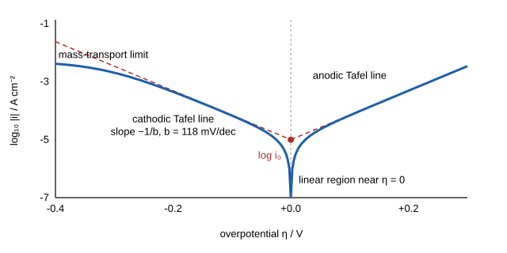

# 32.1 · Electrode kinetics and the Butler-Volmer equation

In [Lesson 08.6](../module-08/lesson-06.md) the Nernst equation told you the potential of an electrode when no current flows. In [Lesson 25.6](../module-25/lesson-06.md) you saw that some couples transfer electrons slowly and measured a rate constant from peak separations. This lesson joins the two: it gives the current that flows when you push an electrode away from equilibrium, which is the Butler–Volmer equation. You will meet its two numbers, the exchange current density and the transfer coefficient, read them from a Tafel plot, and learn why every electrolyser, battery and corrosion engineer works with this plot.

## Why it matters

A company building water electrolysers must choose a cathode. Platinum makes hydrogen with almost no extra voltage, but it is expensive. Nickel is cheap, but it needs more voltage for the same current. How much more? At 10 mA/cm², nickel needs roughly 0.3 V more than platinum. In a stack that runs for ten years, that 0.3 V is electricity paid for every hour. The number that decides the choice comes from one plot of log current against potential, fitted in ten minutes. If the fit ignores the resistance of the solution, the nickel looks worse than it is and the decision is made on a wrong number.

## Core ideas

> [!NOTE]
> Stable: the Butler–Volmer and Tafel equations (Erdey-Grúz and Volmer 1930; Tafel 1905), micro-polarisation, iR correction. Constants: CODATA 2022 via NIST, checked 2026-10-17; $F/RT$ = 38.92 V⁻¹ and $2.303RT/F$ = 59.2 mV at 25 °C. Exchange current densities for real catalysts are research numbers that change with surface preparation; the values here are typical orders of magnitude. The lab data are generated.

### Current is a rate

At an electrode, a current is a reaction rate. For a reduction $\text{O} + n\text{e}^- \rightarrow \text{R}$ on area $A$, the current is $i = nFAv$, where $v$ is the rate in mol per second per unit area. This lesson uses current density (A/cm²), so area drops out.

The **overpotential** $\eta$ is how far the electrode potential $E$ is from the equilibrium (Nernst) potential: $\eta = E - E_\text{eq}$. Negative $\eta$ drives reduction; positive $\eta$ drives oxidation.

### From transition-state theory to Butler–Volmer

In [Lesson 22.4](../module-22/lesson-04.md) a rate constant had the form $k = A\,e^{-\Delta G^\ddagger/RT}$. At an electrode the barrier depends on the potential. Making the electrode 1 V more negative raises the energy of the electrons in the metal by $F$ × 1 V per mole. Only a fraction $\alpha$ of that energy lowers the barrier for reduction; the rest raises the barrier for oxidation. $\alpha$ is the **transfer coefficient**, usually close to 0.5 for a single electron, because the barrier sits about halfway between reactant and product.

With $f = F/RT$, the two rate constants are

$$k_\text{red} = k^0 e^{-\alpha f (E - E^{0\prime})}, \qquad k_\text{ox} = k^0 e^{(1-\alpha) f (E - E^{0\prime})}$$

where $k^0$ (cm/s) is the standard rate constant you met in 25.6. The net current is the difference between the oxidation and reduction currents. When the solution is well stirred, so that surface concentrations equal bulk ones, this becomes the **Butler–Volmer equation**:

$$i = i_0\left[e^{\alpha_a f \eta} - e^{-\alpha_c f \eta}\right]$$

For a one-step, one-electron reaction $\alpha_a = 1 - \alpha$ and $\alpha_c = \alpha$. For multi-step reactions such as hydrogen evolution, $\alpha_a$ and $\alpha_c$ are fitted numbers that carry information about the mechanism.

### The exchange current density

At equilibrium ($\eta$ = 0) the net current is zero, but the reaction has not stopped. Oxidation and reduction run at equal and opposite rates. Each partial current is the **exchange current density** $i_0$. For a simple couple with equal concentrations $C$ of O and R,

$$i_0 = F k^0 C$$

$i_0$ is the single most useful number for comparing catalysts. For hydrogen evolution in acid it is about $10^{-3}$ A/cm² on platinum, about $10^{-5}$ on nickel and about $10^{-12}$ on mercury (Trasatti 1972; Nørskov et al. 2005). Nine orders of magnitude for the same reaction, decided only by the metal surface.

### Three regions of a polarisation curve



**1. Near equilibrium (|η| below about 10 mV).** Expand both exponentials: $i \approx i_0 f \eta$. The electrode behaves like a resistor, the **charge-transfer resistance**

$$R_\text{ct} = \frac{RT}{F i_0}$$

Measure the slope $di/d\eta$ over ±10 mV and you have $i_0$. This is micro-polarisation.

**2. Far from equilibrium (|η| above about 100 mV).** One exponential dominates. For reduction, $\log_{10}|i| = \log_{10} i_0 - \eta/b$, a straight line on a log plot. The **Tafel slope** is

$$b = \frac{2.303\,RT}{\alpha_c F}$$

With $\alpha_c$ = 0.5 at 25 °C, $b$ = 118 mV per decade: each tenfold increase in current costs 118 mV. Extrapolate the line to $\eta$ = 0 and the intercept is $\log_{10} i_0$. For hydrogen evolution, slopes near 120, 40 and 30 mV/dec point to different rate-determining steps (Volmer, Heyrovsky or Tafel steps; Shinagawa et al. 2015 explain why the reading is not always unique).

**3. Mass-transport limit.** At high current the reactant cannot reach the surface fast enough. The current levels off at the limiting current $i_\text{lim} = nFDC/\delta$, where $\delta$ is the diffusion-layer thickness. A useful approximation is $1/i = 1/i_k + 1/i_\text{lim}$, where $i_k$ is the kinetic (Butler–Volmer) current. A Tafel fit must stay well below $i_\text{lim}$.

### The resistance of the solution

The potentiostat controls the potential between the working and reference electrodes. Part of that potential is lost driving current through the solution between them, the **uncompensated resistance** $R_u$ (you met it in 25.6). The true overpotential is

$$\eta = E_\text{applied} - E_\text{eq} - i R_u$$

At 1 mA/cm² and 2.5 Ω cm² the loss is 2.5 mV, which does not matter. At 50 mA/cm² it is 125 mV, which bends the Tafel line upwards and makes the slope look too large. Always measure $R_u$ (by impedance or current interrupt) and correct, or fit only the low-current part of the line.

## Worked example

### 1. How much voltage does nickel cost?

Hydrogen evolution in 0.5 M H₂SO₄ at 25 °C. Nickel: $i_0$ = 8 × 10⁻⁶ A/cm², $b$ = 118 mV/dec. Platinum: $i_0$ = 1 × 10⁻³ A/cm², $b$ = 30 mV/dec. What overpotential does each need for 10 mA/cm²?

From the Tafel equation, $|\eta| = b \log_{10}(i/i_0)$.

- Nickel: $|\eta| = 0.118 \times \log_{10}(0.010 / 8\times10^{-6}) = 0.118 \times 3.10 = 0.365$ V.
- Platinum: $|\eta| = 0.030 \times \log_{10}(0.010 / 1\times10^{-3}) = 0.030 \times 1.00 = 0.030$ V.

Nickel costs about 0.34 V more. Both numbers are close to the Tafel region, so the equation applies. Notice that the slope matters as much as $i_0$: at 1 A/cm² platinum needs only 0.09 V, nickel about 0.60 V.

### 2. $i_0$ from micro-polarisation

Near equilibrium a nickel electrode gives a straight line with slope 0.30 µA per mV (0.30 mA/V). Then

$$R_\text{ct} = \frac{1}{0.30\times10^{-3}\ \text{A/V}} = 3.3\ \text{k}\Omega\ \text{cm}^2, \qquad i_0 = \frac{RT}{F R_\text{ct}} = \frac{0.02569\ \text{V}}{3333\ \Omega\ \text{cm}^2} = 7.7\times10^{-6}\ \text{A/cm}^2$$

This agrees with the Tafel intercept, a good sign that the electrode surface is stable during the scan.

### 3. Linking to the CV rate constant

In 25.6 a couple at 1.0 mM had $k^0$ = 0.004 cm/s. Its exchange current density is $i_0 = F k^0 C = 96485 \times 0.004 \times 1.0\times10^{-6}$ mol/cm³ = 3.9 × 10⁻⁴ A/cm². Unlike $k^0$, $i_0$ depends on concentration, so always state the concentration with it.

## Hands-on

What you need: the [Module 32 lab folder](../../labs/module-32/) with Python set up as in its README, a notebook page ([notebook template](../../templates/notebook-page.md)), and a calculator. Time: about 90 minutes. No home part: hydrogen evolution needs a potentiostat and sulfuric acid, which stay in the lab.

### Part A — simulation: build a Tafel plot (30 min)

[Simulation: Voltammetry — Butler–Volmer kinetics](../../simulations/voltammetry/index.html?preset=butler-volmer)

1. Set $i_0$ = 10⁻⁵ A/cm², $\alpha$ = 0.5, $R_u$ = 0 and no mass-transport limit. Sweep from +0.2 to −0.4 V. Read the cathodic slope from the log plot.
2. Change $\alpha$ to 0.3 and 0.7. How do the anodic and cathodic slopes change?
3. Switch on $R_u$ = 5 Ω cm². At what current does the line start to bend?
4. Switch on a limiting current of 20 mA/cm². Where does the Tafel line stop being useful?

How you know it worked: with $\alpha$ = 0.5 both slopes are 118 mV/dec and the two lines meet at $\log_{10} i_0$ = −5 at $\eta$ = 0; $\alpha$ = 0.3 makes the cathodic slope 197 mV/dec and the anodic 84 mV/dec; with 5 Ω cm² the bend becomes visible above about 2 mA/cm² (10 mV of iR); the limiting current flattens the curve and a fit through that region gives a falsely large slope.

### Part B — Python: Tafel analysis of nickel and copper (45 min)

Open `lesson01_tafel.py`. The data in `tafel_her.csv` are generated: hydrogen evolution on Ni and Cu, 1.00 cm², $R_u$ = 2.5 Ω. Complete `i0_from_linear()` (TODO 1) and `tafel_fit()` (TODO 2), then run:

```bash
py lesson01_tafel.py
```

Answer in your notebook: (a) which electrode is the better catalyst and by how much; (b) how large the error in the Tafel slope is if you skip the iR correction; (c) why micro-polarisation works for nickel but not for copper.

How you know it worked: Ni gives $i_0$ = 7.7 × 10⁻⁶ A/cm² from micro-polarisation and 7.9 × 10⁻⁶ A/cm² from the Tafel fit, $b$ = 118 mV/dec ($\alpha_c$ = 0.50); without iR correction the slope over the whole curve is 133 mV/dec. Cu gives $b$ = 114 mV/dec and $i_0$ = 2.6 × 10⁻⁷ A/cm², but its micro-polarisation value (3.6 × 10⁻⁷) is off by 40 %. Ni needs 366 mV for 10 mA/cm², Cu about 525 mV (an extrapolation beyond the data).

<details><summary>Reference answers</summary>

(a) Nickel: its $i_0$ is about 30 times larger at a similar slope, so it needs about 160 mV less at 10 mA/cm². (b) The uncorrected slope is 13 % too high and the $i_0$ from it is 50 % too high; at the most negative potential the iR loss is about 0.05 V (20 mA × 2.5 Ω). (c) Within ±10 mV, copper's current is about 0.1 µA, below the 0.2 µA noise of the measurement, so the slope is poorly defined. For slow electrodes use the Tafel intercept, or a larger window with the full Butler–Volmer fit (the script's cross-check).

</details>

### Part C — pencil (15 min)

1. A Tafel slope of 40 mV/dec is measured at 25 °C. What is $\alpha_c$ if you read it naively? Why is this not a transfer coefficient of a single step?
2. An electrode has $R_\text{ct}$ = 50 Ω cm² at 25 °C. What is $i_0$?
3. At 60 °C, $b$ for $\alpha_c$ = 0.5 is how many mV/dec?

<details><summary>Answers</summary>

1. $\alpha_c = 2.303RT/(Fb) = 0.0592/0.040 = 1.48$. A value above 1 means that more than one electron transfer comes before or in the rate-determining step (here a Heyrovsky step after a fast Volmer step), so it is an apparent coefficient. 2. $i_0 = 0.02569/50$ = 5.1 × 10⁻⁴ A/cm². 3. $b = 2.303 \times 8.314 \times 333.15/(0.5 \times 96485)$ = 0.132 V, so 132 mV/dec.

</details>

## Common mistakes

- **Fitting the Tafel line too close to equilibrium.** Below about 50–100 mV the reverse reaction still contributes and the line curves. Start the fit where the plot is straight.
- **Ignoring iR drop.** A slope that grows with current is usually resistance, not a new mechanism. Correct with a measured $R_u$.
- **Fitting into the mass-transport region.** If the current approaches a plateau, the slope is meaningless. Stir, use a rotating electrode, or fit lower.
- **Quoting $i_0$ without conditions.** $i_0$ depends on concentration, temperature and surface state. State them, or compare $k^0$ instead.
- **Reading $\alpha$ from a multi-step slope as a single-step barrier symmetry.** Apparent transfer coefficients near 1.5 or 2 describe a mechanism, not one barrier.

## Key takeaways

- Butler–Volmer: $i = i_0[e^{\alpha_a f\eta} - e^{-\alpha_c f\eta}]$, two exponentials from transition-state rate constants whose barrier shifts with potential.
- $i_0$ is the rate of the balanced forward and reverse reactions at equilibrium; it spans many orders of magnitude between materials.
- Near equilibrium $R_\text{ct} = RT/Fi_0$; far from it the Tafel slope $2.303RT/\alpha F$ is 118 mV/dec for $\alpha$ = 0.5.
- Correct for $R_u$ and stay below the limiting current before you trust a slope.

## Sources

- [Tafel 1905, Z. Phys. Chem. 50, 641](https://doi.org/10.1515/zpch-1905-5043) — the empirical log-current law for hydrogen evolution.
- [Erdey-Grúz and Volmer 1930, Z. Phys. Chem. 150A, 203](https://doi.org/10.1515/zpch-1930-15020) — the kinetic theory behind the Butler–Volmer equation.
- [Bazant, MIT 10.626 Lecture 13](https://ocw.mit.edu/courses/10-626-electrochemical-energy-systems-spring-2014/resources/mit10_626s14_s11lec13/) — a free derivation of Butler–Volmer from transition-state theory.
- [Nørskov et al. 2005, J. Electrochem. Soc. 152, J23](https://doi.org/10.1149/1.1856988) — exchange current densities for hydrogen evolution on many metals.
- [Shinagawa et al. 2015, Sci. Rep. 5, 13801](https://doi.org/10.1038/srep13801) — what Tafel slopes can and cannot say about mechanism (open access).
- [NIST CODATA 2022 constants](https://physics.nist.gov/cuu/Constants/) — F and R.
