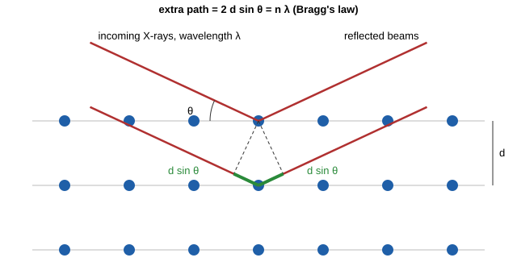

# 32.3 · Crystals, lattices and X-ray diffraction

In [Lesson 18.2](../module-18/lesson-02.md) you packed spheres into cubic cells and used a lattice constant to calculate a density. Here you learn where lattice constants come from. X-rays have wavelengths close to the spacing between atomic planes, so a crystal scatters them only at certain angles, and those angles give the spacings. You will derive Bragg's law, see why some reflections are missing, and index a real powder pattern of cadmium oxide recorded on a laboratory diffractometer.

## Why it matters

A research group makes a cadmium oxide photocatalyst by a quick microwave route. Before they measure how well it degrades a dye, they need to know: is the powder really CdO, is it a single phase, and how large are its crystals? A powder X-ray diffraction (XRD) pattern answers all three in 20 minutes. If the group reads the pattern carelessly, it may report a second phase that is only an artefact of the X-ray tube, or a lattice parameter that is 0.4 % wrong because the sample sat slightly too low in the holder. Both mistakes have been published many times.

## Core ideas

> [!NOTE]
> Stable: lattices, Miller indices, Bragg's law (1913), extinction rules, the ratio method. Wavelengths: NIST X-ray Transition Energies Database, checked 2026-10-17: Cu Kα₁ 1.540593 Å, Kα₂ 1.544427 Å, Kβ 1.392234 Å. The CdO pattern is real data (Zenodo 10.5281/zenodo.18522088, CC BY 4.0, published 2026-02-08). Database entries are corrected over time; quote the COD number you used.

### Lattice plus basis

A **crystal** is a pattern repeated in three dimensions. The **lattice** is the set of points where the pattern repeats; the **basis** is the group of atoms attached to each point. The smallest box that builds the crystal by translation is the **unit cell**, with edges $a, b, c$ and angles $\alpha, \beta, \gamma$. There are seven crystal systems and 14 lattice types (Bravais lattices). This lesson stays with the cubic ones, $a = b = c$ and all angles 90°:

- **primitive (sc):** lattice points at the corners only;
- **body-centred (bcc):** plus one at the centre (iron, tungsten);
- **face-centred (fcc):** plus one at each face centre (copper, and the rock-salt structure of NaCl and CdO).

Rock salt is an fcc lattice with a two-atom basis: one cation at (0, 0, 0) and one anion at (½, 0, 0). The point group of each site (lesson [20.5](../module-20/lesson-05.md)) is $O_h$.

### Miller indices and d-spacings

A family of parallel lattice planes is named by **Miller indices** $(hkl)$: take where one plane cuts the axes, in units of $a$, $b$, $c$, take reciprocals and clear fractions. The (100) planes are the cube faces; (110) cut two axes; (111) cut all three. In a cubic cell the spacing between neighbouring planes is

$$d_{hkl} = \frac{a}{\sqrt{h^2 + k^2 + l^2}} = \frac{a}{\sqrt{N}}$$

Each family of planes can also be drawn as a single point at distance $1/d$ from the origin in the direction normal to the planes. These points form the **reciprocal lattice**, the natural map of a diffraction pattern; single-crystal diffraction and band theory (32.4) both use it.

### Bragg's law



X-rays reflected by neighbouring planes add up only if the extra path of the lower beam is a whole number of wavelengths:

$$n\lambda = 2d\sin\theta$$

A diffractometer reports $2\theta$, the angle between the incoming and outgoing beams. In practice $n$ is absorbed into the indices (the second-order reflection from (111) is written as (222)), so $\lambda = 2d_{hkl}\sin\theta$. Small $d$ means large angle: high-index planes appear at high $2\theta$.

### Powders and the tube

A powder contains millions of tiny crystals in every orientation, so every family of planes finds some crystals at the right angle. One scan of $2\theta$ gives a list of peaks: positions (the cell), intensities (where the atoms sit) and widths (crystal size and strain). A copper tube emits Kα₁ and Kα₂, which overlap at low angles and split at high ones, and also the weaker Kβ line. A nickel filter or a monochromator removes most of the Kβ. The instrument header in this data set (in the composite's .asc file) records a Cu tube and no filter, and every strong CdO peak has a small Kβ partner (about 4 % of its height) at lower angle: the same $d$, a shorter wavelength.

### Why some reflections are missing

Each atom $j$ in the cell, at fractional coordinates $(x_j, y_j, z_j)$, scatters with an amplitude $f_j$ (roughly proportional to its number of electrons). The waves add with phases set by the positions, in the **structure factor**

$$F_{hkl} = \sum_j f_j\, e^{2\pi i (h x_j + k y_j + l z_j)}, \qquad I_{hkl} \propto |F_{hkl}|^2$$

For an fcc lattice the four lattice points cancel each other unless $h, k, l$ are all even or all odd. For bcc they cancel unless $h + k + l$ is even. These **systematic absences** fingerprint the lattice:

| Lattice | Allowed $N = h^2+k^2+l^2$ |
|---|---|
| sc | 1, 2, 3, 4, 5, 6, 8, 9, … (no 7, 15) |
| bcc | 2, 4, 6, 8, 10, 12, 14, 16, … |
| fcc | 3, 4, 8, 11, 12, 16, 19, 20, … |

In rock salt, the (111)-type peaks have $F = 4(f_\text{cation} - f_\text{anion})$ and the (200)-type peaks $F = 4(f_\text{cation} + f_\text{anion})$. In KCl, K⁺ and Cl⁻ have the same 18 electrons, so the odd peaks almost vanish and KCl looks like a simple cubic cell with half the edge.

### Indexing by ratios

Because $1/d^2 = N/a^2$, the ratios of $1/d^2$ values are ratios of whole numbers. Divide every $1/d^2$ by the first, then multiply by 1, 2, 3, … until all become close to integers. The integers are the $N$ values; the gaps tell you the lattice; any line gives $a$.

### Systematic errors

A peak position has small systematic errors: the zero of the goniometer, and a sample surface that sits above or below the focusing circle (displacement). Both shift all peaks and bias $a$, by an amount that changes with angle. So never take $a$ from one peak. Fit all peaks with $a$ and a zero shift together, or plot each peak's $a$ against the Nelson–Riley function $\cos^2\theta(1/\sin\theta + 1/\theta)$ and extrapolate to zero (Nelson and Riley 1945).

### Safety

Diffractometers use ionising radiation inside interlocked enclosures; never defeat an interlock. Cadmium oxide is fatal if inhaled and may cause cancer (GHS H330, H350, H341, H361, H372, H410; PubChem), so its powders are weighed in a fume hood or glove box. In this lesson you handle only the data.

## Worked example

### Index the first five CdO peaks by hand

The five strongest peaks of the CdO pattern, read with Cu Kα₁ (λ = 1.5406 Å), are:

| 2θ (°) | d (Å) | 1/d² (Å⁻²) | ratio to first | × 3 | N | hkl | a = d√N (Å) |
|---|---|---|---|---|---|---|---|
| 32.786 | 2.7294 | 0.13424 | 1.000 | 3.00 | 3 | 111 | 4.7275 |
| 38.049 | 2.3631 | 0.17908 | 1.334 | 4.00 | 4 | 200 | 4.7262 |
| 55.054 | 1.6667 | 0.35999 | 2.682 | 8.05 | 8 | 220 | 4.7141 |
| 65.640 | 1.4212 | 0.49510 | 3.688 | 11.06 | 11 | 311 | 4.7136 |
| 69.009 | 1.3598 | 0.54082 | 4.029 | 12.09 | 12 | 222 | 4.7105 |

Multiplying by 3 gives 3, 4, 8, 11, 12: all even or all odd indices, so the lattice is fcc, as expected for rock salt. The (111) peak is strong, because Cd (48 electrons) and O (8) scatter very differently.

Now look at the last column. The values of $a$ fall steadily with angle, from 4.728 to 4.711 Å. Random errors would scatter; a trend means a systematic shift. A least-squares fit of all six CdO peaks with $a$ and a zero shift $z$ (your Python task) gives $z$ = −0.23° and $a$ = 4.6964 ± 0.0005 Å. The COD entry 9006671 (Zhang 1999) gives 4.6963 Å. Without the shift correction the answer would be 0.2–0.7 % too high, depending on which peak you trusted.

### From $a$ to density

With four CdO units per cell (fcc, Z = 4) and $M$ = 128.41 g/mol:

$$\rho = \frac{4 \times 128.41}{6.022\times10^{23} \times (4.6964\times10^{-8}\ \text{cm})^3} = 8.23\ \text{g/cm}^3$$

This X-ray density is the density of a perfect crystal, the same calculation as in 18.2.

## Hands-on

What you need: the [Module 32 lab folder](../../labs/module-32/), the file `cdo_xrd.csv` (real data, CC BY 4.0, already converted), a calculator and a [notebook page](../../templates/notebook-page.md). Time: about 90 minutes. No home part: X-ray tubes and cadmium oxide stay in the lab.

### Part A — Python: index the CdO pattern (60 min)

Open `lesson03_xrd.py`. The script finds the peaks and flags Cu Kβ partners for you. Complete `index_cubic()` (TODO 1, the ratio method) and `fit_cubic()` (TODO 2, the least-squares fit of $a$ and the zero shift), then run:

```bash
py lesson03_xrd.py
```

Then answer in your notebook:

1. Which peaks are Kβ partners, and how do you know without looking at intensities?
2. Which peak is left unassigned? Give two hypotheses for it and say what extra measurement would decide.
3. Your $a$ against COD 9006671: is the difference significant?

How you know it worked: ten peaks; Kβ partners at 29.52, 34.23 and 49.29° (of the peaks at 32.78, 38.07 and 55.06°); $N$ = 3, 4, 8, 11, 12, 16 with multiplier 3 (fcc); $a$ = 4.6964 ± 0.0005 Å with a zero shift of −0.228° and rms residual 0.006°; the median of $d\sqrt{N}$ without the shift gives 4.712 Å (+0.34 %); one unassigned peak at 31.54°.

<details><summary>Reference answers</summary>

1. Each satellite sits exactly where Bragg's law puts the same $d$ for λ = 1.3922 Å: $\sin\theta_\beta = \sin\theta_\alpha \times 1.3922/1.5406$, within 0.1° after the zero shift. Three strong peaks predict three satellites and all three are found.
2. The 31.54° peak ($d$ = 2.815 Å after the shift) is not CdO and not Kβ. Hypotheses: a trace of a second phase from the synthesis (cadmium metal, COD 9008490, has its (002) line at $d$ = 2.809 Å, and its strongest line, (101) near 38.4°, would hide under CdO (200); or a cadmium hydroxide or carbonate), or a line from tube contamination (tungsten Lα at 1.4763 Å would put the (111) reflection near 31.4°, which fits less well). A scan with a monochromator, or a search-match against a database with the other weak peaks, would decide. One weak peak is not enough to claim a phase.
3. The difference is about 0.0001 Å, inside the ±0.0005 Å fit uncertainty, so the sample is CdO with no measurable strain or doping. The real uncertainty is larger than the fit says: using the weighted Kα wavelength instead of Kα₁ would move $a$ by 0.08 %.

</details>

### Part B — pencil (30 min)

1. NaCl ($a$ = 5.640 Å) and KCl ($a$ = 6.293 Å) are both rock salt. Calculate 2θ (Cu Kα₁) for (111) and (200) of each. Which peak will look missing in KCl, and why?
2. α-iron is bcc with $a$ = 2.866 Å. List the first three allowed reflections and their 2θ values.
3. A powder shows peaks at 2θ = 28.44°, 47.30° and 56.12° (Cu Kα₁). Index them and find $a$.

<details><summary>Answers</summary>

1. NaCl: $d_{111}$ = 3.256 Å, 2θ = 27.37°; $d_{200}$ = 2.820 Å, 31.70°. KCl: $d_{111}$ = 3.633 Å, 24.48°; $d_{200}$ = 3.147 Å, 28.34°. In KCl, K⁺ and Cl⁻ both have 18 electrons, so $F_{111} \approx 0$ and the (111) peak almost disappears.
2. (110) $d$ = 2.027 Å, 44.68°; (200) 1.433 Å, 65.03°; (211) 1.170 Å, 82.35°.
3. $d$ = 3.136, 1.920, 1.638 Å; $1/d^2$ ratios 1 : 2.67 : 3.67, × 3 = 3 : 8 : 11, so (111), (220), (311) of an fcc lattice; $a$ = 3.136 × √3 = 5.431 Å. This is silicon (diamond structure, whose extra absences remove (200)).

</details>

## Common mistakes

- **Taking $a$ from one peak.** A zero or displacement error biases it; fit all peaks with a shift, or extrapolate.
- **Calling a Kβ line a second phase.** Check whether the weak peak sits at the Kβ position of a strong one before you invent an impurity.
- **Using the wrong wavelength.** Kα₁, weighted Kα and Kβ differ; state which one you used.
- **Forcing a pattern to be cubic.** If no multiplier gives integers, the cell is not cubic, or one of the peaks belongs to something else.
- **Forgetting that powders hide symmetry.** Different $hkl$ with the same $N$ (such as 333 and 511) fall at the same angle and cannot be separated in a powder pattern.

## Key takeaways

- A crystal is a lattice plus a basis; in a cubic cell $d = a/\sqrt{h^2+k^2+l^2}$.
- Bragg: $\lambda = 2d\sin\theta$; small spacings appear at high angles.
- Systematic absences identify the lattice: fcc allows all-even or all-odd indices, bcc an even sum.
- Index by $1/d^2$ ratios, then refine $a$ with all peaks and a zero shift; check weak peaks against Kβ before calling a second phase.

## Sources

- [Bragg and Bragg 1913, Proc. R. Soc. Lond. A 88, 428](https://doi.org/10.1098/rspa.1913.0040) — the reflection condition.
- [Dahiya, Dahiya and Sabarwal 2026, Zenodo 18522088](https://doi.org/10.5281/zenodo.18522088) — the real CdO pattern used here (CC BY 4.0).
- [COD 9006671](https://www.crystallography.net/cod/9006671.html) — the reference CdO structure, $a$ = 4.6963 Å.
- [NIST X-ray Transition Energies Database](https://physics.nist.gov/PhysRefData/XrayTrans/Html/search.html) — Cu Kα₁, Kα₂ and Kβ wavelengths.
- [Nelson and Riley 1945, Proc. Phys. Soc. 57, 160](https://doi.org/10.1088/0959-5309/57/3/302) — extrapolating systematic errors out of lattice parameters.
- [PubChem, Cadmium oxide](https://pubchem.ncbi.nlm.nih.gov/compound/10197697) — GHS hazards of the material.
