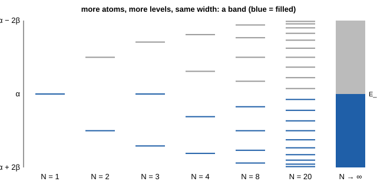

# 32.4 · Band theory: metals, semiconductors and insulators

In [Lesson 12.6](../module-12/lesson-06.md) two atomic orbitals combined into a bonding and an antibonding molecular orbital. In [Lesson 03.2](../module-03/lesson-02.md) you found such levels as the eigenvalues of a matrix. Do the same for a crystal with 10²³ atoms and the levels merge into continuous bands. Whether a solid conducts depends on one question: is its highest occupied band full or partly full? This lesson builds bands from orbitals, explains the band gap, and calculates how many charge carriers a semiconductor has at a given temperature.

## Why it matters

An engineer designs a sensor amplifier for a car engine bay, where the electronics reach 125 °C. Germanium transistors were common in the 1950s, but at 400 K germanium has about 10¹⁵ thermally created electrons per cm³, as many as the doping that is supposed to control it. The device stops behaving as designed. Silicon at the same temperature has about 5 × 10¹² cm⁻³, far below typical doping, and works. The difference comes from the band gap, 0.66 eV against 1.12 eV, inside an exponential. One line of band theory decides which material survives under the bonnet.

## Core ideas

> [!NOTE]
> Stable: tight-binding bands, Bloch's theorem (1929), Fermi–Dirac statistics, $n_i = \sqrt{N_c N_v}\,e^{-E_g/2kT}$. Material constants (band gaps, effective densities of states, Varshni parameters) are from the Ioffe Institute NSM archive, checked 2026-10-17; other compilations differ in the last digit. $k_B$ = 8.617333 × 10⁻⁵ eV/K (CODATA 2022).

### From orbitals to a band

Take a chain of $N$ identical atoms, one orbital each, with Hückel parameters: site energy $\alpha$ and coupling $\beta$ (negative) between neighbours. Two atoms give two levels, $\alpha \pm \beta$, as in H₂. Each atom you add adds one level. For a long chain the levels are

$$E_j = \alpha + 2\beta\cos\left(\frac{j\pi}{N+1}\right), \qquad j = 1, \dots, N$$

They all lie between $\alpha + 2\beta$ and $\alpha - 2\beta$, so the **band width** is $4|\beta|$ whatever $N$ is, while the spacing between levels shrinks like $1/N$. With $10^{23}$ atoms the levels form a continuous **band**.



The **density of states** $g(E)$ counts the levels per unit energy. For the chain it is highest at the band edges and lowest in the middle. Bands in three dimensions have more structure, but the idea is the same.

### Bloch's theorem and k

In a perfect crystal every unit cell is the same, so an electron's wavefunction can differ from cell to cell only by a phase. Bloch (1929) showed that the wavefunctions are a wave $e^{ikx}$ times a function with the period of the lattice. The **wave vector** $k$ labels the levels; for the chain $E(k) = \alpha + 2\beta\cos(ka)$, where $a$ is the spacing. The values of $k$ live in the reciprocal lattice of 32.3, and the region from $-\pi/a$ to $\pi/a$ is the first **Brillouin zone**. A band structure diagram plots $E$ against $k$ along lines through this zone.

### Filling decides: metal or insulator

Electrons fill the levels from the bottom, two per level, up to the **Fermi level** $E_F$. At temperature $T$ the occupation of a level at energy $E$ is the Fermi–Dirac function

$$f(E) = \frac{1}{1 + e^{(E - E_F)/kT}}$$

If the highest occupied band is only partly full, an electric field can push electrons into empty levels a tiny energy above: the solid is a **metal** (sodium, one valence electron per atom, half-fills its band). If the highest occupied band is exactly full and the next band starts a **band gap** $E_g$ higher, the field cannot move electrons: the solid is an **insulator** ($E_g$ of several eV) or a **semiconductor** ($E_g$ of roughly 0.1–3 eV, where some electrons cross at room temperature).

### Where gaps come from

Make the chain from two kinds of atoms, A and B, alternating, with site energies $\alpha_A$ and $\alpha_B$. Now the repeat unit holds two atoms, and the single band splits into two with a gap of $|\alpha_A - \alpha_B|$ between them. One electron per atom fills the lower band exactly, so the chain is a semiconductor or insulator. This is the solid-state version of a heteronuclear bond in 12.6: the more the two atoms differ, the more ionic the bond and the larger the gap (ionic NaCl is a colourless insulator with a gap of several eV; GaAs has 1.42 eV and covalent Si 1.12 eV). Alternating bond lengths do the same; that is the bond alternation that stopped polyenes from behaving like a free-electron box in [Lesson 30.4](../module-30/lesson-04.md).

### Electrons and holes

In a semiconductor, an electron excited across the gap leaves an empty level in the valence band. The rest of the electrons move into it, and the result behaves like a positive particle, a **hole**. Both carry current. In a pure (intrinsic) semiconductor their densities are equal:

$$n_i = \sqrt{N_c N_v}\; e^{-E_g/2kT}$$

$N_c$ and $N_v$ are the **effective densities of states** of the conduction and valence bands (about 10¹⁹ cm⁻³ at 300 K, growing as $T^{3/2}$). The factor 2 in the exponent appears because each crossing makes two carriers. The gap itself shrinks slightly as the lattice expands on heating; Varshni's empirical form $E_g(T) = E_0 - aT^2/(T + b)$ fits it well.

| Material (300 K, Ioffe) | $E_g$ (eV) | Type | $n_i$ (cm⁻³) |
|---|---|---|---|
| Ge | 0.661 | indirect | 2.0 × 10¹³ |
| Si | 1.12 | indirect | 1 × 10¹⁰ |
| GaAs | 1.424 | direct | 2.1 × 10⁶ |

### Doping

Replace one silicon atom in a million with phosphorus (five valence electrons) and the extra electron is bound so weakly that it is free at room temperature: an **n-type** semiconductor. Boron (three valence electrons) creates holes: **p-type**. At equilibrium the product of the densities is fixed by the material:

$$n\,p = n_i^2$$

so adding electrons removes holes. Conductivity is $\sigma = e(n\mu_n + p\mu_p)$, where $\mu$ is the mobility. Metals conduct worse when hot, because vibrations scatter their electrons; intrinsic semiconductors conduct better when hot, because $n_i$ rises exponentially.

### Direct and indirect gaps, and LEDs

A photon carries almost no momentum. If the top of the valence band and the bottom of the conduction band sit at the same $k$ (a **direct gap**, GaAs), an electron and a hole can recombine and emit light efficiently. If they sit at different $k$ (an **indirect gap**, Si, Ge), a lattice vibration must take up the difference, and light emission is weak. That is why LEDs and laser diodes are made of direct-gap compounds (GaAs, GaN, InGaN), while silicon is used for chips and solar cells. An LED emits photons with energy close to its gap, so its turn-on voltage, which you measured in [Lesson 04.5](../module-04/lesson-05.md), is roughly $E_g/e$.

## Worked example

### 1. Why silicon and not germanium under the bonnet

With the Ioffe parameters, $E_g$(Si, 400 K) = 1.17 − 4.73 × 10⁻⁴ × 400²/(400 + 636) = 1.097 eV. $N_c N_v$ at 400 K is $(3.2\times10^{19})(1.8\times10^{19})(400/300)^3$ = 1.37 × 10³⁹ cm⁻⁶, so

$$n_i = \sqrt{1.37\times10^{39}}\; \exp\!\left(-\frac{1.097}{2 \times 8.617\times10^{-5} \times 400}\right) = 3.7\times10^{19} \times 1.2\times10^{-7} = 4.5\times10^{12}\ \text{cm}^{-3}$$

That is about 500 times its 300 K value, but still far below a typical doping of 10¹⁵–10¹⁷ cm⁻³. The same calculation for germanium gives 1.3 × 10¹⁵ cm⁻³: the thermal carriers now match the doping, and the device no longer behaves as designed.

### 2. Electrons and holes in doped silicon

Silicon at 300 K doped with 1.0 × 10¹⁶ phosphorus atoms per cm³: every donor gives one electron, so $n$ = 1.0 × 10¹⁶ cm⁻³. Then $p = n_i^2/n = (8.6\times10^{9})^2 / 10^{16}$ = 7.4 × 10³ cm⁻³. One part in a million of phosphorus changes the electron density by a factor of a million and makes holes almost vanish.

### 3. What colour is the gap?

The photon wavelength for an energy $E$ in eV is $\lambda$ (nm) = 1239.84 / $E$. GaAs (1.424 eV) emits at 871 nm, in the infrared: TV remote controls. A red LED at 630 nm needs a gap of 1.97 eV, so it is made from a wider-gap alloy such as AlGaInP.

## Hands-on

What you need: the [Module 32 lab folder](../../labs/module-32/), a [notebook page](../../templates/notebook-page.md), and for the optional Part B the LED circuit from [Lesson 04.5](../module-04/lesson-05.md) (3 × AA cells in a holder, a red LED, a 150 Ω resistor, a multimeter) and a freezer bag. Time: 50 minutes for Part A and C, 30 minutes for Part B.

### Part A — Python: bands and carriers (35 min)

Open `lesson04_bands.py`. Complete `chain_levels()` (TODO 1, the Hückel matrix of 03.2 for a chain) and `n_intrinsic()` (TODO 2), then run:

```bash
py lesson04_bands.py
```

How you know it worked: with $\beta$ = −2.5 eV the band width grows from 5.0 eV (N = 2) to 9.6 eV (N = 10) and 10.0 eV (N = 1000), while the smallest level spacing falls to 0.0001 eV; the density of states in the band centre is 0.064 per eV, as the analytic formula says; alternating site energies that differ by 1, 3 and 6 eV open gaps of exactly 1, 3 and 6 eV; $n_i$ at 300 K is 8.6 × 10⁹ (Si), 2.0 × 10¹³ (Ge) and 2.3 × 10⁶ cm⁻³ (GaAs); between 300 and 400 K it rises 528-fold for Si, 67-fold for Ge and about 2900-fold for GaAs. The slope of $\ln(n_i/T^{3/2})$ against $1/T$ gives 1.21 eV for Si, not 1.12 eV.

<details><summary>Why the Arrhenius slope gives 1.21 eV and not 1.12 eV</summary>

Over a narrow range, $E_g(T) \approx E_g(0) - \gamma T$. Then $e^{-E_g/2kT} = e^{\gamma/2k}\, e^{-E_g(0)/2kT}$: the linear part of the temperature dependence moves into the pre-factor, and the slope measures the gap extrapolated to 0 K along that line, here about 1.21 eV. The same trap appears whenever a quantity in an Arrhenius plot depends on temperature itself, as in [Lesson 22.4](../module-22/lesson-04.md).

</details>

### Part B — optional home: a cold LED (30 min)

> [!WARNING]
> Use only the low-voltage circuit of Lesson 04.5: three AA cells and a series resistor that is always in the circuit. Never connect an LED straight to the batteries, never short the battery holder, and never open, heat or damage a battery. Use visible LEDs only, no laser pointers, and do not stare into a lit LED. Keep the batteries and wires out of the freezer and away from water: only the LED goes in the bag.

1. Measure the voltage across the red LED at a fixed current (fixed resistor) at room temperature. Write down the temperature.
2. Put the LED alone (no wires, no batteries) in a sealed freezer bag in the freezer for 15 minutes.
3. Take it out, connect it quickly and read the voltage within 10 seconds, then again every 30 seconds as it warms up.

How you know it worked: the cold LED needs a slightly higher voltage, by a few tens of millivolts, and the reading drifts back down as it warms. The gap grows on cooling, as Varshni's formula predicts. This is a qualitative check: the LED voltage also includes resistance and junction effects that this circuit does not separate.

### Part C — pencil (15 min)

1. A semiconductor has $E_g$ = 2.0 eV and $N_c N_v$ = 10³⁸ cm⁻⁶ at 300 K. Estimate $n_i$.
2. Silicon is doped with 1 × 10¹⁷ boron atoms per cm³. What are $p$ and $n$ at 300 K?
3. Why does a half-filled band make a metal, but a filled band with a 0.01 eV gap at 300 K behave almost like a metal?

<details><summary>Answers</summary>

1. $n_i = 10^{19} \times e^{-2.0/0.0517} = 10^{19} \times 1.6\times10^{-17}$ ≈ 160 cm⁻³: an insulator in practice.
2. $p$ = 1 × 10¹⁷ cm⁻³; $n = (8.6\times10^9)^2/10^{17}$ ≈ 740 cm⁻³.
3. $kT$ at 300 K is 0.026 eV, larger than the gap, so a large fraction of electrons is excited across it ($e^{-0.01/0.052}$ ≈ 0.8). Such a solid is a semimetal or narrow-gap semiconductor.

</details>

## Common mistakes

- **Forgetting the factor 2 in $e^{-E_g/2kT}$.** Each excitation makes two carriers; using $E_g/kT$ underestimates $n_i$ by many orders of magnitude.
- **Thinking a full band conducts if it is wide.** Width does not matter; only empty levels just above the occupied ones allow current.
- **Reading an LED's turn-on voltage as an exact band gap.** It also includes series resistance and depends on temperature and current.
- **Assuming silicon emits light well.** Its gap is indirect; that is why LEDs use III–V compounds.
- **Taking an Arrhenius slope as $E_g$ at room temperature.** It gives the gap extrapolated to 0 K.

## Key takeaways

- $N$ orbitals make $N$ levels spread over a fixed width $4|\beta|$: a band.
- Partly filled band: metal. Full band and a gap: semiconductor (about 0.1–3 eV) or insulator.
- A two-atom repeat or bond alternation opens a gap, the solid-state version of a polar bond.
- $n_i = \sqrt{N_cN_v}\,e^{-E_g/2kT}$ and $np = n_i^2$ control every semiconductor device.
- Direct gaps emit light; indirect gaps (Si) need a phonon and do not.

## Sources

- [Ioffe NSM archive: Si](http://www.ioffe.ru/SVA/NSM/Semicond/Si/bandstr.html), [Ge](http://www.ioffe.ru/SVA/NSM/Semicond/Ge/bandstr.html), [GaAs](http://www.ioffe.ru/SVA/NSM/Semicond/GaAs/bandstr.html) — band gaps, $N_c$, $N_v$, $n_i$ and Varshni parameters used here.
- [Varshni 1967, Physica 34, 149](https://doi.org/10.1016/0031-8914(67)90062-6) — the temperature dependence of band gaps.
- [Bloch 1929, Z. Phys. 52, 555](https://doi.org/10.1007/BF01339455) — electrons in a periodic lattice.
- [MIT OCW 3.091](https://ocw.mit.edu/courses/3-091-introduction-to-solid-state-chemistry-fall-2018/) — free lectures on bonding, bands and semiconductors for chemists.
