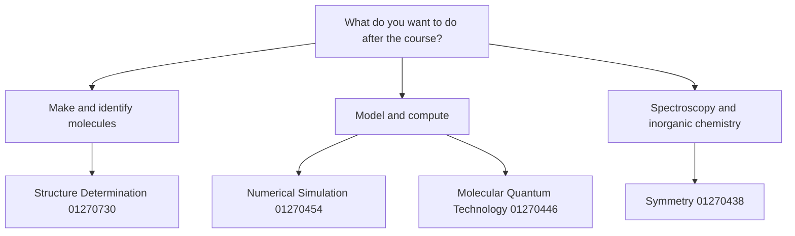

# 32.5 · Choosing your further electives

This last lesson of the electives module has two parts. First, the module practical: a materials dossier that uses electrode kinetics, corrosion analysis and X-ray diffraction on one realistic problem, with real diffraction data that do not come out perfectly. Second, a plan for the rest of your elective studies. The Technion degree asks for at least two courses from a faculty list; this module taught two of them, and here you meet the other four with free resources for each, so you can choose with your eyes open.

## Why it matters

A self-taught learner who has finished the core can drift: a month of quantum computing videos, a week of NMR problems, then nothing finished. The Technion's rule (plan.md 3.5) avoids this by asking for a defined set: at least six points of advanced lab or research and at least two named electives. Picking electives that build on what you already know, with a concrete project at the end of each, turns months of study into evidence you can show. Picking blindly can mean starting a course whose prerequisites you skipped, and quitting halfway.

## Core ideas

> [!NOTE]
> Stable: what each elective is about. Will go out of date: course numbers, points and syllabi (read from the Technion's official SAP text, semesters 2023–2025, on 2026-10-17), the URLs and versions of free resources (all checked 2026-10-17), and software versions (Profex 5.7.3, released 2026-10-16). Check the current Technion catalogue before you rely on a number.

### What the electives requirement asks

In the real degree, 19.5 points are electives (plan.md 3.5). Two rules apply:

1. **At least 6 points of advanced lab or research.** In this course: the Computational Chemistry Lab (Module 31, Technion 01260603, 3.0 points) and the Research Project (Module 33, in place of 01240353, 4.0 points).
2. **At least two courses from the faculty list.** This module covered two: 01270453 Electrochemistry (3.0) in 32.1–32.2 and 01270427 Solid State for Chemists (3.5) in 32.3–32.4. The four below are the other good home-study choices.

A Technion point is roughly one lecture hour per week over a 13-week semester; with homework, plan on about 35–45 hours of self-study per point (a rule of thumb, not a Technion figure).

### The other four electives

| Technion course | What the syllabus covers (own summary) | Builds on | Free resources (checked 2026-10-17) | A finishing project |
|---|---|---|---|---|
| 01270438 Symmetry and its Uses in Chemistry (4.0) | point groups, representations, character tables, normal modes, selection rules, symmetry in bonding and reactions, Jahn–Teller distortion | [20.5](../module-20/lesson-05.md), [20.6](../module-20/lesson-06.md), [18.4](../module-18/lesson-04.md) | [MIT 5.04 (2008) course archive on DSpace](https://dspace.mit.edu/handle/1721.1/151194); [Symmetry Gallery, Otterbein University](https://symotter.org/) | predict IR and Raman bands of five molecules and check them against NIST WebBook spectra |
| 01270454 Numerical Simulation in Chemical Physics (3.0) | writing simulations and checking them: sanity checks, convergence, debugging; Laplace's equation, particle motion, thermal properties, reaction progress, wave-packet propagation, diagonalising potentials | [05.3](../module-05/lesson-03.md), [03.5](../module-03/lesson-05.md), [12.2](../module-12/lesson-02.md) | [MIT OCW 10.34](https://ocw.mit.edu/courses/10-34-numerical-methods-applied-to-chemical-engineering-fall-2015/); [Scientific Python Lectures](https://lectures.scientific-python.org/) | a Verlet molecular dynamics of argon with an energy-conservation test, or a split-operator wave packet hitting a barrier |
| 01270446 Intro to Molecular Quantum Technology (3.5) | superposition, density matrices, entanglement and Bell states, teleportation, basic quantum computing and sensing, two-level systems and the Bloch sphere, Jaynes–Cummings model, Lindblad master equation, materials for quantum devices | [12.5](../module-12/lesson-05.md), [30.2](../module-30/lesson-02.md), [03.2](../module-03/lesson-02.md) | [IBM Quantum Learning: Basics of quantum information](https://quantum.cloud.ibm.com/learning/en/courses/basics-of-quantum-information); [MIT OCW 8.370x Quantum Information Science I](https://ocw.mit.edu/courses/8-370x-quantum-information-science-i-spring-2018/); [QuTiP](https://qutip.org/) | simulate Rabi oscillations and T₂ decay of an electron spin with a Lindblad equation and relate them to an ESR line width |
| 01270730 Structure Determination by Physical Methods (2.5) | determining organic structures by NMR, mass spectrometry, UV and IR, and chiroptical methods | [17.5](../module-17/lesson-05.md), [17.6](../module-17/lesson-06.md) | [WebSpectra (UCLA)](https://webspectra.chem.ucla.edu/); [Hans Reich's NMR collection](https://organicchemistrydata.org/hansreich/resources/nmr/); [SDBS (AIST)](https://sdbs.db.aist.go.jp/) | solve 30 WebSpectra problems of rising difficulty with a written argument for each |

For the two electives this module taught, the free courses that go deeper are [MIT OCW 10.626 Electrochemical Energy Systems](https://ocw.mit.edu/courses/10-626-electrochemical-energy-systems-spring-2014/) and [MIT OCW 3.091 Introduction to Solid-State Chemistry](https://ocw.mit.edu/courses/3-091-introduction-to-solid-state-chemistry-fall-2018/).

### How to choose



Three questions settle most choices. Which modules did you enjoy and finish well? Which elective leads into your Module 33 research question? And which one ends in a project you can show someone? Two electives done properly, each with a finished project, are worth more than four started.

## Worked example

### A plan for two electives at 10 hours a week

Dana works 10 hours a week, enjoyed Modules 20 and 31, and plans a computational research project in Module 33. She picks Symmetry (4.0 points) and Numerical Simulation (3.0 points).

- Hours: about 40 per point gives 160 hours for Symmetry and 120 for Numerical Simulation, 280 hours in total: 28 weeks at 10 hours a week.
- Order: Symmetry first, because its normal-mode analysis feeds the Module 31 IR comparisons she wants to extend; Numerical Simulation second, so that it overlaps with the start of her research project and its convergence checks go straight into it.
- Evidence: one report per elective, written with the [lab report template](../../templates/lab-report.md), and the code in a public repository.

The plan fails if she skips the prerequisites: the Symmetry course assumes the character-table work of 20.6; she reviews it in week 1.

## Hands-on

What you need: the [Module 32 lab folder](../../labs/module-32/) with your completed scripts from Lessons 32.2 and 32.3 (the practical imports your `fit_cubic()`, `stern_geary()` and `corrosion_rate()`), the [lab report template](../../templates/lab-report.md) and the [research proposal template](../../templates/research-proposal.md). Time: about 2.5 hours. No home part: the materials and acids stay in the lab, and you work with the data.

### Part A — module practical: a materials dossier (120 min)

A group sends you three real powder patterns from one study (Dahiya, Dahiya and Sabarwal 2026, Zenodo, CC BY 4.0): pure In₂O₃, pure CdO (already indexed in 32.3), and a CdO–In₂O₃ composite made for photocatalysis. A second, unrelated client asks whether a corrosion inhibitor is worth adding to a 1 M HCl steel pickling bath; their polarisation curves (generated) are in `corrosion_steel.csv`.

1. **Plan.** In your notebook, write for each question which data and which method from this module answer it, and the main risk (Kβ lines, zero shift, unknown instrument width, iR drop).
2. **Compute.** Open `practical_dossier.py`. Complete `scherrer()` (TODO 1: crystallite size $\tau = K\lambda/(\beta\cos\theta)$ with $K$ = 0.9 and $\beta$ the peak width in radians) and `assign_phases()` (TODO 2), then run:

```bash
py practical_dossier.py
```

3. **Judge.** For the composite, decide which phases are present and list the peaks that neither oxide nor Kβ explains. For the inhibitor, give the efficiency $1 - i_\text{corr,inh}/i_\text{corr,bare}$ and the new corrosion rate.
4. **Report.** One report with two sections, following the lab report template. End each section with what the data cannot show.

How you know it worked: In₂O₃ indexes with multiplier 6 on a body-centred lattice (N = 6, 12, 16, …, 76, 80; the smaller cell with multiplier 3 fails because it would need the forbidden N = 23), $a$ = 10.1125 ± 0.0027 Å with a zero shift of −0.175°, 0.04 % from COD 2310009 (10.117 Å); one Kβ line at 27.42°. Scherrer sizes are at least 26–31 nm for both oxides. The composite needs a zero shift of about +0.1°; CdO and In₂O₃ explain 21 of its 29 peaks (Kβ lines included) and 8 remain, among them a strong one at 32.72°. The inhibitor cuts $i_\text{corr}$ from 250 to 21 µA/cm²: 91.5 % efficiency (91.4 % by Stern–Geary), 2.90 → 0.25 mm/y.

<details><summary>Reference conclusions for the report</summary>

Phases: both oxides are present in the composite, but eight peaks, including the third-strongest at 32.72°, belong to neither. That is evidence for at least one more crystalline phase formed during the synthesis. A natural candidate is the spinel CdIn₂O₄ (COD 8104161, $a$ = 9.166 Å), which explains a few weak lines (near 51.9° and 80.6°) but not the strong 32.72° peak, so the identification stays open. The next step is a full-pattern search-match against the COD in a program such as Profex, and a look at the authors' own interpretation. Never call a phase from one or two matching lines.

Sizes: the Scherrer values are lower limits, because the instrument's own peak width was not subtracted (no standard such as LaB₆ or Si was measured in this data set). Crystals of a few tens of nanometres or more are all that can be said.

Inhibitor: 91.5 % efficiency brings the rate from 2.90 to 0.25 mm/y. Tafel extrapolation and polarisation resistance agree within 1 %. The data cannot show long-term stability of the inhibitor film, hydrogen uptake by the steel, or pitting; a 24-hour weight-loss coupon test should confirm the result before the bath is changed.

</details>

### Part B — your elective plan (30 min)

Choose two of the four electives in the table (or argue for different ones). For each, write half a page with the research proposal template: why this one, which lessons of this course it builds on, the free resource you will follow, a weekly schedule, and the finishing project with how you will know it is done. Check every link still works and note the date.

How you know it worked: each plan names its prerequisites by lesson number, has an hour budget that fits your week, and ends in a project someone else could check.

## Common mistakes

- **Calling a phase from one matching peak.** Use several lines, check Kβ first, and say "unassigned" when the evidence is thin.
- **Reporting Scherrer sizes as exact.** Without the instrument profile they are lower limits; strain broadening also adds width.
- **Comparing lattice parameters from patterns with different zero shifts.** Fit the shift for each pattern.
- **Choosing electives by title.** Read the syllabus and check the prerequisites against the lessons you finished.
- **Starting four electives at once.** Finish one with a project before you start the next.

## Key takeaways

- A materials dossier states what was found, how sure you are, and what the data cannot show.
- Real patterns come with Kβ lines, zero shifts and unknown peaks; a good analysis names them instead of hiding them.
- An inhibitor's efficiency follows from two polarisation curves: $1 - i_\text{corr,inh}/i_\text{corr,bare}$.
- The Technion asks for six points of advanced lab or research and at least two faculty-list electives; Modules 31–33 cover the first, this module covers two electives.
- Pick further electives that build on lessons you finished, each ending in a project.

## Sources

- [Technion SAP course descriptions (open-data mirror)](https://github.com/michael-maltsev/technion-sap-info-fetcher) — syllabi and points of 01270438, 01270454, 01270446, 01270730, 01270427 and 01270453 (files courses_2023_201, courses_2024_201, courses_2025_200, courses_2025_201).
- [MIT 5.04 (2008) on DSpace](https://dspace.mit.edu/handle/1721.1/151194) — group theory for inorganic chemistry, complete course archive.
- [MIT OCW 10.34](https://ocw.mit.edu/courses/10-34-numerical-methods-applied-to-chemical-engineering-fall-2015/) — numerical methods with chemical examples.
- [IBM Quantum Learning, Basics of quantum information](https://quantum.cloud.ibm.com/learning/en/courses/basics-of-quantum-information) — free course on qubits, density matrices and entanglement.
- [WebSpectra](https://webspectra.chem.ucla.edu/) — graded structure-determination problems with real spectra.
- [Profex](https://www.profex-xrd.org/) — free (GPL) search-match and Rietveld software for the next step of the dossier.
EOF
cd "C:/Users/TalGiladi/OneDrive/repos/course-creator/chemistry-bsc-course" && grep -m1 "^# 18.4\|^# 03.5\|^# 12.2" lessons/module-18/lesson-04.md lessons/module-03/lesson-05.md lessons/module-12/lesson-02.md