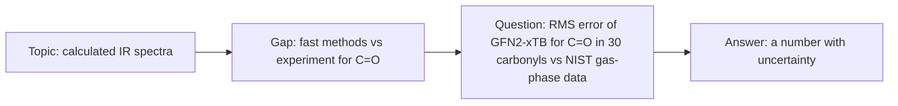

# 33.1 · Choosing a question you can answer at home

This module is your research project: 180 hours of your own work, ending in a written report and a poster. It replaces the Technion's research project course, and this first lesson is about the decision that matters most, the question. A good home question can be answered with public data, free software or safe kitchen measurements, has a known answer to check against, and fits in 180 hours. You will test candidate questions against four checks, budget the hours, and write a one-page proposal.

## Why it matters

Most failed student projects fail in the first week, not the last: the question was too big, had no data, needed equipment nobody had, or had no way to tell a right answer from a wrong one. A narrow question, by contrast, almost writes its own method: "How large is the error of GFN2-xTB for the C=O stretch of 30 carbonyl compounds, compared with gas-phase experiment?" tells you which molecules, which software, which reference data and which number to report.

At the Technion, a supervisor stops a bad question before it starts. You have no supervisor. This lesson gives you the checks a supervisor would make, so you can make them yourself.

## Core ideas

> [!NOTE]
> Stable: what makes a question answerable, the four feasibility checks, budgeting by phase. Will go out of date: the Technion course rules (read from the official SAP text on 2026-10-17), the database releases and licences named here (CCCBDB release 22 of May 2022; AqSolDB on Dataverse under CC0 1.0; IUPAC pKa dataset v2.4a under CC BY-NC 4.0, all checked 2026-10-17). Check the licence of every data source when you download it.

### What the real course asks, and what is different here

The Technion course 01240353 "Research Project in Chemistry" is worth 4 points. Its official description asks for 180 hours of work in a research lab at an academic institution or an approved company, prior approval, and a final report approved by the researcher you worked with. The bigger sister course 01240355 (6 points, about 240 hours in a Technion group) adds a proposal abstract signed by the supervisor before you start and a poster at a faculty forum. This module asks for all three: proposal, report and poster.

Be honest about the difference: the real project is supervised by a researcher who checks the question, watches the work and signs the report. Here nobody does that unless you find someone. Lesson [33.4](lesson-04.md) shows how to find an academic reader; start looking now, because a reader who sees your proposal early can stop you from wasting 100 hours.

### What makes a question answerable

A research question is answerable when someone else could agree that you answered it. In practice that means four things:

1. **The answer is a number or a yes/no.** "What is the RMS error of xtb for C=O stretches?" is answerable. "Is xtb good?" is not.
2. **The population is named.** Which molecules, which samples, which conditions. "30 carbonyl compounds with gas-phase spectra in the NIST WebBook" is a population.
3. **There is a reference.** Something independent you compare against: experimental data, a higher-level calculation, a label value, a literature result. Without it you cannot tell whether your answer is right.
4. **A surprise is possible.** If you already know the answer, it is an exercise, not research. The question should have at least two outcomes that would change what someone does.

The usual path is from a topic to a question by narrowing three times: topic (calculated IR spectra) → gap (how well a fast method does for one functional group) → question with a population and a reference.



### Four feasibility checks

Before you commit, test the question against four checks. Fail one and you either narrow the question or drop it.

| Check | Ask | Fails when |
|---|---|---|
| Data | Does the reference data exist, can you download it, and may you use it? | the data are behind a paywall, or the licence forbids your use |
| Tools | Does free software do the calculation on a laptop? Have you run it once? | the method needs a cluster or a paid licence |
| Safety | Can every measurement be done with the course's safe kitchen materials? | it needs lab reagents, heat with flammables, gases, or anything not in [01.4](../module-01/lesson-04.md) |
| Hours | Does the work fit in 180 hours with a margin? | the data phase alone takes more than its share |

The data check includes licences. AqSolDB, a curated set of about 10,000 aqueous solubilities, is released under CC0 (no restrictions). The IUPAC digitized pKa dataset is CC BY-NC 4.0: free for non-commercial work with attribution. SDBS spectra may be viewed but not redistributed. Record the licence of each source on the day you download it ([11.2](../module-11/lesson-02.md) covers judging sources).

### The three kinds of home project

The project briefs in [projects/](../../projects/README.md) are grouped into three kinds:

- **Computational:** you calculate something with xtb or ORCA (Module 31) and compare it with experiment. Cheap to repeat; the risk is spending all your time on software problems.
- **Data:** you analyse a public data set, for example a model that predicts solubility from structure. The risk is a model that fits the data you trained it on and nothing else.
- **Home measurement:** you measure something safe at home, many times, with a full error analysis (Modules 9, 10, 23 and 30). The risk is an uncertainty too large to answer the question.

Pick the kind whose risk you know how to handle.

### The 180-hour budget

Split the hours by phase before you start. A split that works for most projects:

| Phase | Hours | Share |
|---|---|---|
| Reading and the proposal | 25 | 14 % |
| Setup and pilot | 20 | 11 % |
| Data collection or calculation runs | 50 | 28 % |
| Analysis | 35 | 19 % |
| Report | 30 | 17 % |
| Poster | 10 | 6 % |
| Feedback and revision | 10 | 6 % |

Two numbers decide whether the data phase fits: your **attended time** per item (the minutes you spend building an input, checking an output, or doing one titration) and a **rerun factor** for items you must redo; 1.3 (30 % reruns) is realistic for a first project. Machine time, while a calculation runs and you do something else, does not use your hours, but it does use calendar days.

$$t_\text{data} = \frac{N \times t_\text{item} \times f_\text{rerun}}{60}\ \text{h}$$

## Worked example

### Narrowing and testing three candidate questions

Noa has finished Modules 31 and 10 and has 10 hours a week. She writes three candidates.

**A. "Does tap water in Haifa contain more calcium than in Tel Aviv?"** Data: she would have to measure it. Tools: calcium needs an EDTA titration or an ion-selective electrode; the reagents are lab chemicals (Module 10.3 did this only as a simulation). Safety check fails. She drops it, or reduces it to reading the water utilities' published reports, which is a literature review, not a measurement.

**B. "How well does GFN2-xTB predict the C=O stretch?"** She narrows it: 30 carbonyl compounds (aldehydes, ketones, esters, amides) with gas-phase IR spectra in the NIST WebBook. Reference: the measured band centres. Tools: xtb ran in [31.4](../module-31/lesson-04.md). Licence: NIST WebBook data may be used with citation. Surprise possible: the error may depend on the class of compound, which would matter to anyone screening carbonyls with xtb.

Hours for the data phase: 10 minutes of her time per molecule (build, run, check, read the spectrum), rerun factor 1.3:

$$t_\text{data} = \frac{30 \times 10 \times 1.3}{60} = 6.5\ \text{h}$$

That fits easily in 50 hours, so she can afford a second method (ORCA r2SCAN-3c) on the same 30 molecules. With 25 minutes of machine time per molecule for ORCA, the machine needs $30 \times 25 \times 1.3 / 60 = 16.2$ hours: two evenings and nights.

**C. "Is the acetic acid content of supermarket vinegars equal to the label?"** Eight brands, 9 titrations each (Lesson [33.2](lesson-02.md) shows where the 9 comes from). One titration with weighing and cleaning takes her about 20 minutes:

$$t_\text{data} = \frac{72 \times 20 \times 1.3}{60} = 31.2\ \text{h}$$

It fits in the 50-hour phase with about 40 % margin. Safety passes: vinegar, baking soda and red cabbage are the [10.6](../module-10/lesson-06.md) set.

She chooses B, because the hours leave room to extend it, and keeps C as her plan B.

## Hands-on

What you need: the [project briefs](../../projects/README.md), the [research proposal template](../../templates/research-proposal.md), the [Module 33 lab folder](../../labs/module-33/) and your notebook. Time: about 4 hours, spread over a week.

1. **Read the briefs (45 min).** Read all of them. Pick two that interest you, or write two questions of your own in the same form.
2. **Write three candidates (30 min).** For each, write the question in one sentence with a population and a reference.
3. **Run the four checks (60 min).** For each candidate, fill in the four rows of the feasibility table. For the data check, open the data source, download one file, and note the licence and date. For the tools check, run the software once on one item.
4. **Budget (30 min).** Estimate the attended minutes per item and run:

```bash
py lesson01_budget.py
py lesson01_budget.py 30 25 10 1.3
```

Complete the two TODO functions first (`collection_hours` and `machine_days`). Then run it with your own numbers, and with your own plan file if you change the split.

5. **Write the proposal (75 min).** Fill in every line of the research proposal template for your chosen question. Keep it to one page.

How you know it worked: the budget script prints `VERDICT: feasible` for your plan; your proposal states the answer as a number or yes/no, names the population, the reference data with its licence, the software with its version, and a plan B; and someone who has not taken the course can say in one sentence what you will find out.

<details><summary>Reference output and a model proposal</summary>

With the defaults (30 items, 25 machine minutes, 10 attended minutes, rerun 1.3) the solution prints 6.5 h of your time and 16.2 h of machine time (2.0 days at 8 h a day) and `VERDICT: feasible`. With 200 items at 15 attended minutes it prints `data phase needs 65.0 h but only 50 h are planned`: shrink the population or move hours from another phase.

Model proposal (Noa, question B):

- Question: what is the RMS error, in cm⁻¹, of the GFN2-xTB C=O stretching frequency for 30 carbonyl compounds against gas-phase experiment, and does it differ between aldehydes, ketones, esters and amides?
- Why it matters: xtb is used to screen thousands of molecules; a known, class-dependent error tells users when to trust it.
- What is known: Module 31.4 (xtb formaldehyde: C=O 63 cm⁻¹ too high); the GFN2-xTB paper; CCCBDB scale factors.
- Method: build and optimise each molecule (xtb 6.7.1, `--ohess`), read the C=O mode, compare with NIST WebBook gas-phase band centres; same with ORCA r2SCAN-3c.
- Expected result and surprise: an error of 30–80 cm⁻¹; a surprise would be a sign change between classes.
- Validation: reproduce the formaldehyde value from 31.4 first; check five assignments by animating the mode in Avogadro.
- Hours: 25 / 20 / 50 / 35 / 30 / 10 / 10.
- Risks and plan B: too few gas-phase spectra → accept 20 molecules; xtb fails → plan B is question C.
- Reader: one author of a benchmark paper on fast vibrational methods (Lesson 33.4).

</details>

## Common mistakes

- **A topic instead of a question.** "Solubility of drugs" has no answer. Add the number you will report, the population and the reference.
- **No reference to compare with.** Without independent data you can produce numbers but not judge them. If no reference exists, change the question.
- **Checking the licence after the work.** If the licence forbids what you do, the work is lost. Check on the day you download.
- **Counting machine hours as your hours, or forgetting reruns.** Budget your attended time with a rerun factor; budget machine time in calendar days.
- **A question that needs lab reagents.** The safety check is not negotiable. Narrow the question to what the safe kitchen set or public data can answer.

## Key takeaways

- An answerable question gives a number or yes/no, names its population, has an independent reference, and allows a surprise.
- Four checks before you commit: data (with licence), tools (run once), safety (kitchen set only), hours (fits with margin).
- Budget 180 hours by phase; the data phase is $N \times t_\text{item} \times f_\text{rerun}$, with machine time counted in days.
- The Technion project is supervised. Replace the supervisor as far as you can with a written proposal, a plan B and an outside reader.

## Sources

- [Technion SAP course descriptions (open-data mirror)](https://github.com/michael-maltsev/technion-sap-info-fetcher) — 01240353 (4 points, 180 hours, report approved by the researcher) and 01240355 (6 points, about 240 hours, proposal, poster and report), file courses_2025_200, read 2026-10-17.
- [NIST CCCBDB](https://cccbdb.nist.gov/) — experimental and calculated vibrational frequencies and scale factors, release 22.
- [Sorkun, Khetan and Er (2019), AqSolDB](https://doi.org/10.1038/s41597-019-0151-1) and its [Dataverse record](https://doi.org/10.7910/DVN/OVHAW8) — about 10,000 curated solubilities, CC0.
- [IUPAC Digitized pKa Dataset](https://github.com/IUPAC/Dissociation-Constants) — aqueous pKa values from the IUPAC compilations, CC BY-NC 4.0.
