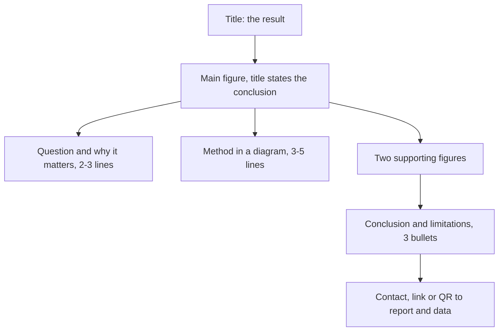

# 33.3 · Writing the report and the poster

The report and the poster are what remain of your 180 hours; everything else is in your folder, where nobody will look unless the report makes them want to. This lesson shows how to write a research report around one result, how to say honestly what a home project could not show, and how to turn the same result into a poster that someone walking past understands in ten seconds. It builds on the lab report and figure work of [11.3](../module-11/lesson-03.md); here the scale is larger and the reader is an expert.

## Why it matters

Your reader, perhaps a researcher who agreed to give you an hour, opens the report. In the first minute they read the title, the abstract and the figures. If those do not say what you found, how sure you are and why it matters, they will skim the rest or stop. A clear report makes it easy to say yes to your request for feedback; a vague one makes it easy to say no.

The poster is harder: at a poster session a visitor gives each poster a few seconds before deciding to stop. The Technion's 6-point research project ends with a poster at a faculty forum.

## Core ideas

> [!NOTE]
> Stable: the structure of a research report, the rules for figures and posters. Will go out of date: very little; the A0 size comes from ISO 216:2007 (current on 2026-10-17). The font sizes and word counts below are common rules of thumb, not a standard.

### The report: one central result

Build the report around one result and say it in the title (Mensh and Kording, rule 1). "A study of calculated IR spectra" is a topic; "GFN2-xTB overestimates carbonyl stretches by 52 ± 6 cm⁻¹, most for amides" is a result. Every section then serves that result.

| Section | What it does | Typical length |
|---|---|---|
| Title | the result in one line | 10–20 words |
| Abstract | the whole story: context, gap, what you did, result with number and uncertainty, meaning | 150–250 words |
| Introduction | from what is known to the gap your question fills; end with the question | 1 page |
| Methods | enough for someone to repeat it: data sources with licences and dates, software with versions, procedure, analysis plan | 1–2 pages |
| Results | a sequence of claims, each backed by a figure or table | 2–4 pages |
| Discussion and limitations | what the result means, how it compares with the literature, and what it cannot show | 1–2 pages |
| Conclusion | the result again, as one or two sentences | a paragraph |
| References | every source, including data sets | — |
| Appendix | data and code availability, the hours log summary | 1 page |

For a 180-hour project, 10–20 pages including figures is a reasonable size.

Write the sections in a different order from the one they are read in: figures first (they are your results), then results, methods, discussion, introduction, and the abstract and title last, when you know what you found. Spend most of the writing time on the title, abstract and figures, because most readers read only those.

### Claims matched to evidence

Each results paragraph opens with its claim and closes by pointing to the evidence: "Amides show the largest error (78 ± 9 cm⁻¹, n = 7, Figure 2)." The strength of the words matches the strength of the evidence ([11.3](../module-11/lesson-03.md)): "shows" for a difference well outside the uncertainty, "suggests" for one at its edge, nothing at all for one inside it. Seven molecules can suggest that amides are worse; they cannot prove a rule for all amides.

### The limitations section

A good limitations section makes the report more credible, not less. Name three kinds:

- **Data:** the population size, gaps in the reference data, the uncertainty of the reference itself (gas-phase band centres are not harmonic frequencies).
- **Method:** the approximations (one conformer, harmonic frequencies, one functional).
- **Setting:** what a home project could not do. No supervisor checked the work as it happened; measurements were made with kitchen equipment; nobody repeated them in another lab.

Then say what would remove each limitation. That paragraph is often the most useful one for your reader.

### The poster

A poster is not a report on a wall. It has one message, a few figures, and few words.

- **Size and layout.** A0 portrait (841 × 1189 mm) is the common format; check what the event asks for. Use two or three columns, read top-left to bottom-right, with clear white space between blocks.
- **Ten-second test.** The title states the result. The main figure, with a title that states its conclusion, sits in the visual centre. A visitor who reads only those two should get the message (Erren and Bourne, rules 2 and 3).
- **Few words.** Aim for 300–800 words in total. Use short statements, not paragraphs. Leave the details to the report and give a link to it.
- **Readable from 2 m.** Title about 80–100 pt, headings 40–50 pt, body text and figure labels at least 24 pt. Make figures at their final printed size so the labels are the size you chose.
- **Colours.** Use a colour-blind-safe palette (for example the blue and orange of the lab figure), and never rely on red against green alone.
- **Contact.** Your name, e-mail and a link or QR code to the report and data.

You can check a poster without printing it at A0. A4 is exactly one quarter of A0 in width and height (ISO 216 keeps the ratio 1:√2 and halves the area at each step: A0, A1, A2, A3, A4). Print the poster on one A4 sheet and read it from 50 cm, which is 2 m scaled by the same factor of four. If you cannot read the body text there, it is too small. Free tools for the layout: LibreOffice Impress or Draw with a custom 84.1 × 118.9 cm page, Inkscape, or LaTeX with a poster class.



## Worked example

### An abstract in five sentences

Noa's results (example numbers for this lesson): 30 carbonyl compounds, 10 of them held out; GFN2-xTB C=O stretches are too high by 52 ± 6 cm⁻¹ on average (mean ± 95 % half-width over the 30), with an RMS error of 58 cm⁻¹; amides 78 ± 9 cm⁻¹ (n = 7), aldehydes and ketones 41 ± 7 cm⁻¹ (n = 14); one scale factor brings the held-out RMS to 21 cm⁻¹. Her first draft began: "Computational chemistry is an important tool in modern chemistry." That sentence tells the reader nothing. Built from five parts instead:

1. Context: "Fast semi-empirical methods such as GFN2-xTB are used to screen thousands of molecules by their infrared spectra."
2. Gap: "How large their error is for the carbonyl stretch, the strongest band of many organic compounds, and whether it depends on the compound class, has not been tested on a common gas-phase set."
3. What she did: "I calculated the C=O stretching frequencies of 30 aldehydes, ketones, esters and amides with GFN2-xTB (xtb 6.7.1) and compared them with gas-phase spectra from the NIST Chemistry WebBook."
4. Result: "GFN2-xTB overestimates the stretch by 52 ± 6 cm⁻¹ (95 % CI), most for amides (78 ± 9 cm⁻¹, n = 7); one scale factor reduces the error on ten held-out molecules to an RMS of 21 cm⁻¹."
5. Meaning: "Screening studies should scale xtb carbonyl frequencies and treat amides with extra care."

Title: "GFN2-xTB overestimates carbonyl stretches by about 50 cm⁻¹, most for amides".

### Font size check by test print

Noa's poster body text is 28 pt. On an A4 test print it becomes 28/4 = 7 pt. Read from 50 cm, 7 pt is small but readable; the 18 pt axis labels she first used become 4.5 pt and are not. She remakes the figures at their printed size with 24 pt labels, which is what `lesson03_poster_figure.py` does.

## Hands-on

What you need: your project folder with results from the main run, the [Module 33 lab folder](../../labs/module-33/), the [lab report template](../../templates/lab-report.md) and a free layout tool (LibreOffice, Inkscape or LaTeX). Time: about 4 hours for the drafts; the full report is part of the 30-hour report phase and the poster of the 10-hour poster phase in your budget.

1. **Make one poster figure (45 min).** Complete the two TODO functions in `lesson03_poster_figure.py` (`summary` and `conclusion_title`) and run it on the demo data, then on your own:

```bash
py lesson03_poster_figure.py
py lesson03_poster_figure.py my_parity.csv
```

Open `runs/poster_residuals.png`. The title should state the result; the labels should be readable when the image is shown at 22 cm wide.

2. **List the claims (30 min).** Write each result of your project as one claim sentence with a number, an uncertainty and the figure or table that supports it. Three to five claims are typical.
3. **Write the abstract (45 min).** Five sentences: context, gap, what you did, result with number and uncertainty, meaning. Then the title, stating the result.
4. **Outline the report (45 min).** Put the section headings into `doc/report.md` and, under each, the claims and figures it will hold. Write the limitations section in full now, while you remember every compromise.
5. **Draft the poster (75 min).** A0 portrait, the layout of the diagram above, at most 800 words. Print it on A4 and read it from 50 cm. Give it to someone for ten seconds and ask what you found.

How you know it worked: the ten-second visitor can repeat your result; every number in the abstract appears in the results with its figure; the A4 print is readable at 50 cm; the limitations section names at least one limitation of data, of method and of the home setting.

<details><summary>Reference output and a checklist</summary>

`py lesson03_poster_figure_solution.py` with the demo data prints `90 modes: scale factor 0.9621; RMS 91.9 cm-1 unscaled, 12.5 cm-1 scaled` and the title `Scaling by 0.962 cuts the RMS error from 92 to 12 cm-1`. The residual plot shows the unscaled points rising from about +30 to +150 cm⁻¹ with frequency (a constant percentage error) and the scaled points scattered around zero. A parity plot of the same data looks almost perfect, because a 4 % error is hard to see next to the diagonal; that is why the residual plot is the better poster figure here.

Report checklist: title states the result; abstract has all five parts and a number with uncertainty; every figure title states a conclusion; methods give data sources with licence and date and software with version; results open each paragraph with a claim; limitations cover data, method and setting; conclusion repeats the result; references include the data sets; appendix gives where the data and code are and the hours by phase.

</details>

## Common mistakes

- **A topic as the title.** Rewrite it as the result.
- **An abstract without a number.** The abstract must contain the main result with its uncertainty.
- **Methods without versions and dates.** "Calculated with xtb" cannot be repeated; "xtb 6.7.1, GFN2, `--ohess`, run 2027-03-02" can.
- **Claims stronger than the evidence.** Seven molecules suggest, they do not prove. Use "shows" only when the difference is well outside the uncertainty.
- **Hiding the limitations.** Readers find them anyway and then trust the rest less. Name them, and say what would remove each.
- **A report pasted onto a poster.** If the poster has more than about 800 words or labels below 24 pt at A0, cut words and remake the figures at print size.

## Key takeaways

- Build the report around one result; state it in the title, the abstract and the figure titles.
- Write figures and results first, the abstract and title last; spend most time on title, abstract and figures.
- Match the strength of each claim to its evidence, and give the limitations of data, method and the home setting.
- A poster has one message that a visitor gets in ten seconds; check readability with an A4 print at 50 cm.

## Sources

- [Mensh and Kording (2017), Ten simple rules for structuring papers](https://doi.org/10.1371/journal.pcbi.1005619) — one central contribution, context-content-conclusion, figure titles that state conclusions, time on title, abstract and figures.
- [Erren and Bourne (2007), Ten simple rules for a good poster presentation](https://doi.org/10.1371/journal.pcbi.0030102) — the ten-second test, title as headline, layout and concise content.
- [Rougier, Droettboom and Bourne (2014), Ten simple rules for better figures](https://doi.org/10.1371/journal.pcbi.1003833) — know the message, adapt the figure to the medium.
- [ISO 216:2007](https://www.iso.org/standard/36631.html) — A-series paper sizes (A0 841 × 1189 mm, each size half the area of the one before).
